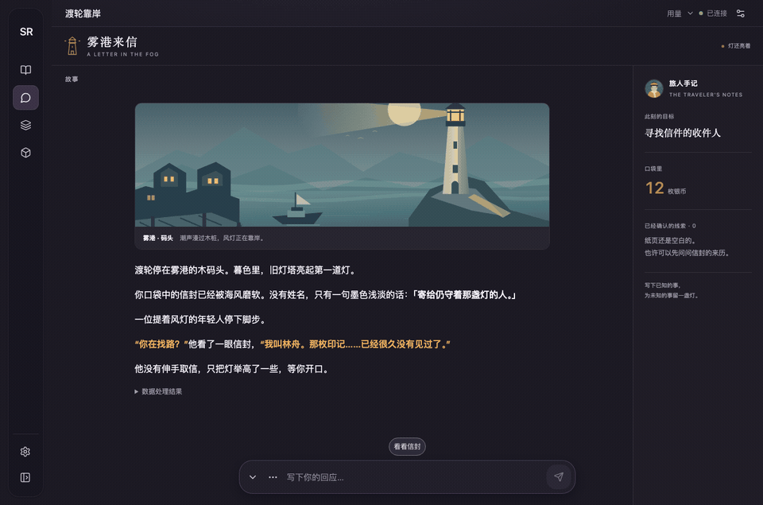
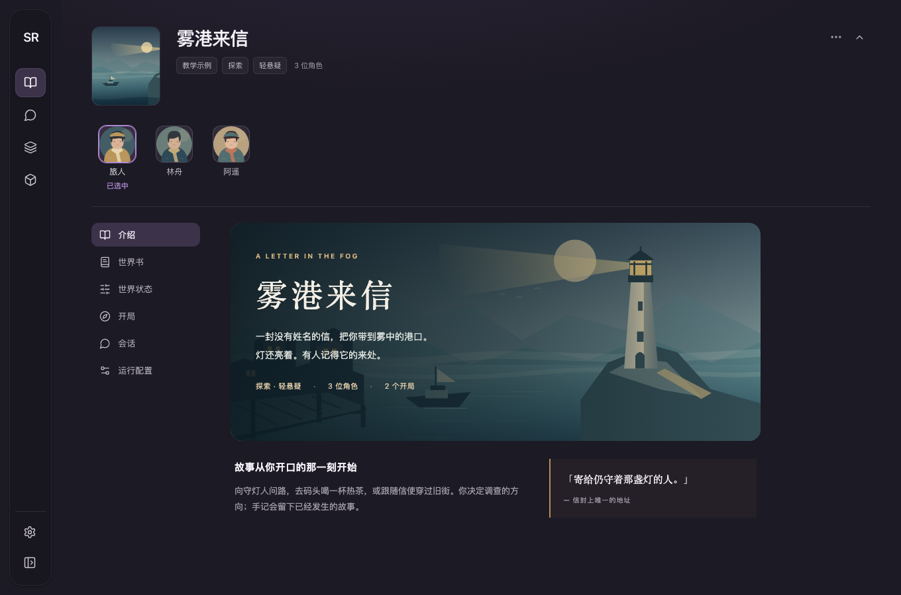
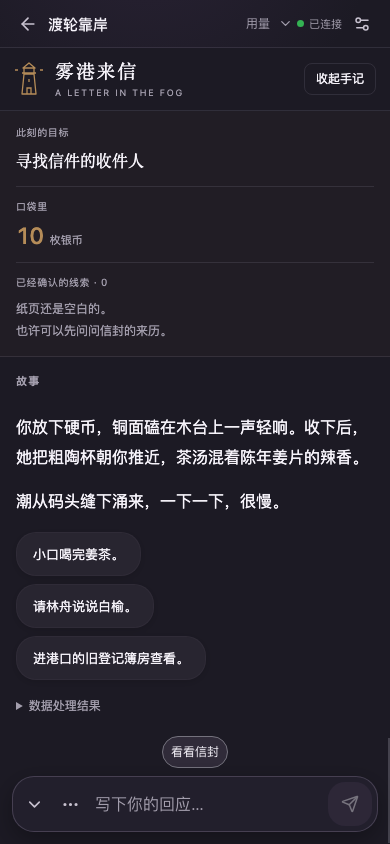

# SillyRealms

**把角色、设定和玩法，做成可以进入的 AI 互动世界。**

SillyRealms（SR）是面向多角色故事的 AI 叙事创作与游玩平台。你可以把人物、世界书、开局、剧情状态、自定义界面和素材组织为一张世界卡，交给玩家选择身份、进入故事，并用自然语言行动。

[开始体验](docs/getting-started.md) · [制作第一张世界卡](docs/creator/first-world.md) · [让 Agent 辅助创作](docs/creator/agent-authoring.md) · [从酒馆迁移](docs/creator/from-sillytavern.md) · [完整文档](docs/README.md)


*同一份作品中，故事、银币、线索和当前目标共同构成玩家的旅途。示例界面由官方正文组件与作者面板组合而成。*

## 看一个世界如何运转

《雾港来信》里，你扮演一名携信抵港的旅人。打听收件人的下落，和守灯人交谈，找到线索，再决定下一步行动。



[体验完整示例](docs/getting-started.md#体验雾港来信) · [查看示例源码与素材](examples/worlds/README.md) · [查看演示录制与验证说明](docs/assets/README.md)

## 你可以创作什么

| 创作想法 | 在 SR 中怎样实现 |
| --- | --- |
| 一座有不同人物和关系的城镇 | 在一个世界里组织多个角色、可扮演身份、世界书和开局 |
| 能持续记录线索、金钱与目标的冒险 | 定义剧情状态，让叙事后的有效变化进入下一轮故事与界面 |
| 有独特阅读体验的互动作品 | 直接使用官方 `WorldStory`，或组合面板、插图、消息组件与自定义舞台 |
| 可以完整交给玩家的作品 | 用 ZIP 携带世界设定、组件和素材；导入后创建会话游玩 |



*介绍、角色与开局属于作品的一部分。不同开局可以给故事不同的起点和初始状态。*

第一张卡可以只写人物、开场和世界书。需要更丰富的玩法时，再加入状态；需要自己的视觉风格时，再学习组件。官方正文已经负责消息、历史与行动建议的基础展示。

## 如果你来自酒馆社区

你熟悉的角色设定、世界书、开场白和预设，仍然是创作的基础。SR 将这些内容组织到一份世界作品中，并为剧情状态和作者界面提供明确的结构。

| 已有素材 | 迁移方向 |
| --- | --- |
| 人物设定与玩家身份 | 世界内的角色与可扮演身份 |
| 世界书与情境资料 | 条目及其加载条件 |
| 多个开场 | 开局与初始剧情状态 |
| 变量、状态栏、正则展示 | 状态定义、消息展示规则和组件 |
| 插件脚本与自动化行为 | 按行为逐项适配并记录差异 |

当前导入的是 **SR 格式的 JSON 或 ZIP**。酒馆 PNG、MVU、STscript 和插件需要分析与转换。[迁移指南](docs/creator/from-sillytavern.md)会说明哪些内容能保留、哪些需要改写，仓库也提供专门的[迁移 Skill](skills/sr-tavern-migrate/SKILL.md)。

## 开始体验

需要 **Node.js 22.19+** 和 **pnpm 10.12.1**。在仓库根目录执行：

```sh
pnpm install --frozen-lockfile
pnpm dev
```

打开 [http://127.0.0.1:5176](http://127.0.0.1:5176)，配置自己的模型接口，然后导入示例世界。首次启动也会安装内置的「标准叙事」预设和「小饭馆」。

可以直接下载[《雾港来信》示例包](examples/worlds/packages/fog-harbor.zip)，也可以从源码检查并打包：

```sh
pnpm world:check examples/worlds/fog-harbor
pnpm world:pack examples/worlds/fog-harbor
```

在「世界卡」页面导入生成的 `examples/worlds/fog-harbor.zip`，选择身份和开局开始会话。模型推理使用你配置的服务；包内素材可以随作品携带。[完整体验步骤](docs/getting-started.md)

[Linux 单机部署](deploy/README.md) · [本地运行、调试与备份](docs/runtime/local-development.md)

## 开始创作

| 你现在想做的事 | 从这里开始 |
| --- | --- |
| 改出自己的第一张卡 | [第一张世界卡](docs/creator/first-world.md) |
| 设计人物、世界书和开局 | [世界内容](docs/creator/world-content.md) |
| 为故事增加金币、线索和进度 | [状态与玩法](docs/creator/state-and-rules.md) |
| 增加面板、图片和自定义舞台 | [展示与舞台](docs/creator/presentation.md) |
| 请 Agent 完成创作或迁移 | [Agent 创作指南](docs/creator/agent-authoring.md) · [仓库 Skills](skills/README.md) |
| 检查并分享作品 | [打包与分享](docs/creator/packaging.md) |



*同一张卡适配窄屏；作者可以为作品组织适合手机阅读的状态与正文布局。*

## 当前能力与发展方向

当前已提供世界卡导入导出、多角色与开局、条件加载的世界书、三作用域状态、主叙事后的 message 状态更新、行动建议、流式正文、最新回复重新生成、上下文裁剪/摘要，以及 React 作者组件和 SDK。

创作主要通过**文件或 Agent 制作 → 导入试玩 → 修改迭代**进行。世界详情展示作者内容，尚未提供完整的可视化世界卡编辑器。状态规则用于指导模型，玩法需要实际试玩验证。

长期记忆、独立 AI 帮答、独立状态更新与原生视觉小说演出属于规划中的方向。当前的行动建议与独立 AI 帮答是两项不同能力。查阅[当前运行契约](docs/runtime/web-runtime.md)，或阅读 [plan](plan/) 中各方案的状态说明。

## 参与 SR

欢迎补充教程、改进示例、报告问题，或分享你完成的作品。问题反馈请附 SR 版本、复现步骤和最小世界卡；分享素材时说明来源与使用条件。

[贡献指南](CONTRIBUTING.md) · [反馈问题](https://github.com/huiru-wang/SillyRealms/issues) · [创作者文档](docs/creator/README.md) · [SDK 参考](docs/sdk/README.md)
