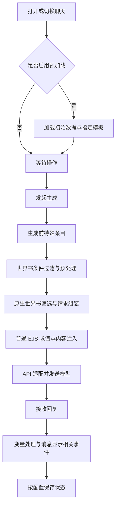

# 提示词模板插件：执行机制、状态存储与扩展能力研究

> 调研日期：2026-11-01。
>
> 对象：[zonde306/ST-Prompt-Template](https://github.com/zonde306/ST-Prompt-Template)，上游 `main`，提交 `d6f520d149aba146305b0b781ddd691d449c28d2`，`manifest.json` 版本 **1.17.9**。
>
> 资料性质：作者文档及源码研究、讨论结论和示例，不代表 SillyRealms 已实现这些能力，也不代表已经在本地或 ECS 安装、运行验证该插件。
>
> 本文仅整理机制，不修改现有角色卡、世界书、预设、聊天数据、MVU 或运行配置。示例使用独立的 `demo.*` 命名空间，不自动对应已有 MVU 变量。

## 1. 定位与核心结论

提示词模板插件在酒馆的文本处理流程中增加 EJS／JavaScript 执行能力。预设、角色相关文本、世界书和消息中的模板，可以读取变量、选择文本、引用其他条目、注入提示词或生成显示内容。

它不是只有一个固定执行点的“脚本运行器”，而是由多种酒馆事件驱动。理解时必须区分：

- **识别**：发现 EJS 标记、条目标题前缀或装饰器。
- **编译**：把模板转换成可调用的 JavaScript 函数。
- **执行／求值**：传入本次环境和变量，运行函数。
- **输出**：生成发给模型的文本，或显示给用户的内容。
- **状态写入与保存**：代码显式修改变量，并经对应保存流程持久化。

普通变量读取不等于初始化，界面渲染不等于状态结算，模板缓存也不等于剧情状态存储。

## 2. 什么时候识别和执行

### 2.1 生命周期

| 阶段 | 主要入口或事件 | 识别与执行的内容 |
| --- | --- | --- |
| 插件启动 | `init()` | 注册事件、命令、界面等；不表示所有世界书代码立即执行 |
| 打开／切换聊天 | `CHAT_CHANGED` | 若开启预加载，处理初始化数据及符合预加载规则的模板 |
| 更新世界书 | `WORLDINFO_UPDATED` | 符合配置时刷新世界书、触发重新处理；保存不意味着绝对不会执行 |
| 发起生成 | `GENERATION_AFTER_COMMANDS` | 运行生成前条目；对应处理会区分准备／真实生成 |
| 原生世界书筛选前 | `WORLDINFO_ENTRIES_LOADED` | 识别特殊条目、判断 `@@if`、执行预处理等 |
| 请求内容已组装 | `GENERATE_AFTER_DATA` 或 `CHAT_COMPLETION_SETTINGS_READY` 等 | 对请求中的普通 EJS 求值，追加生成后内容、处理相关注入 |
| 模型请求 | 酒馆后续 API 转换与发送 | 模型接收模板执行后的结果；最终格式还可能经 API 适配 |
| 回复及消息渲染 | 消息更新、Swipe、用户／角色消息渲染等 | 对符合配置的楼层进行显示处理或原始消息处理 |
| 刷新／重新打开 | 上述加载、预加载、重绘流程再次发生 | 可能再次求值；不代表每次都重置剧情或允许重复写入 |

具体事件分支以固定提交的 [handler.ts](https://github.com/zonde306/ST-Prompt-Template/blob/d6f520d149aba146305b0b781ddd691d449c28d2/src/modules/handler.ts) 为准。不要把 Text Completion 与 Chat Completion 的入口视为完全相同。



图中只展示主要依赖，不代表各扩展之间所有监听器均按该顺序串行完成。

### 2.2 识别、编译、执行的区别

例如：

```ejs
当前灵石：<%- getvar('demo.coins', { defaults: 0 }) %>
```

1. 当前阶段的处理函数拿到文本，检查是否包含模板起始标记。
2. 根据 EJS 语法将文本编译成函数；启用缓存时可复用编译结果。
3. 使用本次环境执行函数，`getvar()` 此时读取变量。
4. 得到 `当前灵石：120` 等结果，替换本次处理的文本。

缓存主要用于减少编译，不意味着把第一次的变量值永远缓存为最终输出。源码在编译或取得函数后仍会调用该函数，见 [ejs.ts](https://github.com/zonde306/ST-Prompt-Template/blob/d6f520d149aba146305b0b781ddd691d449c28d2/src/function/ejs.ts)。

### 2.3 三种容易混淆的语法

| 形式 | 处理方 | 含义 |
| --- | --- | --- |
| `{{char}}` 等 | 酒馆宏系统 | 宏替换，可与模板并用 |
| `<% ... %>` | 提示词模板扩展 | 执行模板代码 |
| `<script>...</script>` | 浏览器／对应 HTML 渲染机制 | 页面脚本，执行条件取决于 HTML 如何创建与加载 |

EJS 主要在打开酒馆的浏览器环境中运行。将工程部署在 ECS，不代表这些模板天然获得服务器 Node.js 文件系统权限。

## 3. 核心语法与示例前提

| 语法 | 用途 |
| --- | --- |
| `<% ... %>` | 执行代码，本身不直接输出表达式结果 |
| `<%- ... %>` | 输出结果；显示阶段可直接输出 HTML |
| `<%= ... %>` | 输出结果；插件在显示阶段会通过相应格式化处理 |
| `await` | 等待插件支持的异步操作，例如读取世界书条目 |

显示阶段的 `<%=` 行为涉及插件对格式化函数的接入，不能只按普通 EJS 的默认 HTML 转义规则推断所有效果。

下面示例假设：相关世界书已挂载，扩展及对应生成／渲染功能已开启。特殊条目的启用状态还受 **GENERATE/RENDER/INJECT 条目禁用视为启用** 设置影响：旧兼容模式下可能要求禁用，新语义下要求启用，需先统一设置。

示例是教学用内容，不是对现有角色卡可直接覆盖的补丁。

## 4. 初始化、读取、计算与写入变量

### 4.1 初始数据

条目标题：`[InitialVariables] 示例初始状态`。

正文：

```json
{
  "demo": {
    "realm": "凡人",
    "affinity": 65,
    "coins": 120,
    "location": "宗门",
    "inventory": ["木剑", "回气丹"]
  }
}
```

开启“立即加载世界书”后，预加载阶段解析初始数据。插件支持对象形式的 JSON／YAML。

初始化集合会被重新构建，再参与变量视图合并；不能据此推断为“每次打开聊天必定将当前好感度重置为 65”。已有聊天或消息状态可以覆盖基线。见 [initial-variables.ts](https://github.com/zonde306/ST-Prompt-Template/blob/d6f520d149aba146305b0b781ddd691d449c28d2/src/features/initial-variables.ts)。

### 4.2 读取变量

```ejs
当前境界：<%- getvar('demo.realm', { defaults: '凡人' }) %>
当前灵石：<%- getvar('demo.coins', { defaults: 0 }) %>
```

示例输出：

```text
当前境界：凡人
当前灵石：120
```

`defaults` 是读取兜底，不会因为读取时返回 0 就自动创建一个持久变量。

### 4.3 条件分支

放在一个已激活的普通条目中：

```ejs
<% const affinity = getvar('demo.affinity', { defaults: 0 }); %>
<% if (affinity >= 60) { %>
她已经信任你，愿意分享私人经历。
<% } else { %>
她仍保持距离，只讨论公开事务。
<% } %>
```

普通生成求值时，只输出命中分支。前提是该条目进入了本轮处理；条目内部的 `if` 不负责让未激活条目自动进入请求。

### 4.4 循环输出

```ejs
当前背包：
<% for (const item of getvar('demo.inventory', { defaults: [] })) { %>
- <%- item %>
<% } %>
```

可以用于背包、任务、在场人物等可变长度列表。

### 4.5 写入与局部变量

在允许写入的阶段，创建尚不存在的聊天级变量：

```ejs
<%
setvar('demo.affinity', 0, {
  scope: 'local',
  flags: 'nx'
});
%>
```

`nx` 表示目标不存在时才设置。预加载／准备阶段是否允许写入，还涉及 `dryRun` 等参数；不要仅凭代码出现就假设写入成功。

以下只是本次模板函数的局部变量，不会自动跨刷新保存：

```ejs
<% const affinity = 60; %>
```

## 5. 状态存储与快照

### 5.1 是否必须先在角色卡声明变量

不必须。变量可来自初始条目、脚本写入、其他扩展已有的数据，读取时也可提供默认值。

数据初始化、Schema／类型约束和普通变量读取是不同工作。存在一个变量值，不意味着它已经有完整的校验和更新规则。

### 5.2 作用域与持久化位置

| 作用域 | 内部位置或性质 | 持久化理解 |
| --- | --- | --- |
| `global` | `extension_settings.variables.global` | 用户设置中的全局变量 |
| `local` | `chat_metadata.variables` | 当前聊天存档的元数据 |
| `message` | 消息的 `variables[swipe_id]` | 聊天存档中对应消息／候选回复的状态 |
| `initial` | 从初始化条目建立的集合 | 定义在世界书，运行时重建 |
| `cache` | 本次执行使用的组合视图 | 不作为独立的持久化状态库 |

当前实现的组合视图按全局、初始、聊天、消息等数据依次覆盖，使用顶层组合；不要把它当作任意深度的无损合并规则。

变量写入内存和成功落盘不是同一时刻。需经过酒馆或插件对应的保存流程；插件的 `checkAndSave()` 会根据配置／强制参数调用聊天保存。全局设置则依赖设置保存链路。见 [variables.ts](https://github.com/zonde306/ST-Prompt-Template/blob/d6f520d149aba146305b0b781ddd691d449c28d2/src/function/variables.ts)。

### 5.3 消息与 Swipe

例如同一楼层的候选 A、B 可以拥有各自变量：

```text
第 10 楼：好感度 60
第 11 楼 Swipe A：好感度 65
第 11 楼 Swipe B：好感度 58
```

读取时必须选择正确聊天、楼层和 Swipe。它不是一个永远指向“全局最新数值”的无上下文字典。

## 6. 控制世界书加载

### 6.1 `@@if`：排除整个条目

正文第一行：

```text
@@if getvar('demo.realm', { defaults: '凡人' }) !== '凡人'
允许描述灵力消耗与基础术法。
```

在候选条目处理阶段判断。为假时排除；为真时继续接受适用的原生筛选，并非无条件强制激活。

装饰器应从正文第一行开始，每行一个，连续书写。与普通正文 `if` 的区别是：前者控制条目资格，后者控制已处理条目的输出内容。

### 6.2 `getwi()`：主动引用内容

假设“修仙规则库”包含“凡人修炼规则”和“修士修炼规则”：

```ejs
<%
const realm = getvar('demo.realm', { defaults: '凡人' });
const title = realm === '凡人' ? '凡人修炼规则' : '修士修炼规则';
%>
<%- await getwi('修仙规则库', title) %>
```

执行到调用点时读取指定内容，并放到当前位置。它绕过被引用条目的普通关键词激活流程；不要期待所有原生预算和筛选规则都以普通条目方式再次应用。重复引用还可能重复处理内容。

### 6.3 `activewi()`：交给原生流程处理

```ejs
@@generate_before
<%
if (getvar('demo.location', { defaults: '' }) === '秘境') {
  await activewi('修仙规则库', '秘境环境规则');
}
%>
```

用于登记指定条目，交由后续世界书处理。需要影响当前轮时应尽早执行；在普通请求已经组装后调用，可能只能影响后续轮次。

### 6.4 预处理：先生成扫描文本

入口条目：

```ejs
@@preprocessing
<% if (getvar('demo.affinity', { defaults: 0 }) >= 60) { %>
事件标记：信任建立
<% } %>
```

另一个条目用 `事件标记：信任建立` 为关键词，正文提供对应事件规则。满足原生递归扫描等配置时，预处理输出可以成为后续激活来源。

预处理可能导致同一内容在后续再次处理，而且不能假设所有条目按常规顺序执行。这里应尽量使用读取和文本生成，避免非幂等状态更新。

实现参考：[worldinfo.ts](https://github.com/zonde306/ST-Prompt-Template/blob/d6f520d149aba146305b0b781ddd691d449c28d2/src/function/worldinfo.ts)、[handler.ts](https://github.com/zonde306/ST-Prompt-Template/blob/d6f520d149aba146305b0b781ddd691d449c28d2/src/modules/handler.ts)。

## 7. 提示词注入

### 7.1 在前后位置加入内容

标题：`[GENERATE:AFTER] 本轮状态提醒`。

```ejs
本轮约束：当前境界为 <%- getvar('demo.realm', { defaults: '凡人' }) %>，
能力描写不得超出该境界。
```

在相应生成处理阶段求值并追加。`[GENERATE:BEFORE]` 用于前置；另有按消息索引指定前后位置的形式。各特殊条目仍需要正确设置对应开关和启用语义。

### 7.2 标签注入：提供方与预设解耦

世界书提供内容：

```ejs
<%
injectPrompt('cultivation_rules', '角色不能施展超出当前境界的法术。');
%>
```

预设指定位置：

```ejs
【修炼约束】
<%- getPromptsInjected('cultivation_rules') %>
```

生成流程可以先留下占位符，待收集完成再替换，减轻提供方／读取方顺序依赖。标签是两者约定的接口，不是变量本身。

源码：[inject.ts](https://github.com/zonde306/ST-Prompt-Template/blob/d6f520d149aba146305b0b781ddd691d449c28d2/src/function/inject.ts)。

### 7.3 `@INJECT`：完整消息注入及版本问题

作者文档语法示例：

```text
条目标题：@INJECT pos=0,role=system
条目正文：请保持当前叙事视角，避免替用户决定行动。
```

设计目标是插入完整的 `{ role, content }` 消息，支持绝对、相对或正则匹配位置。最终结构仍可能受酒馆 API 后处理影响。

**已确认的源码问题：**本次固定提交的 `src/features/inject-prompt.ts` 在筛选条目的 `.filter(x => { ... })` 回调内计算了条件，但没有 `return`。按该源码逻辑会筛出空数组，导致这一路径无法选中注入条目。

这是对固定提交源码的静态结论，不代表所有发布产物或历史版本必然相同。使用时应核对实际安装代码；本文未修复上游，也不把该示例标记为已运行通过。

源码：[inject-prompt.ts](https://github.com/zonde306/ST-Prompt-Template/blob/d6f520d149aba146305b0b781ddd691d449c28d2/src/features/inject-prompt.ts)。

## 8. 回复渲染与状态写入

### 8.1 显示状态面板

```ejs
@@render_after
@@iframe
@@if !is_user && !is_system
<div style="padding:12px;border:1px solid #aaa">
  境界：<%= getvar('demo.realm', { defaults: '凡人' }) %>
  <br>
  灵石：<%= getvar('demo.coins', { defaults: 0 }) %>
</div>
```

在符合配置的角色消息显示阶段追加面板。`@@iframe` 用于隔离界面；不是向模型发送一个必须照抄的面板。

### 8.2 从模板写入消息状态

在允许写入的回复处理阶段：

```ejs
<% setvar('demo.affinity', 70, { scope: 'message' }); %>
当前好感度：<%- getvar('demo.affinity') %>
```

模型回复中的 EJS 也可能被执行。应明确它属于状态更新协议还是仅用于显示，避免刷新／重绘时产生重复副作用。

普通 DOM 渲染与“处理原始消息内容”是不同模式：后者会把处理结果写回原始消息，可能永久改变后续匹配来源。模板在显示阶段消失，不代表它一定已经从原始消息中删除。

### 8.3 辅助扩展 API

- `getchar()`／相关角色函数：读取角色信息。
- `getPresetPrompt()`：读取预设提示词。
- `execute()`：执行 STscript 命令，并返回结果。
- `activateRegex()`：登记额外文本处理规则；根据参数作用于生成、消息或 HTML 等阶段。

例如在生成前登记清理规则，避免变量控制块进入后续上下文：

```ejs
@@generate_before
<%
activateRegex(
  /<demo_control>[\s\S]*?<\/demo_control>/gi,
  '',
  { generate: true }
);
%>
```

具体规则的范围、顺序与生命周期必须结合用途配置，不应把它当作永久删除聊天正文的通用操作。

## 9. 与 MVU 的重叠与分工

| 能力 | 提示词模板 | MVU |
| --- | --- | --- |
| 初始化、变量读写 | 支持 | 支持 |
| 消息／Swipe 状态 | 支持相关作用域 | 用于保存各楼层有效状态 |
| 回复后更新状态 | 可执行模板与变量写入 | 核心职责是解析变量更新并结算 |
| 动态条件提示词 | 核心能力 | 维护数据供相关机制使用 |
| 提示词组合与注入 | 核心能力 | 非主要定位 |
| 显示状态 | 有渲染能力 | 通常为状态栏提供数据和更新事件 |

**两者不是天然隔离的两套数据库。** 提示词模板可读取消息变量；MVU 常把有效状态放在消息变量的 `stat_data` 中。路径、楼层、Swipe、准备时机一致时，可以使用同一份状态。

例如读取既有 MVU 数据，下面仅是路径示意：

```ejs
<%
const affinity = getvar('stat_data.人物.好感度', { defaults: 0 });
%>
<% if (affinity >= 60) { %>
人物愿意分享更多私人信息。
<% } %>
```

不能只根据字段名判断兼容：有的卡片把值包装成数组或对象；插件读取视图可能已缓存；MVU 的异步更新也可能尚未完成。

结合本工作区讨论，建议采用以下分工，尚不表示已经实施：

- MVU 负责维护和更新 `stat_data`。
- 提示词模板读取状态，决定本轮加载的规则与文字。
- 模板专属设置使用其他命名空间，避免直接覆盖 MVU 状态树。
- 不让两套初始化／结算逻辑同时写同一个根对象。

MVU 的 `[InitVar]` 与模板的 `[InitialVariables]` 是不同入口，不是同一机制的别名。

与 SillyRealms 的既有状态设计讨论对照阅读：[MVU-状态机制研究.md](./MVU-状态机制研究.md)。两份文档的上游分支和版本范围不同，勿把历史教程的字段约定当作所有版本的固定协议。

## 10. 与正则替换 HTML、酒馆助手的关系

| 组合 | 结果与关注点 |
| --- | --- |
| 模板仅在生成前选规则，正则／酒馆助手显示状态栏 | 职责清楚，较少相互干扰 |
| 正则生成带 EJS 标记的文本，模板再处理 | 可以配合，但标记需在对应阶段保持完整 |
| 模板和正则都追加状态栏 | 可能出现重复界面 |
| 正则先移除模板需要的内容 | 模板失去输入 |
| 模板重写 DOM，酒馆助手已创建 iframe | 可能触发重建、丢失界面临时状态或重复绑定 |
| 两条处理链都解析变量更新并写入 | 可能重复结算或互相覆盖 |
| 开启原始消息永久改写 | 后续正则匹配的源文本可能改变 |

外层消息的模板处理不代表自动进入已创建的 iframe；iframe 内的样式和脚本仍有自己的处理流程。不能假定所有扩展监听顺序在所有版本中相同。

对于已经运行 MVU + 正则 + 酒馆助手的角色卡，初次引入模板时可只开启生成侧能力，关闭楼层处理与 RENDER 注入，再逐项验证。如确需替换界面，应明确由一条显示链负责状态栏。

## 11. 常见误解与验证方式

| 误解 | 更准确的理解 |
| --- | --- |
| 只有发送消息时才执行 | 开启预加载或重新渲染时也可能求值 |
| 保存世界书只是存文本，绝不执行 | 世界书更新事件可能触发预加载处理 |
| 读取默认值会自动创建状态 | `defaults` 是兜底返回值 |
| `const` 声明会保存剧情变量 | 只是模板局部变量 |
| 缓存让状态停止更新 | 编译缓存与状态读取是两件事 |
| `@@if` 为真就强制激活 | 仅通过该条件，仍可能受其他条件限制 |
| 普通 EJS 输出关键词必定递归激活 | 普通求值可能晚于扫描；需考虑预处理 |
| 修改显示就等于修改聊天正文 | 显示 DOM 与原始消息是两个层次 |
| 两个插件都支持变量就能任意混写 | 需核对路径、作用域、快照与更新时序 |

建议先使用不写状态的模板进行事件观察：

```ejs
<%
console.log('[模板阶段观察]', {
  realm: getvar('demo.realm', { defaults: '凡人' }),
  affinity: getvar('demo.affinity', { defaults: 0 })
});
%>
当前境界：<%- getvar('demo.realm', { defaults: '凡人' }) %>
```

依次观察打开聊天、保存世界书、发送、重新生成、切换 Swipe 和刷新页面时的控制台日志；结合最终请求查看器，核对实际发给模型的内容。再加入变量写入，检查保存、重载和候选切换后的值是否符合预期。

这些是建议验证步骤，本文没有将它们描述为已经在项目完成的测试。

## 12. 来源与研究范围

### 12.1 提示词模板固定版本

- [固定提交](https://github.com/zonde306/ST-Prompt-Template/commit/d6f520d149aba146305b0b781ddd691d449c28d2)
- [manifest.json](https://github.com/zonde306/ST-Prompt-Template/blob/d6f520d149aba146305b0b781ddd691d449c28d2/manifest.json)
- [作者中文概览](https://github.com/zonde306/ST-Prompt-Template/blob/d6f520d149aba146305b0b781ddd691d449c28d2/README_CN.md)
- [功能文档](https://github.com/zonde306/ST-Prompt-Template/blob/d6f520d149aba146305b0b781ddd691d449c28d2/docs/features_cn.md)
- [API 参考](https://github.com/zonde306/ST-Prompt-Template/blob/d6f520d149aba146305b0b781ddd691d449c28d2/docs/reference_cn.md)
- [额外正则实现](https://github.com/zonde306/ST-Prompt-Template/blob/d6f520d149aba146305b0b781ddd691d449c28d2/src/function/regex.ts)
- [EJS 官方说明](https://ejs.co/)

### 12.2 MVU 资料

- [MagicalAstrogy/MagVarUpdate](https://github.com/MagicalAstrogy/MagVarUpdate)
- [作者教程](https://github.com/MagicalAstrogy/MagVarUpdate/blob/master/doc/tutorial.md)：部分示例属于较早约定；当前项目使用前应与实际分支核对。
- 本目录已有 MVU 研究记录固定到 `beta` 的 `d03b7dc`，其中包含更具体的完整快照与消息结算分析。

本次对提示词模板的版本、关键事件入口、保存入口及 `@INJECT` 筛选异常进行了固定提交的只读核对。其余示例用于解释调用方式，未运行角色卡、模型请求或浏览器联调；未将插件安装进 SillyRealms 或 ECS。
