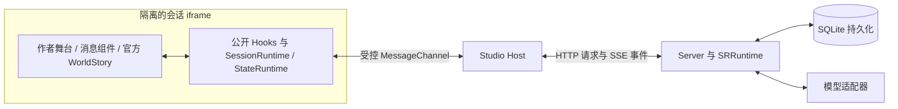
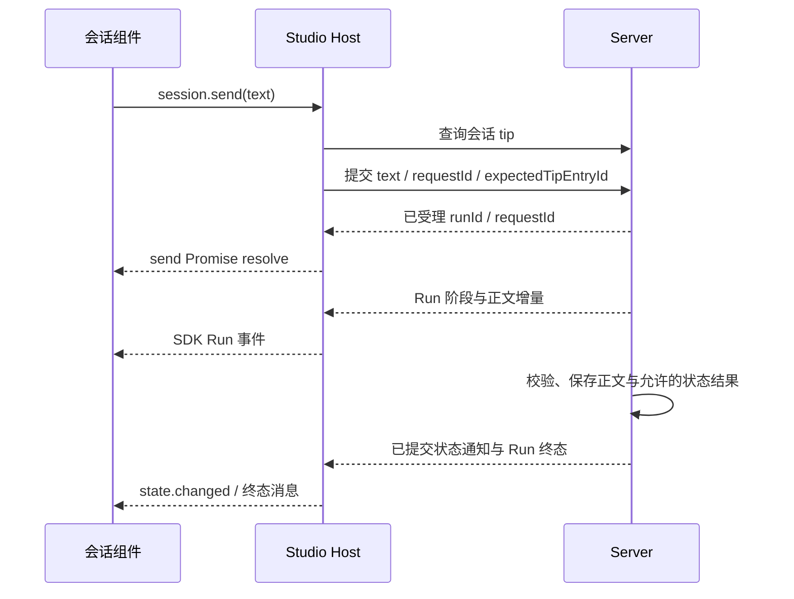

# 运行逻辑与排查

本文面向 SDK 使用者和 SR 维护者，解释当前实现如何支撑用户操作。作者组件只依赖公开 SDK；下述内部模块用于定位行为，不是新的作者导入入口。

## 一次操作经过哪里



| 层 | 职责 |
| --- | --- |
| 作者组件 | 展示和交互意图，处理加载／错误、取消订阅和按钮状态 |
| SDK | 暴露当前会话能力，管理状态 Hook 缓存与事件分发；官方组件合并历史和流式消息 |
| iframe 入口 | 安装 Provider、装载组件、转发有限命令和事件 |
| Host | 可信 HTTP/SSE、草稿、输入、发送／停止、连接恢复、规则 Worker 和主题传递 |
| Server | 校验、运行锁、请求幂等、历史归属、状态验证、持久化、模型调用和终态权威 |

SDK 不运行 Agent，不持有模型密钥，也不负责数据库事务。Direct 生成路径是一份正文与扩展尾块，由 Server 处理；当前不提供 Agent／工具循环执行。

## 会话舞台加载

1. Host 读取会话及世界数据，编译 `components`，但不在 Host 求值作者源码。
2. iframe 通过来源窗口与 nonce 校验完成握手，建立专用 MessageChannel。
3. iframe 使用平台提供的 React 和 SDK 外部模块映射加载舞台；同 iframe 内模块缓存复用。
4. 安装 AtomicContext 和 StoryContext。自定义舞台按作者代码渲染；没有目标则使用官方 WorldStory。
5. 页面挂载、连接就绪后允许发送；状态缓存读取当前快照，官方故事组件读取历史并处理事件。

编译失败按模块记录。舞台目标存在但损坏时显示错误；未使用的坏模块不会自动阻断所有有效入口。消息模块按引用延迟解析，并有自己的失败回退。作者源码只能访问白名单外部模块和本卡静态默认导入。

## 发送、状态提交与恢复



图示表达通常流程，不承诺所有事件相对请求回执的精确到达顺序，也不要求失败回合经历每个阶段。组件应按标识与终态合并，而不是以“先收到某事件”为前置假设。

状态写入的缓存刷新与订阅事件也不是同一件事：成功响应可更新 Hook 缓存，`subscribe` 只转发实际收到的 `state.changed`。重复值成功但不改变状态时，可能没有事件。

断线重连时，Host 查询会话与当前／已知 Run，以 `run.snapshot` 或权威终态恢复界面；状态 runtime 重新读取快照。SSE 没有持久 replay 保证。正在生成的正文在内存里积累，到模型响应结束或停止／失败结算时落库；Server 进程退出可能丢失未提交片段。

进入会话时，SSE 会立即发送连接注释，经过开发代理也无需等待心跳。暂时断线会禁止发送，但保留当前草稿；连接恢复后重新查询状态，尚未完成的舞台加载也会重试。网络错误不会被当作世界卡组件损坏，也不会自动重发用户消息。

正常停止或开发重启时，Server 关闭事件连接、停止生成并等待结算，然后关闭数据库、释放数据目录锁。退出清理有时间上限；超时退出后的未完成回合由下次启动恢复，不能保证保存所有临时正文。若提示“服务器暂时不可用”，先检查后端是否已启动；这与返回成功响应却不符合 API 格式的“服务器响应格式无效”不同。

## 自定义历史渲染的责任

官方 WorldStory 已实现以下协调。如果作者自行实现，公开 `subscribe` 不会自动替他完成：

- 初始化先订阅并暂存事件，再合并历史，避免读取期间漏掉新消息。
- 按 Run ID、message ID 和 UTF-16 offset 合并增量，识别重复、重叠、缺口。
- 迟到的运行中快照不能覆盖更新的增量；权威终态必须覆盖临时文本。
- 完成／失败／停止之后，忽略迟到的 created、phase 和 delta，避免重开已终结回合。
- 保留已加载的旧页；历史读取失败可以重试，不能清空仍然有效的故事。
- 维护稳定的 React key、消息组件槽位和阅读位置；当前官方实现没有列表虚拟化。

内部 reducer 位于 `story-history.ts`，没有从 SDK 根入口导出。普通作者优先组合 `SR.WorldStory`，不依赖仓库源码私有路径。

## 世界详情是独立运行环境

详情 iframe 只安装 WorldStateContext，SDK 对象中没有 session runtime、写入或事件订阅。组件通过 `world.state.read` 查询，Host 再次验证方法、scope 和路径，并从世界当前 global 值中提取所需结果。

组件不会获得原始世界卡、完整状态定义或任意 transport。切换世界／开局会销毁旧 iframe；React 状态、模块缓存和媒体播放不应假定跨预览保持。只读查询没有自动订阅。

两类作者 iframe 都从稳定的独立资源来源加载，采用 `sandbox="allow-scripts allow-same-origin"` 和限制性 CSP，`connect-src 'none'` 禁止直接 fetch/WebSocket。平台也拒绝该资源来源的受保护 API 请求。详情预览只复用编译结果和符合条件的浏览器资源缓存，不复用组件实例或查询结果。不要通过放宽 sandbox、给组件凭据或直连 Server 来排查 SDK 权限错误。

## 问题定位表

| 现象 | 先检查 | 正确处理 |
| --- | --- | --- |
| `SR provider unavailable` | 是否在详情环境或自行挂载到无 Provider 的页面 | 会话 Hook 只放在会话组件内 |
| `World state API unavailable in this context` | 是否在会话舞台使用详情 Hook | 改用会话 `useSRStateAPI` |
| 详情组件没有 updateState/subscribe | 当前环境是只读子集 | 移动操作到会话舞台，使用准确的只读类型 |
| 组件没有出现，反而是官方故事界面 | stage_component 是否为空或目标不存在 | 检查精确 ID 和 components 内容 |
| 舞台存在但页面报错 | 默认导出、白名单导入、依赖环、运行期异常 | 修复作者模块；不会静默回退 |
| 发送被拒绝 | 连接／挂载未就绪、会话忙碌、空文本、世界运行锁 | 保留操作意图，展示错误，避免自动重复发送 |
| Hook 总显示默认值 | 状态是否声明、scope/path 是否一致、初始读取是否失败 | 用显式 getState 区分不存在与读取失败 |
| Promise 成功但部分状态没变 | 逐项 success、相同值、Server 校验 | 处理失败项；批量写入不是全有全无 |
| 错误说明是 undefined | 是否只读取了 result.message | 兼容实际 errorMessage，见状态 API 的差异说明 |
| 历史文本重复或倒退 | 是否直接追加 delta，或拿旧 HTTP 结果覆盖实时内容 | 按偏移合并并尊重终态；优先复用 WorldStory |
| 首条消息不执行正则 | 是否带 origin: opening | 开局行为如此；把常驻 UI 放入舞台 |
| groups[0] 不是完整匹配 | 捕获组编号理解 | 完整匹配使用 match |
| Markdown 中脚本、样式或媒体消失 | 是否触发安全清洗 | 需要交互时编写组件，仍遵守 iframe 权限 |
| fetch 失败 | 是否在作者 iframe 内直连网络 | 通过 SDK 访问允许的能力，不绕过 CSP |

## 源码与验证入口

| 主题 | 实现 | 相关测试 |
| --- | --- | --- |
| 公开导出与 Hooks | [index.tsx](../../packages/sr-sdk/src/index.tsx)、[atomic-context.tsx](../../packages/sr-sdk/src/atomic-context.tsx) | 下列 runtime 测试及现有浏览器测试 |
| 会话事件转发 | [session-runtime.ts](../../packages/sr-sdk/src/session-runtime.ts) | [sdk-session-runtime.test.ts](../../apps/server/test/sdk-session-runtime.test.ts) |
| 状态缓存与竞争 | [state-runtime.ts](../../packages/sr-sdk/src/state-runtime.ts) | [sdk-state-runtime.test.ts](../../apps/server/test/sdk-state-runtime.test.ts) |
| 状态逐项提交 | [state-updates.ts](../../apps/server/src/routes/state-updates.ts) | [state-updates.test.ts](../../apps/server/test/state-updates.test.ts)、[atomic-state.test.ts](../../apps/server/test/atomic-state.test.ts) |
| 历史与增量合并 | [story-history.ts](../../packages/sr-sdk/src/story-history.ts) | [story-history.test.ts](../../apps/server/test/story-history.test.ts)、[history-runs.test.ts](../../apps/server/test/history-runs.test.ts) |
| 模块隔离与引用 | [frame.tsx](../../apps/studio/src/frame.tsx)、[loader.ts](../../packages/sr-ui-compiler/src/loader.ts) | [creator-components.test.ts](../../apps/server/test/creator-components.test.ts) |
| 世界详情权限 | [world-component-frame.tsx](../../apps/studio/src/world-component-frame.tsx)、[world-component-protocol.ts](../../apps/studio/src/features/worlds/world-component-protocol.ts) | [world-components.test.ts](../../apps/server/test/world-components.test.ts) |
| 消息结构与匹配 | [message-content.tsx](../../packages/sr-sdk/src/message-content.tsx) | [message-ranges.test.ts](../../apps/server/test/message-ranges.test.ts)、[message-matching.test.ts](../../apps/server/test/message-matching.test.ts)、[message-render-card.test.ts](../../apps/server/test/message-render-card.test.ts) |
| Portal 连续性 | [message-dom.ts](../../packages/sr-sdk/src/message-dom.ts) | [浏览器测试页](../../packages/sr-sdk/test/message-portal.tsx) |

本次文档核对在 2026-11-15 执行以下现有测试，11 个文件、42 项测试通过。测试使用隔离数据，不调用真实付费 Provider：

```sh
pnpm --filter @sillyrealms/server exec vitest run \
  test/sdk-session-runtime.test.ts test/sdk-state-runtime.test.ts \
  test/story-history.test.ts test/history-runs.test.ts \
  test/state-updates.test.ts test/atomic-state.test.ts \
  test/creator-components.test.ts test/world-components.test.ts \
  test/message-matching.test.ts test/message-ranges.test.ts \
  test/message-render-card.test.ts
```

另外，文档中的 10 个 TSX 示例已按当前 SDK 类型通过 TypeScript 检查，并通过实际创作者模块校验器 `inspectModule`；JSON 片段和本地文档链接也已检查。这些检查不执行示例界面，不代替浏览器交互验收。

这证明列出的测试断言在当前工作区通过，不等于所有作者组件或所有浏览器交互已经验收。本次工作仅新增 SDK 文档；未运行全量 lint、全量测试、生产构建和浏览器视觉回归，没有执行用户数据库迁移。
