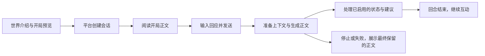

# 用户使用指南

你不需要安装 SDK。导入世界卡后，Studio 会加载作者提供的界面；未指定会话舞台时使用官方故事界面。SDK 是这些界面与 SR 会话、状态交互的通道。

## 从查看世界到开始故事

1. 查看世界介绍和开局预览。作者可以制作交互展示、配图或世界状态说明，但这些详情组件不能发送消息或修改状态。
2. 通过平台的开始会话入口进入故事。开局的 `content` 成为第一条故事消息；预览组件不会自动成为会话界面。
3. 在平台输入框输入回应并发送。正文逐步出现；有些回合正文完成后，还会处理状态与行动建议。
4. 等待回合结束后继续回应，或者使用平台停止按钮结束本次生成。

开局预览和第一条正文可能不同：预览是独立展示，正文使用开局文本。首条开局正文跳过消息正则展示规则，作者定义的后续消息配图或按钮不一定会在开局出现。

## 官方故事界面提供什么

| 功能 | 使用方式与预期 |
| --- | --- |
| 历史记录 | 初次加载最近的回合；点击“加载更早消息”继续向前阅读 |
| 实时正文 | 生成期间逐步显示；最终结果可能校正运行中的临时内容 |
| 阅读位置 | 在底部时跟随新内容；向上阅读时保持位置，可点击“回到最新” |
| 状态 | 查看世界、会话和当前剧情三组值；没有状态定义时显示空态 |
| 宽窄适配 | 故事组件自身宽度达到 960px 时使用内嵌状态侧栏；较窄时使用状态弹层 |
| 行动建议 | 最新已完成回合的有效建议可以填入草稿；旧建议仍可阅读，但不能再点击 |
| 失败反馈 | 区分历史读取失败、生成失败、消息展示失败等情况，部分入口可重试 |

自定义舞台可能隐藏官方状态面板，或完全采用作者自己的布局。平台不会强行插入故事列表。字号、输入框、发送和停止等平台控件由 Studio 管理。

## 填入草稿和直接发送不同

官方行动建议只会**填入草稿**，不会自动发送，你可以继续编辑。

作者制作的按钮也可以调用 SDK **直接发送**。按钮文字应明确表达“填入”还是“发送”，不能仅凭按钮外观判断。直接发送被受理后，正文仍需等待生成；它不等于本轮已完成。

生成期间可以编辑下一条草稿，但不能同时启动另一轮生成。平台发送失败会保留草稿；发送成功也不会清除发送期间新编辑的草稿。刷新或离开页面后的草稿持久保存不属于 SDK 保证。

## 状态值代表什么

| 状态范围 | 用户可以怎样理解 |
| --- | --- |
| 世界状态 global | 同一世界共享的当前值，可能影响这个世界的其他会话 |
| 会话状态 session | 当前会话自己的持续值 |
| 当前剧情 message | 沿当前会话历史继承的剧情状态，不是每条消息都重置 |

作者可以设计按钮更新状态；模型也可以在权限允许时更新状态。按钮的局部动画或文字变化不代表已经保存，最终以 Server 接受的结果为准。一次操作修改多个值时，可能只有部分值成功。

世界介绍或开局预览读取的是查询时的 global 值，没有自动订阅刷新。开局初始状态的查看器由平台提供，与预览组件读取的世界全局状态是两回事。

## 停止、失败与断线

| 情况 | 当前行为 |
| --- | --- |
| 正文结束后仍显示处理中 | 可能正在处理状态与行动建议，回合尚未结束 |
| 状态仅部分通过校验 | 保留有效状态，显示提示，本轮不提供行动建议 |
| 仅行动建议失败 | 正文和有效状态仍可保留，可以继续输入 |
| 必需状态扩展缺失或无效 | 可以保留正文，但回合失败，不提交本轮候选状态 |
| Direct 模式在提交前停止 | 丢弃候选状态和建议，最终正文以停止结果为准 |
| 网络暂时断开 | 平台重新连接并查询当前运行状态；不保证补发每条错过的事件 |
| Server 进程退出 | 尚未落库的生成正文可能丢失，已经显示过也不代表已经保存 |

Direct 是“正文加扩展尾块”的生成模式；Agent 模式是独立的模型／工具执行路径。不要把 Direct 的提交前停止规则推断为 Agent 会撤销此前已提交的工具状态。

## 常见现象

- **没有故事列表：**作者舞台可能没有使用官方故事组件；平台不会自动补上。
- **消息里的组件无法显示：**SDK 尽量保留可展示的原文并提示，展示错误不改写原始消息。
- **按钮提示忙碌或状态更新失败：**当前世界可能正在生成，或目标值不符合世界卡的状态定义。
- **图片加载失败：**远程媒体仍受资源地址、网络和安全策略影响，本地优先不代表外部图片已缓存。
- **整张会话页面报错：**当前舞台组件可能编译或执行失败；存在但损坏的舞台不会静默回退成官方界面。

返回 [SDK 文档入口](README.md)。
