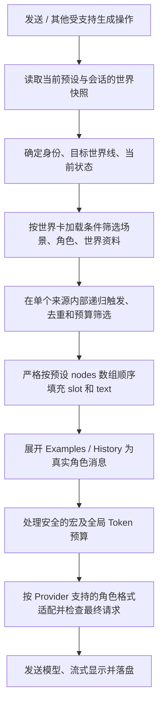

# Context：提示词构建、世界资料加载与历史压缩

> 状态：领域设计，2026-11-01；部分规则和长期能力待验证。返回[文档索引](../README.md)，世界内容见[世界卡](world-card.md)，分叉路径见[会话](session.md)。

## 设计目标

每次生成，SillyRealms 从世界卡、当前故事和用户操作中选择内容，按可解释的顺序构建模型请求。世界卡定义内容与触发规则；**预设独占 Prompt 节点及排列顺序、角色和插入位置的控制权**；本局身份、临时开关、剧情历史和当前状态由 Session 保存。**当实例存在分叉时，当前故事历史仅为选定叶子的 Entry 祖先路径**，绝不能混入未选中分支。详见[会话](session.md)。

场景、角色与世界书条目只能声明常驻、关键词或手动加载等**内容筛选条件**；它们仍是不同内容类型。默认插槽与顺序由不可删除的系统基础预设决定，用户预设可以移动插槽并插入文本节点。详见[预设](configuration.md)。

## 实际请求带来的设计依据

分析来源为 `data/character.json`、`data/预设.json` 和 `data/request.json`。请求文件是控制台展示对象，不是标准 JSON；其中有字符串拼接、`undefined` 和跨行输出。本次按可见结构做受限静态解析，没有执行文件内容，也没有向模型再次发送。

该记录可识别为四条消息：

| 顺序 | 消息角色 | 可观察内容 |
| --- | --- | --- |
| 1 | `system` | 系统指令文本 |
| 2 | `user` | 较长的预设指令和世界资料，包含可与角色卡中清月设定、洞天福地等条目匹配的内容 |
| 3 | `assistant` | 一条开场消息 |
| 4 | `user` | 本次输入“这是哪里？”，后面还有插图规则、状态栏相关规则及预设指令 |

第 4 条尤其重要：**用户输入之后仍然可以出现世界书内容，并且可能与用户输入合并到同一条消息中。** 因此“用户输入永远是整个 Prompt 的最后一段”不是普遍成立的规则。

该次请求记录的模型为 `deepseek-v4-pro`，`temperature: 1`、`top_p: 0.95`、`max_tokens: 65535`，流式开启，推理配置为 `enabled / max`。这是记录中的请求参数，不代表模型实际支持的上限。截图、预设文件和该次请求可能来自不同时刻的生效配置；不能仅凭预设文件推断完整运行状态。

插图规则、状态栏等文字与原角色卡的启用条目高度对应；原条目扩展配置为指定深度 0。酒馆代码会将深度条目注入聊天消息集合，且服务商适配可能合并消息。**记录能证明最终同一条 user 消息中有这些内容，不能单独证明是哪一个阶段完成了消息合并。**

## 世界卡内容结构

```text
世界卡
├─ 基础设定       世界背景和通用规则
├─ scenes[]       场景列表：地点、环境、发生条件等
├─ characters[]   多个独立角色及各自完整人物设定
├─ openings[]     多个开局
├─ lorebooks[]    地点、组织、物品、事件与其他世界资料
└─ 其他内容       示例、文本规则和资源
```

场景与世界书都可能描述地点，但职责不同：**场景定义可进入或可切换的叙事环境；世界书条目提供按需补充的资料。** 一个场景可以简短描述当前环境，相关历史、组织或物品细节可以由世界书另行提供。角色的人物设定直接放在角色下，不通过关联世界书取得。

场景清单在世界卡上表达可用内容；本局当前场景和切换结果属于会话。场景可以有加载规则，不代表每次命中关键词都自动切换当前场景：是否把“加载资料”与“切换场景”联动，由场景交互另行定义。

## 世界卡负责筛选内容，预设负责插入位置

世界卡保留的触发字段是 `load_mode`、`keywords`、`priority`、`recursive_trigger`、`recursive_source`，其中 `priority` **只用于当前插槽内的预算裁剪**，不影响节点位置。场景、角色、世界书各自的内容按照加载条件筛选，再填入预设内置的 `sceneInfo`、`characterInfo`、`worldInfo` 插槽。`injection_position/depth/role/order` 不属于原生世界卡的有效字段；旧酒馆来源导入时只能归档，不能抢占预设排序权。

| 内容类型 | 触发来源 | 预设固定插槽 |
| --- | --- | --- |
| 世界背景 `data.description` | 存在非空文本 | `worldDescription` |
| 场景 `scenes[]` | 加载条件、本局场景选择 | `sceneInfo` |
| 角色 `characters[]` | 加载条件、本局玩家身份 | `characterInfo` |
| 世界资料 `lorebooks[]` | 常驻、关键词命中、手动选择 | `worldInfo` |
| 当前状态 | 当前目标分支的有效状态快照 | `worldState` |
| 对话示例 `examples` | 有效示例内容 | `dialogueExamples` |
| 故事消息 | 当前选定叶子的祖先链 | `chatHistory` |

在某个插槽**未启用**或无有效内容时该插槽不输出；`load_mode=always` 不能突破用户关闭插槽的选择。同一插槽内条目按原始数据源顺序稳定排列并按稳定 ID 去重；预算不足时按候选 `priority` 做当前槽的局部取舍，不得让世界卡指定消息角色或跨节点顺序。触发扫描与实际注入范围可能不同，检查页面需要说明命中与未进入最终请求的原因。

不同参与者的秘密资料可见性仍需单独设计，不能单靠 Prompt 插槽或世界书关键词解决。

## 默认构建流程



每次模型请求先**固定当前预设快照**，构建过程中不因用户编辑预设而改变顺序。只有启用的节点产出消息；同一 `slot.source` 不可有重复的系统节点。Context 预览展示每段的节点 ID、资料来源、筛选原因、原始角色、适配后的角色和最终顺序；它不执行会产生持久化副作用的动作。

开局作为初始历史 Entry，不是每轮重新插入的模板。普通发送时当前 User Entry 也属于 `chatHistory` 中的有效消息：只能出现一次，不能同时作为单独尾部文本再次注入。**聊天 H5 的最近 30 条与 `before` 游标不是模型历史上限**：Context 必须从本次生成确认的 `active_leaf_entry_id` 读取有效祖先链，再依 Token 预算/分支有效检查点压缩；全局世界线压缩拓扑绝不代替真实历史。

## 默认节点顺序和历史之后的 Prompt

基础默认预设的完整 10 节点见[配置规范](configuration.md)及[JSON 示例](../examples/default-preset.json)，默认从前向后为：

```text
main → worldDescription → worldInfo → personaInfo → characterInfo
     → sceneInfo → worldState → dialogueExamples → chatHistory → postHistory
```

这是**系统内置默认模板**的顺序；用户自定义预设可以在保留全部系统节点的前提下重排节点、开关非必需节点，并在任意位置加入自定义文本节点。`chatHistory` 始终启用，不能删除或再次添加；每次生成读取当前选中预设的节点数组，不再写死上述示例顺序。

`postHistory` 默认关闭；自定义预设可以启用并编辑文本，也可以把其他文本节点放在 `chatHistory` 之后。**用户消息之后出现的 Prompt 内容属于预设，而不是用户亲自发送的消息，也不能由世界卡决定插入位置**。`dialogueExamples` 和 `chatHistory` 要展开为带实际角色的多条消息；模型接口不接受中途 system 消息时，Provider 适配必须显式报告限制或要求用户调整预设，不能静默改变既定顺序。

基础版本**不支持将节点插进历史第 N 条消息之前**；如果将来增加类似 SillyTavern 的历史深度插入，它只能是预设节点能力。历史里看到的旧角色卡/世界书深度配置属于导入兼容数据，不参与生效编排。

## 递归如何执行

递归是“一个命中的资料内容可以继续触发其他资料”。以世界资料为例：


每轮只把符合递归规则的新资料加入扫描；相同资料在同一次构建中不重复加入。以下情况停止：没有新命中、达到递归轮数或时间限制、预算不足，或用户关闭递归。系统应显示触发链，例如“山门 ← 清月谷 ← 用户输入”。

酒馆当前源码记录已激活条目，扫描时跳过已处理条目，也支持递归步数及预算限制；其默认最大递归步数为 `0` 时表示该设置不施加步数上限，不能将其误读为“禁止递归”。实际是否启用递归还取决于世界书设置与条目条件。扩展可以介入流程，无法仅凭默认值保证所有插件行为。SillyRealms 应同时使用去重与明确上限，达到限制时报告，不静默无限扫描。

是否让场景和角色内容参与递归，与世界书使用相同配置能力；默认是否开启应在后续世界卡规则评审中确认。资料间相互触发不等于自动切换场景或改变角色控制者。

## 宏是什么，为什么需要处理

宏是写在内容里的占位符或指令，在构建时根据当前故事求出实际值。作者不必给不同用户、角色或每次生成手工写不同版本。

| 示例 | 可能含义 | 构建时需要的信息 |
| --- | --- | --- |
| `{{user}}` | 当前用户或玩家身份名称 | 本局选择的身份 |
| `{{char}}` | 当前角色名称 | 明确的角色绑定 |
| `{{lastusermessage}}` | 上一次用户消息 | 当前故事历史 |
| `{{roll:1d10}}` | 得到一个随机数 | 本次随机结果 |
| `{{setvar::...}}` / `{{getvar::...}}` | 写入或读取变量 | 本局变量与作用范围 |

例如原角色卡插图列表中使用随机宏选择图片编号；这次预设也使用身份、历史、随机和变量宏。宏处理可能影响实际资料、触发结果或最终文本，因此检查界面应显示宏原文、替换结果和适用阶段。

多角色场景下 `{{char}}` 必须有明确绑定；无法确定时保留并提示，不把世界名当作角色。随机和有副作用的变量宏在预览、失败和重生成中的处理方式需要明确：预览不能悄悄改变已保存故事；随机结果应可追踪。完整宏兼容与安全规则另行设计。

## 历史深度插入的边界（后续预设能力）

SillyTavern 的历史注入深度表示从消息序列末尾向前计算插入位置，不同于世界书的**扫描深度**。之前分析的来源请求中，某些世界书内容被插到用户输入之后，这是旧来源的一种行为观察，不表示 SillyRealms 允许世界卡直接控制深度。

首期只支持**预设节点数组排序**：文本节点可以在 `chatHistory` 前后，但不插进其内部。未来如支持深度 0 / 深度 1 等细粒度插入，由预设描述位置和消息角色，并由 Context Builder 检查是否能对目标 Provider 正确表达；世界卡仍不允许出现生效的 `injection_depth`。

## 主指令与历史后置指令

- 基础 `main` 与 `postHistory` 都是预设的 `text` 节点：系统默认模板只读；用户副本可以编辑节点内容，并在预设中控制排序/可选开关。
- 世界卡原生格式**不提供** `data.prompts.system_prompt` 或 `data.prompts.post_history_instructions` 来改动 Prompt。旧来源中的提示词可以保留为非执行兼容资料；只有用户主动导入成自定义预设文本节点才会生效。
- 预设里为空的文本节点不输出消息；自定义 Prompt 和世界卡候选内容都无法覆盖基础系统槽的固定 ID / source。

## 用户控制、预算与检查

| 内容 | 默认规则 | 用户控制 |
| --- | --- | --- |
| 本次操作、基本请求检查 | 必须处理 | 不应被内容开关移除 |
| 世界基础设定 | 存在时加载 | 本局可关闭并显示提示 |
| 场景、角色、世界资料 | 按世界卡加载条件及预设插槽决定 | 本局可调整资料使用状态 |
| 开局及历史 | 作为会话消息 | 可排除或限制历史；保留原始记录 |
| 当前世界状态（启用时） | 从当前路径有效 Entry 快照与世界卡字段规则构建 | 生成与状态结算须一致，不能注入兄弟分支或失效快照 |
| 示例和扩展内容 | 有内容且启用时加载 | 可关闭 |
| 预设自定义文本节点 | 按所选预设启停及排列 | 可编辑、拖动、删除自定义节点；世界卡不可强制插入 |

预算不足时优先保留本次操作与必要内容；其他资料和历史按用户可见的优先级选择。不能把未发送资料显示为已进入 Prompt，也不能悄悄截断本次输入。世界书扫描的历史范围与最终发送的范围可能不同，应显示触发来源和裁剪结果。

每次构建应能查看：使用的预设 ID、各节点顺序与启用状态、本局场景与角色、内容加载原因、递归触发链、资料开关、插槽来源、宏替换、预算取舍，以及模型适配后的最终消息。凭据不显示；同一条消息中的不同来源应可区分。

## 分叉、行动项与历史编辑的 Context 语义

- 普通发送、显式新分叉、重生成/续写和历史压缩都只读取**本次写入操作明确选定的实际叶子/父节点路径**的 Entry 祖先链；世界书扫描、宏替换以及 `chatHistory` 插槽填充同样按该路径计算。H5 只有单向上翻页，不限制模型使用更早历史。总览 `nodes/edges/preview` 只是导航派生视图，不可作为 Prompt 历史。全实例 `seq` 不等于有效历史顺序。
- **世界分叉**是用户在历史 User 消息处显式发起，并从其父 AI Entry 下发送新 User 消息。该消息是真实历史，和普通用户输入采用同一套 Context 构建规则，**不能额外重复注入一份分叉指令**。
- **AI 帮答行动项**只是输入框的候选内容：用户可忽略、选用或编辑。未发送候选不进入历史、世界书扫描或长期记忆；选择行动项本身不触发分叉。最终发送的内容按普通 User Entry 处理。
- **重生成与 AI 续写**仅能针对当前选中路径的最后一条 AI Entry；重生成替换其正文，续写追加其正文。两者不引入新的历史分叉，也不产生重复用户输入。
- **主动编辑历史**不重新生成后代。之后的 Context 读取编辑后的正文；曾经覆盖该条历史内容的压缩摘要、记忆和状态派生结果需失效或重建，以避免把旧版本内容再次注入。兄弟分支若不经过该消息则不受影响。
- 压缩摘要必须锚定属于当前祖先链的 Entry；不同分支的摘要不得交叉使用。世界卡同步后也需要检查依赖旧世界设定的派生上下文是否失效。原始历史仍可浏览。

## 世界状态注入与 Agent 结算（目标能力）

- 世界卡 `data.state` 中每个字段的 `initial / description / rule` 只是**结构与更新原则**；Opening 的 `initial_state` 在新建 Session 时按字段覆盖初值，形成开局 Entry 的完整状态快照。状态定义不是每轮重置的模板，详情见[世界卡](world-card.md)。
- 本轮正常叙事从**活动世界线本次请求父 Entry 的有效完整状态快照**读取当前状态，和必要的字段描述、更新规则一同注入给模型；不能读取其他世界线的最新快照或把全局拓扑摘要当作状态历史。切换世界线后使用新活动叶子的父链，绝不因 UI 之前加载了旧世界线消息而读取旧状态。未定义 `data.state` 时跳过整个机制。
- User Entry 默认继承父节点完整快照；AI 完成叙事后才由 Agent 分析实际发生的变化，输出结构化更新操作。不能因为用户输入声称某件事成功，就提前将其视为已发生。Opening 本身已提供初始化快照，不再被解析成一次额外增量更新。
- 状态引擎只支持[世界卡规范](world-card.md)定义的 `set/add/insert/delete/move`，统一执行类型/目标路径检查，整批原子应用于父快照，保存**整份新状态**。空更新仍保存完整快照；语义规则由模型判断、程序只强校验可验证的部分。`delete` 限集合成员，不能删除作者定义的顶层字段。
- 同一消息的结算必须绑定消息正文版本与父状态版本；重生成/续写仅末尾 AI 时重新基于父快照结算，不叠加旧消息的 `add`/`insert`；迟到或失败的异步结果不能覆盖新版本。`pending/failed/stale` 状态不得被当作已成功结算的当前状态参与下一轮，需明确重试或修复。
- 编辑历史正文不自动重生成后代故事；受影响的状态快照依赖须失效或由用户明确触发重新结算，不能隐式将旧快照当作编辑后的新事实。世界卡手动同步后若状态定义变更不兼容，不得静默把新规则套到旧快照；需要明确迁移策略。

## 分支感知的压缩与记忆（目标能力）

- 真实 Entry 历史属于[会话](session.md)，压缩是用于后续 Agent 调用的**派生 Context 检查点**，不是改写或删除聊天记录。
- 检查点锚定 `anchor_entry_id`，只对该锚点的后代路径可用。共同祖先上的压缩可以复用，分叉后的检查点不能用于兄弟路径。若编辑历史节点 X，任何覆盖 X 的检查点（锚点是 X 或 X 的后代）需失效；锚点严格位于 X 之前的检查点可以继续使用。
- 构造上下文时使用适用的最新有效摘要，再拼接其锚点之后当前路径上的真实历史；再次压缩时将旧摘要与新增历史合并。摘要不能拆散工具调用与其结果；所有内建 Agent 事件必须能够完整恢复或明确限制能力。
- 世界卡同步后对依赖旧世界定义的摘要/缓存作有效性检查，失效时重算或退回原始历史。摘要可保存生成时的世界快照指纹，而不增加 Session 来源版本字段。
- 长期记忆沿同样的祖先可见性规则组织；**世界状态优先采用每条 Entry 完整快照，不依赖额外的增量状态检查点作为权威来源**。外部工具副作用不能简单靠切换叶子回滚。持久化约束见[存储](../technical/storage.md)。

## 待验证项

- Prompt 编排已由[预设](configuration.md)唯一拥有；世界卡只保留加载字段。仍需要验证槽内世界书关键词组合、递归触发上限及预算裁剪的实际算法。
- 必须通过目标 Pi / Provider 的公开接口验证：预设中 `chatHistory` 之后的文本节点能否按预期进入最终模型请求；若不支持，应显式报错，不能暗中挪动。
- 明确多角色 `{{char}}` 的运行时绑定、对话示例格式识别、不同角色的秘密可见范围。旧 SillyTavern 宏、正则和来源预设导入只做明确支持的子集，不将未实现的兼容声称为已有能力。

## 参考

- 本地酒馆 `public/scripts/world-info.js`：世界书读取、递归、预算及深度分发。
- 本地酒馆 `public/scripts/openai.js`：历史深度插入、消息构建与模型请求。
- 本地酒馆 `public/scripts/PromptManager.js`：节点顺序、开关及角色卡提示词配置。
