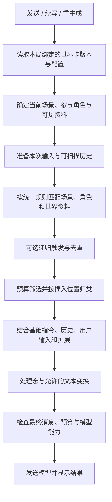
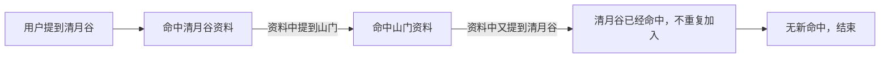

# Context：提示词构建、世界资料加载与历史压缩

> 状态：领域设计，2026-11-01；部分规则和长期能力待验证。返回[文档索引](../README.md)，世界内容见[世界卡](world-card.md)，分叉路径见[会话](session.md)。

## 设计目标

每次生成，SillyRealms 从世界卡、当前故事和用户操作中选择内容，按可解释的顺序构建模型请求。世界卡定义资料和加载规则；本局选择、临时开关、剧情历史和当前状态由世界实例或会话保存。**当实例存在分叉时，当前故事历史仅为选定叶子的 Entry 祖先路径**，绝不能混入未选中分支。详见[会话](session.md)。

场景、角色和世界书条目使用同一套注入配置，既能常驻，也能按关键词或手动选择加载；它们仍是不同的内容类型。此处先确定不依赖预设的默认规则，预设如何修改这些规则另行设计。

## 实际请求带来的设计依据

分析来源为 `data/character.json`、`data/预设.json` 和 `data/request.json`。请求文件是控制台展示对象，不是标准 JSON；其中有字符串拼接、`undefined` 和跨行输出。本次按可见结构做受限静态解析，没有执行文件内容，也没有向模型再次发送。

该记录可识别为四条消息：

| 顺序 | 消息角色 | 可观察内容 |
| --- | --- | --- |
| 1 | `system` | 系统指令文本 |
| 2 | `user` | 较长的预设指令和世界资料，包含可与角色卡中清月设定、洞天福地等条目匹配的内容 |
| 3 | `assistant` | 一条开场消息 |
| 4 | `user` | 本次输入“这是哪里？”，后面还有插图规则、状态栏相关规则及预设指令 |

第 4 条尤其重要：**用户输入之后仍然可以出现世界书内容，并且可能与用户输入合并到同一条消息中。** 因此“用户输入永远是整个 Prompt 的最后一段”不是普遍成立的规则。

该次请求记录的模型为 `deepseek-v4-pro`，`temperature: 1`、`top_p: 0.95`、`max_tokens: 65535`，流式开启，推理配置为 `enabled / max`。这是记录中的请求参数，不代表模型实际支持的上限。截图、预设文件和该次请求可能来自不同时刻的生效配置；不能仅凭预设文件推断完整运行状态。

插图规则、状态栏等文字与原角色卡的启用条目高度对应；原条目扩展配置为指定深度 0。酒馆代码会将深度条目注入聊天消息集合，且服务商适配可能合并消息。**记录能证明最终同一条 user 消息中有这些内容，不能单独证明是哪一个阶段完成了消息合并。**

## 世界卡内容结构

```text
世界卡
├─ 基础设定       世界背景和通用规则
├─ scenes[]       场景列表：地点、环境、发生条件等
├─ characters[]   多个独立角色及各自完整人物设定
├─ openings[]     多个开局
├─ lorebooks[]    地点、组织、物品、事件与其他世界资料
├─ prompts        可选系统指令与历史后置指令
└─ 其他内容       示例、文本规则和资源
```

场景与世界书都可能描述地点，但职责不同：**场景定义可进入或可切换的叙事环境；世界书条目提供按需补充的资料。** 一个场景可以简短描述当前环境，相关历史、组织或物品细节可以由世界书另行提供。角色的人物设定直接放在角色下，不通过关联世界书取得。

场景清单在世界卡上表达可用内容；本局当前场景和切换结果属于会话。场景可以有加载规则，不代表每次命中关键词都自动切换当前场景：是否把“加载资料”与“切换场景”联动，由场景交互另行定义。

## 场景、角色和世界资料的统一注入配置

三类内容共用同一组产品能力；具体字段名称和最终 JSON 结构待世界卡设计同步确认。

| 配置 | 作用 | 可选值或行为 |
| --- | --- | --- |
| 加载方式 | 决定内容什么时候进入候选 | 常驻、关键词命中、本局手动选择 |
| 关键词 | 关键词模式下用于匹配 | 一个或多个词；命中任一还是组合条件可配置 |
| 扫描范围 | 决定检查哪些文字 | 本次输入、最近历史；其他资料是否参与由规则明确 |
| 插入位置 | 决定内容放在哪里 | 基础资料区域、历史前、历史中指定深度、历史后等 |
| 消息角色 | 决定内容以何种身份提供 | `system`、`user`、`assistant`，最终受模型接口支持约束 |
| 顺序 / 优先级 | 处理同位置排列与预算取舍 | 排列顺序与预算优先级分别表达 |
| 递归 | 控制是否参与连锁触发 | 可被其他资料触发、可否继续触发其他资料 |

内容是否在本局暂时关闭属于实例或会话状态，不写作世界卡当前状态。用户可以分别关闭某个场景资料、角色资料或世界书条目的注入；系统应说明关闭对当前故事的影响。人物是否可被玩家选择仍是角色定义，实际选择与控制者属于本局。

某角色由玩家选择后，默认将其身份资料提供给模型；其他角色按其加载方式处理。不同参与者对秘密资料的可见性需要单独设计，不能仅靠注入规则实现。

## 默认构建流程



本图表达逻辑阶段，不要求每一阶段只能在整个流程中执行一次。某些宏需要在匹配或预算计算之前处理，具体处理时机必须明确并在检查界面标注；不能先笼统替换所有文本再假定结果等价。

开局在创建故事时成为初始历史，后续生成不重复插入。普通发送和显式世界分叉发送都将**用户实际提交的内容**保存为 User Entry，Prompt 中本次输入只出现一次；仅当前路径最后一条 AI 消息允许重生成或续写，均不伪造 User 消息、也不创建新分支。

## 默认顺序与用户消息之后的内容

默认以可理解的逻辑位置构建；具体片段可以按各自注入配置进入指定位置：

```text
① 基础指令与用户接受的 system_prompt
② 世界基础设定
③ 选中的场景、角色及命中的世界资料
④ 对话示例
⑤ 聊天历史和本次用户输入
⑥ 配置为历史末尾或当前输入之后的资料
⑦ 用户接受的 post_history_instructions / 操作指令
```

上表是默认阅读顺序，不要求全部合并为一个消息；消息角色依内容配置与模型支持确定。某些内容设置为历史中的深度位置时，插入到第 ⑤ 部分相应位置。

**输入之后可以有资料**：例如要求模型输出状态栏、控制插图格式、强调当前操作约束。这些资料不能被界面误显示成用户亲自输入的文字；检查界面应标注来源和插入位置。对最终接口是否合并相邻同角色消息，依模型与适配方式而定，检查时须能看见合并后的实际内容。

## 递归如何执行

递归是“一个命中的资料内容可以继续触发其他资料”。以世界资料为例：



每轮只把符合递归规则的新资料加入扫描；相同资料在同一次构建中不重复加入。以下情况停止：没有新命中、达到递归轮数或时间限制、预算不足，或用户关闭递归。系统应显示触发链，例如“山门 ← 清月谷 ← 用户输入”。

酒馆当前源码记录已激活条目，扫描时跳过已处理条目，也支持递归步数及预算限制；其默认最大递归步数为 `0` 时表示该设置不施加步数上限，不能将其误读为“禁止递归”。实际是否启用递归还取决于世界书设置与条目条件。扩展可以介入流程，无法仅凭默认值保证所有插件行为。SillyRealms 应同时使用去重与明确上限，达到限制时报告，不静默无限扫描。

是否让场景和角色内容参与递归，与世界书使用相同配置能力；默认是否开启应在后续世界卡规则评审中确认。资料间相互触发不等于自动切换场景或改变角色控制者。

## 宏是什么，为什么需要处理

宏是写在内容里的占位符或指令，在构建时根据当前故事求出实际值。作者不必给不同用户、角色或每次生成手工写不同版本。

| 示例 | 可能含义 | 构建时需要的信息 |
| --- | --- | --- |
| `{{user}}` | 当前用户或玩家身份名称 | 本局选择的身份 |
| `{{char}}` | 当前角色名称 | 明确的角色绑定 |
| `{{lastusermessage}}` | 上一次用户消息 | 当前故事历史 |
| `{{roll:1d10}}` | 得到一个随机数 | 本次随机结果 |
| `{{setvar::...}}` / `{{getvar::...}}` | 写入或读取变量 | 本局变量与作用范围 |

例如原角色卡插图列表中使用随机宏选择图片编号；这次预设也使用身份、历史、随机和变量宏。宏处理可能影响实际资料、触发结果或最终文本，因此检查界面应显示宏原文、替换结果和适用阶段。

多角色场景下 `{{char}}` 必须有明确绑定；无法确定时保留并提示，不把世界名当作角色。随机和有副作用的变量宏在预览、失败和重生成中的处理方式需要明确：预览不能悄悄改变已保存故事；随机结果应可追踪。完整宏兼容与安全规则另行设计。

## 什么是注入深度

深度表示**从聊天历史末尾往前数，资料插入在什么位置**。它不同于“扫描深度”：扫描深度决定看多少历史来触发资料；注入深度决定命中后把资料放到哪里。

```text
较早历史
  用户：……
  AI：……
  [深度 1 的内容：示意]
  用户：这是哪里？
  [深度 0 的内容：示意]
较新位置 → 生成回复
```

本产品拟采用：深度 0 位于本次有效历史的末尾，深度 1 位于最后一条有效消息之前；实际操作是否将本次输入算入历史、同深度不同角色如何排列，必须在构建规则中统一并展示。对于普通发送，本次输入算入用于定位的消息序列，但不能重复发送。

在这次酒馆记录中，“这是哪里？”之后紧接着出现插图等世界书规则，说明当前输入之后可以插入内容；其原卡条目配置显示深度 0。最终同角色内容合并后，输入和注入内容可以出现在同一条 `user` 消息里。消息角色不等于内容作者：一条 user 消息中的后半段也可能来自世界书或预设。

## system_prompt 与后置指令

- `system_prompt`：可选的整体叙事或行为要求，默认位于前部。
- `post_history_instructions`：可选的生成前提醒，默认位于历史之后；是否处于本次输入之前或之后，应作为可明确配置的位置，而不是依赖字段名称猜测。

卡片提供的提示词需要用户接受后使用。空字段不产生消息；与未来预设的覆盖、追加关系另行设计。不同模型对消息角色和位置的处理可能不同，最终请求应如实展示。

## 用户控制、预算与检查

| 内容 | 默认规则 | 用户控制 |
| --- | --- | --- |
| 本次操作、基本请求检查 | 必须处理 | 不应被内容开关移除 |
| 世界基础设定 | 存在时加载 | 本局可关闭并显示提示 |
| 场景、角色、世界资料 | 按共同注入配置决定 | 本局可调整资料使用状态 |
| 开局及历史 | 作为会话消息 | 可排除或限制历史；保留原始记录 |
| 当前世界状态（启用时） | 从当前路径有效 Entry 快照与世界卡字段规则构建 | 生成与状态结算须一致，不能注入兄弟分支或失效快照 |
| 示例和扩展内容 | 有内容且启用时加载 | 可关闭 |
| 卡片高级提示词 | 接受后加载 | 可接受或关闭 |

预算不足时优先保留本次操作与必要内容；其他资料和历史按用户可见的优先级选择。不能把未发送资料显示为已进入 Prompt，也不能悄悄截断本次输入。世界书扫描的历史范围与最终发送的范围可能不同，应显示触发来源和裁剪结果。

每次构建应能查看：本局场景与角色、内容加载原因、递归触发链、资料开关、插入位置和深度、宏替换、预算取舍，以及模型适配后的最终消息。凭据不显示；同一条消息中的不同来源应可区分。

## 分叉、行动项与历史编辑的 Context 语义

- 普通发送、历史分叉、重生成/续写和历史压缩都只读取**当前目标路径**的 Entry 祖先链；世界书扫描、宏替换、注入深度同样按该路径计算。全实例 `seq` 创建序号不等于有效历史顺序。
- **世界分叉**是用户在历史 User 消息处显式发起，并从其父 AI Entry 下发送新 User 消息。该消息是真实历史，和普通用户输入采用同一套 Context 构建规则，**不能额外重复注入一份分叉指令**。
- **AI 帮答行动项**只是输入框的候选内容：用户可忽略、选用或编辑。未发送候选不进入历史、世界书扫描或长期记忆；选择行动项本身不触发分叉。最终发送的内容按普通 User Entry 处理。
- **重生成与 AI 续写**仅能针对当前选中路径的最后一条 AI Entry；重生成替换其正文，续写追加其正文。两者不引入新的历史分叉，也不产生重复用户输入。
- **主动编辑历史**不重新生成后代。之后的 Context 读取编辑后的正文；曾经覆盖该条历史内容的压缩摘要、记忆和状态派生结果需失效或重建，以避免把旧版本内容再次注入。兄弟分支若不经过该消息则不受影响。
- 压缩摘要必须锚定属于当前祖先链的 Entry；不同分支的摘要不得交叉使用。世界卡同步后也需要检查依赖旧世界设定的派生上下文是否失效。原始历史仍可浏览。

## 世界状态注入与 Agent 结算（目标能力）

- 世界卡 `data.state` 中每个字段的 `initial / description / rule` 只是**结构与更新原则**；Opening 的 `initial_state` 在新建 Session 时按字段覆盖初值，形成开局 Entry 的完整状态快照。状态定义不是每轮重置的模板，详情见[世界卡](world-card.md)。
- 本轮正常叙事从**目标路径上一条 Entry 的有效完整状态快照**读取当前状态，和必要的字段描述、更新规则一同注入给模型；不能读取其他世界线的最新快照或把所有历史旧状态混进当前提示词。未定义 `data.state` 时跳过整个机制。
- User Entry 默认继承父节点完整快照；AI 完成叙事后才由 Agent 分析实际发生的变化，输出结构化更新操作。不能因为用户输入声称某件事成功，就提前将其视为已发生。Opening 本身已提供初始化快照，不再被解析成一次额外增量更新。
- 状态引擎只支持[世界卡规范](world-card.md)定义的 `set/add/insert/delete/move`，统一执行类型/目标路径检查，整批原子应用于父快照，保存**整份新状态**。空更新仍保存完整快照；语义规则由模型判断、程序只强校验可验证的部分。`delete` 限集合成员，不能删除作者定义的顶层字段。
- 同一消息的结算必须绑定消息正文版本与父状态版本；重生成/续写仅末尾 AI 时重新基于父快照结算，不叠加旧消息的 `add`/`insert`；迟到或失败的异步结果不能覆盖新版本。`pending/failed/stale` 状态不得被当作已成功结算的当前状态参与下一轮，需明确重试或修复。
- 编辑历史正文不自动重生成后代故事；受影响的状态快照依赖须失效或由用户明确触发重新结算，不能隐式将旧快照当作编辑后的新事实。世界卡手动同步后若状态定义变更不兼容，不得静默把新规则套到旧快照；需要明确迁移策略。

## 分支感知的压缩与记忆（目标能力）

- 真实 Entry 历史属于[会话](session.md)，压缩是用于后续 Agent 调用的**派生 Context 检查点**，不是改写或删除聊天记录。
- 检查点锚定 `anchor_entry_id`，只对该锚点的后代路径可用。共同祖先上的压缩可以复用，分叉后的检查点不能用于兄弟路径。若编辑历史节点 X，任何覆盖 X 的检查点（锚点是 X 或 X 的后代）需失效；锚点严格位于 X 之前的检查点可以继续使用。
- 构造上下文时使用适用的最新有效摘要，再拼接其锚点之后当前路径上的真实历史；再次压缩时将旧摘要与新增历史合并。摘要不能拆散工具调用与其结果；所有内建 Agent 事件必须能够完整恢复或明确限制能力。
- 世界卡同步后对依赖旧世界定义的摘要/缓存作有效性检查，失效时重算或退回原始历史。摘要可保存生成时的世界快照指纹，而不增加 Session 来源版本字段。
- 长期记忆沿同样的祖先可见性规则组织；**世界状态优先采用每条 Entry 完整快照，不依赖额外的增量状态检查点作为权威来源**。外部工具副作用不能简单靠切换叶子回滚。持久化约束见[存储](../technical/storage.md)。

## 待同步的设计

- 世界卡已加入 `scenes[]` 及三类内容共同使用的平铺注入字段；字段默认值为草案，需要进一步评审。
- 决定默认注入角色、场景及世界资料的具体位置，处理多个同位置内容的顺序。
- 决定关键词组合、扫描范围、递归默认值、上限与预算优先级。
- 设计场景选择、场景切换与场景资料加载的关系。
- 设计卡片提示词接受范围、消息角色转换和同角色合并的用户可见方式。
- 原角色卡含有独立角色卡时代的世界书、宏及正则：导入时需逐项分析，不能因字段保留就宣称与酒馆等价。

## 参考

- 本地酒馆 `public/scripts/world-info.js`：世界书读取、递归、预算及深度分发。
- 本地酒馆 `public/scripts/openai.js`：历史深度插入、消息构建与模型请求。
- 本地酒馆 `public/scripts/PromptManager.js`：节点顺序、开关及角色卡提示词配置。
