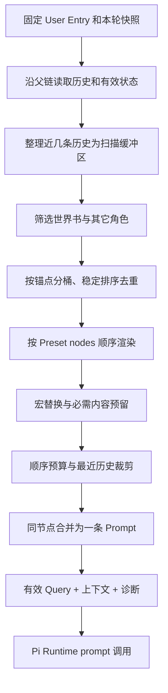

# Context：内容扫描、Prompt 构建与预算

> 状态：2026-11-02 MVP 目标设计，尚未实现。节点、锚点、角色与预设配置的唯一规范见[配置](configuration.md)；世界卡字段见[世界卡](world-card.md)，Entry 父链与状态见[会话](session.md)、[状态](state.md)。

## 目标和职责

ContextManager 对**一次明确的生成操作**进行无持久化副作用的确定性构建：

- Preset 决定节点数组的主顺序、节点角色、启停与 Token 预算；世界书只选择系统允许的 `before/after` 锚点与同位置次序，不能自选角色或创建独立 Prompt 消息。
- 世界卡提供 **一个 `lorebook`**、角色定义及加载条件；世界书条目命中后，同一锚点的文本和对应基础节点本体**拼成一条消息**，且全部继承对应节点角色。
- 真实历史永远从本次 `userEntryId` 的父节点沿 `parent_entry_id` 回溯；不混入其他分支，不以全局 `seq` 或 H5 最近 30 条作为模型历史。
- ContextManager 返回编排消息、有效本轮 User Query 和诊断信息；不负责 Pi 生成、StateEngine 结算、SQLite 写入或缓存持久化。输入固定时预览与执行使用同一个构建器。

## 输入与输出契约

```ts
type ContextInput = {
  preset: PresetSnapshot;
  model: ModelConnectionSnapshot;
  world: WorldCardSnapshot;
  userCharacter: CharacterSnapshot;
  session: SessionSnapshot;
  userEntry: Entry;              // 本次 User，已有稳定 ID
  history: Entry[];              // 仅本次 User 之前的祖先，旧→新
  parentState: EffectiveState;   // 本次 User 的有效继承状态
  manualLoreIds: string[];       // 本局显式选择的条目
  disabledLoreIds: string[];     // 本局显式禁用的世界书条目
};
type ContextResult = {
  messages: PromptMessage[];     // 各基础/自定义节点编排结果（历史展开）
  effectiveUserQuery: string;    // userInput.before + 原文 + userInput.after
  diagnostics: ContextDiagnostic[];
  tokenEstimate: { input: number; limit: number };
};
```

Session 发送时先持久化已确认 User Entry 并锁定父节点，再传入 ContextManager。失败重试使用**同一个 User Entry**；历史分叉新建真实 User 后也复用同一构建链。所有来源快照和构建检查必须属于这次生成，不因途中编辑预设或切线而变化。

## 整体构建流水线



### 1. 内容扫描缓冲区

借鉴 SillyTavern `world-info.js` 中的 `WorldInfoBuffer` / `checkWorldInfo`，但**不复制**它的全部高级条件：

- 本轮 `userEntry.content` 作为深度 0；其前三条真实祖先 Entry 依次为深度 1～3。MVP 默认 `scan_depth=4`，属于预设扫描配置，可修改；超过路径根部就停止。
- 扫描使用已清洗的正文，AI 的 `<UpdateVariable>` 不参与关键词匹配；不扫描兄弟分支、拓扑摘要或未发送的 AI 帮答候选。
- 相同缓冲区用于本轮世界书 `on_mention` 与其他角色的 `on_mention`，避免扫描对象与最终内容不一致。`always` 不依赖关键词，`manual` 取 `manualLoreIds`，而 `disabledLoreIds` 在自动/手动命中前统一排除。所选玩家角色固定加载 `personaInfo`，不重复加载进 `characterInfo`。
- 关键词支持 `keyword_logic=any|all`，默认 `any`；trim 后的非空关键词按普通 Unicode 子串匹配，拉丁文字可大小写折叠；不做词形还原、分词、正则、次要关键词或跨世界线扫描。
- 世界书按稳定 `id` 去重，记录 `always / keyword / manual` 命中理由及来源 Entry ID（如存在）。不支持递归触发、概率、Sticky/Cooldown、互斥组、随机激活；它们以后扩展 Scanner 即可。
- 运行时不改变世界卡原始条目；生成预览是只读 dry-run。仅对正式 Context 在提交 User 后使用已冻结的输入快照。

**扫描不等于注入。** 即使命中条目后因 Token 预算未实际发送，也在诊断中显示“已命中但裁剪”，不能谎称被模型看到了。扫描范围可与最终发送历史不同。

### 2. 按节点编排与锚点分组

固定的七个基础节点是 `main`、`personaInfo`、`characterInfo`、`worldState`、`chatHistory`、`userInput`、`postHistory`。Preset 主顺序完全取 `nodes[]`，另允许自定义 text 节点；仅 `personaInfo`、`characterInfo`、`worldState`、`userInput` 支持世界书锚点。

每条激活世界书只包含 `load.anchor`、`load.position`、`load.order`，**没有 `load.role`**。用 `(anchor, position)` 分桶，桶内依 `order` 升序、条目原始顺序稳定排序。遍历一个节点 `N` 时生成有序片段：

```text
[N.before 的所有已命中世界书条目]
[N 自身的可见内容]
[N.after 的所有已命中世界书条目]
→ 以两个换行拼接成一条 Prompt，role = N.role
```

这不是三条 Prompt；构建诊断可以保留多个内部片段的来源，但请求中**一个有内容的节点对应一条消息**。节点本体为空或显式关闭，不影响其前后锚点生效；三部分均为空才不发消息。`chatHistory` 是例外：它展开为原有 `user/assistant` 多条消息，不把历史压成单一角色；它不允许世界书锚点。

`userInput` 也是单条 `user` 消息：`effectiveUserQuery = join(before, userEntry.content, after)`，调用 `session.prompt(effectiveUserQuery)`。原始 User Entry 只持久化原文，本轮输入不会同时再被放入 `chatHistory`。即使重复调用或切换世界线，也不重复注入锚点文字或创造第二条用户记录。

例如：

```text
personaInfo.role = system
  before: 本局人物背景补充
  body:   玩家扮演「旅人」
  after:  玩家知道的秘密
→ {role: system, content: "本局人物背景补充\n\n玩家扮演「旅人」\n\n玩家知道的秘密"}

userInput.role = user
  before: 请将以下行动当作下一步剧情意图
  body:   我进入王宫
  after:  写出动作发生后的详细场景
→ prompt("请将以下行动当作下一步剧情意图\n\n我进入王宫\n\n写出动作发生后的详细场景")
```

基础节点可移动，锚点始终附着其目标节点；世界书不允许独立决定自己的 Prompt 角色或控制其它节点顺序。历史后的 `system` 在不同 Provider 可能被重排，这属于已知限制；**本轮先不处理**，不把该问题误归因于世界书锚点合并规则。

### 3. 宏与内容规范化

MVP 只实现确定性宏 `{{user}}`，映射到 Session 选定的世界卡角色名称；不支持默认 `{{char}}`、随机数、`setvar/getvar` 等有副作用宏。未知宏保留文字并告警或按配置拒绝，不自行选择 NPC。宏替换发生在 Token 预算前，保证预算针对实际发送文本估算；预览和发送沿同一顺序执行，预览绝不改写状态。

`worldState` 使用本次 User 父快照（User 继承自其父 AI）的有效 `world/user` 值与状态字段规则，包含尾部 `<UpdateVariable>` 指令要求。字段均为空时不强制状态协议；若状态标记 `failed/stale`，必须先恢复/确认，不能采用错误快照。状态解析与结算由 StateEngine 执行，不属于 ContextManager。

### 4. MVP Token 预算：先必需，再按构建顺序

```text
input_budget = context_window_tokens - max_output_tokens - safety_margin_tokens
```

- **优先预留：** 本轮 User 原始输入、必要的 `worldState` 状态快照和更新协议，以及系统规定的不可删除运行约束。对应文本若超出预算则拒绝生成，不静默截断。
- **可选片段：** 按最终 Preset 编排顺序尝试追加（包括本体及各世界书 before/after 条目）。条目以整条为单位；第一项放不下时，舍弃它与其后的可选片段。空文本不消耗预算。
- **`chatHistory` 特例：** 在轮到这个节点时，从最近一条祖先向前保留可容纳的**连续完整 Entry**，直到下一条放不下后停止，最终按原时间正序展开；不从兄弟分支补洞。该步骤的可用空间同样取剩余预算。
- **合并计算：** 片段预算计入最终消息的分隔符、角色及消息格式开销；先记录采纳的片段，再将单节点片段拼为一条并复核整条估算。模型精确 Tokenizer/Provider 细节尚需 PoC，不宣称绝对精确。
- 预算限制仅决定**发送内容**，不修改 Session Entry、世界书和状态定义。记录 `included / skipped_budget / disabled / unmatched` 等诊断原因，便于用户检查。

MVP 不做打分优化、重要性排序、历史摘要或长期记忆；之后的分支感知压缩检查点仍归独立阶段设计，现有原始历史永久保留。

## 与 Pi Agent / Provider 的边界

- 每次调用先从 SQLite 读取本世界线历史并构建临时 Pi 执行态，不使用 Pi JSONL 作为另一份持久化历史。非本轮输入节点作为运行时上下文，`userInput` 本体和锚点合成为 `effectiveUserQuery`，由 `session.prompt(effectiveUserQuery)` 触发执行。
- **不让 Pi 默认消息投影成为第二个 PromptManager**。SillyRealms 负责扫描、编排、预算和诊断；Pi 仅作为执行、SSE、取消底座。
- Pi `prompt()` 本身只接受本轮用户消息，不代表可直接传入任意多角色有序消息数组。其它编排片段需通过临时 Session / 执行适配提供；当前离线 Mock 只验证了部分路径，SQLite 与真实 Provider 的精确请求一致性仍需后续工程 PoC。
- `postHistory` 以及任意历史后文本节点的 `system` 顺序问题已有本地实验记录，**本轮明确暂缓处理**；不新增转换/报错策略或静默假装已验证。
- 生成成功后由会话层写入 AI 原始文本、清洗后正文与状态快照。出错或取消不新建 AI 占位 Entry，重试从同一 User 叶子恢复。

## Context 构建诊断与最小验收

每次 dry-run 或生成都提供节点 ID、原始预设位置、节点角色、世界书 Entry ID、锚点与 before/after、扫描匹配原因、原始与宏替换后内容、被裁剪片段、预算估算、最终节点合并结果。诊断中保留来源分段，发送时仍只输出节点对应的一条 Prompt；不展示密钥。

至少验证：

1. 同输入快照获得同构建结果；正常发送、显式分叉和失败重试本次 User 仅一次，且只取该路径父链。
2. `on_mention any/all`、`always`、`manual`、扫描深度边界和未命中条目，角色人物加载不重复玩家角色。
3. 世界书不能指定角色；前/后锚点同节点拼成一条消息，节点为空/禁用也继承节点角色。
4. 改变 `characterInfo.role` 或调整它在预设中的位置，相关世界书角色与位置自动跟随；`userInput` 始终是单条 user 消息。
5. 预算不足时按顺序丢弃可选片段，`chatHistory` 保留连续最近历史，必需输入不足明确报错；诊断与构建结果一致。
6. 本轮状态仅取父 Entry 有效快照，`<UpdateVariable>` 不从原始 AI 输出回注历史。

## 后续独立讨论

分支感知压缩/长期记忆、递归世界书和高级触发器、正则/动态脚本、AI 重生成与续写专用 Prompt、Provider 对历史后 System 消息的合并/提前、跨角色秘密可见范围均不在本轮实现范围。

### 参考本地 SillyTavern 源码

- `public/scripts/world-info.js`：`WorldInfoBuffer`、`checkWorldInfo`、激活/去重与递归机制。
- `public/scripts/PromptManager.js`：预设节点管理、排序与注入配置。
- `public/scripts/openai.js`：`populationInjectionPrompts`、`populateChatHistory`、`populateChatCompletion`、同角色合并行为。
- `experiments/pi-sdk-feasibility/REPORT.md`：本地 Pi 1.4.0 Mock 8/8 通过及真实 Provider/SQLite 未验证限制。
