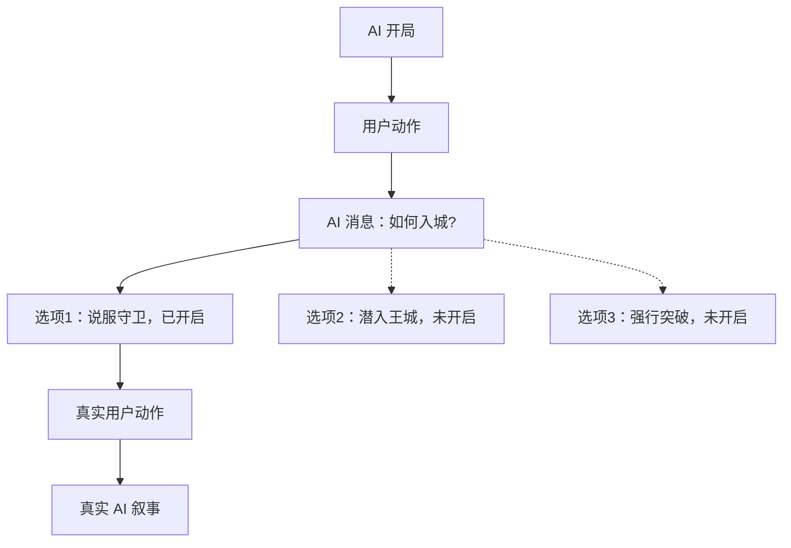

# 会话：Entry 树与三路线分叉决策

> 状态：目标领域设计，2026-11-01；分叉能力分期实现。返回[文档索引](../README.md)，相关技术见[存储](../technical/storage.md)。

## 核心概念与不变量

- **一个世界实例就是一棵完整的消息树**；从根到某个叶子的祖先路径组成一条可恢复的故事会话，分叉不创建新的世界实例，也不复制公共历史。
- **只有已完成、对用户可见的 AI 消息可以成为分叉点**；每个分叉点有一个共同原因 `fork_reason`，可规划最多 **3** 条直接路线。
- **规划不等于发生**：每条规划路线包含标题和推进指令，未开启时不创建 Entry。选中一条并真正交互后才生成子树；其余选项保持待开启。一个分叉点的直接路线最多 3 条，但整棵树的叶子节点不限于 3 个。
- `entries` 是真实历史，`branch_options` 是可能性与入口映射；单独的 `branches` 消息表没有必要。用户消息最多拥有一个有效 AI 后续；保留旧结果的重生成须回到更早的 AI 分叉点建立新路线。
- 当前选中叶子是一种视图选择；切换路线或查看全局树不修改历史。原始消息不会因为历史压缩、分叉或世界卡同步而被改写。

## 关系示例

未开启的选项在产品树视图里显示虚线占位，但**不是 Entry 树中的节点**。已有路线也可在稍后补建分叉规划时占据一个选项槽位。

## 分叉点与 3 路上限

以 `A10`（已完成 AI 消息）作为分叉点，用户填写共同原因「如何进入王城」，规划三个选项：

| 槽位 | 选项 | 第一次开启前 | 开启后 |
| --- | --- | --- | --- |
| 1 | 说服守卫 | 仅有 `branch_options` | `A10 → U11 → A12 → …` |
| 2 | 潜入王城 | 仅有 `branch_options` | `A10 → U21 → A22 → …` |
| 3 | 强行突破 | 仅有 `branch_options` | `A10 → A31 → …`（导演式续写示例） |

分叉选项可以一次建立 1～3 个，之后补充空闲槽位。`U` 表示确实发生的用户行动，`A` 表示 AI 叙事；导演式 `instruction` 可以作为**本次请求指令**直接续写 AI Entry，不强制伪装成用户发言并污染故事历史。若选择把选项表达成玩家实际行动，则保存相应 User Entry。Prompt 检查界面应展示当轮注入的选项指令。

### 核心不变量

1. `assistant` 已完成节点最多有 3 个直接子节点；`user` 节点最多 1 个**有效** AI 子节点。用户消息的 AI 重生成不能在该 User 节点下面产生第二个正式 AI 子节点。
2. 当某 AI 节点存在多于一条真实直接后续时，**每条**都必须对应同一分叉点下不同的已开启 `branch_options`；没有关联选项的隐式第四分支不允许存在。
3. 创建任何新直接子节点时，先检查父节点类型、状态、子节点/选项的绑定以及是否超限；并发请求必须在写事务中重新校验，不能只靠前端按钮置灰。
4. 失败或取消时保留可重试记录，避免再次点击在同一 `user` 下制造第二个 AI 正式子节点；可恢复失败节点的重试语义由 Agent 适配层明确实现。
5. 禁止成环、跨实例父节点、悬空父节点，以及两个选项指向同一 `first_entry_id`；不存在通过 `seq` 猜测父链的逻辑。

### 先有旧路线，后添加分叉规划

例如已经有 `A10 → U11 → A12`，后来用户回到 `A10` 创建分叉点：先将现有 `U11` 登记为**原路线**的已开启选项（占一个 slot），再允许规划最多两个新选项。这既不复制原历史，也不会让「原路线 + 三个新选项」变成 4 条真实后续。

如果某 AI 节点已拥有超过三条后续（迁移异常），应先提示修复数据，不能直接新增规划。已有真实后续的入口绑定以真实子节点为准。

### 重生成

要保持「只在 AI 处分叉」，从 `A10 → U11 → A12` 重生成 AI 回复时，如果希望**保留原结果**，在 `A10` 新建一个可用选项，以相同用户输入创建 `U11′`，再生成 `A12′`。这占用一个分叉槽位；若 3 槽已满，不允许隐藏产生第四条路线。单纯失败重试可以在同一条尚未完成的路线内恢复，不视为额外正式分支。

## 首次开启、返回与继续交互

### 首次点击未开启选项

1. 用户提交 `session_id`、`option_id`、请求幂等 ID；服务端验证分叉点是已完成的 AI Entry、选项仍未开启、直接子节点未超限。
2. 短事务中占用该选项，创建第一条真实 Entry（视用户实际行动或导演式续写而定），将 `first_entry_id` 指向该 Entry；同一选项并发首次开启只允许一个请求成功。外部模型请求**不持有 SQLite 事务**。
3. 读取分叉点及当前新增 Entry 的有效祖先链、世界快照、当前预设、适用摘要，将 `instruction` 作为本轮生成的显式指令，构建实际模型请求。
4. 执行模型调用，流式显示结果，完成后持久化 AI Entry；更新 `sessions.active_leaf_entry_id`。失败/取消记录可以恢复或重试，不能自动启动第二个选项入口。

### 点击已开启选项

- 从 `first_entry_id` 定位对应子树，查询该子树的**真实叶子**。
- 仅一个叶子时直接切换 `active_leaf_entry_id` 并打开历史消息；多叶子时先提供叶子选择，不将某个叶子假定为唯一正确进度。
- 选择叶子只改变当前会话视图，不生成消息，也不改写原历史；继续交互时客户端明确传入所选叶子，服务端校验它仍是当前可用叶子。

### 正常 Agent 交互

假设选中 `A12`，发送用户消息：创建 `U13(parent=A12)`，生成 AI 回复 `A14(parent=U13)`，成功后活动叶子更新为 `A14`。续写可由 `A12` 直接生成 AI 子节点，但同样遵守分叉点/选项约束。普通向前发送时，如果 AI 父节点已经有后续，必须明确「进入既有路线」或「规划一个未占用的分叉选项」，不能无意中隐式新增路线。

## 消息列表、分叉统计与全局树

### 两个视图共用一份树

**消息列表**只展示选中叶子的祖先链，保持常规聊天体验。遇到 AI 分叉点显示「直接分支 2/3」「已规划选项 3/3」，可以切换已有路线或开启尚未发生的选项；在该处也可以看到共同的 `fork_reason` 和选项摘要。

**全局树视图**展示 Entry 父子关系、当前高亮路径与全部实际叶子，并把未开启的选项画为**虚线规划终点**（UI 节点，不属于 Entry，不参与叶子统计）。支持展开/折叠长链、查看每个分叉原因、选择任意叶子后进入消息列表。移动端默认纵向布局和按需展开；数据接口可提供完整关系，超大树再做子树增量加载。

### 明确三个不同统计

| 指标 | 定义 | 例子 |
| --- | --- | --- |
| `planned_option_count` | 当前分叉点选项数 | 3/3 |
| `started_branch_count` | 当前分叉点已开启且有 `first_entry_id` 的直接路线数 | 1/3 |
| `leaf_count` | 当前 Entry 子树全部**真实**叶子数 | 可以是 5 或更多 |

没有规划选项的普通 AI 节点，真实直接子节点数仍可作为直接后续数；规划建立后以选项槽位与入口绑定解释各路线。`leaf_count` 不受单点最多 3 分支的限制。

### 祖先游标分页

聊天列表以选中的 `leaf_id` 为锚点，按 `parent_entry_id` 追溯历史；服务端验证历史游标属于该叶子的祖先链，仅返回本次需要的一页。不能根据全实例 `seq` 排序来推断历史归属。首次只加载最近页，上滑加载旧消息；树视图按需获取节点元数据，不一次加载所有正文。具体查询与 API 草案见[存储](../technical/storage.md)。

## 与 Context 和 Agent 的边界

- **有效历史 = 当前叶子的全部祖先 + 叶子自身**。初次开启路线时，选项 `instruction` 作为本轮操作指令；恢复已开启路线时不重复注入它，也不重新执行选项。
- 历史压缩与未来记忆/状态只能复用当前路径祖先上的检查点，不能使用兄弟分支的摘要。原始 Entry 保留，压缩不替代历史浏览。详见 [Context](context.md)。
- 流式回复、失败恢复与取消不能导致第四条路线或同一 User Entry 下多个有效 AI 子节点；工具调用等内部执行事件需独立于用户可见的故事 Entry 管理。具体数据约束与 API 见[存储](../technical/storage.md)和[运行架构](../technical/architecture.md)。

## 业务验收场景

- 在某条已完成 AI 消息处规划三种路线，只开启一条继续交互，再回来开启其余路线；待开启选项不产生消息或真实叶子。
- 先正常聊天，再回到旧 AI 消息建立分叉规划；原历史自动占用一个槽位，第四条直接路线被拒绝。
- 在已开启路线中继续分叉，进入任意真实叶子后可恢复正常聊天；兄弟分支消息不会出现在当前路径。
- 重新生成若需保留旧结果，创建新选项并遵守三条上限；失败重试不得偷偷制造第二条正式路线。
- 分叉点能显示原因、选项数、已开启数和真实叶子数；全局树虚线规划节点不计入真实 Entry。
- 世界卡同步、历史压缩与路线切换不能改写已经发生的剧情；具体 Agent 可恢复性必须通过运行时验证。

**仍待专项设计：** 分支删除/归档、极大规模树的交互、工具副作用隔离。执行与存储测试见[运行架构](../technical/architecture.md)及[存储](../technical/storage.md)。
