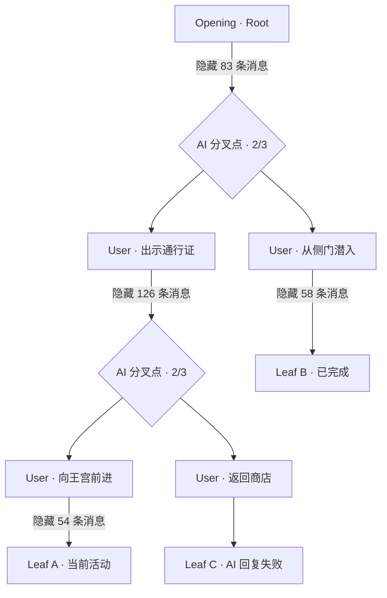
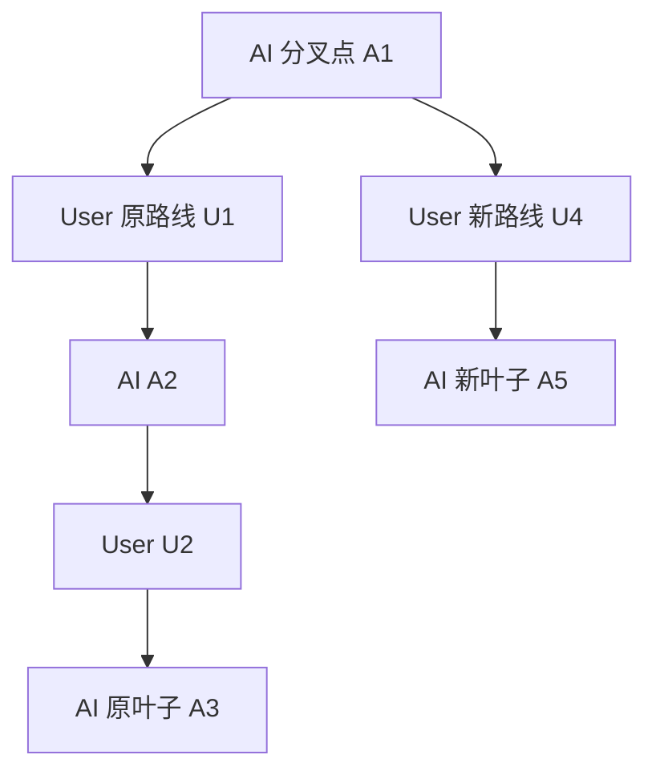
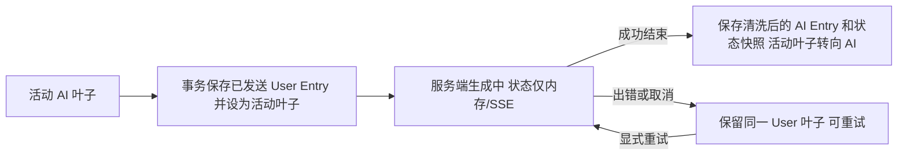

# 会话：MVP 世界线选择、单向历史分页与 Entry 树

> 状态：2026-11-03 MVP 目标领域设计（尚未实现），状态协议已同步为强类型。返回[文档索引](../README.md)；SQLite/API 见[存储](../technical/storage.md)，模型输入见[Context](context.md)。

## 核心模型与边界

**一个世界实例（Session）保存一棵真实 Entry 树，但聊天页面每次只进入某条真实叶子的末尾。** 完整历史不因 UI 折叠而丢失；全局世界线页面只展示压缩拓扑摘要，不是第二套消息历史。

- Entry 是实际用户（`user`）或 AI（`assistant`）消息。开局根 Entry 通常是 AI。正常故事沿 `AI → User → AI` 推进。
- **真实叶子**是在本实例内没有子 Entry 的消息；通常是 AI，也可能是尚未获得回复、模型失败或等待重试的 User。`seq` 是全实例创建顺序，**不能**用来拼接单条世界线。
- 实际分叉点是一个具有 **2～3 个直接 User 子节点**的 AI Entry。历史 User 的「创建世界分叉」操作，把新 User 挂到**这个历史 User 的父 AI**，不是挂到历史 User 自身。每个 AI 最多 3 个直接 User 子节点，一个 User 最多 1 个有效 AI 子节点；可嵌套分叉，全局叶子总量不限于 3。
- `sessions.active_leaf_entry_id` 是**唯一持久化的当前活动世界线**；没有 `view_leaf_entry_id`、`focused_entry_id` 或需要按设备恢复的历史阅读位置。打开/切换世界线总是加载该叶子的最近消息。
- 预览某条世界线只在前端暂存 `selected_leaf_id` 供高亮，**不修改** Session；点击「进入这条世界线」后才切换 `active_leaf_entry_id`、清空旧聊天分页、读取新叶子的末尾。

## 创建和进入世界实例

1. 用户从世界卡库打开实例列表，可创建或进入一局 Session；新实例保存发布世界卡的 JSON 快照、预设选择、Opening，以及**仅从世界卡 `characters[]` 与 Opening 共同许可名单中明确选中的 `user` 角色 ID 和完整角色快照**。`player_selectable` 决定世界卡总体允许的扮演角色，Opening 的 `player_characters` 只能收窄；二者不允许外部角色，规则见[世界卡](world-card.md)。Opening 正文作为根 Entry；启用状态时从世界卡统一 `data.state.modules` 强类型树生成默认完整快照，按 Opening 的部分 `initial_state` 覆盖并校验，保存单份**无 world/user 包装**的完整初始快照，同时冻结 Schema/hash。角色是否被选为 `user` 不会改变状态根映射，旧 `characters[].state` 必须显式迁移，仅初始化一次。
2. 创建完成，`active_leaf_entry_id` 指向开局根 Entry；之后每次成功普通发送、AI 回复或显式分叉，指向最新有效真实叶子。失败 AI 生成可能留下 User 叶子，UI 提供恢复/重试，不自动改选其它路线。
3. **打开已有实例**：服务端读取已保存的 `active_leaf_entry_id` 并校验它属于本实例且仍是真实叶子；直接读取其最近约 30 条祖先消息，前端默认滚动到底部。没有有效叶子时给出明确的恢复/修复提示，**不选择全实例 `seq` 最新节点代替**。
4. 世界实例仍共享一棵树：不同世界实例完全隔离；同实例的多个世界线共享相同祖先。历史编辑及世界卡手动同步不会重置当前叶子。

## 聊天页面：只读一条世界线，只向上分页

- **顶部**：世界实例标题、当前活动世界线标识、世界线总览入口。
- **消息列表**：按真实故事时间从旧到新展示**当前活动叶子唯一祖先链**；首屏为叶子附近最新一页，历史不一次性加载。向上滚动按最早已加载 Entry 的父链请求更早的一页；向下只是滚动已经加载的列表，**没有向下历史查询 API、任意 Entry 定位窗口或进入历史中间位置**。
- **分叉标记**：在已加载的 AI 分叉点上显示 `2/3`、`3/3` 等真实 User 子节点数，普通消息不显示。点击标记只打开本处对应的分支/叶子选择浮层，不自动跳线；该浮层不拉取整段历史。
- **输入**：普通发送永远接在当前活动**叶子**之后，不能从上滑到的历史消息隐式发送。用户在读旧消息时点击输入或「回到最新」，界面可以先回到底部以避免误解。生成中的增量输出只在用户已经停留底部时自动跟随；否则显示「有新内容」提示。
- **长列表**：每页默认 30 条（服务端上限由实现固定，如 100），顶部插入时保持原消息锚点和像素位置、支持虚拟化/媒体延迟布局；到根 Entry 停止。**跨世界线切换**时清空旧消息列表、分页游标与未完成请求；**同一世界线正常生成**只是把新 User/AI 追加到末尾，保留已加载历史与用户当前滚动位置，更新活动叶子绑定，并废弃或重试旧 `leaf_id` 的未完成分页请求。

### 只有两种历史读取动作

```http
GET /sessions/{sessionId}/entries?limit=30
GET /sessions/{sessionId}/entries?leaf_id=A900&before=U850&limit=30
```

- 首次请求不带 `before`，服务端使用当前 `active_leaf_entry_id`；返回从旧到新排列的最近一页。
- `before` 指客户端当前最早展示的 Entry ID，服务端返回**严格在它之前**的祖先消息，不重复该条。必须同时携带首次响应返回的 `leaf_id`，服务端检查其仍是当前活动叶子并验证 `before` 属于它的父链；不匹配返回冲突/无效游标而非混合其他路线。
- 返回 `leaf_id`、`entries`、`next_before`、`has_more`；`next_before` 为当前返回页最早 Entry ID，只有 `has_more=true` 时继续使用；从用户视角不会把兄弟世界线的内容插进聊天中。
- 前端维护单调递增的导航代号（如 `navigation_epoch`，纯内存）丢弃**跨世界线切换**后的旧响应。同线生成让活动叶子从 A → U → A 演进时，只更新分页请求绑定的 `leaf_id` 并取消/重试已发出的旧叶子查询，**不清空当前已加载的祖先消息，也不强制跳到底部**。服务端在生成、切线和历史分页时均要校验请求关联的叶子版本。

> UI **只向上加载历史**，不等于模型每轮也只读 30 条。模型 Context 从本次真实 User Entry 的父节点沿有效祖先链读取，`chatHistory` 排除该 User；按顺序预算选择历史。UI 的 `before` 游标不参与模型历史裁剪。

## 全局世界线：压缩拓扑，而非全消息画布

全局世界线页面展示 **Root → Fork → Branch Start → Leaf** 的有向树，连续无分叉的普通消息**隐藏在边里**。只请求保留节点的预览和轻量连接信息，不拉整局全部正文；不同真实路径共用祖先节点。

| 类型 | 真实 Entry 的选择标准 | 展示内容 |
| --- | --- | --- |
| `root` | Opening 根 Entry | 开局标题/摘要 |
| `fork` | 直接拥有至少 2 条 User 子节点的 AI Entry | 分叉处 AI 摘要、`2/3` 或 `3/3` |
| `branch_start` | 每个 `fork` 的每个直接 User 子 Entry | 该选项的实际 User 输入摘要 |
| `leaf` | 无直接子 Entry 的真实末尾消息 | 末尾摘要、状态（完成/失败/待回复）与「进入」 |

同一个 Entry 如兼具多种意义，可按一条节点记录携带多个 `kinds` 标签，不允许重复产生视觉虚构节点。保留节点之间的边包含 `from`、`to`、`hidden_count`，数量按**该段实际父子链**上未显示的 Entry 数计算，**不能**相减全局 `seq`。无实际分叉的单链可显示 Root → Leaf；若 Root 本身也是 Leaf，则一个节点兼具两种标签。



**重要：** `branch_start` 不一定直接连到最终叶子，后面可能还有多个 `fork`。点击分叉第一条 User 仅意味着选择某个**子树**；若子树存在多条叶子，仍须明确选择其中一个实际叶子，不能暗中选 `seq` 最大或创建时间最近的叶子。

- **预览**：默认高亮当前活动叶子的压缩祖先路径。点击另一真实叶子，只更新临时 `selected_leaf_id`，高亮从根至该叶子的节点和边，并展示叶子摘要；不切换聊天、不读取中间消息正文。
- **进入**：点击「进入这条世界线」→ 服务端验证叶子并原子更新 `active_leaf_entry_id` → 关闭总览 → 清空聊天分页数据和游标 → 从新叶子最新一页重新查询 → 滚到底部。若该叶子是失败 User，则给出重试入口。
- **分叉标记入口**：聊天里点击 `2/3` 只展示其直接 User 分支及可选叶子/子树，引导到同一个世界线总览或叶子选择器；绝不以中间节点作为聊天入口。
- **大树保护**：服务端可先扫描本实例全部**轻量元数据**（`id`、`parent_entry_id`、`role`、`status`），一次构图，然后**仅对保留节点**读取截断预览；千条消息不意味着千个 UI 节点。若实际分叉数也很多，接口需提供摘要节点上限和明确 `has_more` / 子树继续加载机制，**不得无提示截断**。完整画布缩放/搜索中间消息留待后续。

### 世界线切换动作

```http
GET /sessions/{sessionId}/worldlines
PUT /sessions/{sessionId}/active-leaf
Content-Type: application/json

{"leaf_id":"A900","expected_active_leaf_id":"B700"}
```

`expected_active_leaf_id` 作为乐观并发前置条件；若生成刚产生新叶子或其他操作已切线，返回冲突并刷新总览，不覆盖另一操作。选中拓扑节点只是 UI 动作，只有确认按钮调用 PUT。服务端始终验证同实例、真实叶子及正在运行的生成冲突。

## 创建分叉与消息编辑仍然成立

假设原故事是：

```text
A1：你来到王城入口。
└─ U1：我与守卫交谈。
   └─ A2：守卫要求出示通行证。
      └─ U2：我拿出通行证。
         └─ A3：守卫允许你进入。（当前叶子）
```

在已经向上加载到的 **U1** 上点击「创建世界分叉」，输入「我绕开守卫，从侧门潜入」：

1. 打开专用分叉输入状态，未发送前不创建 Entry、不修改当前叶子。
2. 提交时找到 `U1.parent_entry_id = A1`；在同一 SQLite 短事务里校验 A1 是已完成的同实例 AI、实际直接 User 子节点少于 3、幂等请求未执行，再创建 `U4(parent=A1)`。**不是把 U4 挂在 U1 下面**。
3. 使用 U4 的祖先路径生成 AI `A5(parent=U4)`，不重写/删除原分支。生成成功切到 A5 并滚到底部；若生成失败，保留 U4 及其重试状态，并可将其作为真实叶子进入，防止重复分叉请求。



首次新分叉后是 `2/3`，第三条可继续创建，第四条被拒绝；嵌套分叉不受整局 3 条叶子限制。新分叉自动切换活动叶子属于**用户明确提交了分叉**，并非浏览世界线造成的隐式切换。

| 操作 | MVP 规则 |
| --- | --- |
| 普通发送 | 只从 `active_leaf_entry_id` 继续，不因上滑位置变化而改变父节点；幂等处理以防重复 User |
| 历史分叉 | 已加载旧 User 上显式触发；新 User 的父亲是旧 User 的父 AI，直接 User 分支最多 3 条 |
| 末尾 AI 重新生成 / 续写 | 如果对应功能启用，只能编辑当前无后代 AI 叶子，不新增消息、不造出虚假分叉；此处不扩展 AI 帮答/续写的 Prompt 设计 |
| 编辑历史消息 | 主动编辑已加载 User/AI 正文，原后代不自动重生成；公共祖先编辑影响经过它的所有分支，相关 Context、摘要和状态结算标记失效 |
| 删除消息 | MVP 不支持 |

## MVP 最简 Entry 生成生命周期

**只持久化已经确定的 User/AI 正文 Entry，生成过程不建 AI 占位消息、不建 Run 表、不保存 token 级临时状态。**



- `entries.status`：MVP 所有**已落盘**的 User 和 AI Entry 均为 `completed`；创建中的 AI 内容和 `generating` 仅在内存/SSE 中，不是独立 Entry 状态。`failed` / `cancelled` 描述**本次生成尝试**，并非一条已保存的 AI 消息。服务重启后若活动叶子为 User，UI 一律显示「尚未收到 AI 回复，可重试」，不需要第二份 Run 历史。
- **发送**：服务端检查活动叶子预期值、幂等请求 ID 和无并发生成，在一次短事务里创建 User Entry、按父快照复制状态（若启用）、更新 `active_leaf_entry_id` 为这个 User；之后启动 Pi 流式，不持有事务。
- **成功**：只创建一条 AI Entry，`parent_entry_id` 指向这个 User，正文已与 Tool 参数或内联 `<StateUpdate>` 分离，并一次性保存原文、ChangeSet、强类型校验结果及完整状态快照与 AI `completed` 记录；同事务将活动叶子改为 AI。状态解析/校验失败时**允许保存 AI 叙事正文作诊断**，但必须标记 `state_status=invalid` 或 `missing`，不能作为已结算状态；下次生成要明确重试/修复/确认继承，并记录决定。
- **取消/失败/刷新/崩溃**：没有完成就不创建 AI Entry，模型已流出的部分文本只在本次页面临时展示；保留已经写入的 User Entry 及其完整继承状态，活动叶子保持 User；用户重试**同一条 User**，不额外新增 User、不占用第二条分叉，重复请求通过幂等 ID/当前叶子校验防止重入。初版不持久化中断时的部分 AI 文本。
- **分叉**：显式从历史 User 的父 AI 建新 User 分支，随后完全复用上述生成链；取消/失败时新 User 仍是有效待回复叶子。`User` 最多存在**一个**有效 AI 子节点；不为重试创造第二条 AI 子节点。若操作指向错误/过期叶子或生成正在进行，返回明确冲突。
- **末尾 AI 重生成/续写**：目前不扩展对应 Prompt 功能；后续实现时仅修改当前无后代 AI 叶子的正文并重新结算其状态，不使用新增 Entry 伪装生成失败重试。

MVP 前端只需要 `idle / generating / error`（以及可选 `cancelled` 提示）的**临时请求 UI 状态**。这与 `state_status`（状态插件的 `inherited / success / missing / invalid / stale`）是两套不同概念，不能把状态解析失败当作模型生成失败。

## 与 Context、状态和 Agent 的边界

- `active_leaf_entry_id` 是创建 User 前选择真实世界线的**唯一持久化入口**；User 确认落盘后，本轮 Context 固定该 `user_entry_id` 并读取**它的父 Entry 祖先链**。`chatHistory` 只包含本轮 User 之前的历史，`userInput` 保存原文并把世界书锚点合并成一次有效 Query；扫描和状态读取均绑定同一路径，不能读取兄弟分支或 H5 最近 30 条。
- 状态启用时，Opening 根 Entry 写统一强类型状态树的完整初值；User 继承父快照。AI 每轮提交叙事和 ChangeSet（已验证 Provider 优先 `submit_turn`，否则内联 `<StateUpdate>`）；引擎按类型受限语义操作原子结算并保存完整快照，无变化也保存。状态独立于聊天正文在状态抽屉/侧栏显示；切线后的状态取该叶子路径，不与兄弟分支或世界卡原始角色定义的状态混合。编辑历史导致后代状态失效，详见[状态](state.md)。
- 模型生成过程中必须以本次 `user_entry_id` 和其父节点固定执行上下文；Pi `session.prompt(effectiveUserQuery)` 的有效 Query 可含 `userInput` 锚点，但数据库 User Entry 始终只保留原文。Pi Session 只是临时执行态，SQLite 是唯一权威。失败、取消、重试及迟到响应不能误写另一叶子或为原 User 追加第二个有效 AI 子节点。
- 全局拓扑是派生视图：它的摘要/缓存不能被用作模型 Context，也不改变 Entry 的实际父子关系。

## MVP 验收要点

- 有 1000+ 消息时打开实例**只返回最近一页**，向上请求最多返回 `limit` 条祖先；向下滚动不发历史请求，不串兄弟分支；再次打开总是回当前叶子末尾。
- 分叉标记只出现在拥有 2～3 个直接 User 子节点的 AI 消息上；点击不会改变活动世界线；从历史 User 创建新分支并进入新叶子，原分支仍能选择。
- 世界线总览仅返回 Root/Fork/Branch Start/Leaf 及边和隐藏数量，不能全量返回所有 `content`；嵌套分叉与「分支首 User 不等于唯一叶子」正确处理。
- 临时选中叶子只高亮；确认进入后更新活动叶子、废弃旧聊天分页和未完成响应、加载新叶子最新页；拒绝中间 Entry、跨实例 Entry、过期的预期活动叶子。
- User 叶子（生成失败/待重试）可被进入且提供恢复；没有任何分叉的根到叶子单链、根本身为叶子、超大分叉树、孤立/异常父链有安全展示和错误处理。
- 编辑历史不自动重新生成后代；消息删除不开放；流式失败/取消/并发切换不丢失已确认的真实世界线。

**延后范围：** 任意 Entry 直接定位、历史中间进入、双向游标窗口、消息搜索跳转、长链展开成全部正文的全局画布、跨设备阅读锚点恢复、分支/消息删除以及超大树的高级可视化编辑器。
