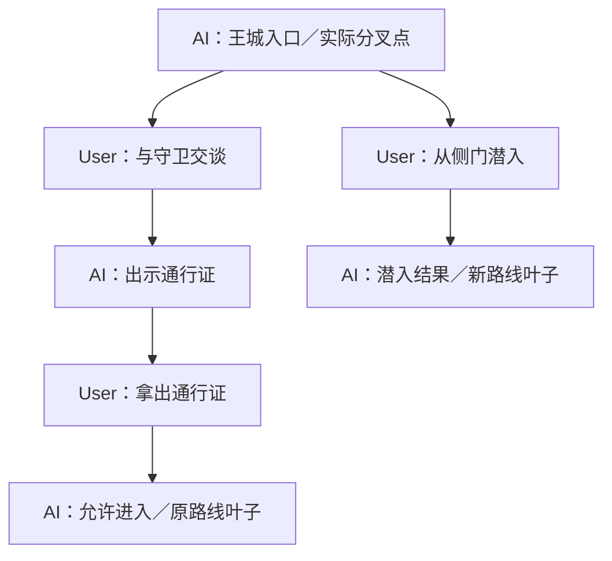

# 会话：Entry 树、历史分叉与消息操作

> 状态：目标领域设计，2026-11-01；分叉体验分期实现。返回[文档索引](../README.md)，实现约束见[存储](../technical/storage.md)、[Context](context.md)。

## 核心模型

**一个世界实例（Session）持有一棵完整的 Entry 树。** 每条从根节点到某个真实叶子节点的父子链都是可继续交互的故事历史；切换路径不新建世界实例、不复制公共祖先，也不改写其他分支。

- Entry 表示实际发生的用户消息（User）或 AI 消息（Assistant）。普通故事交互按 `AI → User → AI` 推进；开局可以是 AI 消息。
- **分叉点是已有用户消息的前一个 AI Entry**，但用户在**历史 User 消息**上发起「创建世界分叉」操作。真正的分叉由在该 AI Entry 后发送**另一条 User Entry**产生。
- 一个 AI Entry 最多有 **3 个直接 User 子节点**，即最多 3 条直接分支；其后代继续分叉，因此整个 Session 的叶子数量没有 3 条的总限制。一个 User Entry 最多有一个有效 AI 子节点。
- `active_leaf_entry_id` 保存用户最后明确选定、可以继续交互的真实叶子。**临时阅读另一条世界线不自动修改它**；Agent 生成、Context、压缩及未来记忆/状态按本次明确选定的实际交互路径工作。聊天阅读另有临时阅读路径，`seq` 只用于消息创建顺序，不代表分支归属。
- **分叉就是不同的真实用户输入**，不需要 `branch_options`、`fork_reason` 或单独 `branches` 表，也不保存未发生的剧情作为真实 Entry。

## 世界实例入口与会话页面

### 创建和进入世界实例

1. 用户从**世界卡库**进入某张卡的**世界实例列表**，可创建新实例，也可打开已有实例。首页可提供最近实例入口，但始终指向同一个世界实例。
2. 创建实例时选择已发布世界卡的开局、玩家身份及所需预设/模型配置。创建一局独立的 Session，复制世界卡发布快照；开局内容作为首个故事 Entry（通常是 AI 消息）。当前世界卡的后续发布不会自动改写旧实例。
3. 打开已有实例时优先恢复 `active_leaf_entry_id` 所对应的故事路径；如保存了该设备的阅读位置，则恢复该路径上的阅读锚点，否则滚动至最新消息。缺失有效叶子时展示开局或可恢复状态，不猜测历史其他分支。
4. 实例列表可展示标题、世界卡、最近访问/交互时间、当前叶子剧情摘要及真实世界线数量。**不同世界实例完全隔离历史**，一个实例的不同世界线则共享共同祖先。

### 聊天页面的基本布局

- **顶部**：返回实例列表、世界/实例标题、当前阅读世界线提示，以及「世界线」入口；可选提供搜索或更多设置。
- **中间**：一条世界线的连续聊天消息，从旧到新；AI 消息存在 ≥2 条实际 User 后续时显示分叉标记（如 `2/3`），点击可切换此处分支。没有分叉的普通消息保持清爽阅读。
- **消息操作**：User 消息提供编辑与「创建世界分叉」（在父 AI 合法、仍有空位时可用）；已保存的 AI 消息可编辑。仅当前**实际交互叶子**是 AI 且当前处于该可交互路径末尾时，允许 AI 重生成与续写。暂不提供删除消息。
- **底部输入**：普通发送时仅从已确认的交互叶子继续；历史分叉时显示明显的「从此处创建世界分叉」编辑状态与取消入口。AI 帮答只是提供候选文字，点击可填入并修改，**并非世界线选择**。
- 浏览其他世界线时，界面明确区分「正在阅读」与「正在继续交互」；输入区域提供「在此世界线继续」确认操作，不把浏览过程中的输入暗中发往另一条路径。即使正在查看当前交互路线上的旧消息，普通发送也只从**实际交互叶子**接续；建议先引导「回到最新」再发送，避免误以为消息会插在浏览位置。

## 从历史用户消息创建世界分叉

假设当前故事是：

```text
A1：你来到王城入口。
└── U1：我上前与守卫交谈。
    └── A2：守卫要求出示通行证。
        └── U2：我拿出通行证。
            └── A3：守卫允许你进入。
```

用户回顾历史，在 **U1** 上选择「创建世界分叉」：

1. 界面显示输入框。**仅进入分叉输入状态，不产生 Entry，也不修改当前历史**。
2. 用户自由输入新消息，例如「我绕开守卫，从侧门潜入」，并点击发送。
3. 服务端找到 **U1 的父节点 A1**，校验它是同一 Session 中已完成的 AI 消息、其直接 User 子节点数少于 3，创建新 User Entry `U4(parent=A1)`，随后正常调用 Agent 生成 `A5(parent=U4)`。
4. 保存完成后切换当前路径到新叶子 `A5`，可以继续 `U → A` 正常交互。原本的 `U1 → A2 → U2 → A3` **完整保留**。
5. 用户未来可回到 `A1` 的分叉处，选择原路线或新路线，打开该路线的真实叶子继续交互。

最终结构：



分叉基于**用户明确点击历史消息上的分叉操作**，不是默认输入行为。已经存在一条后续时，这条真实 User 路线自然占用一个名额：首次创建新分叉后为 **2/3**；第三条仍可创建，第四条禁止。三个名额按实际直接 User 子节点计算，不必预先规划、命名或创建待开启选项。创建分叉的内容不能与原历史合并，也不能替换原 User 消息。

若所选历史 User 的父节点不是已完成 AI Entry（如异常导入的根 User），不允许该操作并给出明确提示。生成失败后保留可恢复的用户输入和原始历史，重试不重复创建同一条 User 分支。

## 行动项与 AI 帮答：只是输入辅助

**行动项与世界分叉没有绑定关系。** 未来 AI 帮答可以基于当前上下文给用户推荐若干行动方向；用户可以忽略、点击填入输入框、修改后发送，或完全自行输入。

- 候选行动项不是历史消息，也不构成分叉点或分支规划；无需 `branch_options` 持久化表。
- 最终点击发送时，仅以**用户实际提交的文本**创建正常的 User Entry，随后按常规流程生成 AI 回复。无论输入来自用户手写还是 AI 帮答，Agent 看见的都是真实用户输入。
- 在历史处触发世界分叉，必须使用明确的「创建世界分叉」操作。**选择行动项本身绝不触发分叉**；在普通会话输入框里发送行动项只是普通发送。
- 不因行动项数量设定三条上限；**最多 3 条**只约束实际世界树上同一 AI Entry 的直接 User 子分支。

## 正常交互、重生成与 AI 续写

| 操作 | 允许条件和效果 | 是否创建世界分叉 |
| --- | --- | --- |
| 普通用户发送 | 在当前故事叶子处发送用户消息，再生成 AI 回复；与行动项来源无关 | 否 |
| 创建世界分叉 | 在历史 User 消息上发起，以它之前的 AI 为父节点，发送新 User 消息；校验最多 3 个直接子节点 | **是** |
| AI 重新生成 | **仅当前选中路径的最后一条消息是 AI Entry（真实叶子）**时允许；重新生成并替换该 AI Entry 的内容 | 否 |
| AI 续写 | **仅当前选中路径的最后一条消息是 AI Entry（真实叶子）**时允许；生成内容续接在该 AI Entry 中 | 否 |
| 编辑历史消息 | 用户可主动编辑已有 User 或 AI Entry 的内容；保留后代与分支关系，不自动重生成 | 否 |
| 删除消息 | **暂不支持**；含当前最后一条在内均不开放删除操作 | 不适用 |

重生成与续写只作用于**当前路径末尾的那条 AI Entry**，不创建新的 `AI → AI` Entry，也不通过复制 User 消息制造分支。流式输出、取消、失败/重试需保证原消息有可恢复内容；是否保留 AI 回复的修订审计记录由未来独立设计确定。用户要探索另一种历史发展时，应显式使用「创建世界分叉」而不是重生成历史 AI 消息。

普通发送不能绕过显式分叉操作，在一个已经存在后续的旧 AI 节点下隐式追加第四条路线；从当前路径的真实叶子继续发送则保持正常聊天行为。

## 编辑历史消息：允许用户主动改变已发生的叙事

允许用户**编辑任意已保存的历史 User/AI 消息正文**（生成中等不可安全编辑的状态应先结束操作）。这是用户明确发起的修改：

- **不重新生成任何后代消息**，不删除后代，不改变 Entry 父链、分叉数量或当前选中叶子。
- 编辑共同祖先会影响所有经过该节点的分支的历史文本。界面应提示「后续内容可能与修改后的剧情不一致」，如影响多条分支则进一步提示其共同祖先作用范围，但不阻止用户确认修改。
- 编辑后的内容用于下一次 Prompt、世界书触发、宏替换等 Context 读取；编辑之前产生的派生摘要、长期记忆或状态检查点若覆盖该消息且可能受其影响，应标记失效或重新计算，避免继续注入旧事实。未受影响的其他分支及其上游检查点不需要重建。
- 如果编辑的是用于分叉的 User Entry，该分支的展示摘要应反映修改后的正文；不额外维护需要同步的分叉标题或行动项快照。

**删除消息暂不开放**。删除单条消息、删除子树、公共祖先与跨分支副作用的处理方式留待将来独立设计，不在目前实现假设为已支持，也不以悄悄重连父子节点代替删除。

## 聊天阅读、全局世界线与消息定位

### 三类独立的导航状态

| 状态 | 含义 | 生命周期 |
| --- | --- | --- |
| `active_leaf_entry_id` | **实际交互叶子**：会话接下来允许写入和执行 Agent 的正式世界线终点 | Session 持久化；显式选择继续时或完成新分叉时更新 |
| `view_leaf_entry_id` | **当前阅读路径**：用于确定聊天列表上/下滚所经过的唯一历史链；可暂时与实际交互叶子不同 | 客户端阅读状态；可为空，直到用户选定下行路线 |
| `focused_entry_id` + `scroll_anchor` | **当前关注消息及阅读位置**：目标 Entry ID、像素偏移等；不代表世界线终点 | 客户端导航状态；可按设备按需缓存以恢复阅读位置 |

**阅读一条历史消息，不代表选择该消息作为 Agent 的执行终点**。切换世界线的阅读视角也不立即覆盖 `active_leaf_entry_id`。若用户从另一条世界线发起继续交互，须显式选择真实叶子并确认「在此世界线继续」；确认后再切换正式活动路径并定位到其底部。显式创建新世界分叉且发送成功是另一种合法切换方式。

### 聊天与全局世界线的职责

- **聊天界面**在阅读叶子明确时只展示 `view_leaf_entry_id` 的单条祖先链。首次进入以 `active_leaf_entry_id` 初始化阅读路径；若从跨分支跳转进入一个尚未确定后续叶子的共同祖先，则先只显示已确定的祖先和目标消息，等待下行分叉选择。当前阅读路径的历史消息可逐条定位、编辑和从历史 User 发起分叉。
- **全局世界线界面**展示当前 Session 的完整真实 Entry 树。默认呈现重要 AI 分叉点、直接 User 分支、各路径末端和剧情摘要；连续无分叉的长消息链按段折叠（例如「这一段包含 126 条消息」），可按需展开。移动端使用纵向层级与分支卡片，桌面端可扩展为可缩放画布。
- 每个 AI 分叉点的**实际直接分支数**由直接 User 子节点计算（最多 3）；全局真实叶子数可能远超 3。无需未开启的规划选项节点，也无需独立世界线表。
- 世界线中的叶子可直接打开对应聊天路径供阅读；若当前查看的是另一条路径，显示「正在阅读其他世界线」，继续交互需另行确认。分叉标记点击后显示直接 User 分支的内容预览及其后续叶子。

### 从任意消息跳转与跨世界线定位

- 用户可从全局世界线、搜索结果或分叉选择器，**定位任意真实 Entry**，而不仅限于叶子。定位后聊天直接呈现目标消息附近的窗口，滚动到目标消息并短暂高亮。
- 若目标在当前阅读路径上，保持 `view_leaf_entry_id`，仅改变 `focused_entry_id` 和滚动位置；若目标不在当前路径，则先切换临时阅读路径，不修改实际交互叶子。
- **一个消息可以是多条路径的共同祖先**。如果目标有多条可到达的真实叶子，且没有用户指定的阅读叶子，不应随意选“最新”分支：先允许阅读目标及其祖先，向下阅读到第一个不确定的分叉时再弹出分支选择；也可以先显示叶子选择器让用户一次确定路线。
- 若点击分叉点上的某条直接 User 路线，而其子树还有多个叶子，可以在入口处选择某个真实叶子，或继续阅读至下一处分叉再选；不能偷偷用某条默认路线替代用户选择。
- 点击消息只影响**阅读定位**；点击某个真实叶子也可以先只用于阅读。明确选择「在此世界线继续」才更新正式交互叶子并回到底部。

### 上下滚动与分叉相遇

**滚动是沿一条已确定的历史路径移动，不负责自行决定故事走向。**

1. **初始加载**：打开实例时以实际交互叶子作为默认阅读叶子，读取最近一页祖先消息，正常倒序查询、正序显示；建议初期每页约 30 条，可根据真实性能调整。
2. **向上滚动**：沿当前目标消息的 `parent_entry_id` 链向祖先加载更早的一页，不存在分叉歧义。追加到列表顶部时保持原有可见消息的锚点及像素偏移，避免视觉跳动。
3. **向下滚动，已选阅读叶子**：只加载该叶子祖先路径上、位于当前消息之后的后续消息。即使经过有 2/3 或 3/3 标记的 AI 节点，也**不断滚、不自动弹窗、不切换另一条世界线**；仅在消息上保留可点击的分叉入口。
4. **向下滚动，尚未确定阅读叶子**：如果一个节点只有唯一真实后续，可以直接展示；当遇到拥有多条直接 User 子节点的 AI 分叉点时，停止自动向下加载，在该处显示「选择后续世界线」。用户选定路线或具体叶子后继续下滚；不把兄弟分支消息混排。
5. **主动点击分叉标记**：打开此处的分支选择器，展示每条直接 User 输入摘要与后续进展。选择其他阅读路线时，尽量将当前位置锚定在同一共同 AI 分叉点，替换之后的消息窗口，而不是突然跳转到另一条线的末尾。
6. **到达阅读叶子**：下滚停止；提供「回到最新」快速定位当前阅读路径末尾。只有实际交互叶子上的 AI 生成正在进行、且用户已经停留在底部时才自动跟随新文本；用户在读旧消息时不强制滚到底部，可显示「有新内容」入口。

**历史消息的任意跳转不能通过一次次从末尾翻页实现。** 聊天需要「围绕目标 Entry 的附近窗口」能力：进入时直接读取目标前后少量消息并聚焦，随后上/下双向游标分页。若目标后续路径尚不明确，可以先读目标及祖先，直到用户选择下行方向。分页遵循固定的阅读路径，不使用全实例 `seq` 拼接“较新消息”。

移动端长篇聊天使用基于稳定 Entry ID 的虚拟列表，优先保证文本/图片异步加载后的视觉锚定；切换阅读路线时清理旧路径的分页游标，防止把另一条世界线的后续消息拼接进来。具体查询约束见[存储与 API 草案](../technical/storage.md)。

### 典型用户流程

| 触发 | 交互过程与结果 |
| --- | --- |
| 打开已有实例 | 恢复实际交互叶子作为阅读路径；恢复设备阅读锚点或默认最新消息 |
| 阅读旧消息 | 上/下滚只是浏览；不会更换交互叶子，也不会运行 Agent |
| 点开世界线页 | 查看真实分叉与折叠长链；点击某条消息后回到聊天并在对应位置高亮 |
| 在共享 AI 祖先下滚 | 若已选阅读叶子则无感经过；若无明确叶子，遇多路后续时选路线 |
| 在分叉点点击其他路线 | 临时改变阅读路径并保留附近位置，正常阅读；想继续交互时再确认切换 |
| 在另一条世界线继续 | 选真实叶子 → 点击「在此世界线继续」→ 更新实际交互叶子 → 回到末尾并开放发送 |
| 从历史 User 创建分叉 | 打开专用输入状态不改历史；发送时新增父 AI 下的 User 分支，生成后切换到新叶子 |
| 编辑历史消息 | 当前正文更新、后代保留、受影响的摘要/记忆/状态缓存失效；不自动生成 |
| 末尾 AI 重生成或续写 | 只更新当前实际交互叶子的 AI Entry，不新建分支；删除操作不提供 |

## 与 Agent、世界卡和压缩的边界

- 选中叶子的 **有效历史 = 全部祖先 + 叶子本身**。世界卡同步只更新实例的世界 JSON 和 `source_world_version`，不改写 Entry 树。
- 压缩是派生 Context，不替代完整原始历史；仅复用当前路径上祖先锚定的有效检查点。编辑历史消息时按前述规则失效受影响的派生信息，见 [Context](context.md)。
- 工具调用等 Agent 内部执行事件不强制变成用户可见的 Entry；需要保持可恢复、可检查且与对应故事消息关联。切换分支不代表外部工具副作用自动回滚。

## 验收重点

- 从历史 U1 发起分叉，实际新增 `parent=U1.parent(A1)` 的 U4 与后续 A5；原路径完整保留。打开输入框但取消不创建 Entry。
- A1 原有 1 条后续，新分叉后显示 2/3；最多可到 3/3，第四条被拒绝；嵌套分叉的总叶子数可以大于 3。
- AI 帮答行动项直接填入并发送是普通用户输入，不创建分叉或候选历史。
- 只有当前路径末尾 AI 可以重生成或续写，两者都不增加树节点或分支。
- 修改历史 AI/User 消息后，所有后代保留并继续展示；公共祖先修改不会污染不相关路径，但受影响的 Context 摘要会失效。
- 不提供删除消息功能；从任意叶子分页恢复、分叉切换以及失败重试不丢历史、不串分支。
- 从实例恢复已选路径；跨分支跳转任意消息并围绕消息加载窗口；上滚不跳动、下滚沿已选路线不受分叉打断，未知路线到多路分叉时才选择；阅读其他世界线不暗中修改实际交互叶子。

**仍待专项设计：** 分支/消息删除、历史编辑的审计与冲突处理、超大树交互、工具副作用隔离。详细事务与接口见[存储](../technical/storage.md)。
