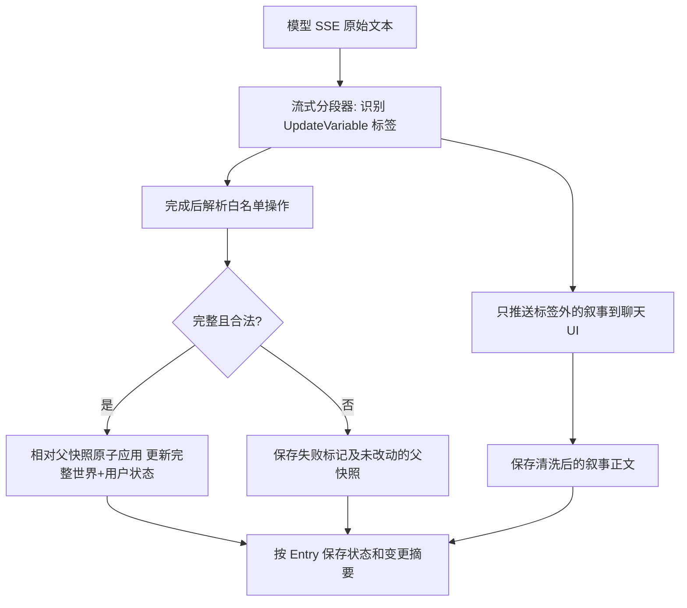

# MVP 状态：一次叙事输出、MVU 风格更新与独立渲染

> 2026-11-02 目标设计，尚未实现。参考[MVU 研究](../../data/MVU-状态机制研究.md)，世界状态及世界卡角色字段定义见[世界卡](world-card.md)，消息持久化见[存储](../technical/storage.md)。**借鉴 MVU 的文本包裹与命令思路，不宣称完整兼容 MVU 插件脚本。**

## 首期只做一个模型请求

当世界卡 `data.state` 或本局从该世界卡选中的 `user` 角色定义了状态字段时，预设 `worldState` 节点必须启用（否则生成前报配置错误），叙事模型**同一轮**输出正文和末尾的 `<UpdateVariable>` 标签；不额外调用变量解析模型。`worldState` 预设槽由引擎提供本世界线最新有效状态、字段描述/规则及简洁的更新格式要求。世界书可锚定 `worldState` 的前/后位置，但只将内容合并进这一条 Prompt、继承 `worldState` 的角色；不能单独指定角色、改写状态或重排预设节点。没有任何状态字段时不强制要求该标签。

```text
月光下，守卫收下三枚金币，将通行证递还给旅人。

<UpdateVariable>
_.add('user.金币', -3); // 支付通行费
_.set('world.当前时段', '夜晚'); // 故事明确进入夜晚
</UpdateVariable>
```

此处 `world` 是 `data.state` 的运行值，`user` 是**本 Session 选中的世界卡角色**的 `character.state` 运行值；均为字段平铺映射。路径在第一个 `.` 处分割命名空间，其后是**完整的字段 ID**，字段名本身可包含 `.`；数组/对象内部成员通过具体操作参数定位，不把原始模型文本当 JavaScript 代码执行。

- **支持五种 MVU 风格命令名**：`_.set(path, value)`、`_.add(path, delta)`、`_.insert(path, ...)`、`_.delete(path, ...)`、`_.move(path, ...)`，语义沿用[世界卡](world-card.md)已经定义的操作边界；数组/对象成员参数精确定义需在实现解析器时形成测试用例。支持明确的字符串/数字/布尔/数组/对象等数据字面量及 `//` 原因注释。**只做白名单语法解析与确定性执行，禁止 `eval`、`Function`、任意脚本、网络/文件访问**。
- 一个回复**最多一个**末尾更新块；正常情况下无状态变化时建议输出空 `<UpdateVariable></UpdateVariable>`。模型没有输出标签时，按**本轮无显式更新**保存继承后的完整快照，但记录 `missing_update_block` 提示模型可能漏更；**不能保证语义完整性**。重复标签、无闭合标签、非法命令/路径/类型视为状态结算失败，不部分应用。
- Opening 根消息不额外请求状态分析：直接以世界卡 `data.state` 默认值加 Opening 差异初始化 `world`，以选中世界卡角色的 `state.initial` 初始化 `user`，保存完整快照；新的世界线从分叉父 AI 的快照继承，绝不从其它路线或外部身份来源重读。
- User Entry 仅继承父节点完整状态。AI 回复模型完成后先从原始输出提取块，**从展示文本和后续模型历史中移除块**，再以父 User 快照执行合法更新，保存本条完整状态快照；没有变化也冗余保存。更新必须绑定本条文本修订/父状态修订，重生成不能重复 `add`。

## 分流和存储（原始与叙事分开）



1. **流式**：以增量缓冲识别可能跨 token 拆开的 `<UpdateVariable>` 开标签，在确认标签前保留有限长度的尾部候选片段，避免把 `<Upd` 等半截标签闪到 UI。识别到起始标签后不再向聊天正文推送该块及其内容；完整回复结束后严格校验闭合与末尾位置。需设块长度上限并处理意外断流。
2. **持久化**：`entries.content` 是**纯叙事**，默认聊天展示和下一轮 `chatHistory` 均取此字段。另存 `raw_content`（原始模型输出，供调试/重新解析，不默认回注模型）、`state_update_text`（原始标签块，可选）、`state_snapshot_json`（`{"world": {...}, "user": {...}}` 完整快照）、`state_status` 与可选变更摘要。**不得**把命令作为可见消息或下一轮历史重复注入。世界/用户状态的字段定义来自本 Session 的世界卡快照及选中角色定义快照；结果运行值只存在 Entry 快照中。
3. **异常**：格式错误或不支持的操作不允许静默写入部分状态，叙事正文仍保存且可见，状态标记 `failed` 并保留父快照作诊断，**不能把该继承值当作已结算状态**。MVP 允许用户对当前末尾 AI 重新生成，或明确选择「忽略本次状态更新、按父状态继续」（记录用户确认）后标记已结算；不得后台自行重试一次模型却造成双倍消耗。未输出标签属于非阻塞的缺失提醒，不等于解析失败。
4. **历史编辑**：编辑 AI 叙事正文不会自动生成新的命令；相关自身及后代状态变 `stale`，直到显式修复/确认，不以旧快照冒充新剧情。世界卡发布新版本或修改角色字段时不偷偷改写已有实例的世界/选中角色定义快照。

## 状态渲染：与叙事消息解耦

**默认不把状态面板插入每条 AI 回复正文，更不依赖角色卡提供 HTML/JS。**

- **聊天顶部「状态」入口**：一条精简入口可显示少量摘要/变更提示；点击打开状态面板。移动端为底部抽屉，桌面端为右侧面板。固定分为「世界状态」和「当前所扮演角色状态」两组，按字段名/值展示 JSON 的基础类型、列表和对象（复杂内容可折叠）。
- 状态面板始终显示**当前活动叶子的最新有效快照**并标识其 Entry 来源、更新时间；**向上滚动阅读旧消息不会改变面板状态**，切线后立即读取新叶子的快照。缺失/失败/stale 状态显示明确警告而不是编造最新值。
- AI 消息下方可用低干扰的「状态变化 2 项」折叠入口显示该条变化摘要；无变化时默认不占空间。状态面板与变更信息**由结构化数据渲染**，绝不将 `raw_content` 或 `<UpdateVariable>` 原样显示为正文。
- 调试模式可查看原始文本、解析错误与合法操作列表；MVP 不提供世界卡自定义状态栏脚本、任意 HTML、复杂 EJS、可执行插件或可视化状态编辑器。

## 最小验收

- SSE 标签分块、不完整标签、模型中断及一个完整尾块；界面始终只显示正文，原始内容可追溯。
- 空块/缺失块都保存完整冗余快照，后者有明确告警；合法 `set/add` 原子应用，非法命令不污染部分状态；完整五种操作应在实现前确定参数测试。
- 世界线 A 的世界/用户状态变化不污染 B；世界卡角色的原始定义不会被会话叙事改动；切叶子后状态面板立即更新。
- 更新失败不冒充状态无变化，下一轮不能静默使用失败快照；避免重复执行 `add`。
