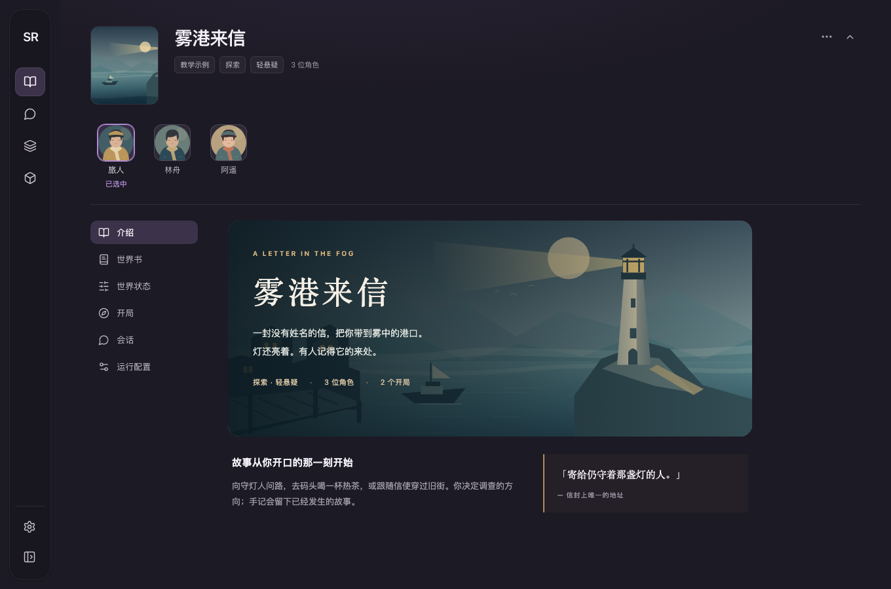
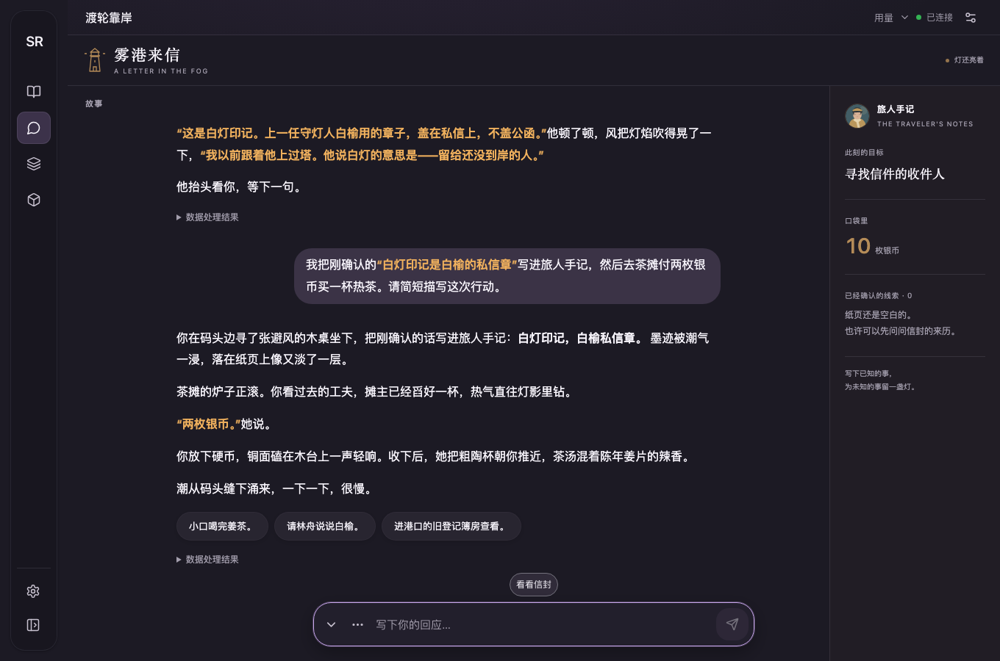

# 快速体验

完成本页后，你会进入《雾港来信》，选择旅人身份，并发出一次行动。模型连接和首次安装所需时间取决于你的环境。

[文档首页](README.md) · [制作第一张卡](creator/first-world.md)

## 1. 启动 SR

准备 Node.js 22.19 或更高版本，以及 pnpm 10.12.1。获取仓库后，在根目录执行：

```sh
pnpm install --frozen-lockfile
pnpm dev
```

打开 [http://127.0.0.1:5176](http://127.0.0.1:5176)。终端需要保持运行。按 Ctrl+C 会停止这次启动的服务。

成功时你会看到世界卡、会话、预设、模型与设置入口。首次启动会安装「标准叙事」和「小饭馆」。如果启动失败，保留终端错误并查看[运行与调试](runtime/local-development.md)。

## 2. 配置模型

进入「模型」页面，添加你已有的模型服务配置，填写该服务要求的接口地址、模型标识和 API Key。使用页面的连接测试确认配置可用，再设为默认模型。

进入设置或创建会话时，确认选中了可用模型与「标准叙事」预设。世界卡定义作品内容；模型配置提供生成能力；预设组织叙事所需的上下文。

API Key 属于你的运行配置，不需要放进世界卡或交给作品作者。界面截图和可分享文件中也不要包含它。

## 体验雾港来信

### 3. 准备示例包

可以直接下载[《雾港来信》示例 ZIP](../examples/worlds/packages/fog-harbor.zip)。如果想确认源码与导出流程，另开一个终端，在同一仓库根目录执行：

```sh
pnpm world:check examples/worlds/fog-harbor
pnpm world:pack examples/worlds/fog-harbor
```

生成的文件为 `examples/worlds/fog-harbor.zip`。检查命令会报告格式、声明资源和组件依赖问题；它不替代浏览器试玩。重复打包时，工具会拒绝覆盖已有文件；可用 `--out /你的路径/新版本.zip` 指定另一个输出位置。

如果只想先体验最小纯文字世界，也可以直接导入 `examples/worlds/minimal/world.json`，无需打包。[两个示例的区别](../examples/worlds/README.md)

### 4. 导入并选择开局

在「世界卡」页点击导入，选择刚生成的 ZIP。进入《雾港来信》详情，你可以查看介绍、角色、世界书和状态定义。

选择可扮演的「旅人」，在开局中选择「渡轮靠岸」，点击创建会话并确认模型和预设。创建成功后会进入会话页面。

世界卡中的介绍组件展示作品，开局正文开启会话；只查看介绍不会调用模型。



### 5. 发出第一次行动

输入一次明确的行动，例如：

```text
我拿出信封，向林舟询问灯塔印记的含义，并记下得到的线索。
```

点击发送，或使用 Cmd+Enter。输入框中的普通 Enter 用于换行。等正文生成完成，检查旅途面板中的线索和当前目标。

示例初始有 12 枚银币、空线索列表，以及“寻找信件的收件人”的目标。具体叙事由你选择的模型生成，得到的线索措辞可能不同；应以故事已经发生的事实为准。

接着尝试一次容易核对的变化：

```text
我去码头的茶摊，付两枚银币买一杯热茶。请简短描写这次行动。
```

当正文确认交易完成，且模型提交了有效的 `coins` 更新时，面板应从 12 变成 10。文档录制中已完成这一变化，并显示了下一步行动建议。模型提到新线索却没有提交有效更新时，线索列表仍可能为空；请按下文排错，而不要把正文与状态视为天然同步。



### 6. 确认这张卡已经跑起来

- 正文区域有开局和本轮回复。
- 人物回应与世界设定相符。
- 实际买茶并成功更新状态后，面板显示 10 枚银币。
- 获得线索时，核对是否有有效的状态更新；成功保存后，面板与后续故事才能读取它。
- 有行动建议时，点击建议会填入草稿，仍由你决定是否发送。
- 刷新后，已保存的对话与状态仍然可见。

如果正文正常但状态没变化，先看[状态排错](creator/troubleshooting.md)。模型可能没有输出有效变化，规则也可能需要写得更明确。

## 下一步：改出自己的版本

在[第一张世界卡](creator/first-world.md)中，你会复制最小模板，修改名字、人物和开场，再导入自己的作品。

已有酒馆卡时，从[迁移指南](creator/from-sillytavern.md)开始。想让 Agent 动手时，使用[Agent 创作指南](creator/agent-authoring.md)。

## 手机体验与部署

同一局域网内的手机，可以打开启动终端显示的「Web 主站」局域网地址。主机需要允许 5176 和 5177 两个端口，主站与舞台共同构成作品界面。只在可信网络使用本地管理服务。

服务器部署请阅读[单机部署](../deploy/README.md)。数据目录、备份与来源配置见[本地运行说明](runtime/local-development.md)。
