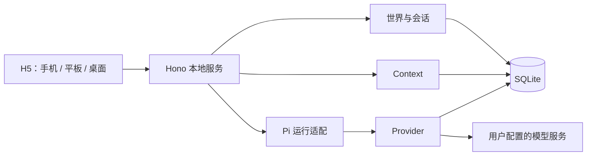
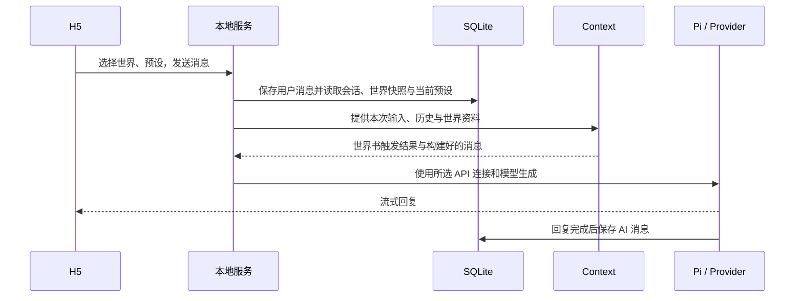

# 本地运行时与 SQLite 数据设计

> 状态：MVP 技术方案草案，2026-11-01；尚未实现。产品范围以[产品设计](product-vision.md)为准。
> [文档索引](READE.md) · [世界卡设计](world-card-design.md) · [Context 产品设计](prompt-construction-design.md)

## 1. MVP 目标与技术方向

MVP 支持：加载和管理世界卡、管理预设、配置 API 连接、加载世界书和预设进行聊天。聊天记录可保存并重新打开，界面适配移动端。长期记忆、状态跟踪、世界树分叉、资源管理和云同步不在 MVP 实现范围。

- 前端：React + Vite + TypeScript，移动端优先的 H5。
- 本地服务：Hono + TypeScript，负责 API、Context、Provider 和数据读写；正式运行提供构建后的静态页面。
- 数据：SQLite 存储结构化信息，世界卡及预设可以使用 JSON 导入导出。
- 运行时：以最小化 Pi Coding Agent 为接入目标，Context 和 Provider 独立。先验证 Pi 公开接口能否满足本方案，再确定接入方式。

SQLite 是应用持久化数据的唯一权威来源；Pi 的运行时对象或缓存不能成为另一份独立事实来源。手机访问电脑上的本地服务时，电脑需要运行且网络可达。

## 2. Pi 最小接入的前置验证

目标为 `@earendil-works/pi-coding-agent`，只扩展**会话持久化和 Agent 执行前的消息构建**。不开启 coding tools、自动发现的技能与扩展，也不在 MVP 提供工具调用能力；是否能通过固定版本的公开配置做到需要实测。

[Pi Coding Agent SDK](https://github.com/earendil-works/pi/blob/main/packages/coding-agent/docs/sdk.md) 中，SessionManager 管理会话树与有效上下文。不能假定简单修改内存消息就改变最终请求，也不能假定内存 SessionManager 支持从 SQLite 任意无损恢复。

实现前验证：① SQLite 会话保存和恢复能否通过公开接口完成；② Context 构建结果能否以正确顺序进入最终模型请求，包括用户消息后的资料；③ 独立 Provider 能否配置模型、地址和凭据并支持流式与取消；④ 默认工具、资源发现和自动压缩能否关闭；⑤ 长会话是否能够只加载所需消息。

验证失败时记录限制并停止声称该方案可用，不依赖未公开 API，也不以 SQLite 与 Pi 默认会话文件双写充当两份权威数据。后续替代路径需重新讨论。

## 3. 模块与运行流程

| 模块 | 职责 |
| --- | --- |
| 世界卡 | 加载、创建、编辑、发布、搜索与实例快照 |
| 预设 | 创建、编辑、导入导出；生成时读取唯一当前配置 |
| Provider | 管理 API 连接、凭据、选中的模型及模型请求 |
| Context | 根据实例、世界卡、世界书、预设和历史构建消息；不依赖 Pi 内部消息结构 |
| 会话 | 保存用户和 AI 消息，提供当前会话的顺序读取与分页 |
| Pi 适配 | 将 Context 和 Provider 接入固定版本 Pi，处理生成与流式结果 |
| 存储 | 统一处理 SQLite 读写、事务和迁移 |

每次生成读取预设当前值；生成进行中编辑预设只影响下一次生成。API 密钥不写入消息、预设或世界卡。Context 只读取本次会话的可用资料，解释命中、插入顺序与预算结果。

消息先保存用户输入，再开始模型请求；失败或取消时保留用户输入并可重试。流式回复完成后保存完整 AI 消息；中断状态和错误需要向用户提示。外部模型请求期间不持有 SQLite 写事务。

## 4. 数据表设计原则

- 所有表均**不设计数据库外键**。引用关系由应用在事务中检查，数据库不执行级联删除。
- 稳定 ID 使用 TEXT；时间使用 UTC 毫秒整数。字段中的 JSON 使用 TEXT 保存并验证格式。
- 查询和唯一性使用主键、唯一索引和普通索引；不因没有外键就省略引用校验。
- JSON 用于世界卡和预设等完整定义；消息独立存储，避免每轮重写完整会话。
- 表结构与 SQLite 驱动尚未确定，以下是 MVP 逻辑表设计，不是已执行的 DDL。

### 4.1 世界与会话

| 表 | 字段 | 用途 |
| --- | --- | --- |
| `worlds` | `id` 主键、`name`、`draft_json`、`published_json` 可空、`version_major` / `version_minor` / `version_patch` 可空、`created_at`、`updated_at`、`published_at` 可空 | 世界当前编辑内容和唯一最新发布内容；不保存历史发布版本 |
| `sessions` | `id` 主键、`world_id`、`title`、`world_snapshot_json`、`source_version_major` / `source_version_minor` / `source_version_patch`、`preset_id`、`created_at`、`updated_at` | 一条记录是一局世界实例/会话；保留创建或同步时的世界内容 |
| `entries` | `id` 主键、`session_id`、`seq`、`role`、`content`、`status`、`created_at` | 当前会话内的一条用户或 AI 消息；`(session_id, seq)` 唯一，用于顺序和游标 |

世界首次发布版本为 `0.0.1`，之后由用户手动输入严格递增的三段数字版本。发布更新 `published_json` 与版本；创建会话复制最新发布内容和版本。编辑或发布不自动改变已创建的实例。版本不同的实例可以由用户选择并手动同步；具体差异处理与冲突交互另行设计，不能覆盖聊天历史。

MVP 的 `entries.role` 只要求用户/AI 消息；`status` 至少区分完成和失败/中断等实际需要的状态。导入原始角色卡数据单独保留时，不视作已转换完成的世界内容。

### 4.2 预设与 API 连接

| 表 | 字段 | 用途 |
| --- | --- | --- |
| `presets` | `id` 主键、`name`、`api_connection_id`、`config_json`、`created_at`、`updated_at` | 配置上下文长度、温度、惩罚项、Top P、帮答、续写、自建提示词及编排顺序；只保存当前配置 |
| `api_connections` | `id` 主键、`name`、`platform`、`base_url`、`credential_ref` 可空、`model_id`、`created_at`、`updated_at` | 一条 API 连接包含名称、模型平台、地址、凭据引用与选中的模型 |

参考界面：用户创建连接时填写名称、选择模型平台、配置 API 密钥、选择模型。模型列表由项目配置文件或内置列表提供，允许搜索和直接输入模型 ID；不建立独立 `models` 表，也不假设模型列表是实时或完整的。平台与自定义地址的默认规则在 Provider 详细设计中确定。

预设通过 `api_connection_id` 选择连接，模型由该连接的 `model_id` 指定；同一平台若需不同模型或凭据，可创建不同连接。删除连接前检查预设引用，提示并要求解除或重新选择；不存在的模型 ID 可保留供编辑，连接失败时明确提示，不静默更换。

`credential_ref` 用于指向本地服务管理的凭据，具体安全保存方式须在实现前确定。API Key 不放在 `config_json`、世界卡或普通导出中；接口默认不回显密钥。

### 4.3 通用标签

| 表 | 字段 | 用途 |
| --- | --- | --- |
| `tags` | `id` 主键、`target_type`、`target_id`、`name`、`name_key`、`created_at` | 一条记录表示一个对象拥有一个标签；按类型和对象查询 |

`target_type` 表示标签归属对象类型，例如 `world`；未来可扩展 `character`、`scene`、`session`。角色、场景属于世界卡内部对象时，其全局标识规则需先明确，不能假定卡内 ID 全局唯一。唯一索引建议为 `(target_type, target_id, name_key)`，并建立 `(target_type, name_key, target_id)` 查询索引。

此表直接存放对象与标签的对应关系，不另建标签定义表。世界卡 JSON 的标签用于导入导出；数据库标签作为列表搜索索引，保存世界卡时由同一事务更新。修改方式和大小写归一化规则需要统一，避免数据不同步。标签不自动成为关键词或 Prompt。

### 4.4 迁移记录

| 表 | 字段 | 用途 |
| --- | --- | --- |
| `schema_migrations` | `version` 主键、`applied_at` | 数据库结构迁移记录 |

MVP **不设计** `world_assets`、`entry_attachments`、`models`、`memories`、`state_checkpoints`、`branches` 或 `runs` 表。世界卡中的资源引用可以保留，但资源文件管理不在本表设计范围。

## 5. 分支与记录：是否过度设计

相对于当前 MVP，之前同时设计 `branches`、有父链的 `entries`、`runs`、记忆和状态快照，确实超出了聊天闭环所需。MVP 先用 `sessions + entries` 表达单条线性会话，以会话内递增 `seq` 读取和分页；不会宣称已经实现世界树。

未来世界树仍需满足：仅用户可见、已完成的 AI 消息可作为分叉点；切换分支只读取对应路径；未来记忆和状态也按分支隔离。届时再设计父子关系、分支头与迁移；不能用全会话 `seq` 大小直接判定分支归属。是否增加 `branches` 表、如何组织 Agent 多步记录，以分叉产品设计和 Pi 验证结果为依据，不预先固定。

因此 MVP 的线性 `entries` 并不保证未来分叉无需迁移。世界实例就是会话的产品概念保持不变，扩展世界树时不要求复制或删除既有故事。

## 6. 一致性、索引和分页

主要索引：`entries(session_id, seq)` 唯一；`sessions(world_id, updated_at)` 用于世界下的实例列表；`tags(target_type, target_id, name_key)` 唯一以及标签搜索索引。主键和索引不属于外键。

所有引用由服务层校验：写入消息前确认会话存在；创建会话时确认世界已发布、预设和 API 连接可用；修改或删除世界、预设、连接和对象标签时检查相关引用并采取用户可见的保留、解除或拒绝策略，不留悬空引用。多项关联写入在短事务中完成；并发更新使用事务和应用层冲突检查。禁止用数据库外键或级联删除替代这些规则。

打开会话只查询最新一页，使用 `(session_id, seq)` 获取更早的消息；界面与 Context 分别读取需要的范围。会话内每次新增消息须在事务中获得唯一递增 `seq`。SQLite 分页不自动解决浏览器渲染：H5 同时限制渲染数量并保持上滑位置。

## 7. API 与移动端

接口命名仍为草案：世界卡、会话及消息、预设和 API 连接各有增删改查接口；生成接口提供流式结果和取消；Context 检查接口可预览资料命中及最终消息。MVP 不提供分支 API、记忆 API 或状态 API。

H5 支持软键盘、安全区和手机窄屏；分页展示不要求加载完整历史。服务默认仅监听本机；局域网访问是用户明确开启的能力，开放前需具备访问控制及来源校验。

## 8. 备份、验证与回退

数据库位于独立数据目录，不覆盖世界卡原始素材。迁移失败停止写入并保留原库；数据库一致性备份使用 SQLite 备份能力或经过验证的快照，避免只复制运行中的主文件。普通导出不包含 API Key。

MVP 验证：导入或创建世界卡、编辑发布、创建会话、选择预设和 API 连接、发送消息时世界书生效、流式回复保存、刷新后恢复、分页读取旧消息。测试无外键条件下应用层引用检查、并发序号、删除保护、失败和中断；测试预设更新只影响后续生成。目标设备上测量大约 1,000 轮会话的打开、分页和内存，实际指标以测试结果为准。

Pi 接入、迁移、Provider 和存储改动应可以在备份后回退；不能因回退覆盖或删除已有聊天。世界树、记忆和状态的设计与测试在后续阶段单独安排。
