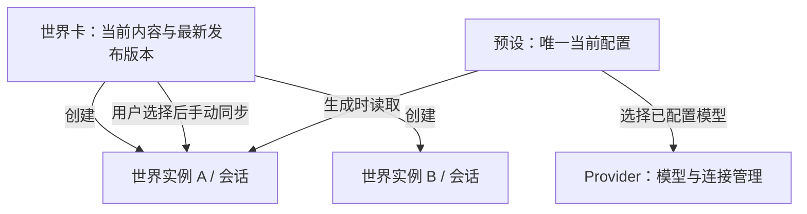
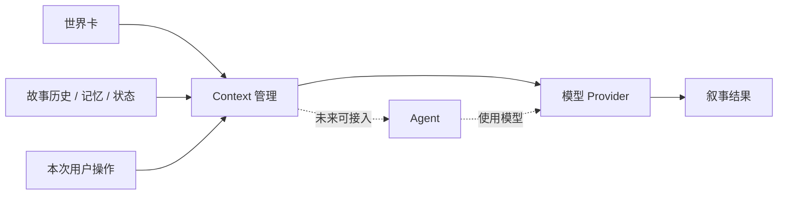

# SillyRealms 产品设计

> 状态：产品方向，2026-10-31。本文描述当前目标与未来探索，不代表相关能力已经实现。
> [返回文档索引](READE.md)

## 产品定位

SillyRealms 是一个**以世界为核心，具备叙事、记忆和状态能力的可持续交互 LLM 前端**。

用户选择世界与参与方式，通过自己配置的模型推进故事；世界中的叙事历史、记忆和需要精确跟踪的状态共同支撑持续互动。叙事是基础体验，记忆和状态按玩法需要使用，不要求每个故事都成为数值化模拟。

核心体验：**选择世界 → 选择开局与参与方式 → 持续互动 → 查看或调整故事 → 继续**。重生成和分支属于后续体验设计。

## 当前产品形态

- **本地前后端应用**：用户运行本地服务管理数据并连接模型，浏览器提供交互界面；不依赖 SillyRealms 云端服务。
- **H5 优先**：首先面向浏览器设计和验证。
- **移动端优先适配**：从产品和界面设计阶段考虑手机使用，同时支持平板和桌面浏览器。
- **本地优先**：世界卡、故事记录和用户配置以用户设备上的数据为基础；导入、导出和备份方式需另行设计。
- **模型由用户选择**：用户配置可访问的模型服务及参数；不同服务的连接条件和能力可能不同。

模型推理可以由用户配置的远程服务完成。手机通过局域网访问电脑上的服务时，电脑需保持运行；未来独立原生 App 的运行方式另行设计。

## 核心能力

| 能力 | 产品职责 |
| --- | --- |
| 世界 | 管理世界卡中的场景、角色、开局和世界资料，作为互动内容的基础 |
| 叙事 | 使用模型生成故事，支持连续对话、续写、重生成和故事分支 |
| 记忆 | 保存和调用有助于长期连贯的摘要与持续事实；具体策略另行设计 |
| 状态 | 按需跟踪和调整需要明确记录的内容；简单故事可以不配置状态 |
| Context | 根据当前世界、本局选择、历史、记忆与状态，组织本次交给模型的上下文，并能检查来源与结果 |
| 模型连接 | 让用户配置模型服务，处理请求、流式回复和连接错误 |

## MVP 目标

MVP 先完成一个可持续聊天的最小闭环：

- 加载、创建、编辑和发布世界卡。
- 创建并打开世界实例，保存和读取聊天记录。
- 创建和管理预设，选择已配置的 API 连接及模型。
- 配置模型平台、API 地址、密钥和模型，能够连接用户选择的模型。
- 聊天时根据世界卡加载世界书，结合当前预设构建上下文并获得模型回复。
- 提供移动端优先的 H5 使用体验。

MVP 不实现长期记忆、状态跟踪或世界树分叉，也不建设资源管理模块。它们仍属于后续方向；现阶段不因未来能力提前扩大数据库设计。世界实例仍是一局会话。

## 世界卡与世界实例

世界卡定义一个世界的内容，包括角色、场景、开局和世界资料。世界实例就是一局独立的会话，拥有自己的故事历史、记忆、状态和分支；不同实例之间的故事互不影响。

世界卡维护当前编辑内容和最新发布版本，不提供世界卡历史版本管理。首次发布版本为 `0.0.1`；用户修改内容后，可以手动输入并发布更高的版本，例如 `0.1.0` 或 `1.0.0`。版本由三个数字部分组成，按数字部分依次比较，新版本必须严格大于最新发布版本。

创建世界实例时，使用世界卡的最新发布版本，并保留本实例所需的内容及其版本号。后续编辑或发布世界卡不会自动改变已有实例。客户端通过比较版本号标识可同步的实例；用户可以选择具体实例，查看变化后手动同步。实例保留创建或上次同步时的内容，不等于提供可浏览的世界卡历史版本。

世界卡尚未发布时如何保存草稿，以及同步中内容删除或实例自身改动发生冲突时如何处理，留待世界管理详细设计；同步不得默认抹除已发生的剧情、记忆或状态。

## 预设与 Provider

**预设**是可复用的生成和提示词配置，包含已配置的模型选择、模型上下文长度、温度、存在惩罚、Top P、帮答、续写指令、自建提示词条目及 Prompt 组装顺序等。

每个预设只维护一份当前配置，不提供历史版本或对实例的版本同步。世界实例选择预设后，在每次生成时读取该预设的当前配置；编辑预设会影响使用它的实例的下一次生成，已发生的消息不会因此改写。

**Provider** 是独立的模型管理模块，负责配置模型服务、服务地址、API Key 和可用模型。预设从已配置的 Provider 中选择模型，以引用方式保存选择，不重复保存 API Key。所选模型被删除或不可用时，应提示用户重新选择。

预设与 Provider 的详细配置、模型能力差异、实例是否允许临时覆盖预设，以及覆盖后的生效顺序，留待对应模块设计。

## Context 与执行方式

Context 是独立的产品能力，负责**选择、组织和解释本次互动所需的信息**。它不绑定特定 Agent 框架或模型服务：

当前技术方向为独立 Context、独立 Provider 和 Pi Coding Agent 最小运行时；Pi 的 SQLite 持久化与执行前消息构建需通过固定版本验证。Context 不依赖特定 Agent，具体接入见[本地运行时技术设计](local-runtime-technical-design.md)。

## 未来方向

未来可能支持云端部署，使世界及其持续互动能力可以被不同设备、不同 Agent 使用，并在用户允许的范围内延续叙事、记忆和状态。

这是产品方向，不表示现在已有云服务、跨设备同步、多端一致性或任意 Agent 兼容。账号、授权、数据归属、接入方式、同步冲突及部署形态都需要后续单独设计。云端能力的探索不将当前本地服务改为必须依赖云端。

## 范围与后续设计

现阶段优先围绕移动端 H5 的持续叙事体验，设计世界卡、Context、模型连接和故事数据如何配合。安卓及其他原生客户端、Agent 集成和云端部署是后续可能的产品形态，不预设共享框架或实现路径。

世界卡详细结构见[世界卡设计](world-card-design.md)，当前 Context 和 Prompt 的产品逻辑见 [Prompt 构建设计](prompt-construction-design.md)。目录外的旧版产品构思保留为历史参考；涉及产品定位、客户端形态和 Agent 方向时，以本文为准。
