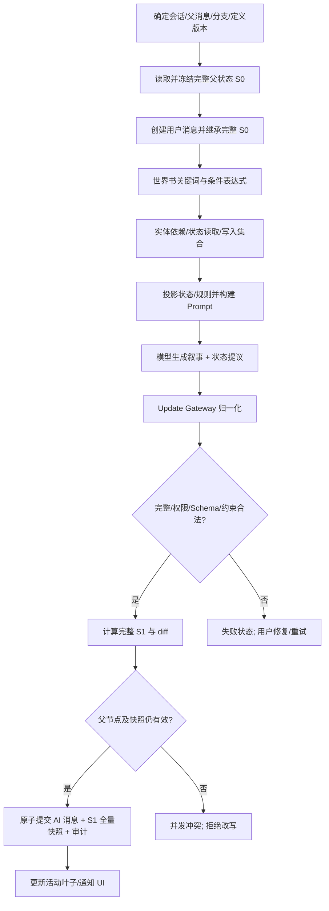
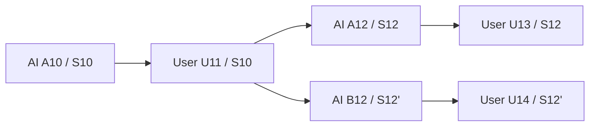

# 通用叙事状态管理模块：独立设计方案

> 版本：Draft 0.1，2026-11-02。状态：独立技术与产品方案，**尚未开发、未经运行验证**。
>
> 本文从零设计一个可嵌入任何长篇叙事 / RPG / 角色扮演客户端的状态模块。**不继承任何现存应用的节点数、世界卡结构、消息协议或模型 SDK 决策**。角色卡和世界书仅用于举例，不依赖 SillyTavern 或某种 MVU 插件。本文是单独提案，不自动更改项目其他设计。

## 0. 一页结论

**设计目标**：作者只需定义实体、状态字段、默认值、更新语义和必要的硬约束；在世界书/叙事文本里可以直接写 `{{清月.心情}}`，或用 `when: '清月.心情 == "愉悦"'` 控制内容；引擎负责解析引用、选择最新快照、注入本轮相关状态、生成更新协议、校验变更、一次性提交，以及给**每一条已提交消息**附带完整状态快照。

这套系统由七个独立模块组成：

1. **Definition Registry**：实体模板、字段、类型、默认值、规则、可见性及版本。
2. **Entity Registry**：每个会话中真实实体的稳定 ID、显示名、别名、生命周期、作用域。
3. **Reference & Expression Engine**：解析 `{{实体.路径}}`、可选默认值和只读条件表达式；绝不执行用户脚本。
4. **State Resolver / Context Adapter**：在确定的父消息快照中计算世界书条件、实体引用和应注入的状态投影。
5. **Update Gateway**：统一接收模型工具调用、文本尾部结构块、可选独立更新模型或人工操作，输出标准变更提议。
6. **State Engine**：校验、计算派生字段、执行事务、保存完整快照与审计记录。
7. **State Inspector**：供创作者、玩家、调试器查看当前实体、引用展开、条件命中、变更原因、分支与异常。

**基本约束**：

- **叙事是真实发生了什么的表达，状态是可查询、可校验的结构化投影**；不要求每句叙事都结构化，也不将状态视为完整世界模拟器。
- **模型提出变化，程序只接受合法变化**。程序可以保证类型、范围、引用、事务、快照和分支一致性，不能仅凭一次模型输出保证语义不遗漏、不矛盾。
- **读状态、注入状态、允许改状态是三件不同的事**。世界书条件读取状态，不代表该状态必须曝光到模型；加载角色资料也不代表模型可以改这个角色。
- **所有求值针对本轮生成开始时冻结的父状态**；世界书不因模型生成中的状态变化而重新激活。新状态从下一轮生效。
- **有实体 ID 才有持久状态**。名字仅是易写易读的别名；别名歧义必须报错，不能猜。
- **每条消息都有可独立还原的完整逻辑快照**；生成失败、编辑、分叉和显式工具更新均不能破坏既有消息历史。

## 1. 范围和不做什么

### 1.1 必须支持

- 作者自由定义世界、角色、地点、组织、物品、任务及任意自定义实体类型；支持临时和可动态创建的实体。
- 字段可以是字符串、数字、布尔、null、列表、对象，允许自由文本、嵌套结构、集合与可选字段。
- 自然语言更新原则与程序可执行硬约束分离；支持按字段/实体/跨实体指定规则。
- 文本变量引用、条件表达式、世界书条件加载、派生/只读字段、状态变更检测。
- 一次生成的**工具通道**与**单次正文内联通道**，二者归一为同一事务语义；可选后处理独立模型通道。
- 每轮消息全量状态快照、分支继承、精确重试、模型输出解析、严格或宽松失败策略。
- 可见性、写入权限、版本迁移、审计与回放、状态预览与可测试性。

### 1.2 明确不做

- 不强制模型在每轮推演所有离场角色或世界所有事件；没有被事件触及的实体继承原状态。
- 不实现真实的时间流逝模拟或多 Agent 自主社会；若要自动推进，需要单独、显式的事件来源。
- 不保证自然语言规则能被程序理解为硬约束，不自动将“永远不会背叛”等句子编译为代码。
- 不运行世界书提供的 JS、EJS、正则脚本中的任意执行部分；表达式只运行本文定义的安全 DSL。
- 不依赖模型输出与文本叙事天然一致；提供检测、警告和修复入口，但不宣称能数学证明一致性。

## 2. 数据概念与归属

| 概念 | 归属 | 生命周期 | 说明 |
| --- | --- | --- | --- |
| `StatePackage` | 创作者内容版本 | 编辑 → 发布 | 字段模板、实体静态定义、规则及权限，不存运行值 |
| `EntityType` | StatePackage | 定义期 | `character/location/faction/item/quest` 仅是作者可自定义的分类 |
| `EntityDefinition` | StatePackage | 定义期 | 固定人物“清月”的身份、显示名、静态属性和默认状态 |
| `EntityInstance` | 会话世界线状态 | 创建 → 活跃 → 归档 | 稳定 `entity_id`、别名、模板 ID、当前动态字段 |
| `StateSnapshot` | 一条已提交消息 | 永久不可变 | 该消息结束时的**全部运行状态**，包含实体注册表和状态 |
| `StateProposal` | 一次生成/工具调用 | 暂存 | 请求更新的操作、依据、来源；尚未修改任何权威状态 |
| `StateCommit` | 消息提交事务 | 永久 | 审计提议、验证结果、状态修改集合及新快照 |
| `StateProjection` | 一次模型请求 | 临时 | 从父快照筛选的相关状态，不是状态真相来源 |
| `LoreEntry` | 创作者内容 | 编辑 → 发布 | 叙事文本、加载条件、相关实体 ID 和变量引用 |

### 2.1 身份与名字必须分离

推荐内部标识例如 `char.qingyue`、`world.main`、`quest.ascension`。这些 ID **创建后不变**，且在一个会话内唯一；显示名可重命名为“清月仙尊”，旧名可保留作为别名。ID 不能因为角色更名、转场、世界书条目重排而变化。

面向作者的 `{{清月.心情}}` 只是一种**编写期名字解析糖**。发布内容时应编译为实体 ID 和规范字段路径，运行时按 ID 读取。当名字冲突时发布失败或要求指定明确实体：

- `{{清月.心情}}`：当前作用域恰好一个“清月”时成立。
- `{{@char.qingyue::心情}}`：显式稳定 ID 形式，作为歧义时的高级写法。
- `{{世界.时间}}`：一个预定义别名 `世界`，指向当前会话的世界实体 ID；`玩家` 指向本局扮演实体实例，不能作为另一份独立状态。
- `{{清月.储物袋.灵石}}`：对象嵌套路径；列表动态元素应使用稳定元素 ID 或专用读取函数，禁止按不稳定数组序号长期引用。

多个同名“清月”同时存在时：允许所在世界卡/世界书的词法作用域先解析明确的本地绑定；若仍歧义则**编译错误**，不按第一个命中或最近出现猜测。显示名变化后，已发布的编译引用仍绑定旧 entity ID。编辑器应展示“清月 → char.qingyue”。

### 2.2 实体生命周期

- **预定义实体**：世界内容发布时已有 ID/模板及初值；新会话创建时可将所有声明实体纳入注册表，但未进入场景的角色不会自动注入每轮 Prompt。
- **临时叙事实体**：模型可以描写路人，不自动创建状态条目，避免无意义增长。
- **动态持久实体**：模型或作者可调用 `create_entity`；必须匹配允许的实体模板，生成唯一 ID，绑定来源消息；例如长篇剧情出现新 NPC。
- **归档实体**：`archive_entity` 保留状态与身份，默认不作为活跃候选；快照依然包含归档数据，历史引用可解析。
- **重命名**：改变 displayName/aliases，不改内部 ID 或历史记录；不得夺取已使用且同作用域有歧义的别名。
- **彻底删除**：不提供普通模型更新操作；历史快照不可变，归档即可。需要 GDPR 或用户主动清理时，应走独立数据删除流程，不能伪装为普通剧情状态更新。

### 2.3 统一实体图，关系不强制建模

角色和组织之间的关联可选择简单字段 `所属宗门: "青云宗"`，或结构化引用 `所属宗门: {"entity_id":"faction.qingyun"}`。前者易创作，后者可验证存在性并跨实体追踪。**作者可自行选择**；不强制所有关系都成为图结构，也不把模型生成的自由文本自动解释为强关联。

## 3. StatePackage 与字段定义

### 3.1 核心配置示例

以下是独立方案推荐格式，并非某已有角色卡的格式：

```json
{
  "schema_version": "1.0",
  "package_id": "cultivation-demo",
  "package_version": "1.2",
  "entity_types": {
    "character": {
      "allow_dynamic": true,
      "fields": {
        "心情": {
          "type": "string",
          "default": "平静",
          "description": "角色当前情绪，不强制使用数值",
          "guidance": "根据真实经历和人物性格渐进变化，不能无故跳变",
          "writable": "model",
          "prompt": "active",
          "model_readable": true,
          "visibility": "public"
        },
        "灵力": {
          "type": "integer",
          "default": 100,
          "minimum": 0,
          "maximum": 100,
          "guidance": "施法实际消耗，休息或修炼可恢复",
          "writable": "model",
          "prompt": "active",
          "model_readable": true,
          "visibility": "public"
        },
        "储物袋": {
          "type": "object",
          "default": {},
          "additional_properties": {
            "type": "integer",
            "minimum": 0
          },
          "guidance": "实际获得才增加，消耗/失去后减少",
          "writable": "model",
          "prompt": "when_referenced",
          "visibility": "public"
        }
      }
    },
    "world": {
      "allow_dynamic": false,
      "fields": {
        "时间": {
          "type": "string",
          "default": "清晨",
          "guidance": "剧情明确推进时间时才变化",
          "writable": "model",
          "prompt": "always",
          "visibility": "public"
        }
      }
    }
  },
  "entities": [
    {
      "id": "world.main",
      "type": "world",
      "name": "世界",
      "initial": {"时间": "清晨"}
    },
    {
      "id": "char.qingyue",
      "type": "character",
      "name": "清月",
      "aliases": ["清月仙尊"],
      "initial": {"心情": "平静", "灵力": 80}
    }
  ]
}
```

### 3.2 字段语义

| 维度 | 推荐字段 | 作用 |
| --- | --- | --- |
| 值类型 | `type`、`nullable`、`default`、`required` | 结构、初始化、缺失值行为 |
| 数值/字符串 | `minimum`、`maximum`、`enum`、`min_length`、`pattern`（受限正则） | **程序硬约束** |
| 复合结构 | `properties`、`items`、`additional_properties`、`unique_by` | 对象/数组元素 Schema |
| 语义指引 | `description`、`guidance`、`examples` | **给模型看的软规则** |
| 修改权限 | `writable: model/manual/derived/never` | 谁可以提交更改 |
| 模型可见性 | `model_readable: true/false` | 是否允许模型或模型只读工具读取字段，不能只依赖 UI 隐藏 |
| Prompt 策略 | `prompt: always/active/when_referenced/never` | 在模型有读取权限前提下的注入候选规则；`never` 禁止主动注入 |
| 展示策略 | `visibility: public/creator_only/internal` | UI 展示范围 |
| 重要程度 | `critical: true/false` | 缺少有效更新时是否严格阻止继续 |
| 计算字段 | `derived.expression` | 只读、安全表达式计算值 |
| 生命周期 | `ephemeral`、`archive_policy` | 状态是否自动归档；不直接做物理删除 |

核心设计：**`description/guidance` 与程序约束分开存储**。如作者只写“灵力最多 100”，引擎不会擅自从中文猜出 `maximum: 100`，而是提示“若需程序保证，请设置数值上限”。作者不懂代码也能通过可视化编辑完成配置。

`type` 覆盖 `string/integer/number/boolean/null/array/object/entity_ref`；`object` 的 `properties` 可完整列出字段，也可用 `additional_properties` 允许开放字典。`array` 可配置 `items` 类型与 `unique_by` 稳定键；未声明开放属性的对象拒绝未知字段。所有数值拒绝 NaN/Infinity；所有输入有大小、深度及数量限制。

### 3.3 规则分层

1. **Narrative Guidance**：自然语言软规则，让模型理解何时应该变化，不能证明执行正确。
2. **Field Validation**：类型、范围、枚举、字段必需性、集合元素，程序确定性检查。
3. **Cross-Field Invariant**：例如“生命 ≤ 最大生命”或“库存数量不得为负”，用安全表达式校验新快照。
4. **Derived State**：纯函数表达式计算“生命比例 = 生命 / 最大生命”，只能由引擎计算，模型不能更新。
5. **Transition Policy**：可选限制允许的状态迁移，例如境界不能一次提升三级，仍用显式配置的枚举转移表而非模型猜测。
6. **World Rules**：跨实体的硬约束，例如任务发布者必须是存在的实体；这类规则必须有明确作用域与依赖。

验证顺序固定：**检查提议和权限 → 应用到临时副本 → 计算派生字段 → 字段校验 → 跨字段/跨实体不变量 → 原子提交**。不可出现多个规则彼此覆写、随机决定执行顺序的行为；派生字段依赖构成 DAG，检测到环则禁止发布。

### 3.4 初始值与版本

发布 StatePackage 时冻结 `package_version`。每个会话绑定**自己的定义版本**与实体初始快照；开局可以显式覆盖初值，但覆盖本身必须通过相同结构校验。既有会话不会因作者更新世界卡而无声改变字段、别名和规则。

迁移必须显式声明 `from_version → to_version`，校验后产生新的状态修订，并对已有历史采取**保持旧版本、从新节点开始使用新版本**的方式。若要重算整条历史分支，则视为独立重建操作，不能覆盖原先的历史快照。

## 4. 状态引用：给作者一个低门槛入口

### 4.1 模板语法

```text
{{清月.心情}}
{{清月.储物袋.灵石}}
{{世界.时间}}
{{玩家.境界}}
{{清月.心情 ?? "未知"}}
{{@char.qingyue::心情}}
```

推荐第一版仅支持：

- `{{实体名.字段路径}}`：引用一个叶子值；对象/数组可序列化成有上限的可读 JSON。
- `?? "默认文本"`：仅当引用**不存在**时使用默认值，`null`、`false`、`0` 与空字符串不自动等同不存在。
- `@entity_id::字段路径`：用双冒号明确分隔稳定实体 ID 与字段路径；实体 ID 本身允许句点，例如 `{{@char.qingyue::心情}}`。作者界面可点击实体生成引用。
- 路径语法：Unicode 标识符组成的 `.` 分隔符；含句点、空格、引号的特殊字段通过高级 `field("char.qingyue", ["复杂.字段"])` 纯读取函数访问（允许用于模板 `{{field(...)}}` 与条件 DSL）；不使用任意 JS 属性访问。
- 运行前对所有引用做静态语法分析；发布时对可解析的固定实体/字段进行校验。动态实体引用在运行时检查，并返回“未找到”诊断。

**不是字符串模板引擎**：不支持 `eval`、对象方法、循环、文件、网络、全局变量、时间、随机数或脚本中的变量修改。文本中出现 `{{...}}` 才会触发；要字面显示花括号，使用转义 `\{{...}}`。

### 4.2 展开阶段与缺失策略

一次生成使用固定的 `snapshot_id`。所有引用都指向此快照，不因其他世界线或编辑器正在改变状态而变化。引用发生在世界书条件筛选之后、发送模型之前。

- **作者编辑预览**：展示语法、指向实体、预期字段、可能类型，不擅自填入当前玩家数据。
- **正式构建**：在父快照求值，输出经过上下文转义/序列化的只读值。
- **缺失实体**：无默认值时记录错误并拒绝该片段加载（可选择“警告并保留字面文本”，但生产默认严格）。
- **缺失可选字段**：有 `??` 时显示默认值；没有时显示诊断，不悄悄变成字符串 `undefined`。
- **隐藏字段**：依据调用者读取权限返回明确“无权读取”，不能通过默认值回退绕开权限。`model_readable: false` 的字段不能在模型正文中模板展开，即使世界书条件由可信引擎内部读取；条件命中本身也可能间接泄露秘密，应由创作者审查相关条目的公开性。
- **文本注入安全**：从状态读出的字符串视为**数据**，通过明确界定的状态段注入模型；渲染到 HTML 默认做字符转义，不能把状态值当模板、代码或可信指令二次求值。
- **防递归**：状态值中的 `{{...}}` 不再次展开。世界书内容只做一层模板替换，避免无限递归和意外提权。

可以为文本新增 `{{清月.灵力 | format:"number"}}` 之类显示格式化语法，但应当是纯函数、可静态检查的扩展，首版不必引入完整管道模板 DSL。

## 5. 条件表达式与世界书加载

### 5.1 允许直接写中文路径表达式

```json
{
  "id": "qingyue-happy",
  "entity_refs": ["char.qingyue"],
  "when": "清月.心情 == '愉悦' && 清月.灵力 >= 30",
  "content": "清月今日心情舒畅，{{清月.灵力}} 点灵力尚能施展剑诀。"
}
```

`when` 使用一个**只读、确定性、小规模**表达式语言，不执行 JS：

| 类别 | 第一版语法 | 说明 |
| --- | --- | --- |
| 逻辑 | `&&`、`\|\|`、`!`、`(...)` | 短路求值 |
| 比较 | `== != > >= < <=` | 类型严格比较；不做字符串转数字 |
| 集合 | `in`、`contains(a, b)` | 集合包含与字符串包含，参数类型严格 |
| 存在性 | `exists(清月.心情)` | 区分字段不存在与 `null` |
| 简单值 | 数字、布尔、`null`、单双引号字符串 | 无隐式类型转换 |
| 引用 | `清月.心情`、`@char.qingyue::灵力`、`field("char.qingyue", ["复杂.字段"])` | 编译后绑定实体 ID/字段路径 |
| 辅助函数 | `len(...)`、`changed(...)` | `changed` 检查**已提交父消息与其前一快照**之差 |
| 未来扩展 | `inScene(...)`、范围、日期、聚合 | 需要可测试语义与预算控制后再加入 |

`changed(清月.心情)` 只检查**此前已结算的状态变化**；不引用本轮尚未生成的内容，否则条件会自我循环。没有前一快照时返回 `false`。

禁止赋值、增减操作、任意函数调用、动态属性名执行、复杂正则、循环及访问沙箱之外的数据。表达式在内容发布时编译成 AST，限制 AST 节点数、求值步数、字符串长度和嵌套深度；不会被传给 `eval/Function`。条件缺失/类型不匹配属于 `indeterminate`，**默认不加载条目并记录诊断**，不得悄悄把错误判定为真。

### 5.2 和关键词激活如何组合

世界书触发逻辑不是二选一：

```text
active(entry) =
  enabled(entry)
  AND base_trigger(entry)      // always / keywords / manual / custom
  AND state_condition(entry)   // when 为 true，或根本没有 when
```

判断全部针对**本轮开始的父快照**。无 `when` 时不启用额外状态筛选。作者可用 `OR` 语法组织多个条件，但不建议在第一版配置中加入“先触发 A 再触发 B”的世界书递归执行。

**推荐两阶段解析，避免循环依赖：**

1. 固定父消息、StatePackage 版本、世界线和状态快照。
2. 执行文本关键词/手动触发，得到候选世界书（不依赖即将输出的模型响应）。
3. 对候选条目评估 `when`，并记录 read-set（条件读取了哪些字段）。
4. 对通过筛选的条目解析 `entity_refs` 与模板引用，生成注入请求。
5. 将常驻/当前玩家/当前场景的必需状态与上述引用做并集，按预算生成 **StateProjection** 和 Lorebook 文本。
6. 生成模型回复；本轮输出的变更在**下一轮**才能影响世界书选择。

**必须区分**三份集合：

- `condition_read_set`：用于判断世界书是否加载的变量，通常**不必**全部放进 Prompt。
- `prompt_state_set`：需要模型知道的状态（常驻、当前场景、显式关联、引用），受可见性与预算约束。
- `allowed_write_set`：模型获准变更的实体与字段，不因“世界书命中”自动开放全部状态写入。

例如 `when: 清月.心情 == "愉悦"` 可以让某个条目加载，但如果作者不希望模型看到具体数值，条件读取可以只在引擎内部完成。另一方面，模型若需要修改清月的心情，则其相关状态、规则和身份必须进入本轮授权的写入投影。

### 5.3 自动关联实体不是强制耦合

- 世界书可以配置 `entity_refs`；作者也可在世界书中直接用 `{{清月.心情}}`，编译器会提取对应的实体依赖，不要求重复声明。
- 当前场景中的在场实体、玩家主体、正在执行的任务可由宿主应用作为 `active_entities` 传入。
- **世界书被加载 ≠ 实体一定可写；世界书未加载 ≠ 状态不能被读取/继承**。
- 未来“实体在场”可来自外部 Scene 模块；State Engine 本身不猜场景或强制维护空间推演。
- 当预算不足时不能半截输出关键状态约束。必需的可写字段状态和更新规则优先保留；非必要实体先降级或排除，并同步收紧 `allowed_write_set`，不能允许模型修改没有可靠状态基线的字段。

### 5.4 条件稳定性示例

在父快照 `S₁` 中 `清月.心情 = "平静"`：心情愉悦条目本轮不加载。模型同轮把它更新为“愉悦”，提交得 `S₂`。下一轮基于 `S₂` 评估，条目才加载。

这避免“模型输出改变条件 → 重新加载世界书 → 又要求重写输出”的不可收敛循环。实时联动只适用于**本地 UI 渲染**，不得反向改变已经发送给模型的本轮 Context。


## 6. 通用状态更新协议：一种内部格式，多种输入通道

**外部协议不等于内部事务。** 无论模型通过工具调用提交、在正文末尾输出结构块，还是人工在编辑器修改，均归一化为同一 `StateChangeSet v1`。作者**不需要写**这些协议，协议由引擎根据字段定义和运行方式注入 / 注册。

### 6.1 标准变更提议

```json
{
  "protocol": "state-changeset/1",
  "proposal_id": "turn-9001-state-1",
  "base_message_id": "msg-9000",
  "base_state_hash": "sha256-of-frozen-snapshot",
  "ops": [
    {
      "op": "increment",
      "entity": "char.qingyue",
      "path": "/灵力",
      "value": -20,
      "reason": "叙事中实际施展剑诀消耗灵力"
    },
    {
      "op": "set",
      "entity": "char.qingyue",
      "path": "/心情",
      "value": "愉悦",
      "reason": "与玩家交谈后情绪发生变化"
    }
  ]
}
```

#### 标准操作集

| 操作 | 目标 | 语义和边界 |
| --- | --- | --- |
| `set` | 可写字段/成员 | 新值替换；不隐式改变 Schema |
| `increment` | 数字字段 | 在父快照数值上增减；必须避免重复执行 |
| `insert` | 数组 / 允许新增的对象成员 | 指定稳定键/数组元素 ID 和插入位置；拒绝重复键 |
| `remove` | 集合成员 | 删除指定成员；不能删除实体顶级字段定义 |
| `move` | 数组成员或允许重命名的对象键 | 明确来源/目标，验证存在与目标冲突 |
| `create_entity` | 允许动态创建的实体类型 | 新建实例并应用类型模板默认值和合法覆盖；分配唯一 ID |
| `archive_entity` | 已存在实体 | 标记归档，保留快照和历史引用 |

路径采用**JSON Pointer 风格**：以 `/` 开始、`~1` 表示字面 `/`、`~0` 表示字面 `~`。例如字段 `修为.境界` 整体是键名，可写 `"/修为.境界"`；它与模板的点路径是**两套不同语法**，解析层分别处理，不允许混用。对于数组，首版建议使用带唯一 `item_id` 的对象元素，避免并发和重排后用序号删除错项。数值索引只可在冻结同一 `base_state_hash` 时使用。

`ops` 是一笔**有顺序的原子事务**：操作从第一个到最后一个依次在临时草稿上执行，任何错误都使整笔更新拒绝；同一 Proposal 不能为绕过单字段上限反复写入不合法中间值，最终/每步验证策略须在定义中确定（建议每步类型有效、整体结束后约束有效）。

任何操作都要执行：

- 会话 ID、当前分支、来源用户及 `proposal_id` 幂等检查。
- `base_message_id` 和 `base_state_hash` 匹配冻结父快照，防止在 A 分支的提议误写 B 分支。
- `entity` 存在且状态活跃，或通过有效 `create_entity` 在本事务里创建；权限、`allowed_write_set`、字段 `writable` 均允许。
- 字段路径/类型、值大小、嵌套深度、列表长度及允许的操作符合 Schema；对象不能随意新增未知顶级字段。
- 关系引用实体存在、跨实体不变量成立，派生字段被正确重算。
- 序列化后的整个状态符合数据容量预算，避免一次更新写入数十 MB 无意义字符串。

**提议不是事实**：`reason` 便于调试，但不能充当权限授权。规范化提议仅能引用允许的实体及字段，不能通过叙事文本中的指令扩权。

### 6.2 模式 A：模型工具调用（Tool Update）

对支持 function/tool calling 的模型提供一个描述明确的工具：

```ts
state.propose_changes({
  protocol: "state-changeset/1",
  ops: StateOp[]
})
// returns { accepted_for_staging, validation_preview, proposal_id }
// NOT immediate persistent commit
```

推荐默认采用 **staging 语义**：模型的调用将变化加入本轮暂存区，直到本轮最终叙事完成且生成状态合法，才在同一个提交事务中保存正文与状态。调用工具时不直接修改权威快照，避免“模型调用工具成功，但随后流式失败/用户取消”的半提交。

工具模式需要处理：

- 模型可能先生成文字后调用工具，也可能先调用工具再继续生成；提议的应用时点取决于模型最终完成事件，不以工具开始执行为准。
- 模型可能多次调用同一工具：按 `proposal_id` 去重，或为一次生成累加有序的多个提议；若互相冲突或重复消耗，合并检查不通过则拒绝提交，不能盲目执行两遍。
- 若模型未调用状态工具，按字段的 `critical` 和运行策略决定是否允许无更新；工具不存在不等于无状态变化。
- 模型调用 `state.get` 可作为**只读工具**，必须返回冻结父快照且符合读权限；不可读取生成期间尚未提交的其他世界线。
- 真正的立即写入工具应命名为 `state.commit_manual` 或类似显式能力，仅供人工或受信工作流，不能误让模型通过 `propose` 绕过原子生成事务。

注意：部分 Provider 的工具调用会导致一次生成内部出现多次模型续写。**工具模式不等于一次模型文本输出**；如果用户严格要求一次 LLM 响应完成，需要选择模式 B。

### 6.3 模式 B：一次性输出叙事 + 尾部状态块（Inline Update）

不支持工具调用、或希望保持单次模型请求的情况下，模型可输出：

```text
清月收剑归鞘，灵力消耗让她略有疲惫。
但看见来人时，她的目光渐渐柔和。

<StateUpdate protocol="state-changeset/1">
{
  "ops": [
    {"op":"increment","entity":"char.qingyue","path":"/灵力","value":-20},
    {"op":"set","entity":"char.qingyue","path":"/心情","value":"愉悦"}
  ]
}
</StateUpdate>
```

该块只是一个**传输容器**，`Update Gateway` 将其规范化为与模式 A 相同的 `StateChangeSet`，在内部填充可信的 `proposal_id/base_message_id/base_state_hash`，**不信任**模型在文本中自行声明的身份与版本。

协议规则：

1. 最多一个尾部 `<StateUpdate>`，严格闭合，必须出现在本轮最后；`ops: []` 表示模型明确认为本轮无更新。
2. `<StateUpdate>` 内是合法的严格 JSON，不支持注释、尾随逗号、脚本语句或自然语言替代 JSON。
3. 正文向 UI 流式输出，但解析器维护有限长度的状态机缓冲，防止拆开的开标签露出；进入尾部块后不把任何字节作为正文展示。
4. 模型异常终止、块不完整、过长、多个块、正文中夹杂非尾部块 → 格式错误，拒绝该笔变更。
5. `StateUpdate` 原始块可用于调试存储，但**不能**作为默认下轮叙事历史内容回注；UI 默认只展示清洗后的正文。
6. 安全性上，正文引用了字面的 `<StateUpdate>` 也可能与协议冲突。因此需要通过生成器指令、明确末尾位置和解析器状态进行约束；无法完全消除歧义时应让作者选择工具模式。协议标记不是 XML 代码执行功能。

### 6.4 模式 C：独立状态提取模型（可选，不作为默认成本）

某些模型擅长叙事但经常遗漏结构化块。可让叙事模型只输出正文，第二个模型读取**父状态 + 本轮用户输入 + 完成的叙事**，专门提议 `StateChangeSet`。这个模式增加延迟和成本，还可能给出与叙事矛盾的解释；通过同一 State Engine 校验，不能认为“调用两次模型”就能保证正确。

推荐三种运行策略：

| 策略 | 方式 | 成本/特征 |
| --- | --- | --- |
| `inline_single_pass` | 一次叙事 + 尾部块 | 兼容性高，单次模型生成；需要严格文本解析 |
| `tool_staged` | 模型原生工具提议 + 叙事 | 结构化更好，但生成内部可能多轮续写 |
| `separate_reconcile` | 叙事后额外状态提取 | 可作为按需修复/测试模式，不默认开启 |

同一生成只启用**一个权威输出模式**；不允许同时把工具提议和尾部状态块当成两份应执行的更新。若同时出现，按协议错误处理或在明确模式下忽略非权威通道并记录警告。

### 6.5 独立工具写状态（非模型生成期间）

作者编辑器、可信插件或系统调度器可以在**没有一条新的 AI 文本输出**时提交操作。为保持“任意时刻都能回到完整状态”，这种写入必须创建一个新的不可变 `state_event` 节点（可在聊天 UI 隐藏），**不能原地修改上一条消息的快照**。

- `state.propose_changes`：提议，不会持久化。
- `state.commit_event`：需要可信调用者与权限，提交事务并新建 `state_event` + 完整快照。
- `state.read`：读取特定消息快照或最新活动叶子；可用于作者工具、调试器和外部模型。
- `state.diff`：对比两个消息快照，展示变更和来源。

若事件来自外部定时器，其“真实时间到达”是外部明确输入事件，不允许在普通 Context 求值中偷偷推进时间。所有外部更新都必须明确关联父节点、分支和 idempotency key。

## 7. 本轮运行流水线



### 7.1 三种集合避免“全世界全量注入”

可将每轮工作集表示为：

```ts
type StateTurnScope = {
  conditionRead: StatePath[];  // 仅用于世界书判定，不必展示给模型
  modelRead: StatePath[];      // 实际纳入 Prompt/工具可读的投影
  modelWrite: StatePath[];     // 本轮模型可以变更的范围
  createTypes: string[];      // 本轮允许动态创建的模板类型
};
```

Scope 由作者策略、活跃场景、用户输入、世界书依赖、模型权限共同确定。默认应收紧：

- 当前玩家、世界时间、持续关键事件通常属于常驻读集合。
- 本轮交互角色及相关任务按需放入模型读集合。
- 写集合优先取当前涉及的实体与常变化字段；不允许模型仅凭引用世界书就修改任何隐藏实体。
- 读取但不可写的字段不必重复发送完整的更新说明。
- 预算不够时先缩减可选实体与文本，并同步从 `modelWrite` 移除不可可靠读到的状态；必需状态与硬约束不能悄悄被截断。

从模型角度可以看到：

```text
[当前状态，基于消息 msg-9000]
- 世界.时间 = "清晨"（可更新）
- 清月.心情 = "平静"（可更新；规则：情绪随事件渐变）
- 清月.灵力 = 80（可更新；范围 0..100）
- 清月.储物袋 = {"灵石":5}（只读，除非本轮明确涉及资源）
[输出协议由引擎统一提供，不由创作者书写]
```

建议实际 Prompt 对每个片段附加稳定实体 ID 和可写字段约束，以便模型输出操作直接使用 ID，避免昵称歧义。对于数组、字典或大型结构，应按依赖裁剪**只读展示**；需要修改的集合必须提供足以安全验证的完整相关键/稳定元素 ID，而不是只提供一句“背包里有几件物品”。

### 7.2 决策、事件与变更的三层区别

作者可以要求：“模型自由决定人物心情变化”，由其输出 `set`；也可以规定“每施展一次技能固定消耗 10 点灵力”，在剧情中由模型**报告** `cast_skill` 事件，由程序规则映射为 `increment -10`。

后者更可控，但代价是创作者必须定义事件和确定性效果。因此推荐：

- 默认只使用**直接状态提议**（适用开放叙事）。
- 可选高级 `domain_event`：模型提议有类型的事件，如 `cast_skill`、`consume_item`、`advance_time`；规则引擎根据作者定义确定性派生变化。
- 不要求所有叙事行为都必须转换为事件。只有对稳定性要求高的资源、生命、回合制行动等才值得这样做。
- 同一变化只能由一种机制拥有：若事件派生了灵力扣减，就禁止模型再对灵力提出重复 `increment`，或在编译期明确优先级，避免双重扣费。

### 7.3 语义一致性与不可保证的上限

系统可以自动检查：

- 生命值不能低于 0，灵力消耗后仍符合范围，境界跳跃是否属于允许迁移。
- 可写字段是否真的在当前可写集合中；关系引用是否指向已注册实体。
- 模型输出是否没有更新块、是否声明 `ops: []`、是否试图修改只读字段。

系统无法在**没有额外语义理解**的情况下证明：

- 正文写“清月受重伤”，但模型未降低生命值。
- 正文写“已经消耗三颗灵石”，但状态只消耗两颗。
- 模型把某段幻境描写误当作真实事实。

可以提高稳定性的手段：按字段生成变化检查清单；要求 `reason` 关联本轮事实；对关键字段设置严格模式；提供人类可审阅的状态 diff；按需二次独立核对模型。**不应对外承诺 100% 无遗漏**。

## 8. 全量状态持久化：消息即状态检查点

### 8.1 不变量

**每个已提交的消息节点都必须拥有完整逻辑状态快照**，包括：

- 全部已注册实体及其稳定 ID、别名、模板类型、活跃/归档标记；
- 各实体所有动态字段（包括未在本轮模型 Context 中读取的离场实体）；
- 世界/玩家别名绑定、定义版本、状态完整性标记及校验哈希；
- 可选运行中的持久领域事件/任务元数据（不将临时 UI 缓存混入权威状态）。

由此任一节点 `M` 满足 `restore(M) = load_full_snapshot(M)`，不需要从根节点重放全部 Patch，分支读取不会因为丢失历史中间事件而变成错误状态。

**要求的是完整逻辑快照，不要求数据库每一行把巨型 JSON 反复存为纯文本。** 可以在物理层压缩或分块去重，但从任一消息恢复时必须拿到完整、经过校验的状态对象；不能正常读取时才依赖父链回放。

### 8.2 与每轮 User / AI 消息的关系

假设上一条 AI 消息 `A10` 拥有完整状态 `S10`。

1. 用户消息 `U11` 插入后，**立即附带 S10 的完整继承快照**；用户自然语言输入本身不会越过模型/工具直接写状态。
2. 模型根据 `U11` 生成下一条 AI `A12`，合法变更 `P12` 产生 `S12 = apply(S10, P12)`。
3. `A12` 与 `S12` 在一个原子事务中提交；若无变化也写一份 `S10` 的完整继承逻辑快照。
4. 新一轮 `U13` 从 `A12` 的快照复制，不能回溯其他支线拿到“最近全局状态”。
5. 若工具在两轮之间直接改状态，追加隐藏 `state_event` 节点和新快照；之后的 User 从事件节点继承。



图中 A12 与 B12 是从同一 U11 衍生的**互不污染**的候选故事分支；不允许某条分支的新状态覆盖另一条消息原有快照。

### 8.3 建议的关系型持久化结构

以下是逻辑表（可用 SQLite/PostgreSQL 实现），并非限制具体数据库：

| 表 | 关键字段 | 要求 |
| --- | --- | --- |
| `state_packages` | `id, version, definition_json, definition_hash` | 已发布版本只读 |
| `sessions` | `id, package_id, package_version, active_leaf_id, revision` | 每局保存明确的定义版本与当前叶子 |
| `messages` | `id, session_id, parent_id, kind, content, status, created_at` | User / AI / state_event；父链承载世界线 |
| `message_state_snapshots` | `message_id PK, state_revision, state_hash, snapshot_blob, format, size_bytes, definition_hash` | **一消息一完整快照**，与消息同事务提交 |
| `state_change_proposals` | `id, source, target_message_id, base_message_id, base_hash, proposal_json, result, errors, created_at` | 审计与幂等；失败提议也可留存 |
| `state_change_events` | `id, message_id, proposal_id, diff_json, actor, timestamp` | 提交后真实变更与来源 |

`snapshot_blob` 的逻辑结构建议为：

```json
{
  "format": "state-snapshot/1",
  "package_version": "1.2",
  "entities": {
    "world.main": {
      "type": "world",
      "name": "世界",
      "status": "active",
      "state": {"时间": "清晨"}
    },
    "char.qingyue": {
      "type": "character",
      "name": "清月",
      "aliases": ["清月仙尊"],
      "status": "active",
      "state": {
        "心情": "愉悦",
        "灵力": 60,
        "储物袋": {}
      }
    }
  },
  "bindings": {"世界": "world.main"}
}
```

`bindings` 只能指向**本快照已注册**的实体；完整实际快照必须包含所有当前已注册实体，而非只保存本轮展示的两名角色。

### 8.4 快照可压缩，但不能失去独立恢复能力

建议策略：

- JSON 采用稳定的 canonical serialization，生成 `SHA-256` 校验哈希，记录定义版本与消息父 ID。
- 在数据库内用 gzip/zstd 压缩每一份**完整**快照；重复 JSON 键多，压缩收益通常明显，但实际性能需基准测试。
- 若单世界大量实体造成重复写入，可以采用按实体内容寻址的不可变 chunks：每条消息都保存**完整实体 ID → chunk hash 索引清单**，各 chunk 永久保存并引用计数管理。这是**逻辑全量、物理去重**，不是按消息增量 Patch 回放。要求单条消息快照无需父链即可恢复。
- 原始状态快照和变更提议分开存储；Diff 用于解释，不是唯一恢复依据。
- 设置单状态字段、单实体、单会话和单快照尺寸配额；大小限制触发时在提交前拒绝并给出明确原因，不能写半份状态。
- 应对非常长的游戏，测量 `100/1,000/10,000` 条消息下空间、压缩率、快照读取、分叉恢复与写入延迟，再决定是否值得引入 chunk 去重。首版优先**压缩全量快照**，减少实现复杂度。

### 8.5 原子提交、幂等与并发

每次 AI 生成绑定 `generation_id`、`base_message_id`、`base_state_hash`。写入时采用 Compare-and-Swap：

```text
BEGIN TRANSACTION
  assert session.active_leaf_id == expected_user_message_id
  assert state_snapshot(user_message).hash == proposal.base_state_hash
  assert generation_id has not already committed
  validate complete StateChangeSet on frozen base
  insert AI message
  insert FULL snapshot for AI message
  insert accepted proposal and diff/audit event
  update session.active_leaf_id and session.revision
COMMIT
```

- 重复收到同一 `generation_id` → 返回已提交结果，不再次 `increment`。
- 其他设备/线程已改变活动叶子 → 报并发冲突，绝不自动把旧提议 rebase 到新状态。
- 允许不同分支并行生成，但提交时必须明确目标分支和可写的活动叶子策略；一个分支的结果不得劫持另一条当前活动分支。
- 外部事件同样遵循基于父消息的事务与版本检查，不能绕过快照创建。
- 数据库提交成功但 SSE 客户端断开 → 查询 `generation_id` 可恢复已提交结果；连接重试不重复生成状态变化。
- 数据库事务失败 → 不出现“AI 消息存在但快照缺失”的半提交记录；可使用外键/唯一键/NOT NULL 约束与事务校验。

### 8.6 失败、取消、缺失更新块

定义几种互不混淆的状态：

| 状态 | 含义 | 默认策略 |
| --- | --- | --- |
| `resolved` | 提议存在且合法；也包括明确 `ops: []` | 允许提交下一轮 |
| `no_update_declared` | 模型明确给出空变更（格式有效） | 允许提交，记录“模型认为无变化” |
| `missing_update` | 没有工具提议或有效内联块 | 对关键状态要求严格；否则可在显式宽松模式继承状态并告警 |
| `invalid_update` | 格式/类型/引用/硬约束验证失败 | 不应用变更；严格阻止继续 |
| `conflict` | 父状态/世界线已改变或 generation 重复冲突 | 拒绝旧提交并保留审计 |
| `cancelled` | 生成取消/中断且没有最终协议 | 不写已结算 AI 消息 |
| `stale` | 历史内容编辑/定义迁移导致后代与现有状态因果不一致 | 禁止视为已可靠结算 |

**默认推荐严格模式**：状态解析失败时，保留 User 消息和可供调试/重试的**临时 AI 草稿**，但不提交为有效的 AI 消息；不应为了故事继续而把失败冒充成“状态没有变化”。

**可选宽松模式**：创作者允许某些非关键字段遗漏，AI 正文可被正式提交，并保存完整的**继承快照**，状态标记为 `degraded` 且显示诊断；这个模式不是高可靠保证。若关键字段标记 `critical`，即使启用宽松模式也应阻止未结算状态继续，除非用户明确人工确认忽略。

所有失败都不得部分提交状态；已生成流式正文可以先显示为**未确认/草稿**，直到完成状态验证再升级为已保存消息。

### 8.7 编辑历史、回滚和分叉

- 修改旧消息的正文会改变事件含义，**不可原地覆盖旧状态快照并声称后代仍正确**。
- 建议将历史编辑视为 `message revision` 或从旧消息前驱创建一个新分叉版本；旧消息/快照保留可追溯。
- 编辑导致的派生后代如果仍被允许显示，必须标记 `stale`，需要用户选择重算（模型成本）、确认沿用原状态（有风险）、或只从编辑节点开始创建新后续分支。
- “撤销本轮更新”不对旧快照做逆向修改；应在目标分支追加新的补偿 `state_event`，或者切换活动叶子回到某个旧节点。
- 快照/实体定义同步升级要显示版本边界；历史分支恢复旧节点时仍使用旧定义和当时的状态快照。


## 9. API 与运行时边界

本模块不直接拥有聊天 UI、故事文本排序、模型 SDK 或世界书存储。宿主只需提供：

```ts
type StateRuntime = {
  publishPackage(draft: StatePackageDraft): PublishedPackage;
  createSession(packageRef: PackageRef, opening?: InitialOverrides): Snapshot;
  resolveRef(snapshotId: string, reference: string, access: AccessContext): ResolvedValue;
  evalCondition(snapshotId: string, expression: string, access: AccessContext): ConditionResult;
  planProjection(turn: TurnContext): StateProjection;
  proposeUpdate(turnId: string, payload: unknown, source: UpdateSource): ProposalResult;
  commitAssistantTurn(turnId: string, content: string, proposalId: string): CommitResult;
  commitExternalEvent(parentMessageId: string, payload: unknown, actor: AccessContext): CommitResult;
  getSnapshot(messageId: string, access: AccessContext): Snapshot;
  getDiff(fromMessageId: string, toMessageId: string, access: AccessContext): DiffResult;
  inspectTurn(turnId: string, access: AccessContext): StateDiagnostics;
};
```

### 9.1 读 API

- `GET /sessions/{session}/state?at_message_id=...`：返回指定消息的完整状态快照，按权限过滤返回；不要把过滤后视图当成可重新提交的权威快照。
- `GET /sessions/{session}/state/entities/{id}`：读取一个实体。
- `GET /sessions/{session}/state/diff?from=...&to=...`：展示两节点状态差异。
- `POST /state/expressions/evaluate`：在指定快照对表达式求值；编辑器预览和测试可用，要求权限及表达式资源限制。
- `POST /state/references/resolve`：批量解析引用，返回实体 ID、字段类型、当前值或缺失诊断。

### 9.2 写 API

- `POST /state/packages/validate`：定义校验、宏引用编译、条件 AST 编译、规则依赖检查、静态权限检查。
- `POST /state/turns/{turn}/proposals`：提交暂存提议，不写权威状态。
- `POST /state/turns/{turn}/commit`：正文与合法提议原子提交，`generation_id` 幂等。
- `POST /state/events`：可信用户/系统工具在目标世界线追加 `state_event`。
- `POST /state/sessions/{session}/migrations`：用户明确批准的定义迁移，不默默修改历史。
- 人工作者修改仍使用相同变更校验，只是 `actor` 为有权用户，不能直接 SQL 修改快照 JSON。

对外接口名只是推荐草案，可以使用 TypeScript SDK、RPC、HTTP 或数据库封装；必须保留相同**权限、幂等、事务和快照语义**。

### 9.3 服务端不可变构建对象

一轮生成创建 `TurnContext` 时应固定：

```ts
type TurnContext = {
  sessionId: string;
  generationId: string;
  userMessageId: string;          // 当前已提交的 User 消息
  parentSnapshotHash: string;      // User 消息继承后的完整快照 Hash
  packageVersion: string;
  candidateLoreEntryIds: string[];
  activeEntityIds: string[];       // 宿主显式提供
  access: AccessContext;
  updateMode: "inline_single_pass" | "tool_staged" | "separate_reconcile";
  policy: "strict" | "degraded_allowed";
};
```

State Engine 不自行生成文本；模型适配层只需要把本轮解析好的提议提交给 `Update Gateway`。世界书加载器只调用 `evalCondition/resolveRef`，不需要知道 SQLite、Pi、MVU 或 JSON Patch 的内部细节。

## 10. 创作者 UI：设计目标是“不用学习协议”

### 10.1 作者工作台建议

```text
状态管理
├── 实体模板
│   ├── 角色
│   ├── 地点
│   ├── 宗门
│   ├── 任务
│   └── + 自定义模板
├── 预设实体
│   ├── 清月 (char.qingyue)
│   │   ├── 字段：心情 [文本，平静]
│   │   ├── 字段：灵力 [整数，0~100]
│   │   └── 字段：储物袋 [物品字典]
│   └── 世界 (world.main)
│       └── 字段：时间 [文本，清晨]
├── 规则
│   ├── 自然语言更新原则
│   ├── 数值 / 枚举 / 关系硬约束
│   ├── 跨字段规则、只读派生值
│   └── 更新失败策略
├── 引用与条件实验室
│   ├── 选择实体/字段 → 复制 {{清月.心情}}
│   ├── 条件可视化编辑器 → 预览匹配世界书
│   └── 指定一条消息快照进行试运行
└── 运行检查器
    ├── 本轮引用/条件/注入/允许写入集合
    ├── 模型提议、接收/拒绝原因
    ├── 完整状态、变化对比与审计
    └── 世界线切换、状态故障与修复
```

**新手操作流程**：

1. 选择“角色”模板 → 添加一个叫“清月”的人物。
2. 新增字段“心情”，默认“平静”，写一句“依据剧情缓慢变化”。
3. 新增字段“灵力”，整数，范围 0～100，并写更新原则。
4. 打开世界书编辑器，输入 `{{清月.心情}}` 或通过变量选择器插入。
5. 选择“条件加载”，从下拉框构建“清月 → 心情 → 等于 → 愉悦”。
6. 点击“模拟一轮”，看到提示词状态投影和预期更新格式；只需确认内容，不需编写协议。

**高级用户**可以切到 JSON/表达式视图，手动维护模板和不变量，但所有修改仍经过相同编译校验。

### 10.2 世界书编辑体验

世界书编辑器在正文中键入 `{{` 时给出实体自动补全，输入 `.字段` 时给出字段；显示字段类型和当前状态来源。`when` 支持语法高亮、错误位置、条件树可视化、模拟父快照和布尔求值。

对状态敏感的引用应标注可见性和缺失策略。条目预览显示：

- 为什么该条目命中：关键词、手动条件、状态表达式。
- 读取的是哪条世界线、哪一条父消息快照。
- 编译的实体 ID 和读取的字段值。
- 哪些状态只供条件判定，哪些会放进模型 Prompt。
- 它是否使某个实体进入模型可写范围；若没有，不应暗示状态能被自动更新。

### 10.3 玩家状态 UI 与创作者私有数据

默认 UI 将状态按实体分组、字段嵌套呈现，展示时间、最后更新消息、变化摘要、错误与来源。作者可指定字段顺序、分组、图标和简单显示方式（数字条、进度、标签、列表）；MVP 不允许角色卡注入可执行 HTML/JS。

权限不能靠“前端隐藏”实现：`creator_only` 和 `internal` 值应由服务端按调用者过滤；如果模型已收到秘密字段，则**不能保证模型一定不会把秘密写进叙事**。因此将 `model_readable`（模型是否可读）与 `visibility`（玩家/创作者界面可见范围）作为**两个独立维度**管理；`prompt` 进一步决定可读字段在何时被注入。高敏内容只要不应该被模型知道，就不能仅依赖 UI 隐藏。

## 11. 安全性、成本与可运维性

### 11.1 安全边界

- **作者配置不能执行代码**：表达式 AST 白名单；禁止文件、网络、进程、正则回溯爆炸、脚本函数、动态导入。
- **状态值不是可信指令**：所有模型输出字符串必须按数据处理，防止状态中包含“忽略上述规则”后被二次提升为系统指令。
- **访问控制在服务端**：模型工具调用不能越过 `allowed_write_set`；人工事件需要权限；隐藏字段不经普通读 API 返回。
- **恶意 / 错误更新**：限制单次 `ops` 数量、实体创建频率、单值字节数、表达式长度、AST 深度、引用嵌套和快照总大小。
- **发布/迁移审批**：作者改变规则不追溯覆盖历史；状态定义有固定版本和 Hash。
- **分支与会话隔离**：所有状态更新都验证 `session_id`、明确父消息、哈希、目标实体归属；禁止跨会话写入。
- **审计**：持久化 actor、模型、模式、提议与拒绝原因；避免把秘密 Token、API Key、未获授权的内部状态写进调试日志。

### 11.2 性能策略

- **编译缓存**：按 `package_hash + lore_entry_version` 缓存引用 AST 和条件 AST；不要把当前状态值缓存进静态模板。
- **求值缓存**：按 `snapshot_hash + compiled_expression_id + access_scope` 做本轮短缓存；分支改变或访问权限不同不得复用。
- **按实体索引**：维护引用依赖索引、状态路径 → 世界书条件倒排索引（用于编辑器与未来增量刷新），不要求首版实现复杂增量算法。
- **快照压缩**：首版完整压缩存储；性能数据足够后再考虑逐实体内容寻址块去重。不能提前为了节省空间牺牲任意消息的独立恢复性。
- **Prompt 预算**：状态工作集大小、可写规则和其它叙事内容共同计算；预算不够时显式缩减范围，不默默截取关键字段。
- **大世界动态实体**：不把几百个 NPC 的完整状态每轮送给模型。存储可以全量保留，Context 只选择相关投影。
- **诊断采样**：普通用户保留必要状态变更与错误，高详细度的 Prompt/模型原文审计须显式开启，避免无限增长。

### 11.3 时间与全局事件

时间不是免费的自动状态变化。状态里的“世界时间”只会在明确事件或模型合法提议更新时变化。若系统提供现实时间驱动或后台计划任务，必须通过 `commitExternalEvent` 创建独立状态事件快照，使任何分支能解释其状态来源。不能打开世界书时因为计算 `now()` 就改变状态。

## 12. 综合案例：清月、夜晚世界书、施法消耗、两条世界线

### 12.1 定义

作者创建实体：

- `world.main`，别名“世界”，状态 `时间 = 黄昏`；
- `char.qingyue`，别名“清月”，状态 `心情 = 平静`、`灵力 = 80`；
- 字段“灵力”整数范围 `0..100`，模型可写；
- 字段“心情”开放文本，模型可写；不要求创作者写 `set/increment` 命令。

世界书内容：

```json
{
  "id": "night-talk",
  "entity_refs": ["char.qingyue"],
  "when": "世界.时间 == '夜晚' && 清月.心情 == '愉悦'",
  "content": "今夜清月愿意谈及往事。她当前的心情：{{清月.心情}}。"
}
```

### 12.2 本轮生成

父消息 `A10` 快照 `S10`：

```json
{
  "world.main": {"时间": "黄昏"},
  "char.qingyue": {"心情": "平静", "灵力": 80}
}
```

当前 User `U11`：“清月挥出一剑，随即笑了起来，夜幕也渐渐降临。”

- `when` 在 `S10` 上求值为 `false`，本轮 `night-talk` **不加载**。
- Context 只注入相关世界时间、清月心情和灵力，以及生成工具/内联协议。
- 模型生成叙事并提议：`灵力 -20`、`心情 = 愉悦`、`世界时间 = 夜晚`。
- State Engine 校验后提交 AI `A12` 的完整 `S12`：`清月灵力=60`、`心情=愉悦`、`世界时间=夜晚`。
- **下一轮**读取 `S12`，`night-talk` 才会命中，插入包含“愉悦”的文本。

### 12.3 分叉

在 `U11` 处用户创建另一路叙事 `B12`，模型选择“清月拒绝施法，夜幕仍未降临”，合法提议为空。`B12` 的完整状态继续是 `S10`。从 `B12` 派生的消息不会看到 `A12` 的灵力消耗或夜晚世界书，除非该分支日后自己发生变化。

**这个例子同时验证：引用解析、条件求值时点、更新协议、全量快照、分支隔离，以及一次输出中内容和状态的衔接。**

## 13. 实施分层与建议开发顺序

| 阶段 | 必须交付 | 暂时不做 |
| --- | --- | --- |
| **M0：状态内核** | StatePackage、实体 ID/别名、字段类型、初值、压缩全量快照、消息父链、事务、Diff、审计 | 动态模板复杂约束、复杂 UI |
| **M1：作者可用** | `{{实体.字段}}`、表达式 AST、条件加载、预览和诊断、自动输出状态协议 | 跨世界书递归、复杂聚合 |
| **M2：模型闭环** | `inline_single_pass` 和 `tool_staged`、规范化 Proposal、严格校验、幂等、SSE 过滤、错误恢复 | 默认第二模型修复 |
| **M3：复杂长期世界** | 动态实体模板、实体关系引用、可见性、派生值、跨字段不变量、旧定义迁移 | 多 Agent 共享世界模拟 |
| **M4：强化可靠性** | 重要字段核对、状态修复、自动化一致性测试、性能优化/物理去重 | 对语义正确性的绝对承诺 |

即使最终一次性开发完整版本，也建议按 M0 → M1 → M2 → M3 的依赖顺序验收。最早的原型只需 **世界实体 + 一名角色 + 两个字段 + 一条条件世界书 + 一轮状态更新 + 一次分叉**，就能验证整个链路。

## 14. 必须覆盖的验收测试

### 14.1 实体与引用

1. 中文显示名、别名、重命名、实体 ID 稳定；重名时拒绝歧义引用；旧已编译引用不受改名影响。
2. `{{清月.心情}}`、`{{清月.储物袋.灵石}}`、`??` 默认值、缺失实体、null/false/0、特殊字段路径均有确定性结果。
3. 动态实体创建需要模板并分配新 ID；创建失败不产生半个实体；归档实体仍可在历史快照中恢复。
4. 禁止状态字符串中的模板再被递归解析；HTML 输出安全转义，秘密数据不被普通 UI API 返回。

### 14.2 世界书条件

5. `when` 的 AND/OR/NOT/范围/`exists/changed`、括号优先级与短路求值；非法类型、缺失状态默认不加载且记录原因。
6. 世界书条件针对**父快照**，本轮更新不能反过来改变已经确定的世界书加载；下轮状态变化生效。
7. 仅用于条件的状态不被强制注入 Prompt，已加载世界书的实体也不自动获得写入许可。
8. 世界书正文自动提取隐式引用、稳定绑定实体 ID、记录命中和宏展开诊断。

### 14.3 状态更新

9. 模型工具提议和尾部 JSON 块被归一化为**同一操作集合**；不会将重复工具调用、重复流式帧或重试当成重复扣资源。
10. `set/increment/insert/remove/move/create_entity/archive_entity` 每一种都有合法、非法、边界、权限和集合冲突用例。
11. 允许空 `ops: []`；缺失块、多个块、未闭合块、非法 JSON、无权限路径、跨实体坏引用均按策略清晰报错。
12. 叙事 SSE 不泄露尾部 JSON、不泄露半截标签；取消和异常不会写入半笔状态。
13. 复杂业务规则/派生字段不会执行 JS，规则依赖有环时拒绝发布；不变量失败整笔回滚。
14. 关键字段 strict、非关键字段 degraded 模式含义可区分，UI 不把失败或继承状态冒充可靠更新。

### 14.4 全量快照、分支与并发

15. 根节点、User、AI、`state_event` 都具有与定义版本一致的**完整**快照；即使无更新也可从该节点独立恢复。
16. 从同一 User 分出的 A/B 路线相互隔离，跨分支状态不渗透；切换叶子立即读取正确状态。
17. 同一 `generation_id` 重试多次仍仅产生一个提交；失效 `base_state_hash` 拒绝，绝不自动重放旧 `increment`。
18. 编辑早期消息不偷偷修改后代快照，后代明确标记 stale 或作为旧历史保留。
19. 外部工具更新必须生成隐藏状态事件并写入全量快照；退出/重启后可以按任意节点恢复。
20. 测试 100、1,000、10,000 条消息以及几百个实体下的快照体积、压缩率、写入耗时和状态恢复时延。

## 15. 开放决策（实现前需要冻结）

下面属于**需要原型验证或产品选择**的点，而非已经证明正确的事实：

1. **写入失败的默认 UX**：更高可靠性建议严格模式，代价是可能打断叙事；是否允许分字段降级需要产品明确。
2. **自由文本字段的“可靠更新”**：只能保证合法字符串与权限；重要语义若要求校验，需要结构化枚举/事件或额外模型审查。
3. **当前场景与活跃实体由谁给出**：建议宿主供给而不是 State Engine 猜测；如果宿主缺失场景信息，退化为显式 `entity_refs` 和引用发现。
4. **动态实体创建时机**：默认由提议显式创建，而不是出现一个新名字就自动注册；后续可提供可确认的“转持久实体”工作流。
5. **大状态的存储物理形式**：逻辑上必须每消息全量，首版完整压缩 JSON；只有在基准测试表明瓶颈后才做实体 chunk 去重。
6. **工具调用协议适配**：不同 Provider 对工具、消息角色和生成续写可能有差异。内部标准状态协议必须独立于 SDK。
7. **世界书条件对隐藏信息的访问**：可信引擎内部可读取条件变量，但作者、玩家、模型的权限必须分别定义。
8. **跨实体强规则范围**：是否首版只做引用存在性 + 字段不变量，还是引入复杂事务规则，取决于真实复杂世界样例的需求。

## 16. 关键选择速览

| 议题 | 本方案建议 |
| --- | --- |
| 实体定义 | 自由模板 + 稳定实体 ID + 易写别名 |
| 状态字段 | 开放 JSON 结构、软规则 + 硬约束 |
| 作者引用 | `{{清月.心情}}` 为常用写法 |
| 世界书条件 | `when` 纯表达式，在父快照求值 |
| 状态加载 | 关联实体/场景/引用自动发现，但**读、注入、写权限独立** |
| 模型更新 | 工具提议或一次叙事尾块，统一 `StateChangeSet` |
| 可靠性 | 类型/约束/事务/分支/幂等有程序保证；语义遗漏仅能检测、不能绝对防止 |
| 持久化 | **每条消息完整状态快照**，物理可压缩或分块去重 |
| 世界分叉 | 快照按父消息继承，禁止跨支线污染 |
| 状态故障 | 默认严格拒绝部分提交，可显式配置非关键状态降级 |
| 创作门槛 | 可视化编辑，作者无需书写更新协议 |
| 下一步 | 做最小闭环原型与失败/重试/分支验证，再决定扩展功能 |

---

**设计原则总结**：

> **作者描述世界能如何变化；模型判断这一轮故事发生了哪些变化；状态引擎验证什么变化可以被正式承认；消息快照记录当时完整世界是什么样子。**

这是一个独立的状态管理层，而不是 MVU 提示词模板，也不是试图替代小说叙事的全自动世界模拟器。
