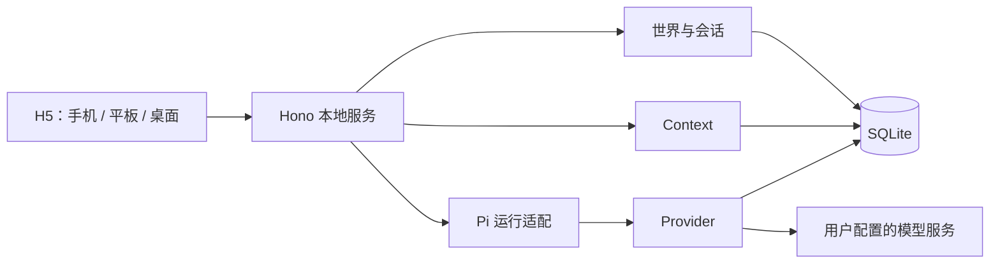
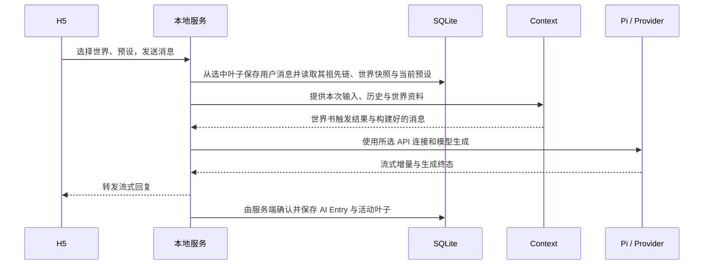

# 运行架构：本地服务、Context 与 Pi 适配

> 状态：技术方案草案，2026-11-01；**应用尚未实现**，Pi 1.4.0 离线与本地模拟服务验证已记录，SQLite 端到端集成未完成。返回[文档索引](../README.md)，产品范围见[PRODUCT](../PRODUCT.md)、[Pi 可行性报告](../../experiments/pi-sdk-feasibility/REPORT.md)。

## 架构边界

- 客户端负责世界/实例管理与交互展示；本地服务负责领域协调、持久化、Prompt 组装和流式响应。
- Context 的领域行为见[Context](../design/context.md)，Provider 与预设的产品行为见[配置](../design/configuration.md)。**预设节点顺序为唯一权威**，世界卡只提供加载条件和内容，不能决定注入位置、消息角色或运行时 Prompt 编排。本文只定义进程与运行时适配。
- **SQLite 是唯一持久化事实来源**，模型运行时对象是执行态，不能与 Pi 的 JSONL 文件形成双份权威历史。存储表、事务和备份统一见[storage.md](storage.md)。

## MVP 目标与技术方向

MVP 支持：加载和管理世界卡、提供不可删除/不可覆盖的基础默认 Prompt 预设及可编辑自定义副本、配置 API 连接、按预设节点顺序构建世界内容与历史并聊天；**包含基础世界分叉与压缩世界线总览**，切换必须明确选择真实叶子。打开实例仅从 `active_leaf_entry_id` 读取最近一页，聊天只向上加载祖先历史，适配移动端。**Entry 从首期开始采用父子树结构**；不提供任意消息定位、双向分页、全量树消息画布。长期记忆、复杂状态跟踪、资源管理和云同步均非此部分的已实现能力。目标设计见[会话](../design/session.md)。

- 前端：React + Vite + TypeScript，移动端优先的 H5。
- 本地服务：Hono + TypeScript，负责 API、Context、Provider 和数据读写；正式运行提供构建后的静态页面。
- 数据：SQLite 存储结构化信息，世界卡及预设可以使用 JSON 导入导出。
- 运行时：以最小化 Pi Coding Agent 为接入目标，Context 和 Provider 独立。SDK 1.4.0 的本地 Mock 已通过 8 项测试；生产 SQLite 与完整 Prompt 请求适配仍需单独 PoC。

SQLite 是应用持久化数据的唯一权威来源；Pi 的运行时对象或缓存不能成为另一份独立事实来源。手机访问电脑上的本地服务时，电脑需要运行且网络可达。

## 可选状态引擎（后续实现）

世界卡 `data.state` 定义字段和规则，Opening 仅覆盖初值；会话各 Entry 的完整状态快照才是实际游玩状态。User Entry 继承父快照，叙事 AI 完成回复后由 Agent 提议 `set/add/insert/delete/move` 变化，状态服务独立校验、原子结算并保存完整快照；不执行卡片脚本。状态不变仍持久化快照，失败与无变化需区分。具体类型、操作和 Opening 语义以[世界卡](../design/world-card.md)为准，Context 注入见[Context](../design/context.md)，数据落盘见[存储](storage.md)。本能力属于后续阶段，不表示首期 MVP 已有状态引擎。

## Pi 最小接入的前置验证

目标为 `@earendil-works/pi-coding-agent`，只使用**模型执行能力与受控 Context 适配**，不开启 coding tools、自动发现的技能与扩展。独立实验已实测工具/资源禁用、内存 Session、流式及取消，但仍需工程级 SQLite 接入与真实 Provider 验证，详见[报告](../../experiments/pi-sdk-feasibility/REPORT.md)。

[Pi Coding Agent SDK](https://github.com/earendil-works/pi/blob/main/packages/coding-agent/docs/sdk.md) 中，SessionManager 管理会话树与有效上下文。不能假定简单修改内存消息就改变最终请求，也不能假定内存 SessionManager 支持从 SQLite 任意无损恢复。

接下来的**工程集成**要验证：① SQLite 按真实 `active_leaf_entry_id` 父链恢复与写回（不使用 Pi JSONL 作为权威）；② 所选预设 `nodes[]` 最终请求与预览一致；③ 真实 Provider/凭据/取消与错误恢复；④ 长会话的服务端分页和完整 Context 的独立预算。现有 Mock 已证明 Pi 可执行流式请求，也确认 OpenAI 兼容适配可能把历史后的 `system` 合并到开头；不支持的节点角色/顺序必须报错或提示有损转换，不能静默重排。

验证失败时记录限制并停止声称该方案可用，不依赖未公开 API，也不以 SQLite 与 Pi 默认会话文件双写充当两份权威数据。后续替代路径需重新讨论。

## 模块与运行流程

| 模块 | 职责 |
| --- | --- |
| 世界卡 | 加载、创建、编辑、发布、搜索与实例快照 |
| 预设 | 只读的系统默认 10 节点模板 + 自定义副本；基础节点不可删除且必须恰好出现一次，保存完整排序节点数组及 API 连接引用 |
| Provider | 管理 API 连接、凭据、选中的模型及模型请求 |
| Context | 先筛选世界卡内容，再严格按预设 `nodes[]` 逐一填充 slot 或 text；`chatHistory` 必需且只出现一次，独立于 Pi 的内部消息结构 |
| 会话 | 保存真实父子 Entry 树及唯一持久化活动叶子；打开时读取最新一页，向上祖先游标查询；支持历史 User 明确分叉、压缩拓扑与真实叶子切换 |
| Pi 适配 | 将 Context 和 Provider 接入固定版本 Pi，处理生成与流式结果 |
| 存储 | 统一处理 SQLite 读写、事务和迁移 |

每次生成读取并固定当前自定义预设快照；生成进行中编辑预设只影响下一次生成。内置 `builtin/default` 是只读模板，不绑定用户 API 连接；用户首次调用可先复制并绑定连接。API 密钥不写入消息、预设或世界卡。Context 只读取本次会话的可用资料，解释命中、插入顺序与预算结果。

消息先保存用户输入，再开始模型请求；失败或取消时保留用户输入并可重试。流式回复完成后保存完整 AI 消息；中断状态和错误需要向用户提示。外部模型请求期间不持有 SQLite 写事务。

## API 与移动端

接口命名仍为草案：世界卡、会话/消息、预设和 API 连接各有管理接口；会话支持创建、读取、**编辑消息但没有删除消息 API**。生成支持流式与取消，Context 检查可预览预设节点与最终请求。MVP 核心为 `GET /sessions/:id/entries` 最近页 / `before` 祖先上翻、`GET /sessions/:id/worldlines` 压缩拓扑、`PUT /sessions/:id/active-leaf` 显式切叶子，以及 `POST /sessions/:id/forks` 创建分支；**无**全量树正文、历史中间窗口、向下历史查询。接口细节见[存储](storage.md)。AI 帮答、复杂记忆与状态 API 属后续方向。

H5 支持软键盘、安全区和手机窄屏；分页展示不要求加载完整历史。服务默认仅监听本机；局域网访问是用户明确开启的能力，开放前需具备访问控制及来源校验。

## 备份与回退边界

数据库一致性备份、迁移与数据回滚遵循[存储设计](storage.md)；普通导出不包含 API Key。Pi、Provider 和持久化适配失败时，不得以恢复运行态为理由覆盖或丢弃既有故事记录。

## 运行态与分支恢复约束

- 生成请求必须明确携带本次选中叶子，不以当前 UI 默认叶子猜测请求意图。由存储层读取祖先链后，Context 组装本轮有效输入，适配层再执行 Pi/Provider。
- 工具调用、工具结果及 compaction 等内部事件与对用户可见的叙事 Entry 不是同一个概念；若目标 SDK 不能从 SQLite 正确恢复完整执行态，必须限制对应 Agent 能力或调整适配策略，不假装已经支持。
- 生成中不能持有长事务。重试、幂等、取消/异常处理需保证不产生无意分叉；结果及游标写回 SQLite 后才能被视为持久化。仅末尾 AI 消息可重生成/续写并更新同一 Entry；编辑历史消息不触发后代重新运行，须对受影响的 Context 派生缓存失效。暂不支持删除消息。
- 未来执行外部工具时，切换分支不代表外部副作用自动回滚；执行权限及补偿机制需要独立评审。

## 技术验证清单

1. **固定 Pi SDK 版本**继续工程验证：从 SQLite 恢复明确活动叶子的父链、完整 Context、状态/压缩时是否能按公开接口执行，最终请求是否与 Context 检查一致；对照[已归档的本地 Mock 实测](../../experiments/pi-sdk-feasibility/REPORT.md)。
2. 验证插在当前用户输入之后的世界书资料仍按目标顺序进入模型；测试用户输入只出现一次。
3. 验证 Provider 连接、流式输出、取消、网络错误和服务重启后恢复。
4. 在目标 H5 环境测试移动端键盘、安全区、最新 30 条首屏、只向上游标、虚拟列表视觉锚点、世界线压缩预览与叶子切换，并覆盖 Wi-Fi 访问及服务端访问控制。
5. 测量约 1000 轮长篇对话的最近页加载、祖先查询、压缩拓扑构建、Prompt 预算与内存占用；已实测的 Pi 内存投影不等于 SQLite 和 H5 生产性能阈值。
6. 验证系统默认预设不可删除/覆盖，用户预设保存时 10 个基础节点完整且不重复、`chatHistory` 必需；移动节点后最终模型请求顺序与检查页面一致，世界卡旧版注入字段不能改变排序。

**待定：** SQLite 驱动、认证/密钥安全存储、工具调用支持范围、云端部署、跨设备同步与原生 App 均不在本文宣称为已实现能力。
