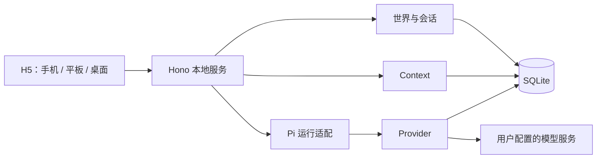
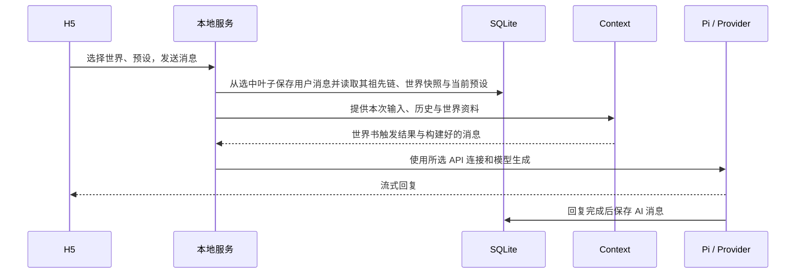

# 运行架构：本地服务、Context 与 Pi 适配

> 状态：技术方案草案，2026-11-01；**尚未实现，Pi 适配必须先验证**。返回[文档索引](../README.md)，产品范围见[PRODUCT](../PRODUCT.md)。

## 架构边界

- 客户端负责世界/实例管理与交互展示；本地服务负责领域协调、持久化、Prompt 组装和流式响应。
- Context 的领域行为见[Context](../design/context.md)，Provider 与预设的产品行为见[配置](../design/configuration.md)。本文只定义进程与运行时适配。
- **SQLite 是唯一持久化事实来源**，模型运行时对象是执行态，不能与 Pi 的 JSONL 文件形成双份权威历史。存储表、事务和备份统一见[storage.md](storage.md)。

## MVP 目标与技术方向

MVP 支持：加载和管理世界卡、管理预设、配置 API 连接、加载世界书和预设进行聊天。聊天记录可保存并重新打开，界面适配移动端。**Entry 从首期开始采用父子树结构**，普通聊天先用单条路径；完整分叉选项与全局树 UI、长期记忆、状态跟踪、资源管理和云同步不在首期 MVP 交互范围。目标设计见[会话](../design/session.md)。

- 前端：React + Vite + TypeScript，移动端优先的 H5。
- 本地服务：Hono + TypeScript，负责 API、Context、Provider 和数据读写；正式运行提供构建后的静态页面。
- 数据：SQLite 存储结构化信息，世界卡及预设可以使用 JSON 导入导出。
- 运行时：以最小化 Pi Coding Agent 为接入目标，Context 和 Provider 独立。先验证 Pi 公开接口能否满足本方案，再确定接入方式。

SQLite 是应用持久化数据的唯一权威来源；Pi 的运行时对象或缓存不能成为另一份独立事实来源。手机访问电脑上的本地服务时，电脑需要运行且网络可达。

## Pi 最小接入的前置验证

目标为 `@earendil-works/pi-coding-agent`，只扩展**会话持久化和 Agent 执行前的消息构建**。不开启 coding tools、自动发现的技能与扩展，也不在 MVP 提供工具调用能力；是否能通过固定版本的公开配置做到需要实测。

[Pi Coding Agent SDK](https://github.com/earendil-works/pi/blob/main/packages/coding-agent/docs/sdk.md) 中，SessionManager 管理会话树与有效上下文。不能假定简单修改内存消息就改变最终请求，也不能假定内存 SessionManager 支持从 SQLite 任意无损恢复。

实现前验证：① SQLite 会话保存和恢复能否通过公开接口完成；② Context 构建结果能否以正确顺序进入最终模型请求，包括用户消息后的资料；③ 独立 Provider 能否配置模型、地址和凭据并支持流式与取消；④ 默认工具、资源发现和自动压缩能否关闭；⑤ 长会话是否能够只加载所需消息。

验证失败时记录限制并停止声称该方案可用，不依赖未公开 API，也不以 SQLite 与 Pi 默认会话文件双写充当两份权威数据。后续替代路径需重新讨论。

## 模块与运行流程

| 模块 | 职责 |
| --- | --- |
| 世界卡 | 加载、创建、编辑、发布、搜索与实例快照 |
| 预设 | 创建、编辑、导入导出；生成时读取唯一当前配置 |
| Provider | 管理 API 连接、凭据、选中的模型及模型请求 |
| Context | 根据实例、世界卡、世界书、预设和历史构建消息；不依赖 Pi 内部消息结构 |
| 会话 | 保存父子 Entry 树；按选中叶子的祖先链分页、恢复和继续交互；后续扩展分叉决策选项 |
| Pi 适配 | 将 Context 和 Provider 接入固定版本 Pi，处理生成与流式结果 |
| 存储 | 统一处理 SQLite 读写、事务和迁移 |

每次生成读取预设当前值；生成进行中编辑预设只影响下一次生成。API 密钥不写入消息、预设或世界卡。Context 只读取本次会话的可用资料，解释命中、插入顺序与预算结果。

消息先保存用户输入，再开始模型请求；失败或取消时保留用户输入并可重试。流式回复完成后保存完整 AI 消息；中断状态和错误需要向用户提示。外部模型请求期间不持有 SQLite 写事务。

## API 与移动端

接口命名仍为草案：世界卡、会话及消息、预设和 API 连接各有增删改查接口；生成接口提供流式结果和取消；Context 检查接口可预览资料命中及最终消息。首期 API 支持选中叶子的祖先分页，但不开放分叉操作；后续增加全局树、分叉选项、选择叶子和压缩 API，参见[会话](../design/session.md)。记忆与状态 API 仍是后续方向。

H5 支持软键盘、安全区和手机窄屏；分页展示不要求加载完整历史。服务默认仅监听本机；局域网访问是用户明确开启的能力，开放前需具备访问控制及来源校验。

## 备份与回退边界

数据库一致性备份、迁移与数据回滚遵循[存储设计](storage.md)；普通导出不包含 API Key。Pi、Provider 和持久化适配失败时，不得以恢复运行态为理由覆盖或丢弃既有故事记录。

## 运行态与分支恢复约束

- 生成请求必须明确携带本次选中叶子，不以当前 UI 默认叶子猜测请求意图。由存储层读取祖先链后，Context 组装本轮有效输入，适配层再执行 Pi/Provider。
- 工具调用、工具结果及 compaction 等内部事件与对用户可见的叙事 Entry 不是同一个概念；若目标 SDK 不能从 SQLite 正确恢复完整执行态，必须限制对应 Agent 能力或调整适配策略，不假装已经支持。
- 生成中不能持有长事务。重试、幂等、取消/异常处理需保证不产生无意分叉；结果及游标写回 SQLite 后才能被视为持久化。
- 未来执行外部工具时，切换分支不代表外部副作用自动回滚；执行权限及补偿机制需要独立评审。

## 技术验证清单

1. **固定 Pi SDK 版本**验证：从 SQLite 恢复选中路径、内部工具事件和压缩状态时是否能按公开接口执行，最终请求是否与 Context 检查一致。
2. 验证插在当前用户输入之后的世界书资料仍按目标顺序进入模型；测试用户输入只出现一次。
3. 验证 Provider 连接、流式输出、取消、网络错误和服务重启后恢复。
4. 在目标 H5 环境测试移动端键盘、安全区、历史加载、渲染窗口、Wi-Fi 访问及服务端访问控制。
5. 测量约 1000 轮长篇对话的最近页加载、祖先查询、提示词构建、内存占用，先测量后确定性能阈值。

**待定：** SQLite 驱动、认证/密钥安全存储、工具调用支持范围、云端部署、跨设备同步与原生 App 均不在本文宣称为已实现能力。
