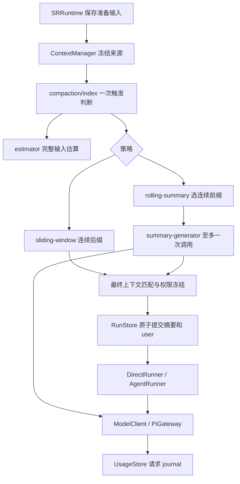

# Run 准备期上下文整理

更新：2026-11-13。已实现 [上下文策略方案](../../plan/sr-context-compaction-strategies-v1.md)。本次交付仅含 Server、测试与文档；前端数值配置、失败提醒和重试操作尚未接入。

## 用户流程

接受请求时先保存输入，返回 202。准备阶段读取当前有效祖先链、冻结配置与状态来源，选择可用历史，最后匹配角色、世界书和状态模块。准备成功后，摘要与当前 user Entry 同事务写入，才开始主生成。

准备失败、停止或中断时，输入保存在 `run_preparations`，不进入叙事历史、不推进 tip。已知 Run ID 可查询输入、失败分类与恢复建议。用户用新 requestId 和当前 tip 重新提交，原失败记录保留。没有自动重试、分批摘要、后台补救或 SSE 重放。

## 配置与额度

```ts
budget: {
  strategy: 'rolling_summary' | 'sliding_window';
  max_context_tokens: number; // C：完整输入的软触发额度
  max_output_tokens: number;  // O：每次主请求的最大输出
}
```

新建默认 rolling_summary / 32768 / 2048。两个 token 参数为正安全整数，且 60% 目标必须大于零。按实际模型校验：

```text
W = model.contextWindow
C <= min(floor(W × 80%), W − O − 1024)
O <= model.maxTokens
触发：E_before >= C
目标：floor(C × 60%)
```

80% 为配置上限，100% 为触发比例，60% 为整理后完整输入的占用目标。C 包含提示词、条目、状态/能力规则、工具 schema、历史/摘要、当前输入及包装。只有旧历史被摘要或裁剪，系统提示、当前输入和权威规则不会被摘要替换。

显式配置超上限会失败；合法配置下，保护内容或最终激活使输入仍超目标/C 时继续主生成并记录诊断。Provider 硬窗口拒绝则正常失败。剩余 20% 不保证足以容纳任意工具往返。

兼容旧 context_strategy 输入：compact / standard / extended 对应旧总窗口 131072 / 262144 / 524288，转换为旧窗口减输出减 1024，并在运行时按模型上限夹紧。规范读取和导出只返回数值结构；私有来源标记不接受外部注入。显式更新 C 后不再按旧档位夹紧。详细兼容边界见 [公开契约](../data-formats/runtime-v2-contract.md)。

## 模块和处理顺序



先用初始投影做无副作用的预算预览，得到触发估算和固定非历史预留。策略按固定预留选择历史，最终按**选定摘要＋保留原文＋当前输入**重新匹配。被裁原文、被加载条目自身的 prompt、系统私有文本不会参与递归激活。never、when 和玩家规则不变；when 使用冻结的权威状态基准。

仅最终匹配结果决定本 Run 的 active 集合、状态可写根、工具和扩展要求，Run 内不再改变。未激活的状态值不删除、不重置。Agent continuation 仅组装原冻结上下文与本 Run 的 assistant/tool 往返，不再估算、检查额度或压缩；仍检查请求身份和支持适配器的 wire payload。

## 两种策略

| 策略 | 初始历史 | 触发后的行为 |
|---|---|---|
| rolling_summary | 有效旧摘要＋未覆盖原文 | 固定预留扣除新摘要输出和包装后，选择最大连续后缀；至少保护五个旧 user 回合；一次摘要后缀之前的连续前缀及旧摘要 |
| sliding_window | 完整原始净叙事，忽略旧摘要 | 按固定预留选最大连续后缀，可为零；不调用摘要、不记录永久裁剪水位 |

开场 assistant 是独立最早历史组。其余按完整 user 回合分组，不跳过相邻的大回合去拼接更早小回合。原始 entries 不删除或改写，扩大额度或切换策略可重新使用完整来源。旧摘要覆盖边界无效但原始链完整时，退回原文投影。

滚动摘要无可整理前缀时继续；候选没有降低完整输入估算时使用原投影。候选有收益但仍超目标时提交并继续。不会因此再次摘要。覆盖边界、第一条保留消息和全来源指纹在 startRun 事务内重验。

## 摘要独立预算与失败

```text
summaryOutput = min(2048, model.maxTokens)
summaryInputLimit = min(floor(W × 75%), W − summaryOutput − 1024)
```

W 为真实模型窗口。完整请求一次包含摘要指令、summary_prompt、旧摘要、缺口、来源包装及全部选中正文。超预算时以 SUMMARY_CAPACITY_EXCEEDED 零调用失败。不存在旧版 12000 codepoint 切片、分批或八次调用额度。

每 Run 的真实摘要调用只能为 0 或 1。结果必须正常 stop、非空、无工具调用，delta/final 一致；错误、length、取消、重复终态及终态后文本均失败，不提交部分摘要。Provider 错误映射 SUMMARY_FAILED 并保留受控 causeCode；空摘要为 SUMMARY_EMPTY。已发生的真实用量照常结算，容量失败不承诺原样重试能恢复。

stopped、failed、interrupted 及状态关闭/未同步的受控 gaps 最多保留 32 项。摘要不得把未完成事件写成成功；sr_instruction 不作为摘要事实。摘要不构造权威状态。

## 估算、请求身份与真实用量

固定版本 `fixed-text/1`：ASCII 每字符 1/3，汉字/日假名/韩文每字符 1，其他 Unicode 按 UTF-8 字节数；消息包装 16、请求 64、每工具 32 加序列化文本。非文本图片等不支持内容明确失败。估算不调用远程计数、不需要模型专用 tokenizer、不写入真实计费统计。

只有正常结束且确有 Provider usage 的主请求才可建立基线。模型/模式/策略/system/tools/toolChoice 及全部消息原样相同、仅纯追加时，使用 reported input 加新消息估算；否则全量估算。身份只存哈希，不存私有 prompt。缓存读写输入只计一次；不把上一轮输出、隐藏尾块或 thinking 无条件加入基线。明确 reported 零值与 SDK 默认零对象不同；没有报告的请求为 unknown。

PreparedRequest 的 fingerprint 与额度判断分离；发送前校验模型/消息/工具/输出参数。Pi 的可离线预览适配器还核验最终 wire payload，一旦变化则阻止发送。旧 DeepSeek BPE 资源、计量接口及依赖已删除；payload 预览与消息顺序校验独立保留。

准备诊断记录估算 before/after、固定预留 before/after、阈值、目标、方法及原因；不冒充真实 Usage。准备失败明细在 run_preparations.metrics_json，实际累计量在 sessions.usage_json；成功 Run 继续使用 entries.metrics_json。准备输入不进入 Usage API 或额外 SSE 字段。

## 存储与验证

输入与 pending usage journal 同事务创建；摘要、user Entry、删除 preparing 记录同事务交接；准备终态、用量结算和清 pending 同事务完成。失败记录不按 64 条淘汰，随所属会话显式删除而级联清理。未持久化的终态不发布，保留已有 journal 供中断恢复。

数据库 v3 的增量升级、备份与人工回滚见 [存储契约](../data-formats/runtime-v2-contract.md)。开发验证只使用临时 SQLite、fake Provider 和离线 mock transport，不打开真实用户库、不发付费请求。

测试重点：compaction-strategies、compaction-lifecycle、run-preparation、model-usage-evidence、summary-budget、runtime-migration、budget-v2 及原有全量回归。本期没有前端改动，未执行或宣称新配置/恢复 UI 的浏览器验收。
