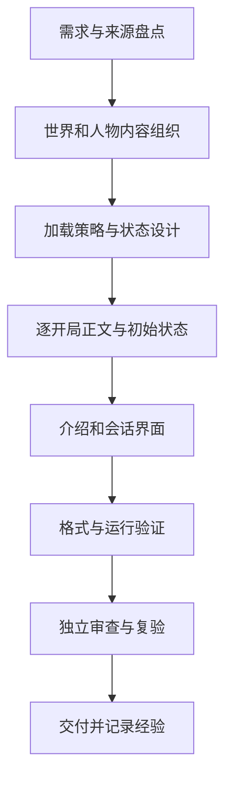

# 世界卡构建指导

更新：2026-11-15。面向世界卡作者和协助创作的 Agent，适用于从零创作、酒馆角色卡转换及已有世界卡重构。

[世界卡结构规范](world-card.md)回答“文件怎么写、平台支持什么”；本指导回答“内容怎么组织、体验怎么设计、怎样证明做对了”。格式和权限以结构规范及当前实现为准。本文不新增平台能力，也不把某张卡的特例当作所有卡的规则。

## 1. 先定义玩家体验

构建前用一页需求说明回答以下问题。没有确定的事项标记为待定，不通过补写设定掩盖缺失信息。

| 问题 | 应明确的内容 |
| --- | --- |
| 玩家是谁 | 扮演身份、已知背景、自由决定的部分 |
| 从哪里开始 | 地点、时间、在场人物、已有关系、初始状态 |
| 玩家做什么 | 最常发生的行动与互动，不只是题材标签 |
| 世界如何回应 | 人物动机、规则、后果，以及需要持续记录的变化 |
| 怎样了解世界 | 介绍、人物资料、剧情中逐步揭示的信息各承担什么 |
| 怎样判断完成 | 内容覆盖、导入、实际运行、视觉与交互验收 |

例如“调查一座雾港的失踪事件”还不够具体。进一步明确：玩家是新来的调查员，从码头开始，通过询问、勘察和核对证词推进；线索影响下一步行动，时间和人物在场情况影响可获得的信息。

从零创作时，由作者建立设定；转换已有卡时，优先从来源中识别这些要素。不要以“增强体验”为由擅自更换人物动机、社会规则或故事起点。

推荐顺序：



## 2. 转换前，完整盘点来源

### 2.1 不只看角色描述

酒馆卡的主要机制可能藏在世界书、正则替换后的 HTML、脚本的 data 或备选开局里。至少检查：

| 来源 | 需要提取的内容 |
| --- | --- |
| 角色常规字段 | description、personality、scenario、示例对话、作者说明、系统及历史后指令 |
| 世界书 | 每条正文、原 id、顺序、启用状态、常驻/关键词、位置和扩展加载配置 |
| 开局 | first_mes、全部 alternate_greetings、宏、占位符、内嵌初始化补丁 |
| 正则 | 匹配表达式、flags、作用角色/位置、显示或 prompt 用途、替换内容 |
| 脚本 | 数据定义、默认值、事件、读写 API、浏览器存储、外部依赖 |
| 附带数据 | 人物简介、图片分类、数组顺序、资源 URL、设置值 |
| 原运行环境 | 未随卡导出的全局设置、扫描深度、依赖版本和外部资源 |

脚本首先作为待分析的数据读取，不为理解机制而直接执行。未知依赖、环境继承配置和未验证行为要显式标注，静态阅读不等于实际运行证据。

### 2.2 建立来源对应表

保持原始文件不变，记录文件哈希，转换产物另存。为每项建立稳定来源键，区分数组索引和条目自身 id。

| 来源键 | 原内容/机制摘要 | 目标字段或组件 | 处理方式 | 差异与原因 | 验证证据 |
| --- | --- | --- | --- | --- | --- |
| lore:12 | 某地点背景 | lorebook.entries | 内容保留、加载映射 | 注入位置变化 | payload 对照 |
| opening:2 | 雨夜开局及补丁 | openings、initial_state | 补丁计算为快照 | 整项覆盖 | 初始状态对照 |
| regex:status | 状态展示占位符 | 会话状态面板 | 技术机制替代 | 不依赖首条正则 | 实际界面检查 |

处理状态可用：已保留、已映射、技术机制替代、保持停用、待确认、未处理。未处理不能标成已迁移；保留原附件也不等于内容已进入运行时。

“还原”分别检查四个维度：

- **内容：**背景、人物、关系、开局和条目是否覆盖。
- **加载：**什么情况下把什么内容交给模型，顺序是否改变。
- **状态：**初始值、更新含义、持久化范围是否一致。
- **界面：**显示信息、入口、交互及失败反馈是否达到约定。

原稿若有语法错误，最小修复并保留差异；若有设定冲突、人物别名不明或相互矛盾的初始值，列出来源后解决，不能静默“统一”。

## 3. 世界观与角色内容怎么写

### 3.1 世界观分层

先写少量决定故事如何运行的基础事实，再写随地点、事件和人物触发的细节。

| 层次 | 建议内容 | 常见错误 |
| --- | --- | --- |
| 核心规则 | 时代、主要矛盾、能力边界、行为后果 | 长篇背景挤占所有对话上下文 |
| 社会与空间 | 势力关系、机构、交通、经济、地点用途 | 只有名词，没有行动上的影响 |
| 人物关系 | 谁知道什么、想要什么、与谁有关系 | 所有人共享作者知道的全部秘密 |
| 当前局面 | 开局发生什么、哪些事实已经成立 | 把未来可能发生的事写成既成事实 |

每条规则最好能回答“它怎样影响人物判断或玩家选择”。例如设定夜间封港，就同时说明封港时间、例外、谁执行，以及玩家能怎样获知规定；不要为了丰富设定添加没有实际用途的制度堆积。

### 3.2 角色应能推动互动

角色资料可以按以下顺序整理：身份与背景、当前目标、行动倾向、关系与信息边界、语言特征、随剧情变化的条件。用具体反应解释性格，少堆抽象形容词。

例如“守夜人谨慎”可具体到：面对陌生人的调查，先确认来意；谈及失踪者时只陈述亲眼所见；得到可靠证据后愿意开放值班记录。示例台词用于体现语气，不应让角色每次复述同一句。

- `characters[].description` 给玩家看，仍是字符串。
- `characters[].prompt` 给模型用，受 load 规则控制。
- 同一份详设选择一个主要模型注入来源，避免角色 prompt 和 lore 重复全文。
- 展示用短简介不能替代完整模型设定；模型设定也不必全部公开到介绍页，尤其涉及剧情秘密时。

### 3.3 补充玩家角色

世界卡至少需要一个 `player_selectable: true` 的角色。原卡只有 `{{user}}` 时，补充最小玩家身份，不自动把全部 NPC 变成可扮演角色。

多个开局若有不同社会身份，公共玩家 prompt 只保留共同设定，具体起点写在各开局中。不要让固定“贵族”身份与“平民起点”冲突。

当前客户端创建会话使用 characters 数组中首个可扮演角色，尚未实现角色选择交互。单一玩家身份的卡把该角色置于首位；多身份体验需明确客户端能力限制，不能假定点击人物介绍就会切换玩家。

`{{user}}` 仅在规范列明的模型设定文本中替换。开局正文按原文保存，不自动替换；`{{char}}` 也没有同等支持。每个宏都要明确处理位置。

## 4. 世界书加载策略

### 4.1 按信息用途选择加载

| 策略 | 适合的信息 | 检查重点 |
| --- | --- | --- |
| always | 理解当前世界必不可少的简短规则 | 常驻内容是否过长、是否重复 |
| on_mention | 人物、地点、物品、机构的细节 | 全名/别名覆盖、宽泛词误触发 |
| when | 与已提交状态有关的条件 | 路径、scope、缺失值和返回类型 |
| never / enabled=false | 停用内容或不参与模型注入的资料 | 停用不是删除，也不应意外激活 |

以下是一个世界书条目片段，不是完整世界卡：

```json
{
  "id": "lighthouse",
  "title": "旧灯塔",
  "content": "旧灯塔由守夜人管理，日落后访客需要出示港务署的通行凭证。",
  "load": {
    "mode": "on_mention",
    "keywords": ["旧灯塔", "守夜人"],
    "keyword_logic": "any",
    "order": 20
  }
}
```

关键词是区分大小写的子串匹配。不要用“城”“人”“法”等过宽词代替具体名称，除非原卡刻意这样设计；转换时先保留并测量，再提出独立优化，不悄悄修改来源行为。

### 4.2 不能直接等同于酒馆

- Direct 模式把激活 lore 按 `load.order` 和原数组次序放进 `world_info`；anchor/position 不控制 Direct 的实际插入位置。
- 扫描基于准备阶段最终摘要、保留历史和当前输入的叙事文本，不是无限历史，也不保证只看最近几轮。旧名字留在摘要中可能继续触发。
- 本轮激活和模型写入权限会被冻结，不能依赖模型刚生成的名字让同轮状态项自动激活。
- 世界书递归、概率、黏性、冷却、注入深度等酒馆设置，不能机械地写成 SR 同名字段。逐项核对有无现有表达能力。
- `when` 显式写 scope；其默认查找次序不同于详情/会话 SDK，表达式最终必须为 boolean。

至少准备命中、未命中、别名、排除词、状态条件、停用、摘要后触发、相同 order 顺序等样本。验证实际 Provider 请求内容，不能只看界面上的“触发方式”标签。

常驻正文长度、激活条目数和完整请求预算分别记录。字符数不是 token 数；不要用截断原文掩盖预算问题。

## 5. 状态设计：先确定含义，再确定结构

### 5.1 为每个状态建立说明

| 路径 | 含义 | 类型 | 初始值 | 谁能更新/何时更新 | scope | 展示位置 |
| --- | --- | --- | --- | --- | --- | --- |
| progress | 当前剧情地点、阶段与天数 | json | 完整对象 | 模型在事实变化时更新 | message | 状态概览 |
| energy | 当前体力 | number | 80 | 有明确消耗/恢复时更新 | message | 数值条 |
| panel | 界面偏好 | json | 折叠等设置 | 会话组件根据操作更新 | session | 不进故事正文 |

只把需要记忆、比较或驱动交互的事实做成状态，不把所有形容词都变成数值。写清未知、空集合、null、0 的不同含义，避免 UI 把0误判为“暂无”。

### 5.2 作用域与类型

- `global` 是世界共享值，不适合放每个开局不同的剧情进度；模型只读。
- `session` 是本会话值，模型只读，适合由应用/组件维护的会话设置。
- `message` 沿当前会话历史继承，适合模型维护的剧情状态；不会每轮重置 initial。
- 固定标量用 string/number/boolean；动态人物集合或嵌套记录可用 json。
- json 能存结构，但没有自动获得每个子字段的业务范围、枚举和默认补齐校验。
- UI 偏好可设 `load.mode: "never"` 以免进入模型上下文；load 不是 SDK 访问权限控制。

截至本指导日期，独立 number 字段仍按类型和范围严格校验。个别构建方案中讨论的数字字符串兼容、自动截断和静默忽略，不应当作平台已实现能力；只有实现及规范更新后才能依赖。

### 5.3 更新与显示分开

从旧补丁协议迁移时，分别核对 replace、insert、delta、remove 的含义。当前 SR 支持给路径赋值，但不是通用 JSONPatch 执行器：

- 新人物可以写入已存在字典的新键；深层赋值前父对象必须存在。
- 数值增量需转换成最终值，不是直接发送 delta 指令。
- 删除键通常需提交删去该键后的父对象；null 不等于删除。
- 数组修改用整个数组值替换，不依赖点路径下标更新。
- 批量更新逐项给结果，不保证全成或全败；整对象读改写还需注意竞争和 busy 状态。

模型状态更新由平台 Direct 协议、校验和持久化负责。作者不要再运行第二套 MVU 更新逻辑，也不要从正在流式显示的正文推断并回写权威状态。

状态栏展示已提交的最新状态。若没有按历史消息查询状态的公开能力，就明确显示“当前状态”，不把它伪装为旧楼层快照。必需扩展缺失、停止和部分更新遵循现有 runtime 语义，不能通过 UI 隐藏提示宣称成功。

## 6. 开局：正文、预览、初始状态分别设计

一个好开局交代必要背景，呈现可感知的场景，给玩家明确的行动空间。不要一开场堆完整世界百科，也不要替玩家完成一长串关键决定。

| 部分 | 用途 | 构建规则 |
| --- | --- | --- |
| content | 第一条 assistant 正文 | 必填；可用 Markdown；原文持久化 |
| initial_state | 本开局的 message 初始值 | 覆盖已声明的顶层状态项；不是深度补丁 |
| type/component | 可选的开局预览 | 需要专门展示时才提供；与正文独立 |

**Markdown 足够时，省略 type/component 即可。** 不需要为每个开局生成复杂页面。需要特定排版或直接资源预览时，可用轻量组件及 WorldDocumentContent；图片使用实际可访问的资源，不靠正则标签生成开局页面。

开局预览与首条开局消息均不执行 message_render。预览组件也没有 groups，不会被执行来生成 content。

### 初始状态整体计算

例如状态默认值为 `progress = {"phase":"arrival","day":1}`。开局如果只写 `{"progress":{"phase":"night"}}`，day 不会自动保留。应在构建时得到完整结果再交付：

```json
{
  "id": "night-arrival",
  "name": "雨夜抵港",
  "content": "## 雨夜抵港\n\n渡轮靠岸时，第三声钟响刚刚落下。守夜人把灯抬高，等你说明来意。",
  "initial_state": {
    "progress": {"phase":"night","day":1},
    "energy": 80
  }
}
```

这是开局片段，要求所属世界卡已声明 progress 和 energy。旧卡转换时依次处理：schema 默认值 → 该开局补丁 → 完整快照 → 当前解析器校验。每个开局单独计算，不把一个开局的修改串到另一个。

详情组件不能读取 message/session。若要显示开局初始状态，可使用平台预览能力或构建时生成的只读展示常量，与 initial_state 一同生成并核对；不能为了预览把会话状态搬到 global。

## 7. 页面设计与组件分工

### 7.1 世界介绍 Tab

介绍页应让玩家迅速理解“这是怎样的世界、我扮演谁、从哪里开始”。推荐顺序为世界名称与一句定位、核心背景、玩家身份、主要人物/势力入口、开局差异与必要说明。

“美观、清晰、高级”落实为可检查的设计条件：

- 标题、正文、辅助信息有明确层级；字号、间距、圆角和色彩使用一套尺度。
- 留白分组、正文宽度和段落节奏服务阅读，不把每句话装进独立卡片。
- 图片表现世界气质并帮助理解内容；说明图片用途，提供替代文本和失败占位。
- 初始视图先呈现核心信息，长设定通过目录或折叠分层；重要背景不能只藏在装饰性弹窗里。
- Tab 使用真实按钮与清晰选中状态，键盘和触屏都可操作；不要只靠悬停揭示信息。
- 背景、文字对比和状态反馈可读；动画克制，尊重减少动画偏好。

世界介绍通过 `data.description` 引用组件。人物 description 和世界书正文仍是安全静态文档，不能将世界介绍的组件结构复制给人物字段。

### 7.2 状态栏

先列出原界面显示的字段、分组、条件和交互，再还原视觉。状态栏可以优先显示时间/地点/关键数值，人物详项按需展开。

| 要素 | 验收问题 |
| --- | --- |
| 数据 | 来自哪条状态路径？0、空集合、未知值怎样显示？ |
| 展开 | 可同时展开多少项？切换人物后如何保持上下文？ |
| 立绘 | 点击、放大、关闭、加载失败分别怎样处理？ |
| 操作 | 是纯展示还是写状态？失败、busy、部分成功如何反馈？ |
| 持久化 | React 局部状态还是通过 SDK 保存？刷新后的预期是什么？ |

不默认照搬浏览器 localStorage。opaque-origin iframe 与原酒馆脚本环境不同；也不能访问 parent DOM。URL 图片、临时文件预览和持久资源管理是不同能力，按约定范围实现。

### 7.3 Stage

以故事为主，状态和图鉴为辅助。宽屏可采用正文与可折叠侧栏；窄屏优先单栏和可关闭面板。具体布局由卡片内容决定，不必都做成管理后台。

- 自定义舞台显式包含 `<SR.WorldStory />`，复用历史、流式和消息组件能力，不自行重造会话循环。
- 自定义状态面板需要从首条开局就可用时，由舞台直接挂载，不依赖消息正则。
- 当前 WorldStory 支持 `showState={false}`；自定义状态入口替代官方入口时可使用它，避免重复入口。不修改 SDK 私有 DOM。
- 处理正文宽度、长内容滚动、面板焦点、Host 输入区与浮层遮挡。
- 使用稳定人物/消息标识，不因状态刷新重置所有展开状态或反复创建媒体。

### 7.4 详情与会话是两种环境

| 能力 | 世界介绍/开局详情组件 | 会话舞台/普通消息组件 |
| --- | --- | --- |
| React 局部交互 | 可以 | 可以 |
| global 查询 | useSRWorldStateAPI，只读 | 通过会话状态 SDK |
| session/message | 禁止 | 通过受控 SDK |
| 状态写入/订阅 | 禁止 | 受权限和生命周期约束 |
| 会话发送/草稿/历史 | 禁止 | useSRSession |
| 正则参数 | 没有 | 正则消息组件有 match/groups 等 |

详情查询没有隐式订阅。异步操作须处理失败和卸载；共享展示组件不要间接导入会话专属 Hook。SDK 不提供原始整卡、extensions、状态定义或任意网络访问，所需静态资料应在构建时明确传入或编入允许的组件模块。

组件放在 `data.components[]`，舞台入口为 `data.stage_component`，外部导入使用白名单模块，作者 SDK 统一为 `@sillyrealms/sdk`。卡内依赖只用 `./ID` 默认静态导入。不要生成旧 ui 字段、URL 脚本或循环依赖。

## 8. 正则与资源转换

先按用途分类，再决定迁移：

| 原逻辑 | 处理原则 |
| --- | --- |
| 变量更新块 | 改接 SR 状态机制后，不继续维护重复的 MVU 协议 |
| 消息美化 | 映射 message_render，保留原文与显示层的区分 |
| 标签配图 | 普通消息组件按明确标识查资源；不存在时可见回退 |
| 开局 HTML 向导 | 拆成介绍/开局展示与 Host 创建动作，不从组件改历史 |
| prompt 清理或动态注入 | 与显示规则分开记录；message_render 不实现这些能力 |

记录角色作用范围、匹配先后、捕获组和失败行为。组件的 groups[0] 是第一个捕获组，完整匹配在 match；不要把抓到的文本拼接成可执行源码。

显示替换不修改持久化消息或模型历史。定义图像正则也不会自动告诉模型输出标签；需要约定时放在合适的模型设定中。

资源清单至少包含来源 URL、用途、角色/开局关联、分类和顺序、可用性检查。分类数组顺序可能决定编号含义，不擅自排序。外链可用不代表本地离线可用；缓存或资产上传没有实现就记录为限制，不作保证。

## 9. 验证与交付

### 9.1 四层验收

| 层级 | 必须检查 | 不能替代它的证据 |
| --- | --- | --- |
| 内容覆盖 | 来源逐项对应、未处理项、语义差异 | 条目数量相同 |
| 文件合法 | 真正的 parseCard、引用、初始状态、大小限制 | JSON.parse 成功 |
| 实际运行 | 组件编译/加载、开局状态、模型输入、失败与恢复 | 导入成功 |
| 使用体验 | 真正浏览器操作和截图，375px/1280px | 只阅读 CSS 或代码 |

检查开局时同时验证正文、预览和初始状态；检查加载时看实际 Provider payload；检查状态时以提交结果为准。不要从视觉上“看起来更新了”推断已经持久化。

格式校验可在仓库根目录执行以下只读命令，将最后一个参数换成候选文件的绝对路径：

```sh
pnpm --filter @sillyrealms/server exec tsx -e 'import {readFileSync} from "node:fs"; import {parseCard} from "./src/domain/world-card.ts"; parseCard(JSON.parse(readFileSync(process.argv[1], "utf8"))); console.log("世界卡结构校验通过");' /absolute/path/world.json
```

该命令不导入数据库，不执行作者组件，也不调用模型。后续仍需组件运行和资源验证。使用隔离测试数据与离线 Provider 验证调用顺序和异常；真实模型质量评估另行获得使用授权，记录模型/预设和检查场景。

首次建立完整路径后再分批扩展：一个开局、必要角色/世界书、状态、介绍、会话界面。每轮通过相关检查再增加复杂度；修改应用代码时按影响范围运行仓库的类型检查、测试与构建。

### 9.2 交付清单

- [ ] UTF-8 世界卡 JSON，可直接导入，无 Markdown 外壳、注释或尾逗号。
- [ ] 至少一个合法玩家和开局；ID 稳定，全部引用正确。
- [ ] 组件使用当前字段和权限；没有依赖首条开局正则。
- [ ] 各开局有可复核初始值；普通消息状态更新与显示一致。
- [ ] 来源覆盖和差异报告，没有隐瞒的删减或未处理内容。
- [ ] 图片、空态、加载、错误、取消、重复点击、部分成功已检查。
- [ ] 桌面/移动端截图与交互记录，明确已验证和未验证范围。
- [ ] 原件保持不变；不包含凭据、个人会话历史或数据库版本。
- [ ] 独立审查后修复并复验；提供运行配置需求和已知限制。

“可导入”“可运行”“体验验收通过”“来源完整还原”是不同结论，分别给证据。只完成其中一项时，不使用模糊的“全部完成”。

## 10. 如何积累为构建技能

每个案例记录：问题出现条件、原机制、目标表达、采用的取舍、验证样本、失败原因和最终结果。按内容创作、加载、状态、开局、UI、资源、验收分类积累。

经过多个不同类型案例验证后，再提炼为可复用步骤。技能应包含输入要求、决策方法、产物模板、检查命令、失败处理和停止条件；不硬编码某张卡的人名、字段、配色或目录。

本指导是当前流程整理，不表示已经完成所有类型酒馆卡的转换验证。后续平台变更先更新结构规范，再调整本指导，避免把过时接口固化为经验。

## 参考

- [世界卡结构规范](world-card.md)：正式格式、权限、限制及完整 JSON 示例。
- [世界卡组件与展示权限](../design/world-components.md)：介绍、开局和会话环境边界。
- [世界卡解析器](../../apps/server/src/domain/world-card.ts)：结构校验入口。
- [原子状态实现](../../apps/server/src/domain/state/atomic-state.ts)：类型、范围及路径行为。
- [WorldStory 实现](../../packages/sr-sdk/src/world-story.tsx)：官方舞台和 showState 能力。

同目录的 MDX 演示不等于可导入世界卡；具体构建提案、任务和未实施优化继续放在 `plan/`。
