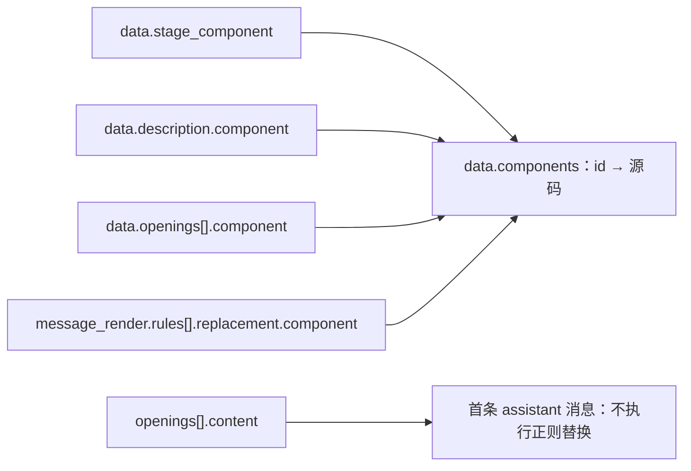

# SillyRealms 世界卡结构规范

本文面向世界卡作者、客户端与 Server 开发者，以及生成或修改世界卡的 Agent。描述的是 **2026-11-15 当前项目已实现的契约**，不是待实现方案。

| 标识 | 当前值 | 含义 |
| --- | --- | --- |
| 世界卡格式 | `spec: "world_card"` | 可导入、导出的完整世界文件 |
| 世界卡格式版本 | `spec_version: "0.1"` | JSON 文件的格式版本，必须是字符串 |
| 状态定义版本 | `state.schema_version: 1` | 状态定义格式，必须是数字 |
| 本地数据库版本 | `PRAGMA user_version = 5` | 数据库迁移版本，不写入世界卡 |
| 创作者 SDK | `@sillyrealms/sdk` | 唯一支持的 SDK 导入名称 |

**世界卡、角色、组件、会话是不同对象。** 世界卡包含角色、开局、世界书、状态定义和可选的 React 组件。角色是 `data.characters[]` 的元素；当前没有独立角色卡导入协议。会话由世界卡创建，运行中的历史、凭据和当前状态值不属于便携世界卡定义。

## 阅读导航

- 构建流程与创作方法：阅读[世界卡构建指导](world-card-authoring-guide.md)，涵盖内容组织、酒馆卡转换、加载、状态、UI 与交付验收。
- 作者：从「最小可导入文件」开始，再阅读角色、开局、世界书和组件章节。
- 开发者：重点阅读校验、状态权限、API 与数据库映射、兼容性章节。
- Agent：先遵循「Agent 生成与修改清单」，生成后执行真实解析器校验。
- 完整参考：文末提供同时包含所有顶层能力的 JSON 示例。

## 1. 最小可导入文件

```json
{
  "spec": "world_card",
  "spec_version": "0.1",
  "data": {
    "name": "雾港",
    "characters": [
      {
        "id": "traveler",
        "name": "旅人",
        "player_selectable": true,
        "prompt": "玩家是一位刚刚抵达雾港的旅人。"
      }
    ],
    "openings": [
      {
        "id": "arrival",
        "name": "抵达港口",
        "content": "渡轮靠岸，雾中传来一声钟响。"
      }
    ]
  }
}
```

保存为 UTF-8 JSON 文件后，通过 Studio 世界卡导入入口上传。文件合法不等于已经具备创建会话的运行配置：还需要有效的预设、模型配置与凭据，它们由本地应用管理。

没有组件库和舞台入口时，会话使用官方 `SR.WorldStory`；没有世界介绍时，详情页显示暂无介绍。开局未指定预览组件时，详情页以安全静态文档展示 `content`。

## 2. 文件外层与 data 根字段

外层只有三个正式字段：`spec`、`spec_version`、`data`，均必填。下表中的路径均相对于 `data`。

| 字段 | 类型 | 必填 | 语义与省略行为 |
| --- | --- | --- | --- |
| `name` | string | 是 | 世界名称，去除首尾空白后不得为空 |
| `description` | ComponentReference | 否 | 世界介绍组件引用；省略则无介绍 |
| `cover` | string | 否 | 封面资源地址；不属于组件源码 |
| `tags` | string[] | 否 | 世界标签名称；每个名称去除首尾空白后非空，由标签系统保存 |
| `characters` | Character[] | 是 | 角色列表，ID 唯一，至少一个角色明确允许玩家扮演 |
| `openings` | Opening[] | 是 | 至少一个开局，ID 唯一 |
| `lorebook` | `{ entries: LoreEntry[] }` | 否 | 世界书；提供对象时必须包含 entries，允许空数组 |
| `state` | StateDefinition | 否 | 三种作用域的状态定义与初始值；不是运行时状态快照 |
| `components` | ComponentSource[] | 否 | 所有用途共用的组件源码库，允许空数组 |
| `stage_component` | string | 否 | 舞台主组件 ID，直接位于 data 根层 |
| `message_render` | `{ rules?: MessageRule[] }` | 否 | 普通会话消息的显示规则；省略 rules 或使用空数组表示无规则 |
| `extensions` | object | 否 | 自定义 JSON 元数据；平台不会自动执行或注入模型上下文 |

可选字段的省略值一般是“不提供”，**不要使用 `null` 代替省略**。例如 `description: null`、`components: null`、`state: null` 均不符合导入格式；状态项的 `initial` 是否允许 null 则由其类型决定。

`stage_component`、`description.component`、`openings[].component` 和正则规则中的 `replacement.component` 都引用同一份组件库：



### ID 规则

- 角色、开局、世界书条目、消息规则的 ID 是去除首尾空白后的非空字符串；分别在各自列表内唯一。不同列表可以使用相同 ID。
- 组件 ID 使用 `^[A-Za-z_$][A-Za-z0-9_$-]*$`，区分大小写，不做自动去空白。建议使用 `WorldStage`、`OpeningPreview` 这类名称。
- 组件 ID 是模块引用键，不要求等于源码中的函数名。
- 数据库世界 ID 由导入流程生成，不是角色 ID，也不是世界卡 JSON 的根字段。

## 3. 角色 characters[]

| 字段 | 类型 | 必填 | 含义 |
| --- | --- | --- | --- |
| `id` | string | 是 | 世界内稳定、唯一的角色 ID |
| `name` | string | 是 | 展示名称，不能只包含空白 |
| `description` | string | 否 | 用户阅读的角色介绍，支持安全文档渲染；不作为角色提示词加载 |
| `prompt` | string | 否 | 模型使用的角色设定；省略或空字符串时不产生角色设定正文 |
| `avatar` | string | 否 | 头像地址 |
| `order` | integer | 否 | 非当前玩家角色的提示词排列顺序；默认按 0 比较，较小者靠前，同值保持数组顺序 |
| `player_selectable` | boolean | 否 | 只有显式为 true 才可作为会话的玩家身份 |
| `load` | LoadRule | 否 | 控制本轮是否加载该角色 prompt；省略时相当于 always |

角色的 `description` **仍然是字符串**。世界的 `data.description` 才是组件引用对象，不能把二者写成同一种结构。

### 玩家与其他角色

创建会话时，Server 要求 `userCharacterId` 引用一个 `player_selectable: true` 的角色。

- 当前选中的玩家，其激活的 prompt 进入玩家设定（`personaInfo`）。
- 其他角色，其激活的 prompt 进入角色设定（`characterInfo`），包括没有被选为玩家的其他可扮演角色。
- `player_selectable` 不会绕过 load 规则。即使是当前玩家，`load.mode: "never"` 也会阻止其 prompt 加载。
- 角色没有正式的 `enabled` 字段；禁用其动态加载应使用 `load.mode: "never"`。
- `order` 控制提示词顺序。当前详情页角色列表按 characters 数组顺序显示，不按 order 自动重排。
- 当前开局区域没有角色选择控件，创建会话暂沿用数组中的首个可扮演角色。角色选择交互归属角色列表，但尚未实现；点击角色查看介绍不等于切换玩家身份。

### 占位符

角色 prompt、激活的世界书正文、预设作者文本及状态说明在模型上下文构建时支持 `{{user}}`，替换为当前玩家的名称。当前上下文渲染器没有 `{{char}}` 的对应替换，不应生成依赖该变量的设定。

该处理不等于全世界卡模板引擎：不要假定头像、组件源码、description 或开局 content 会自动进行相同替换。开局正文当前按原文持久化；模型上下文中的既有历史和当前输入也不会被二次模板替换。

## 4. 开局 openings[]

| 字段 | 类型 | 必填 | 含义 |
| --- | --- | --- | --- |
| `id` | string | 是 | 开局 ID |
| `name` | string | 是 | 开局名称，不能只包含空白 |
| `content` | string | 是 | 创建会话时写入的第一条 assistant 消息，不能只包含空白 |
| `initial_state` | object | 否 | 覆盖 message 作用域中已声明状态项的初始值 |
| `type` | `"component"` | 与 component 成对 | 指定开局详情展示方式 |
| `component` | string | 与 type 成对 | 预览组件 ID，必须在 components 中存在 |

**开局预览与首条会话文本是两个独立用途。** 指定组件后，开局详情页渲染该组件；content 仍然必须提供，且不会变成组件执行结果。未指定组件时展示 content 的安全静态版本。

开局预览以及首条开局消息都不执行 `message_render.rules`。作者需要图片、音频时，应直接在预览组件中编写资源引用，不使用正则匹配生成页面，也不依赖正则传入的 `groups`。

### initial_state 是整项覆盖

它的键直接对应 `state.scopes.message` 中声明的状态项，不写 `global/session/message` 外层，也不使用点路径做深度补丁。

例如 message 中的 `progress.initial` 为 `{"phase":"arrival","day":1}`，开局提供 `"progress": {"phase":"night"}`，得到的是 `{"phase":"night"}`，不会自动保留 day。

每个覆盖值必须通过对应状态类型及数值范围校验。未列出的项采用 initial；不存在的项被拒绝。没有状态定义时，可以省略 initial_state 或使用 `{}`。

## 5. 世界书 lorebook.entries[]

| 字段 | 类型 | 必填 | 含义 |
| --- | --- | --- | --- |
| `id` | string | 是 | 条目 ID |
| `title` | string | 否 | 详情页展示标题，允许空字符串 |
| `content` | string | 是 | 条目正文，不能只包含空白；激活后进入模型上下文 |
| `enabled` | boolean | 否 | false 明确禁用；省略视为启用 |
| `load` | LoreLoadRule | 否 | 共享加载规则，加上下表中的世界书专用字段 |

| load 专用字段 | 值 | 运行语义 |
| --- | --- | --- |
| `order` | integer | 激活条目的排序键，默认 0；同值保持条目数组顺序 |
| `anchor` | `personaInfo / characterInfo / worldState / userInput` | Agent 模式中的插入锚点，默认 characterInfo |
| `position` | `before / after` | Agent 模式中相对锚点的位置，默认 after |

**当前默认 Direct 模式**把所有激活的世界书条目按 `load.order` 和原数组顺序放入 `world_info`。anchor、position 仍保存、展示和导出，但不控制 Direct 模式中的实际插入位置。不要把界面显示的位置标签理解为当前所有运行模式都按此定位。

条目展示与模型加载分开：在详情页打开条目不会自动触发它进入上下文，禁用加载也不会删除正文。

## 6. 共享加载规则 load

角色、世界书条目和状态项支持以下字段：

| 字段 | 类型 / 可选值 | 省略行为 |
| --- | --- | --- |
| `mode` | `always / on_mention / never` | always |
| `keywords` | 非空白字符串数组 | on_mention 必须至少有一个；其他模式可省略 |
| `keyword_logic` | `any / all` | any |
| `exclude_keywords` | 非空白字符串数组 | 无排除词 |
| `when` | string | 无附加状态条件 |

按以下顺序判断：

1. 世界书条目 enabled 为 false，直接不加载。
2. mode 为 never，直接不加载。
3. on_mention 检查关键字；命中任何排除词则不加载，随后按 any/all 判断正向关键字。
4. 提供 when 时，还必须求值为 true；否则不加载。

关键字是**区分大小写的子串匹配**，不是正则、分词或语义搜索。all 表示每个词都在扫描文本集合中出现，不要求它们出现在同一条消息。always 模式忽略 keywords 和 exclude_keywords，但仍检查 when。

扫描集合来自当前 Run 准备阶段最终用于激活判断的摘要、保留历史和当前输入的叙事文本，不应理解为无限扫描数据库中的全部历史。用户指令部分不当作叙事触发文本；激活与模型写入权限在准备阶段冻结，不随同一轮中途生成文本重新激活。

### when 表达式

这是受限表达式，不是任意 JavaScript。可使用：

- 字符串、数字、布尔值、null 字面量，括号。
- `!`、一元正负号；`=== !== < <= > >=`；数值 `+ - * / %`。
- `&& || ??`、三元表达式。
- `getState("progress.phase", {scope: "message"})`；也支持字符串数组路径。

推荐写法：`getState("progress.phase", {scope: "message"}) === "night"`。缺失值需要容错时，可写 `(getState("hp", {scope: "message"}) ?? 0) > 0`。

没有显式 scope 时，when 的 getState 按 **global → session → message** 查找第一个存在的路径。这与会话 SDK 默认 message、详情 SDK 默认 global 不同；建议始终明确 scope。

表达式最终必须得到 boolean。赋值、循环、函数定义、任意函数调用、自由变量或不受支持的语法均不可用。非法语法在导入时拒绝；运行时求值失败则该项不激活，并提供诊断。不要把 when 当作组件里的 SDK 调用，也不要据此推断详情组件可以读取 message 状态。

## 7. 状态 state

结构固定为 `{"schema_version":1,"scopes":{...}}`。scopes 可含 global、session、message，均可省略；每个作用域是“状态项名称 → 定义”的对象。

### 状态项定义

| 字段 | 类型 | 必填 | 约束 |
| --- | --- | --- | --- |
| `type` | `string / number / boolean / json` | 是 | 不存在 object、array、enum 等其他声明类型 |
| `initial` | 对应类型的 JSON 值 | 是 | json 可为对象、数组、字符串、有限数字、布尔值或 null |
| `description` | string | 否 | 状态含义与维护规则；激活时可进入模型上下文 |
| `min` | number | 否 | 仅 number 类型可用，有限数字 |
| `max` | number | 否 | 仅 number 类型可用，有限数字，必须不小于 min |
| `load` | LoadRule | 否 | 控制模型上下文激活，不是 SDK 的访问授权 |

状态项名及 json 对象的嵌套键不得为空、不得含 `.`，也不得为 `__proto__`、`prototype`、`constructor`。支持中文键。推荐显式写出完整初始结构，避免把“缺失键”和 null 混淆。

### 作用域与权限

| 作用域 | 状态归属与初始化 | 介绍/开局组件 | 会话 SDK | 叙事模型 |
| --- | --- | --- | --- | --- |
| global | 世界共享值，导入世界时由 initial 建立 | 只读 | 通过受控 API 读写 | 激活后只读 |
| session | 当前会话值，创建会话时由 initial 建立 | 禁止访问 | 通过受控 API 读写 | 激活后只读 |
| message | 沿会话历史继承的当前消息状态，开局时应用 initial_state | 禁止访问 | 通过受控 API 读写 | 仅允许本轮激活且能力许可的项更新 |

message 状态不是每条消息都重置为 initial。它沿当前历史读取最近状态快照，更新由运行时验证和持久化。Direct 模式还取决于 state_update 能力、合法扩展输出以及成功提交；声明状态项并不保证每轮一定写入。

Direct 模式给模型的当前状态按 writable_state / readonly_state 分组，每行一个 JSON 状态对象，显式提供 path、scope、type、value、description 及适用的 min/max。只有已激活的状态进入列表；当前阶段固定开启状态更新和行动建议。模型先生成故事，再通过完整的 sr_extensions 信封返回本轮所需子块；提示中的空骨架和完整示例使用代码围栏展示，模型实际输出不带围栏。更新项的 reason 可选，省略不会产生警告；路径和值仍须通过服务端校验。

会话 SDK 的写入同样会被 Server 校验，并受忙碌锁等运行约束限制；不能绕过类型、路径、数值范围和生命周期规则。模型权限与 SDK 权限不可混用。

SDK 的嵌套点路径只沿对象属性访问，不把数组索引作为通用状态编辑接口；修改数组可替换整个数组所在项/属性。开局 initial_state 始终是顶层状态项整项覆盖。

## 8. 组件库 components[] 与舞台 stage_component

| 字段 | 类型 | 必填 | 约束 |
| --- | --- | --- | --- |
| `components[].id` | string | 是 | 满足组件 ID 规则，库内唯一 |
| `components[].component` | string | 是 | 非空 React TSX/JSX 模块源码，必须有默认导出 |
| `stage_component` | string | 否 | 舞台入口 ID，直接引用库内组件 |

源码不是文件路径、URL、MDX 文档，也不是已渲染的 HTML。源码由客户端宿主编译，组件模块在隔离的 iframe 中加载和执行；Server 数据库迁移不会编译或执行作者代码。

### 模块导入

- 外部白名单：`react`、`react-dom/client`、`react/jsx-runtime`、`@sillyrealms/sdk`。
- 卡内依赖：`import Weather from './Weather';`，必须精确匹配另一个组件 ID，只支持默认静态导入。
- 禁止动态 import、require、转发导出、循环依赖及未授权 npm/URL 依赖。
- 同一 iframe 内共享模块缓存与 React 实例；不同详情或会话 iframe 不共享 React 局部状态。
- 文件导入验证结构和引用；源码语法、导入或执行错误仍可能在实际加载组件时出现。导入成功不代表所有组件已通过运行验证。

### 舞台选择规则

| 条件 | 行为 |
| --- | --- |
| 未提供 stage_component | 使用官方 SR.WorldStory |
| stage_component 找不到对应 ID | 使用官方 SR.WorldStory，并提示未找到舞台主组件 |
| 找到对应组件 | 直接使用该作者组件 |
| 找到但编译、依赖或执行失败 | 显示错误，不静默回退官方舞台 |

平台不检查作者组件是否包含 WorldStory，也不自动插入它。作者未使用故事列表时，平台不会自动创建故事列表或执行其消息展示规则。官方 WorldStory 即使作为默认舞台，也仍可使用 components 中的正则消息组件。

## 9. 世界介绍与开局组件权限

世界介绍引用是严格对象：`{"type":"component","component":"WorldIntroduction"}`。它与开局的 type/component 字段都必须引用实际存在的组件，缺失引用在导入时拒绝；不能应用“舞台找不到就回退”的规则。

介绍与开局预览运行在专用详情 iframe，仅提供 `useSRWorldStateAPI()` 的以下接口：

| 方法 | 行为 |
| --- | --- |
| `getState(path, scope?)` | Promise 返回对应状态值或 undefined；scope 省略为 global，只允许 global |
| `batchGetState([{path, scope?}])` | Promise 返回 `{path, scope:"global", value}` 数组 |

详情环境的 `useSRStateAPI` 是同一只读接口的运行时别名；新组件推荐使用 `useSRWorldStateAPI`，其 TypeScript 类型准确体现限制。

```tsx
import React from 'react';
import {useSRWorldStateAPI} from '@sillyrealms/sdk';

export default function WeatherLabel() {
  const state = useSRWorldStateAPI();
  const [text, setText] = React.useState('正在读取天气…');
  React.useEffect(() => {
    let active = true;
    state.getState('setting.weather', 'global').then(
      value => { if (active) setText(String(value ?? '尚未设置天气')); },
      () => { if (active) setText('暂时无法读取天气'); }
    );
    return () => { active = false; };
  }, [state]);
  return <p>{text}</p>;
}
```

明确禁止：读取 session/message、任何状态写入、Session API、事件订阅、直接请求 Server，以及获取原始世界卡对象、状态定义、凭据或底层 transport 等非授权数据。详情组件也没有正则的 match/groups 参数。

Host 独立校验每个请求；删掉 SDK 方法并不是唯一防线。iframe 使用 `sandbox="allow-scripts"`，CSP 禁止直接 connect，Server 拒绝 opaque origin 的 API 请求。没有订阅意味着读到的是查询时的值，不承诺组件自动随世界状态变化刷新。

作者可使用 React 局部状态提供纯页面交互，图片、音频直接引用资源。资源必须符合 iframe CSP：图片允许 HTTPS/data/blob，音视频允许 HTTPS/blob；声明为字符串不代表任意地址都能加载。切换开局或离开详情时，旧 iframe 及其媒体元素销毁，未完成的 Host 请求被取消。

安全静态正文可通过 SDK 的 `WorldDocumentContent` 在已有 iframe 内展示。不要把脚本塞进 Markdown/HTML 文本来绕过组件边界。角色介绍和世界书仍由无脚本的隔离文档渲染。

### 与会话组件的区别

会话舞台与正则消息组件可使用 `useSRSession()`、`useSRStateAPI()`、`useSRState()`，由会话 Host 桥接受控操作。Session API 包括填入草稿、发送、历史查询和事件订阅；这些能力不会出现在详情 iframe 中。会话状态 API 默认作用域为 message，详情只读 API 默认 global。

## 10. 消息显示规则 message_render.rules[]

| 字段 | 类型 | 必填 | 含义 |
| --- | --- | --- | --- |
| `id` | string | 是 | 规则 ID，规则列表内唯一 |
| `name` | string | 否 | 规则说明 |
| `roles` | `("user" / "assistant")[]` | 是 | 非空，选择作用消息角色 |
| `pattern` | string | 是 | JavaScript 正则表达式正文，不写两侧 `/` |
| `flags` | string | 否 | 省略为 g；只允许不重复的 g、i、m、s、u，空字符串表示不带 flags |
| `replacement` | Replacement | 是 | 下列三种严格对象之一 |

| replacement.type | 其他字段 | 行为 |
| --- | --- | --- |
| `markdown` | `content: string` | 用文本模板替换，再按安全消息文档渲染 |
| `html` | `content: string` | 替换内容仍经过清洗，不是任意 HTML 执行入口 |
| `component` | `component: string` | 引用共享组件 ID，在匹配位置挂载组件 |

文本替换支持 `$$`、`$&`、`$1` 至 `$99`、`$<name>` 等捕获组模板。组件替换通过 props 获取匹配结果，不做源码字符串插值：

```ts
type MessageComponentProps = {
  match: string;
  groups: Array<string | undefined>;
  namedGroups: Record<string, string | undefined>;
  message: { id: string; role: 'user' | 'assistant' };
  runId: string;
};
```

groups[0] 对应第一个捕获组，整个匹配文本是 match。组件默认按块级插入；需要行内展示时，在组件函数上设置 `srDisplay = 'inline'`。

规则只改变展示，不改写持久化消息和模型历史。重叠匹配按规则数组顺序决定优先级，并受代码块、链接目标、HTML/Markdown 结构与用户指令区间保护。零长度匹配、超限或超时规则会被限制；不要依赖复杂正则突破渲染结构。

找不到消息组件或组件失败时保留可展示的匹配原文并提示；正则组件引用不使用介绍/开局那样的“目标必须存在”导入校验。作者仍应保证引用有效。

`CGImage` 若通过 groups 获得图片标识，就属于这里的消息组件。它不会自动成为开局预览；开局组件应直接引用图片资源。首条开局消息带 `origin: "opening"`，官方消息渲染明确跳过这些规则。

## 11. 扩展、限制与错误

### 扩展字段

自定义元数据放入 extensions，建议用命名空间区分作者工具。它只是保存的数据，没有自动执行、模型注入或 SDK 读取语义，也不能改变平台权限。

当前解析器会剥离许多普通对象中的未知字段，但 components 条目、介绍引用、state 定义、消息规则等严格对象会拒绝未知字段。**不要依赖“未知字段可能被忽略”来扩展正式结构**，也不要假定所有拼写错误都会报错。

### 主要边界

| 对象 | 当前限制 |
| --- | --- |
| 上传 JSON 文件 | 最大 10 MiB，UTF-8，必须是合法 JSON |
| 整体结构 | 最大深度检查阈值为 64 |
| state 定义 | 序列化后不超过 1 MiB |
| 单个状态值 | 序列化后不超过 1 MiB；json 值递归深度检查阈值 32 |
| components | 最多 100 个；单份源码不超过 1 MiB；源码总计不超过 2 MiB（UTF-8 字节） |
| message_render.rules | 最多 100 条 |
| 正则 pattern | 1–2000 个 JS 字符串长度单位 |
| 文本 replacement.content | 不超过 100000 UTF-8 字节 |
| when | 不超过 4096 UTF-8 字节、256 个表达式节点；路径最多 32 段 |
| 详情组件状态查询 | 每批最多 100 项；路径最多 2048 个 JS 字符串长度单位、32 段 |
| 消息匹配运行 | 输入/输出分别受 1 MiB 限制，匹配数量受 500 限制；有规则及整次处理时间预算 |

ID 重复、空必填文本、没有可扮演角色、没有开局、类型不匹配、无效状态初值、未知开局覆盖项、非法引用或 when 语法，都会导致导入失败。返回错误包含位置，例如 `$.data.openings[0].component`。导入错误常用 `INVALID_WORLD`；读取到损坏的持久化卡返回 `WORLD_CORRUPT`，不静默修复。

## 12. API 与数据库映射（开发者）

### API 边界

| API | 用途与返回 |
| --- | --- |
| `POST /api/v1/worlds/import` | multipart/form-data，字段 file 为 JSON 文件；验证后新建世界与源文件记录 |
| `GET /api/v1/worlds/:id` | 返回详情 item：数据库 id、完整卡内容、本地默认配置 ID、时间戳等 |
| `GET /api/v1/worlds/:id/export` | 返回规范化的 world_card JSON，可再导入；不包普通响应 envelope |
| `GET /api/v1/worlds/:id/source` | 返回原始导入附件字节，校验保存的哈希；不保证已转换为最新结构 |
| `GET /api/v1/worlds/:id/state` | 供可信 Host 获取当前 global 值；不是状态定义，也不返回 session/message |
| `PATCH /api/v1/worlds/:id` | 只更新 defaultPresetId、defaultApiModelConfigId，不是任意卡内容编辑接口 |
| `POST /api/v1/sessions` | 通过 worldId、openingId、userCharacterId 创建会话；title 可选，Studio 默认传所选开局的 name；Server 去除 title 首尾空白，未传、null、空串或纯空白时将「未命名会话」写入数据库并返回 |

普通 JSON API 使用 `{success,errorCode,errorMessage,data}` envelope。详情卡位于响应的 `data.item.data`，其中第二个 data 是世界卡自身的 data；导出文件直接是 `{spec,spec_version,data}`。

创建会话的名称保存在 `sessions.title`，不是随开局名称动态变化的引用。上述默认命名仅影响新建会话，不回填已有会话，也不改变 PATCH 重命名规则。

上述 HTTP API 给第一方客户端与可信 Host 使用，**不是创作者组件可以直接调用的 Server 接口**。创作者只能使用其运行环境允许的 SDK。

默认预设、模型配置与凭据属于本地运行配置，不能塞入 world_card 当作可移植凭据。导入会采用应用默认配置；创建会话时再次验证配置可用性。

### 数据库 v5

| 卡字段 | worlds 中的存储列 / 归属 |
| --- | --- |
| spec / spec_version / name | 同名列 |
| description | `description`，组件引用对象序列化为 JSON TEXT |
| cover | `cover` |
| characters | `characters_json`，JSON 数组 |
| openings | `openings_json`，JSON 数组 |
| lorebook | `lorebook_json` |
| state（定义） | `state_definition_json` |
| message_render | `message_render_json` |
| components | **`components`**，JSON 数组，不叫 components_json |
| stage_component | **`stage_component`**，独立可空文本列 |
| extensions | `extensions_json` |
| tags | `tags` 与 `tag_assignments`，不内嵌在 worlds JSON 列中 |

注意：数据库 `worlds.state` 是当前 global **值**，不是卡中的 state **定义**；会话值位于 `sessions.state`，消息状态快照位于 `entries.state`。便携导出包含定义和 initial，不自动把这些当前运行值回填为初始值。

创建会话将 opening.content 原文写入首条 assistant Entry，初始化 session 状态，并把开局覆盖后的 message 状态保存为快照。它不会运行 OpeningPreview 来生成首条正文，也不会自动调用模型。

## 13. 兼容性与迁移

当前格式使用 components 数组和根字段 stage_component，不支持继续提交 `ui.source/ui.main`。`ui` 输入会被拒绝；也不应再生成中间讨论过的根字段 `component`。所有正式内容均在外层 data 内。

- 世界 summary 已删除，不用于展示或存储；会话历史摘要和预设摘要提示词不受此变更影响。
- 世界 description 已由字符串改为组件引用。角色 description 仍为字符串。
- 正则消息库不再使用 message_render.component_source；统一引用 components。
- 旧 `@sr/sdk` 导入不兼容，必须改为 `@sillyrealms/sdk`。
- 数据库 v4 → v5 升级前生成备份，事务内把 ui_json 改为 components，新增 stage_component，并把旧介绍和开局展示文字包装为独立组件。原 content、initial_state、其他记录及原始附件保持不变；失败整体回滚。
- 更早的单文件 UI 需要显式离线转换；不要将“已有数据库自动升级”误解为“导入接口接受所有旧文件”。

不要在导出时捏造新 spec_version。目前这些变更仍在 world_card 0.1 内，数据库版本与文件版本必须分开理解。

## 14. 完整示例

以下为可通过当前结构校验的 JSON，包含世界介绍、独立开局预览、作者舞台、正则消息组件、角色、世界书及三种状态作用域。图片地址是示例占位地址，实际使用应替换为作者持有的可访问 HTTPS 资源。

```json
{
  "spec": "world_card",
  "spec_version": "0.1",
  "data": {
    "name": "雾港来信",
    "description": { "type": "component", "component": "WorldIntroduction" },
    "cover": "https://assets.example.com/fog-harbor/cover.webp",
    "tags": ["探索", "奇幻"],
    "characters": [
      {
        "id": "traveler",
        "name": "旅人",
        "description": "一位携带未署名信件的外来者。",
        "prompt": "{{user}}刚刚抵达雾港，正在寻找信件的收件人。尊重玩家对行动的选择。",
        "avatar": "https://assets.example.com/fog-harbor/traveler.webp",
        "order": 0,
        "player_selectable": true,
        "load": { "mode": "always" }
      },
      {
        "id": "keeper",
        "name": "林舟",
        "description": "旧灯塔的守夜人。",
        "prompt": "林舟是旧灯塔守夜人，说话简短，熟悉海雾中的航路。",
        "order": 10,
        "player_selectable": false,
        "load": {
          "mode": "on_mention",
          "keywords": ["林舟", "灯塔"],
          "keyword_logic": "any",
          "exclude_keywords": ["守夜人已离港"],
          "when": "getState('hp', {scope: 'message'}) > 0"
        }
      }
    ],
    "openings": [
      {
        "id": "arrival",
        "name": "渡轮靠岸",
        "content": "渡轮靠上码头，远处灯塔亮起。林舟提着风灯走来：“你带了那封信吗？”",
        "initial_state": { "progress": { "phase": "arrival", "day": 1 }, "hp": 100 },
        "type": "component",
        "component": "OpeningPreview"
      }
    ],
    "lorebook": {
      "entries": [
        {
          "id": "harbor-rules",
          "title": "港口的规矩",
          "content": "雾港日落后关闭外港。旧灯塔每夜点亮三次，第三次之后禁止出海。",
          "enabled": true,
          "load": { "mode": "always", "order": 0, "anchor": "characterInfo", "position": "after" }
        }
      ]
    },
    "state": {
      "schema_version": 1,
      "scopes": {
        "global": {
          "setting": {
            "type": "json",
            "initial": { "weather": "薄雾", "city": "雾港" },
            "description": "所有会话共享的世界背景。",
            "load": { "mode": "always" }
          }
        },
        "session": {
          "chapter": { "type": "number", "initial": 1, "min": 1, "description": "当前会话章节，由应用管理。" }
        },
        "message": {
          "progress": { "type": "json", "initial": { "phase": "arrival", "day": 1 }, "description": "随故事进展更新阶段与日期。" },
          "hp": { "type": "number", "initial": 100, "min": 0, "max": 100, "description": "旅人的体力，有明确消耗或恢复时更新。" }
        }
      }
    },
    "stage_component": "WorldStage",
    "components": [
      {
        "id": "WorldIntroduction",
        "component": "import React from 'react'; import WeatherLabel from './WeatherLabel'; export default function WorldIntroduction(){ return <section><h1>雾港来信</h1><p>寻找一封信的收件人，探索灯塔与港口。</p><WeatherLabel/></section>; }"
      },
      {
        "id": "WeatherLabel",
        "component": "import React from 'react'; import {useSRWorldStateAPI} from '@sillyrealms/sdk'; export default function WeatherLabel(){ const api=useSRWorldStateAPI(); const [text,setText]=React.useState('正在读取天气…'); React.useEffect(()=>{let active=true; api.getState('setting.weather','global').then(value=>{if(active)setText(String(value ?? '未知天气'));},()=>{if(active)setText('暂时无法读取天气');}); return ()=>{active=false;};},[api]); return <p>{text}</p>; }"
      },
      {
        "id": "OpeningPreview",
        "component": "import React from 'react'; import WeatherLabel from './WeatherLabel'; export default function OpeningPreview(){ return <section><h2>渡轮靠岸</h2><p>从第一声钟响开始。</p><WeatherLabel/></section>; }"
      },
      {
        "id": "WorldStage",
        "component": "import React from 'react'; import {SR} from '@sillyrealms/sdk'; export default function WorldStage(){ return <SR.WorldStory/>; }"
      },
      {
        "id": "CGImage",
        "component": "import React from 'react'; export default function CGImage({groups}){ const key=groups?.[0]; if(!key || !/^[a-z0-9-]+$/.test(key))return null; return ; }"
      }
    ],
    "message_render": {
      "rules": [
        {
          "id": "cg-image",
          "name": "故事插图",
          "roles": ["assistant"],
          "pattern": "\\[CG:([a-z0-9-]+)\\]",
          "flags": "g",
          "replacement": { "type": "component", "component": "CGImage" }
        }
      ]
    },
    "extensions": {
      "authoring": { "author": "示例作者", "revision": "1", "notes": "资源地址需要替换。" }
    }
  }
}
```

后续 assistant 消息中的 `[CG:arrival]` 可以被 CGImage 显示为图片。上述开局 content 不依赖该规则，OpeningPreview 已直接引用资源。若希望模型主动输出插图标记，还需要在合适的模型设定中说明约定；定义正则本身不会向模型注入此要求。

## 15. Agent 生成与修改清单

1. 输出可解析的 UTF-8 JSON；完整文件包含 spec、spec_version、data，不含 JSON 注释、尾逗号或 Markdown 包装文本。
2. 至少一个 characters 项显式设置 player_selectable 为 true，至少一个有效 opening；各列表内 ID 唯一且稳定。
3. 世界 description 使用组件引用；角色 description 使用展示字符串；需要模型理解的角色设定写 prompt。
4. components 是平铺数组，stage_component 位于 data 根层；不要生成 ui、component_source、旧 SDK 别名或已删除的 summary。
5. 介绍和开局引用必须存在。开局 type/component 成对提供，content 始终保留为独立首条正文，不做正则替换。
6. 详情组件只通过只读世界状态 API 获取 global 值；不引用 Session API、useSRState 订阅 Hook、message/session 状态、Server HTTP 或内部数据。
7. 正则消息组件可以使用 groups，详情组件不依赖它；资源预览直接引用资源。组件默认导出、卡内静态依赖完整且无循环。
8. state 每项显式提供合法 initial；initial_state 只覆盖已声明的 message 项，整项替换 JSON，不能自动推断成深度合并。
9. load 默认 always；on_mention 提供关键字；when 只用受限语法并显式写 scope，不混淆 when 与 SDK 的参数格式和默认作用域。
10. 不把导入成功当作运行成功：还应检查组件编译、详情加载、舞台入口、正则引用、资源地址与空值/错误状态。
11. 保留与任务无关的角色、开局、世界书、状态定义及扩展字段；不要擅自改 ID、移除原始附件或清理会话。
12. 不把预设、模型、凭据、当前状态快照、历史消息或数据库迁移版本写入便携卡定义。

## 16. 实现依据与维护入口

本规范核对以下实现。行为变更后应同步更新本文件及相应测试；不能只修改文档便宣称功能已经实现。

| 主题 | 源码 / 测试 |
| --- | --- |
| 结构与导入校验 | [world-card.ts](/Users/wanghuiru/Workspace/SillyRealms/apps/server/src/domain/world-card.ts) |
| 字段存储与读取 | [world-repository.ts](/Users/wanghuiru/Workspace/SillyRealms/apps/server/src/repositories/world-repository.ts) |
| 导入、导出、原始附件、世界状态 API | [worlds.ts](/Users/wanghuiru/Workspace/SillyRealms/apps/server/src/routes/worlds.ts) |
| 会话创建与首条开局消息 | [sessions.ts](/Users/wanghuiru/Workspace/SillyRealms/apps/server/src/routes/sessions.ts) |
| 加载与模型上下文 | [activation.ts](/Users/wanghuiru/Workspace/SillyRealms/apps/server/src/runtime/context/activation.ts)、[prompt-builder.ts](/Users/wanghuiru/Workspace/SillyRealms/apps/server/src/runtime/context/prompt-builder.ts) |
| 状态声明与 when | [atomic-schema.ts](/Users/wanghuiru/Workspace/SillyRealms/apps/server/src/domain/state/atomic-schema.ts)、[when.ts](/Users/wanghuiru/Workspace/SillyRealms/apps/server/src/domain/state/when.ts) |
| 状态值与开局覆盖 | [atomic-state.ts](/Users/wanghuiru/Workspace/SillyRealms/apps/server/src/domain/state/atomic-state.ts)、[state.ts](/Users/wanghuiru/Workspace/SillyRealms/apps/server/src/domain/state/state.ts) |
| 组件依赖限制 | [modules.ts](/Users/wanghuiru/Workspace/SillyRealms/packages/sr-ui-compiler/src/modules.ts) |
| 详情 SDK 与 Host 权限 | [world-state.tsx](/Users/wanghuiru/Workspace/SillyRealms/packages/sr-sdk/src/world-state.tsx)、[world-component-protocol.ts](/Users/wanghuiru/Workspace/SillyRealms/apps/studio/src/features/worlds/world-component-protocol.ts) |
| 消息组件 props 与渲染 | [story-types.ts](/Users/wanghuiru/Workspace/SillyRealms/packages/sr-sdk/src/story-types.ts)、[message-content.tsx](/Users/wanghuiru/Workspace/SillyRealms/packages/sr-sdk/src/message-content.tsx) |
| 迁移与权限验证 | [world-components.test.ts](/Users/wanghuiru/Workspace/SillyRealms/apps/server/test/world-components.test.ts) |
| 组件设计说明 | [world-components.md](/Users/wanghuiru/Workspace/SillyRealms/docs/design/world-components.md) |

同目录的 MDX 演示文件不是世界卡格式，也不是可直接导入的组件源码，不能替代本规范中的 JSON 契约。
