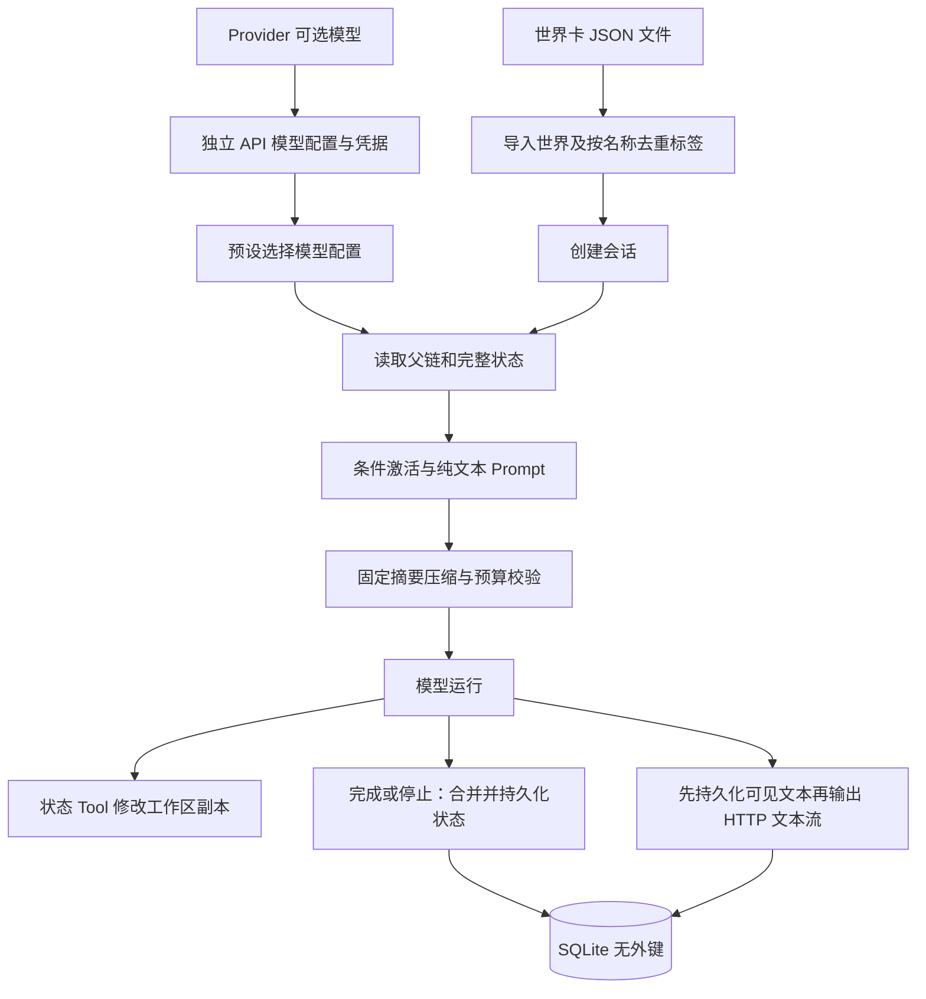

# 01 · SillyRealms Server MVP 总体方案

状态：待实施。2026-11-06 更新；本目录 01—05 是本次 Server MVP 实施基线，覆盖 `docs/` 与旧方案中冲突的内容。已有 docs 及其工作区未提交修改保持不变；真正实现核心链路时按 05 同步修订相关 docs 和受影响的 AGENTS.md。

## 1. MVP 目标与边界

以单用户本地服务端跑通：**导入世界卡 JSON → 导入标签 → 创建 API 模型配置 → 创建会话 → 按需选择预设和模型配置 → 流式对话、Tool 更新状态 → 摘要压缩 → 停止与历史恢复**。本期只实现 Server 和必要的自动化验证；不实现 Web、UI Runtime、事件总线、事件协议、SSE 或 WebSocket。流式回复使用普通 HTTP 响应体输出 UTF-8 文本，不把文本流包装成事件协议。

| 范围 | 本期决定 |
| --- | --- |
| 世界与世界线 | 不实现 createWorld/updateWorld；通过上传原生 WorldCard JSON 文件导入，每次导入创建一张世界卡。只追加当前 tip，世界线查看、切换、分叉、重新生成及续写均不支持。保留 parent_id、tip_entry_id、run_id、branch_count 和 Entry 类型以兼容未来分叉。 |
| 标签 | 从导入的世界卡 JSON 的 `data.tags` 直接读取标签**名称**，按名称导入 tag 表并去重；不要求调用者传 tag 映射。世界定义保存可导出的标签名称，不把内部 tag ID 当名称输出。 |
| Prompt | 预设、世界书、角色和摘要指令只使用纯文本；不执行 Prompt 脚本、不开放 Prompt 状态 API，`{{user}}` 等宏均原样保留、不做变量替换。`when` 是唯一独立的状态只读条件入口。 |
| Context | 不提供策略配置，固定摘要压缩；内部 N=40、K=12，并遵守完整 Token 预算。旧卡 `data.context` 留作非生效数据并返回提示，不改变运行策略。 |
| 状态 | 模型仅通过 Tool 调用修改本轮工作区状态；不从正文提取状态，不输出内联状态、不使用 ChangeSet。Tool 直接对本轮工作副本做经 Schema 检验的操作；Run 结束将工作区状态合并并持久化。正文只作为叙事，不承担状态协议。 |
| 停止 | stop 实际中止模型生成并保存**已输出给前端的文本**；停止完成后刷新、读取历史，能看到已收到的部分内容。已执行成功的状态 Tool 与该部分叙事一并结算；准备阶段未产生 User/输出时不新增空消息。 |
| 会话与预设 | 创建 Session 不依赖 Preset 或模型配置可用；`presetId` 可不传或为 null，提交任意非空 ID 时只保存引用。每次 Run 开始再验证当前 Preset、模型配置、凭据和模型；失败不写本轮 User。 |
| 模型配置 | Provider 内置模型目录按 `provider:[models]` 列出；API 模型配置是独立持久化模块。每条配置选择一个 Provider/模型并关联用户输入的 API Key，可为同一模型创建多个配置；Preset 选择配置 ID。 |
| Preset | 保留 create/import/export/list/get，支持 updatePreset 部分更新节点 Prompt、模型配置及其他允许字段。导出和删除无需检查内置标记或引用；删除后引用失效，读取/运行报明确错误，不自动替换。 |
| 数据库 | SQLite 不建外键，不依赖外键级联；无 schema 版本表、无 user_version 或自动版本迁移框架。初始 DDL 直接执行，后续 DDL 直接执行；关系和必要的关联清理由服务端显式处理。 |

仍保留 Session 查询/创建/更新/删除、按 Run 分页的历史、三个作用域的状态读取、Provider 模型列表及 API 模型配置管理、标签管理。世界卡删除主动清除其 Session/Entry；预设及模型配置删除不阻止已有引用，相关 Run 应提示缺失。所有路径均不允许通过隐藏入口绕过本表的 MVP 边界。

## 2. 数据流



一次 Run 按本轮开始时的 World、Preset、API 模型配置和完整状态构建输入，加载规则只计算一次。需要摘要时先生成且检查预算，再写 Summary 与 User；已成型 Pi 消息和工具调用保存为 Raw Entries，叙事投影用于历史及下轮上下文。流式文本采用先落库再对外写入的顺序。正常完成或用户停止时持久化完整状态；发生异常且无法完成状态校验时保留已输出文本并标记状态结算失败，不伪造成功。

## 3. 实施前要验证的风险

1. 选定版本 Pi SDK 能否按需组织 Prompt、暴露原始 toolCall/toolResult、准确取消，以及对同一轮依次交替产生文本和工具时正确持久化。用户已确认：模型不支持中途 system 时，允许 Pi SDK 按模型兼容规则将其合并至前部；User 只能出现一次，取消和工具数据仍需验证。
2. 状态仅通过 Tool 更新，选定模型必须实际支持 Tool；不支持时明确报错，不退回正文解析。无状态世界不需开放状态工具，可用纯文本模型。
3. `when` 的安全解释器只支持 03 定义的有限表达式；旧文档的任意 JS 行为不承诺兼容。导入不支持的表达式应返回定位诊断。
4. HTTP 网络只能保证服务端先保存再尝试写入；网络断开时服务端无法证明客户端实际收到哪些字节。因此停止后历史**至少包含客户端已成功接收的内容**，网络异常可能多出服务端已保存但客户端未收到的尾部，重连以历史为准。
5. API Key 需要与具体模型配置一一关联并安全存储，不出现在预设、导出、日志或 API 响应中。实际凭据存储平台和 Pi SDK 版本须先 PoC。

当前示例 WorldCard 以标签 ID 和旧 context 为目标格式，可能含 `{{user}}`；默认 Preset 含 EJS 和旧内联状态模式。本期应更新实现侧样例或给出可定位不兼容提示，不能声称它们原样导入后具备旧行为。数据格式与不变量见 02，Context/Tool 见 03，HTTP/停止见 04，任务见 05。

## 4. 目标工程目录

以下是实施目标，不表示这些目录或文件已经存在；初期只创建实际用到的内容，沿用 SillyRealms 自身 Git 仓库，不额外创建 Web、移动端或预支共享包。

```text
SillyRealms/
├── package.json                       # pnpm workspace 命令
├── pnpm-workspace.yaml
├── pnpm-lock.yaml
├── tsconfig.base.json
├── apps/
│   └── server/
│       ├── package.json
│       ├── tsconfig.json
│       ├── src/
│       │   ├── app.ts                 # Hono 应用和路由注册
│       │   ├── server.ts              # 监听、关闭、启动恢复
│       │   ├── config.ts              # 本地路径、监听配置
│       │   ├── routes/                # HTTP DTO、输入校验和调用服务
│       │   │   ├── worlds.ts
│       │   │   ├── tags.ts
│       │   │   ├── providers.ts       # 可选模型目录
│       │   │   ├── api-model-configs.ts
│       │   │   ├── presets.ts
│       │   │   ├── sessions.ts        # 历史、状态
│       │   │   └── runs.ts            # 文本流、停止、运行状态
│       │   ├── domain/                # 领域服务与领域校验
│       │   │   ├── world/
│       │   │   ├── tag/
│       │   │   ├── provider/
│       │   │   ├── api-model-config/
│       │   │   ├── preset/
│       │   │   ├── session/
│       │   │   └── state/
│       │   ├── agent/
│       │   │   ├── runtime.ts         # Run 协调、停止及结算
│       │   │   ├── projection.ts      # Raw Entry 到可见叙事
│       │   │   ├── context/           # 节点、内容激活、预算、摘要
│       │   │   ├── tools/             # set_state 及工作区更新
│       │   │   └── pi/                # Pi SDK 适配、文本流与取消
│       │   ├── infrastructure/
│       │   │   ├── database/          # 直接执行初始化 DDL、Repository
│       │   │   ├── credentials/       # 安全凭据存储适配
│       │   │   └── locks/             # 单实例、会话互斥
│       │   └── common/               # 错误、ID、日志脱敏等必要共用代码
│       └── test/                      # 单元与临时库/假 Provider 集成测试
├── docs/                              # 实施后同步的正式文档
└── plan/                              # 当前方案与实施任务
```

运行数据库、真实凭据和生成数据使用配置的数据目录，不写入源码或仓库。没有 migrations、events、web、UI runtime 和尚无复用需求的 packages；when 解释器、摘要算法等随各自领域落位，不为未来功能预建空目录。
