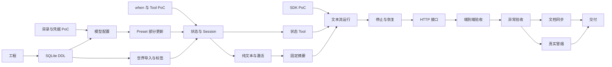

# 05 · Server MVP 实施任务和验收

状态：实施中；勾选表示对应本地实现和测试已通过，真实 Provider 兼容性仍待验证。按 01—04 的具体契约执行；每项记录测试命令和结果。只实现 Server，不建设 UI 或事件协议。改动涉及核心链路后同步 docs 和受影响的 AGENTS.md，保留用户工作区已有文档修改。

## A. 前置验证与骨架

- [x] **A1 · 技术栈和 Pi PoC**：锁定 Node、pnpm、TypeScript、Hono、SQLite 和 Pi 版本，建立 Server。以假 Provider 捕获请求，验证消息 role/order、当前 User 一次、普通文本流、Tool 请求/结果顺序、Abort、交错文本与工具、完成消息的原始内容。通过标准：可运行测试断言上述行为；允许 SDK 在模型不支持中途 system 时自动合并到前部；若取消或工具消息不能可靠处理，停止依赖该假设的实现。
- [x] **A2 · 模型目录和凭据 PoC**：核实 Pi 的 provider→models、模型能力与 contextWindow/maxTokens；选择安全凭据存储，验证同一 provider/model 多个独立 Key 配置的创建、替换、删除及故障。通过标准：同模型两项互不覆盖，响应/日志/数据库没有密钥明文；未支持平台明确失败。
- [ ] **A3 · when 与 Tool PoC**：实现 03 表达式子集的解析和安全解释原型，验证路径、短路、缺失和恶意 AST；用假 Provider 验证 set_state 直接修改工作副本，再针对选定真实模型验证工具支持和多轮交互。通过标准：无法执行任意 JS，Tool 参数不进入正文；未实际验证的模型不能被称作已支持工具。
- [x] **A4 · 工程初始化**：按 01 的目标工程目录配置 pnpm Server 项目、基础测试、lint/typecheck、配置与健康检查；限制监听地址和 Origin。通过标准：空数据目录可启动，测试不依赖真实 Key，库和运行数据不进入 Git。

## B. 数据、导入与配置

- [x] **B1 · SQLite 初始化 DDL**：实现 02 六表、JSON 和唯一性约束与查询索引；不声明外键、不引入版本字段、自动迁移或迁移表。通过标准：临时空库可反复启动；检查 `sqlite_master` 无外键声明；手工执行 DDL 的限制在文档中说明。
- [x] **B2 · JSON 世界卡导入和标签**（B1、A3）：以 multipart 文件接收 WorldCard JSON，校验定义和 when，读 `data.tags` 名称、去空白并按名称去重，同事务写 tag、World 和 Global；实现世界查询、导出、删除及标签管理。通过标准：同文件/不同世界的重复标签不重复创建，导出标签是名称；无 createWorld/updateWorld 路由；失败不留下半张卡或半组标签。世界删除由服务事务显式清理 Session/Entry。
- [x] **B3 · API 模型配置**（A2、B1）：实现 provider 可选模型目录和独立 api_model_configs 增查改删、凭据管理、显式连接测试；返回已配置项的列表和详情。通过标准：同模型多个 Key 配置独立，Key 不回显、不进入日志；删除后不因 Preset 引用而拒绝，后续解析返回缺失。
- [x] **B4 · Preset CRUD 与局部更新**（B3）：实现新增/导入/导出/读取/删除、选择 API 模型配置与 PATCH 语义；节点按 ID 局部合并，新增/删除/排序自定义节点有明确操作。通过标准：只修改一个节点的 content 不影响其他字段/节点；换模型只改引用；非法 patch 整体回滚；内置或被引用的 Preset 仍能直接导出和删除，引用不自动替换、历史不删除。
- [x] **B5 · 状态类型和 Session/Entry**（B1、B2、B4）：实现三作用域 Schema、Opening 覆盖、完整快照、Session CRUD、Entry 父链及 Run 分页。通过标准：无可玩角色禁止创建；未选择预设、引用不存在的预设或预设模型/密钥不可用均可创建并读取 Session，Opening 为根 Entry；同 Run 的多 Entry 不拆页；不支持分叉入口但保留 parent 等字段；父链跨会话和 tip 竞争被服务层拒绝。

## C. Context、状态 Tool 与运行

- [x] **C1 · 纯文本 Prompt / 内容激活**（A3、B5）：实现 always/on_mention 和 when、角色/世界书排序、七系统节点，正确处理玩家角色与锚点。通过标准：`{{user}}`、EJS、JS 均是原样文本、不被执行或替换；所有 when 读取初始完整状态，摘要之后不重新匹配；系统生成 worldState 不暴露状态脚本 API。
- [x] **C2 · 固定摘要**（C1）：实现固定 N=40/K=12、条数及预算双触发、分批摘要与覆盖点、完整 Token 复核和不丢源消息；保留旧 context 原文但不生效。通过标准：多轮后每个来源被准确覆盖，超限/摘要失败不写不完整 Summary；停止后的正文进入后续候选，旧样例提供清晰提示。
- [x] **C3 · 状态 Tool 与工作区合并**（A3、B5）：实现 `set_state(path,value)`、Schema/激活根/作用域与大小验证、工作副本顺序更新；完成或 stop 时合并、校验并持久化完整快照。通过标准：不存在正文状态提取、内联更新或 ChangeSet；非法路径与类型不得改变工作区；多次成功调用按顺序生效、未改字段保留，工具无成功调用时状态不变；纯 Tool 无正文也可将 state 挂到本 Run 最后 Entry。
- [x] **C4 · AgentRuntime 和普通文本流**（A1、C2、C3）：实现单会话锁、预检、User/摘要入库、Pi 实际调用、原始工具消息保存、文本块持久化后再写出普通 HTTP 流；采用可识别 partial Entry 并避免最终原始消息重复投影。通过标准：连接收到的每一段均可从数据库恢复；交错文本与 Tool 的顺序和原始数据保留；不出现事件总线、事件 envelope、SSE、UI Runtime。
- [x] **C5 · stop 与恢复**（C4）：实现 Abort、串行写入屏障、阻断迟到结果、幂等终态及状态合并；进程重启将 running 标为 interrupted，保留已落库内容。通过标准：测试真实分块输出，在中途停止后刷新 history，可看到收到的半条消息且无重复；成功 Tool 的状态与停止叙事一起持久化；stop/完成竞争、断线、失败和重启都有明确结果。网络断线时历史可能多出服务端已写出但客户端未收到的末尾，文档不承诺精确接收确认。
- [x] **C6 · HTTP 领域接口**（B2—B5、C4—C5）：实现 04 列出的 routes、DTO、请求大小、错误码、requestId 去重和缺失引用反馈。通过标准：模型目录按 provider 分组，已创建配置可单独查询；Session 可不选预设、可保存暂不可用引用；Run 在写本轮 User 前检查最新预设和模型配置、失败返回对应错误；世界只通过文件导入；所有移除接口 404；流启动后通过 GET run 判断最终结果。

## D. 集成与交付

- [x] **D1 · 端到端自动验收**：临时 SQLite + 假安全存储 + 假 Provider，走 JSON 文件导入含重复名称标签 → 创建两条同模型配置 → 创建和局部修改 Preset → 无可用预设时创建 Session → 验证 Run 被拦截 → 选择可用预设 → 发送文本和 Tool → 主动停止 → 刷新历史与状态 → 继续对话 → 触发摘要 → 删除仍被引用的 Preset。通过标准：状态、可见文本、Raw Entry、父链和失败提示符合 01—04，不请求真实外网。
- [x] **D2 · 失败与边界验收**：测试模型无工具支持、Tool 非法值、Key 丢失、被删除模型配置、被删除预设、重复 requestId、会话并发、摘要超限、真实分块 UTF-8、进程中断。通过标准：错误可定位、已输出文本不丢、引用不被隐式替换；网络/崩溃语义与 04 一致。
- [ ] **D3 · 真实模型冒烟**：用户显式配置真实 Key 后，测试一次基本生成、状态 Tool 和途中停止；只记录脱敏版本、模型、结果和用量。无真实环境时如实标记未验证，不把假 Provider 测试当真实兼容证明。
- [x] **D4 · 项目文档同步与最终检查**：按实际实现更新 `docs/README.md`、PRODUCT、design 下相关世界卡、Preset、Provider、Session、状态、Context、Agent、脚本、UI Runtime 和领域接口，以及 technical 下架构、存储、实施计划和示例 JSON；更新受影响 AGENTS.md。重点移除当前 MVP 的外键、迁移框架、内联状态、ChangeSet、事件协议、createWorld、分叉、宏替换等过时陈述，明确它们不属于已实现范围。通过标准：文档与真实接口及手工 DDL 行为一致，用户已有变更不被覆盖。
- [x] **D5 · 交付验证**：运行依赖安装、typecheck、lint、相关单元和集成测试；记录命令、结果、受支持模型与限制。没有真实 Key 或聊天正文进入提交/日志。后续 DDL 手工执行前按工作区约定备份，不自动执行破坏性数据库操作。

## 顺序

## 当前验证记录（2026-11-06）

- `pnpm lint`、`pnpm typecheck`、`pnpm test`：本地通过；测试使用临时 SQLite、假 Provider、模拟传输和临时独立 macOS Keychain。
- A3：受限表达式和工作区 Tool 的本地路径已实现；真实 Provider 的 Tool 兼容性与连接测试仍未执行。
- D1：完整假 Provider 流程已覆盖连续对话触发摘要；另有超长中文消息分段摘要测试。D2 的停止/中断/缺失引用、摘要失败、预算边界、凭据回滚和状态提交失败已测试；资产文件管理不在当前实现内，资源清理故障不适用。D3 需要用户自行配置真实模型，测试可能产生费用；本地交付检查已完成，真实 Provider 验收仍未完成。
- 参考世界卡 `$.data.lorebook.entries[5].load.keywords` 为空，会被按规范拒绝；未自动修改用户原文件。
