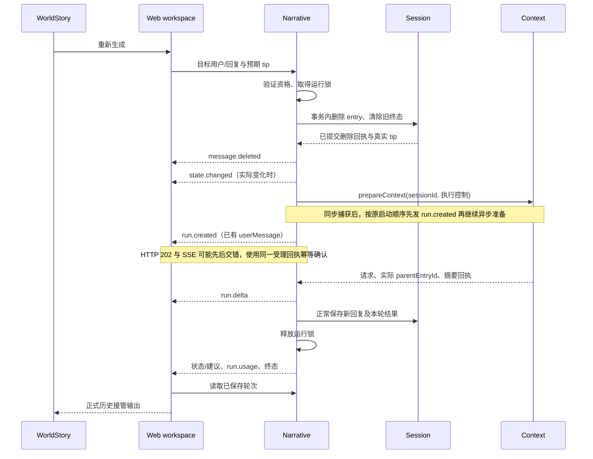

# 最新 AI 回复重新生成方案

状态：已实施。基于已调整的 Context，普通发送和重新生成共用执行链路。

本方案采用后续确认的产品规则：先删除旧回复，再生成；失败不恢复旧回复；用量继续按现存 entries 汇总；正常生成事件不增加 mode。此前《WorldStory-消息操作方案》中成功后替换、独立计量记录、编辑和历史截断的设计不适用于本次。

## 1. 范围与行为

- 最新一个用户轮次存在 AI 回复时，提供“重新生成”；已停止的部分回复也可以重新生成。
- 不允许重新生成开场，不允许处理后面还有新普通消息的历史回复。资格由 Narrative 用例在服务端验证。
- 使用当前会话配置，复用原用户 entry，删除旧 AI entry；新 AI 使用新消息 ID，沿用该轮 runId。
- 点击后暂留旧回复并禁用操作；服务端确认删除后才移除。模型失败不恢复旧回复；停止/失败时沿用普通发送的部分输出保存规则。
- 失败且没有新 AI 消息时，提供“重试生成”，复用同一用户 entry；此时没有旧回复要删除。不能误删更早一轮 AI。
- 生成中、离线或未同步时禁用重复操作。只读操作与停止保持可用。
- 不提供版本切换、编辑、任意历史删除、全局/会话状态回滚或后台自动重试。

## 2. 职责划分

| 层 | 责任 |
| --- | --- |
| Session | 通用删除、线性关系/tip 原子维护、受控结果元数据写入；不知道重新生成业务 |
| Narrative | 验证最新回复/用户轮次、持锁、编排删除与结果清理、发布删除事件、启动正常生成 |
| Context | 保持当前实现，仅凭 session 快照构建和优化上下文 |
| Web history / narrative | 分别管理已保存消息删除与本次临时输出；按消息 ID 去重 |
| SDK / WorldStory | 当前会话的命令代理、按钮、等待/失败/停止反馈 |

不复制 executeNarrative。将普通 submit 中“用户已就绪之后”的锁内启动流程提取为一个内部函数：获取凭据、准备 Context、启动 execute、结算与释放锁。普通发送先保存用户；重新生成先删除旧回复；两者交给同一启动流程。

## 3. Session 的通用删除能力

建议 `deleteEntry(sessionId, entryId, expectedTipEntryId, permit?)`，返回被删 entry、新 tip 与必要的前后关系信息。Service 校验本域规则和许可，Repository 内部事务维护本域 SQL。

仅有 `deleteTipEntry` 不足以覆盖当前架构：独立 Context 构建可在 AI 后保存 compaction，因此“最新 AI”不一定是物理 tip。

删除方法原子完成：校验会话、条目和预期 tip；将直接后继的 parentId 接到被删条目的 parentId；删除目标；目标为 tip 时回退 tip，否则保持 tip；更新 session 时间。不改其余条目内容、state、runId 或计量，不级联删除后续条目，不发布事件，不清理业务运行结果。本次不开放通用删除 HTTP/SDK 接口。

Narrative 对其施加更窄的准入：目标是最新普通 AI 消息，同轮存在原用户消息，用户与目标之间及目标之后只允许对应轮次的 compaction；拒绝开场和不符合结构的手工历史。

例如 `用户 → 摘要 A → 旧 AI → 摘要 B` 删除后为 `用户 → 摘要 A → 摘要 B`，tip 仍为摘要 B。有效 message 状态按剩余链继承；摘要若覆盖了被删内容，现有 sourceHash/覆盖范围校验会使其失效，无须另建回滚逻辑。

旧轮次终态由 Narrative 在同一个外层同步事务里通过 Session 的受控方法清除；可扩展 `setNarrativeOutcome(..., null, permit)` 表示清除结果。它与删除是两个职责。读写状态计算及事件仍归用例；不把 EventHub 放入 Session。

## 4. 受理与执行身份

新增 `POST /api/v1/sessions/:id/narrative/runs/regenerate`，输入：

```ts
{
  userEntryId: string;
  assistantEntryId: string | null; // 要删除的回复；null 仅用于最后用户尚无回复的重试
  expectedTipEntryId: string;
}
```

服务端读取正文，不接受客户端重新传来的用户文本。assistantEntryId 为 null 时，必须验证最新普通消息恰好是目标用户，不能用 null 跳过已有回复的校验。校验、删除、结束结果清理及实际生成均在同一个运行锁生命周期内，不在模型等待期间持有数据库事务。

HTTP 仅在删除/清理事务提交后返回 202。沿用 AcceptedRun 的 runId、userEntryId、assistantEntryId、userMessage，增加实际 tipEntryId 和 deletedMessageIds。响应里的 assistantEntryId 是本次新回复的预留 ID，绝非已删除消息 ID；deletedMessageIds 为空表示无回复的重试或普通发送。

消息与执行身份分开处理，但不新增 attemptId：

- 原用户 ID 和轮次 runId 保持稳定，确保完整轮次分页、摘要边界与原历史对应。
- 新回复预留 ID 已经唯一，可直接作为每次执行标识。所有普通生成的 run 事件公共字段、受理响应、停止请求携带 assistantEntryId，delta.messageId 与它相同。
- stop 校验 runId 与 assistantEntryId 两者；旧停止请求不得停止同轮新生成。
- active Map、查询投影、前端已结束集合按执行身份区分。新终态在现有首条 entry 的 narrative 元数据中记录 assistantEntryId；兼容旧记录缺少此字段，不创建运行表或恢复任务。
- 生成事件名称保持正常的 run.created/summarizing/summarized/delta/usage/completed/stopped，不添加重新生成 mode 或特殊 phase。

## 5. 事件与前后端时序

新增会话事件 `message.deleted`，由 Narrative 用例发布：

```ts
{
  sessionId: string;
  runId: string;
  assistantEntryId: string; // 本次新执行的身份
  messageId: string;       // 已删除的旧 AI
  tipEntryId: string;      // 删除后实际 tip，可能是 compaction
}
```

SessionEvent 增加此事件；Web 明确路由给 history/suggestions/workspace，不把它误当成生成终态。正常 run.created 增加实际 tipEntryId，messages 仍携带同一个已保存用户消息，不伪造第二条 user。



删除和状态通知必须发生在事务提交后；此时运行锁仍持有以保护后续生成。这是开始阶段的已提交变化，不能等到生成结束才通知。终态前的通知仍遵循原有“结算并释放锁之后发布”顺序。事件观察者失败不回滚提交，也不能阻止执行或锁释放。

## 6. 前端状态处理

1. 点击：设置 submitting，保留旧消息；拒绝重复点击，SDK 只调用 Web 命令。
2. 收到删除事件或 HTTP 删除回执：按旧 messageId 幂等移除 history 和相关临时残留；清除旧建议、旧实时 usage 和终态展示；采用真实 tip，更新有效状态并重新查询用量。
3. 收到 run.created：按用户消息 ID upsert，不追加重复用户；为新 assistantEntryId 建立执行状态。不能再把 userMessage.id 当成 tip，也不能被同一 runId 的旧 settled 标记拦截。
4. 收到 delta：在新 AI 消息位置追加输出，只接受本次执行身份。workspace 不能用旧已完成轮次遮住新执行；saved 标记只以持久化查询为准。
5. 收到终态：根据正常保存结果接管；不按旧消息恢复。迟到 HTTP 回执只能补齐删除/受理事实，不能把完成状态或新 tip 回退。

HTTP/SSE 两条到达路径共用受理处理。重复 message.deleted 无副作用；老执行的迟到 delta、usage、terminal、stop 响应不能覆盖新执行。建议依 messageId 绑定，已删除消息的旧建议不重新显示。

## 7. 历史同步和异常

- 当前 history 的 `lastSeq 只增不减` 与 `完成状态不能回到运行中` 合并规则必须调整。最新轮次权威读取应完整替换该轮 entries，包括不存在的旧 AI。
- 本次不引入通用历史版本系统或数据库 seq 迁移。仍按现有 seq 分配；删除物理末尾后新消息可能复用 seq，因此 messageId 才是条目身份，不能依赖 afterSeq 发现删除或替换。
- 删除/新执行/终态使相应在途历史请求失效；以本地读取代次丢弃旧响应。普通 delta 不反复使历史请求失效。
- 重连及显式重新同步时，清空旧历史分页缓存并有界读取最新 1–5 轮，而不是仅 catchUp；需要更早内容时继续分页。中断前的旧请求不能回填已删除消息。保留可用的阅读锚点，不要求拉全量历史。
- 删除失败：不发删除事件、不启动生成，返回错误并释放锁；原消息保留。
- 删除成功后准备/模型失败：旧回复不恢复；保存本次停止结果。部分输出正常保存，没有公开输出不造空 AI，页面显示重新尝试。
- HTTP 超时/连接中断：先同步，不自动重新请求，避免多次模型调用。服务进程重启不续跑，沿用 unknown/当前持久历史的恢复边界。
- 两窗口竞争：目标 ID 与 expectedTip 校验加会话运行锁，只受理一个；冲突窗口刷新。成功后状态只更新 message scope，session/global 不回滚。

## 8. 用量、摘要和兼容边界

保持 `recordedUsage` 汇总现存 entries.metrics。删除旧 AI 会移除它的计量，新 AI 保存后计入新计量，保留 compaction 的计量不删除；不声称 Session 数值是历史全部账单。不建累计表、不在 session.usage_json 另存账本、不合并被删请求到新 AI。

前端清除旧实时 run.usage 并重新读取服务器统计，不自行减 token。latestContext 沿用最近已保存主请求的含义，不把回退后的旧快照冒充新请求的精确占用。失败且无公开输出时的计量限制沿用普通生成。

Context 不改接口、不识别来源。删除后按 session 当前数据选择输入、有效摘要、消息状态和材料。后处理只处理新输出一次，旧 output 不重放；新结果无行动建议时不残留旧建议。

## 9. 验收与文档

验证从 API 用例到 Web 控制器的函数级行为：最新回复准入、开场拒绝、摘要前后删除的父链与状态、重复用户幂等、原消息确实删除、新消息正常保存、失败/取消/零输出、旧事件隔离、HTTP/SSE 乱序、遗漏删除事件后的重连、seq 复用、重复点击、多窗口冲突、摘要失效和现存计量统计。普通发送、摘要、停止、后处理回归必须通过。

实施时更新根与 Server/Web AGENTS、server-http/server-events/server-narrative/web-runtime 及 SDK/世界组件相关实际契约。按项目要求运行函数级测试（排除启动真实服务的 server.test.ts）、typecheck/lint 及相关构建；不启动服务、不增加模拟浏览器端到端环境。

## 10. 树形文件变更范围

下列为实际实施范围：`[改]` 修改现有文件，`[增]` 新增文件。本次功能没有删除文件。

```text
SillyRealms/
├── AGENTS.md                                      [改] 项目契约与方案文件树要求
├── apps/
│   ├── server/
│   │   ├── AGENTS.md                              [改] 删除、重新生成与事件契约
│   │   └── src/
│   │       ├── errors.ts                          [改] 重新生成目标校验错误
│   │       ├── modules/sessions/
│   │       │   ├── service.ts                     [改] 通用 deleteEntry、受控终态清理
│   │       │   ├── repository.ts                  [改] 原子删除、后继衔接及 tip 维护
│   │       │   ├── schema.ts                      [改] 终态关联本次 assistantEntryId
│   │       │   ├── types.ts                       [改] 删除回执及查询类型
│   │       │   └── service.test.ts                [改] 删除、父链、继承状态与计量验证
│   │       ├── routes/
│   │       │   ├── narrative.ts                   [改] 重新生成入口、停止执行身份
│   │       │   └── narrative.test.ts              [增] 路由函数级权限、入参与响应验证
│   │       └── usecases/narrative/
│   │           ├── index.ts                       [改] 普通提交/重新生成装配与查询投影
│   │           ├── start.ts                       [增] 已有用户就绪后的公共执行生命周期
│   │           ├── regenerate.ts                  [增] 资格校验、删除事务与提交后通知
│   │           ├── execute.ts                     [改] 正常执行事件及终态关联新回复 ID
│   │           ├── events.ts                      [改] message.deleted 与普通事件字段
│   │           ├── types.ts                       [改] 输入、受理回执与执行类型
│   │           ├── index.test.ts                  [改] 普通发送/停止兼容回归
│   │           ├── regenerate.test.ts             [增] 删除后生成、摘要父链、失败重试与事件时序
│   │           ├── write-locks.test.ts            [改] 删除至结算锁生命周期
│   │           ├── compaction.test.ts             [改] 摘要取消使用精确执行身份
│   │           └── postprocess.test.ts            [改] 新执行身份及状态/建议回归
│   └── web/
│       ├── AGENTS.md                              [改] 消息删除、执行幂等与重连契约
│       ├── src/
│       │   ├── transport/session-events.ts        [改] 删除事件白名单与事件字段校验
│       │   ├── stage-host/commands.ts             [改] 新命令和停止参数校验
│       │   └── features/
│       │       ├── narrative/controller.ts        [改] 重新生成命令、执行身份与乱序处理
│       │       ├── history/controller.ts          [改] 删除、权威替换、分页请求失效
│       │       ├── suggestions/controller.ts      [改] 删除后清理对应建议
│       │       └── sessions/
│       │           ├── workspace.ts              [改] 事件路由、投影合并及重新同步
│       │           └── SessionPage.tsx            [改] 停止按钮传递本次执行身份
│       └── tests/
│           ├── narrative.test.mjs                 [改] 用户去重、旧事件隔离、HTTP/SSE 乱序
│           ├── history.test.mjs                   [改] 删除、seq 复用与完整轮次替换
│           ├── suggestions.test.mjs               [改] 被删除消息的建议不复活
│           ├── session-events.test.mjs            [改] 新事件解析和分发
│           ├── session-workspace.test.mjs         [改] 生成展示、真实 tip 和断线同步
│           ├── stage-host.test.mjs                [改] 命令准入校验
│           └── stage-frame.test.mjs               [改] SDK 代理与执行身份透传
├── packages/sr-sdk/src/
│   ├── stage-contract.ts                         [改] 共享命令、事件、受理及快照类型
│   ├── world-story.css                           [改] 紧凑操作入口与生成状态样式
│   └── stage/
│       ├── runtime.ts                            [改] session API 命令代理
│       ├── index.tsx                             [改] 新增公共类型导出
│       └── world-story.tsx                        [改] 重新生成、停止反馈与无回复重试入口
├── docs/
│   ├── runtime/
│   │   ├── server-http.md                         [改] 重新生成与停止接口
│   │   ├── server-events.md                       [改] 删除事件及正常生成事件字段
│   │   ├── server-narrative.md                    [改] 删除后生成、锁和统计口径
│   │   └── web-runtime.md                         [改] 前端幂等、历史替换与恢复行为
│   └── design/world-components.md                [改] SDK/WorldStory 操作能力边界
└── plan/
    ├── WorldStory-最新回复重新生成方案.md           [改] 当前方案与文件变更树
    └── WorldStory-最新回复重新生成任务.md           [改] 对应实施任务
```

`usecases/context/`、模型适配器、后处理算法、数据库表结构、Session 用量汇总算法和 SSE 传输基建继续复用，不属于本次计划修改范围。`start.ts` 与 `regenerate.ts` 是 narrative 内部文件，不增加独立服务或新的跨模块入口。
