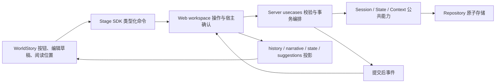

# WorldStory 消息操作方案

状态：建议方案，尚未实施。范围：最后回复重新生成、正文编辑、删除消息及后续历史。本文不改变现有运行契约；实施时须同步更新相关规范。

## 1. 当前实现与缺口

- `packages/sr-sdk/src/stage/world-story.tsx` 负责消息展示、阅读位置、状态面板和行动建议，没有消息操作入口。
- `packages/sr-sdk/src/stage-contract.ts` / `stage/runtime.ts` 只开放发送、停止、历史查询等命令，没有重生成、编辑、删除。
- `apps/server/src/routes/sessions.ts` 已有通用 entry PATCH；`modules/sessions/service.ts` 会阻止生成期间编辑，保留 narrative/output。它不是面向用户的“仅修改正文”完整操作：还缺少正文专用校验、版本冲突、变更通知与前端同步。
- `usecases/narrative/index.ts` 每次 submit 都创建用户消息。因此不能用再次 send 相同文本实现重新生成，否则重复用户消息。
- entries 当前按线性 seq 读取，message 状态按 seq 继承；没有单条消息删除用例。只改 tip 或只在界面隐藏消息均不够。
- 用量当前从 entries.metrics 汇总；物理删除或覆盖会丢失旧请求计量。历史控制器主要合并新增/重叠轮次，不能可靠发现历史正文修改和删除。
- 摘要已有覆盖范围 sourceHash 校验，可识别被编辑的旧历史；应复用，不另建摘要失效框架。

## 2. 推荐的产品边界

| 操作 | 第一版范围 | 不隐式执行的行为 |
| --- | --- | --- |
| 重新生成 | 最后一个用户输入对应的最后一条 AI 回复，包括已停止的部分回复；没有回复时显示“生成回复” | 不重复用户输入，不自动生成历史中间回复，不保留可切换的版本分支 |
| 编辑正文 | 已保存的用户/AI 消息；开场也可改文字 | 不重新调用模型、不重跑后处理、不自动改变状态和后续回复 |
| 删除 | 最后一条直接删除；历史位置删除该条及后续全部消息 | 不提供挖掉中间一条但保留后续的行为；不自动重演剧情 |
| 开场 | 可编辑正文，保留初始化快照 | 不删除，不重新生成；换开局应新建会话 |

所有写操作要求会话已同步、目标已保存、无活跃生成；正在同步、离线或生成中禁用，并给出原因。服务端仍须独立校验。允许复制、阅读、加载历史和停止生成。

“最后一条 AI 回复”必须同时属于最后一个用户轮次，不能在后面已有新用户消息时重生成更早回复。资格由 Server 计算，不能依据前端当前加载的五轮或消息角色猜测。开场根据会话首条初始化消息的结构识别，不把任意 assistant 都视为模型回复。

## 3. 交互与例子

### 重新生成

用户：“推开门。” → AI：“屋里有一位老人。”

点击 AI 回复的“重新生成”：复用“推开门”，使用当前模型、预设和当前可用材料，再生成一次。旧回复保留，新回复在同一位置显示为“正在重新生成”的临时预览；成功后替换旧回复。失败或停止恢复旧回复，显示本次失败原因，不追加第二条“推开门”。停止不会自动采用半条新回复。已经发生的模型请求仍计量。

没有旧回复的失败轮次使用“生成回复”，复用已保存用户输入；其停止/失败时保留部分输出的行为沿用普通发送。重新生成不是精确复现原始请求，不承诺相同配置和随机结果。

首次操作说明：“将替换当前回复，成功后更新消息状态；失败保留原回复。会产生新的模型用量。”不要求每次弹确认框。生成期间显示停止按钮，防止重复点击；其它消息操作和发送禁用。

### 编辑正文

点击消息的“编辑”，原位显示正文输入框、“保存”“取消”。读取原始正文而非渲染后的 HTML；保留原阅读位置。禁止全空正文；保存失败保留草稿。Escape 取消，Ctrl/Cmd+Enter 保存，处理输入法组合状态。成功显示“已编辑”。

例如把“消耗 10 金币”改成“消耗 5 金币”，这只是文字修订，不会把金币状态自动补回 5。编辑区明确提示“只修改正文，不修改状态，也不重新生成后续回复”。下次生成按已修改正文准备上下文；旧后处理记录仍表示当时执行结果。

第一版不把“保存”和“保存并重写后续剧情”混在一起。用户想改变剧情，应先删除相应后续，再编辑保留的用户消息，最后生成回复。

### 删除

最后 AI 回复：菜单显示“删除回复”，删除后保留用户输入，呈现“等待生成回复”，而不是沿用已完成或显示不明错误。删除最后用户消息时，也删除它后面的 AI 回复。

历史位置：菜单明确显示“删除此条及后续消息”，确认框展示起始消息摘要及受影响的用户/AI 消息数，不把 compaction 条目计入消息数。例：“将删除此条及后续 5 条消息。消息状态退回保留位置；会话和全局状态不回退，已有用量保留。”不以“删除这条？”掩盖级联范围。

确认框由 Web 宿主统一承载，避免 iframe 裁剪，并让自定义组件也经过同一删除确认。确认时重新校验历史版本；范围变化返回冲突，刷新预览后重新确认。失败保留原列表；成功后刷新历史、状态、建议和用量展示，并把焦点移到保留位置。第一版不提供回收站/撤销。

桌面使用紧凑的消息操作菜单，最后回复可单独展示重生成入口；移动端保留可点击的“更多”，不依赖 hover/长按，不为每条消息增加一排常驻大按钮。用现有语义 token 和控件尺寸。

## 4. 状态与副作用

| 操作 | message 状态 | session/global 状态 | 行动建议 | 用量 |
| --- | --- | --- | --- | --- |
| 编辑 | 不变；保留原 output | 不变 | 不重跑；原处理记录保留 | 不变 |
| 重生成成功 | 从保留的回复前边界计算新快照，替换旧回复快照 | 保留受理时的当前值，不回滚 | 替换为新结果；新结果为空也清除旧建议 | 旧、新请求均保留 |
| 重生成失败/停止，有旧回复 | 旧快照继续生效 | 不变 | 恢复旧建议 | 保留实际取得的计量，未知不当作零 |
| 删除及截断 | 重新读取保留 tip 的继承状态 | 不变 | 按保留末轮恢复/清空，不沿用被删建议 | 不随消息删除而减少 |

特别注意：重生成上下文不能包含被替换回复的正文、模型旁注或它已经改变的 message 状态。旧回复仍在正式历史里显示，不代表它可进入候选生成的上下文。message 状态上的后续手工改动会随被删除的消息快照一起移除；这不是所有业务状态的时间旅行。

## 5. 能力归属

- WorldStory 不直接发 HTTP，不操作 tip/seq，不拼重生成上下文，不计算状态回滚。
- SDK 只代理当前会话的窄命令，如 `narrative.regenerate`、`messages.edit`、`messages.requestDeleteFrom`，并传递明确的目标/预期版本。不得暴露任意 entry payload/state/metrics 修改；作者预览不开放运行消息写入。
- workspace 组合 feature 生命周期、确认、冲突后的重新同步；history 管已保存记录，narrative 管新候选输出，state 管有效状态，suggestions 管建议投影。避免把所有逻辑继续堆进 workspace。
- Server 的消息操作用例拥有权限、资格、锁、上下文边界和事务；模块只暴露明确的本域方法。删除和重生成不能通过现有通用 PATCH 拼装。

## 6. 服务端与协议设计

### 版本与并发

增加持久化 historyRevision，并在正文修改、历史截断、回复替换及影响读取结果的历史写入后原子递增。写请求同时携带 expectedTipEntryId 和 expectedHistoryRevision；只比 tip 发现不了同一消息已被另一个窗口编辑。

复用 RuntimeCache 写锁。重生成从受理直到结算持有 run permit，包括世界级 global 写保护；编辑/删除在同步事务内校验锁与版本。不得在模型调用期间持有 SQLite 事务。

seq 改为会话单调递增分配，截断后不通过 MAX(剩余 seq)+1 重用旧序号。历史分页携带 revision；旧 revision 的分页结果不能混入新历史。

### 请求与轮次身份

现有 runId 同时承担消息分组和执行识别；原样复用会让旧 delta/stop 误伤新生成。保留 runId 表示原有对话轮次，新增 attemptId 表示一次执行；首次发送也分配 attemptId。受理、delta、stop、终态携带 attemptId，客户端按它隔离迟到事件。不能给原用户消息重复分配新消息 ID，也不能仅创建不同 runId 的孤立回复破坏完整轮次分页。

最近一次失败的重生成结果与已采用回复的终态分别表达；可在轮次首条 entry 的服务端 narrative 元数据内保存最近 attempt 结果，不新增 runs 表或执行恢复体系。轮次投影补充“等待回复”的明确状态，删除回复后不能仍称原回复已完成。活跃 attempt 的展示优先于旧回复的完成状态。

### 三个窄业务接口（建议命名）

- `PATCH /sessions/:id/messages/:entryId/content`：正文、expectedTipEntryId、expectedHistoryRevision；返回更新消息及 revision。只允许正文，不接受客户端 role/output/state/metrics/narrative。
- `POST /sessions/:id/narrative/regenerate`：目标 userEntryId、可选被替换 assistantEntryId、预期 tip/revision；返回 runId、attemptId、用户消息 ID 和候选回复 ID。独立于普通 submit，不重复追加 user。
- `POST /sessions/:id/messages/delete-from`：起始 entryId、预期 tip/revision；返回删除数量、保留 tip 和新 revision。配套只读删除范围预览供宿主确认。

若保留原通用 entry PATCH，它也必须经过同一版本递增与通知路径，不能出现另一条不通知客户端的历史编辑通道。资格/范围由 Server 返回，分页未加载完整历史时仍可正确确认。

### 重生成执行与原子替换

1. 校验目标属于最后用户轮次，识别受保护开场；加锁后同步捕获配置、历史前缀、用户正文和回复前 message 状态。
2. 扩展 context 的显式输入模式，使它能从已存在用户输入准备上下文；复用材料、预算、模型旁注和摘要算法。不能假定 user 一定是当前 tip，也不能仅绕过该校验而仍读取旧回复。
3. 增加候选准备路径：新摘要和回复在采用前不推进正式 tip，候选流独立投影；后处理基于保留边界计算候选快照，不提前发布状态事件。
4. 正常完成时，在一个同步事务中再校验版本与 permit，清除用户消息之后的旧回复/该轮尾部 compaction，写入候选摘要、回复、output、状态快照、轮次结果并推进 tip/revision。用户 entry 保留，替换回复使用新 ID，seq 不重用。
5. 模型失败、取消或落库失败时，有旧回复则保留旧消息、状态及原终态，记录本次尝试结果和实际可得计量；不采用半条候选。没有旧回复的补生成遵循普通发送的部分输出保留语义。

这里需要明确扩展现有摘要契约：普通 send 仍立即保存成功摘要；替换操作使用候选摘要，成功采用时才写入有效历史，未采用的成功摘要请求保留计量但不推进 tip。不能直接照搬当前 prepareContext 中“保存摘要即推进 tip”的行为来宣称失败保留原历史。

### 删除与编辑

删除只操作连续尾部：先识别边界和涉及的隐藏 compaction，再在事务内删除尾部 entries、修正 tip、剩余轮次状态和 revision。删除 AI 回复时，同轮用户之后的 compaction 一起处理；不暴露通用 setTip/任意历史分支。初始 assistant 和其初始化快照不可删除。

编辑只改 payload.message.content 和明确的编辑标记，保留 reasoning/tool_calls、output、state、metrics 及运行结果。旧摘要 sourceHash 不匹配时按现有逻辑失效；删除或替换也必须使覆盖已失效历史的摘要不可复用。不让模型旁注从已删除/被替换回复漏入新上下文。

### 用量持久化

推荐由 sessions 域维护独立的请求计量记录，以 requestId 去重，保留 sessionId/runId/attemptId、用途、模型、usage、时间与上下文快照。它不是执行任务表，也不承担恢复或事件回放。

迁移现有 entries.metrics 的已知请求；汇总只从计量记录读取，避免双计数。消息上的 metrics 可以作为读取投影，但不是删除后唯一的数据来源。删除消息不级联删除请求；删除整个会话仍可按现有会话清理语义清理其请求。未知用量保持未知，既有失败摘要计量边界不在本任务中顺带扩张；新候选中成功摘要即使最终未采用仍需保留已得到的计量。

latestContext 与累计费用分开：旧请求仍计费，但失去对应有效回复、历史版本改变或配置改变时，不能作为当前有效上下文显示，需标记 stale 或清空。

## 7. 同步、恢复与验证

新增原生 history.changed 事件，包含 revision、变更类别及受影响边界/ID。事务提交并释放锁后再通知。重生成仍使用已有生成事件族，加 attemptId 和操作类别；不能通过伪造新 user 的 run.created 适配旧前端。

history 控制器按 revision 更新/移除数据，废弃旧分页请求；不能继续只允许 lastSeq 增大。断线重连比较 Server revision，有差异就重新读取有效历史和各投影。无失效范围证据时，废弃缓存分页并有界重读；不承诺靠 afterSeq 找回被删除或改写的消息。

重生成期间采用候选覆盖展示，但 durable history 保留旧回复；持久化读取确认新候选后才接管。编辑草稿只属 UI，不被事件静默覆盖；冲突保留草稿并提示重新同步。历史重读保留已有锚点，锚点被删除时定位最近的保留消息。

验证重点：无重复 user；生成失败旧回复仍在；不会重复执行旧状态更新；截断后 seq 不复用；历史修改后摘要失效；计量不丢不重；多窗口冲突；旧 delta/终态不会污染新 attempt；事件遗漏后能恢复；作者组件不能越界操作其它会话或写入系统字段。

本阶段不包含：多版本切换、分支会话、全文事件回放、全局/会话状态回滚、生成中编辑、后台自动重试、进程重启续跑、中间单条挖空删除。按项目约束使用函数级测试、typecheck/lint/build，不启动服务或添加模拟浏览器端到端环境。
