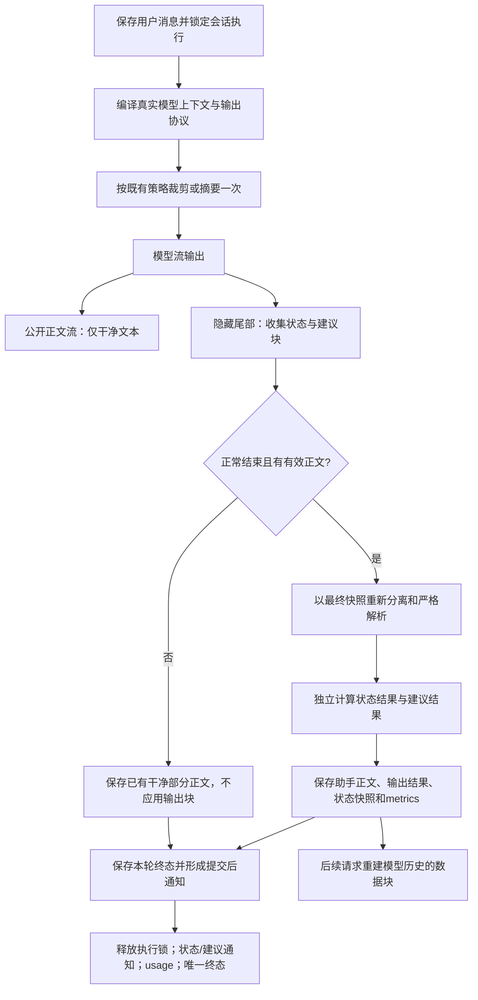

# ServerV2 叙事输出块处理与模型历史方案

状态：待实施。只编写方案，不修改业务代码。依据当前 ServerV2 与原 Server 源码；不以兼容旧 SDK 为设计目标。

任务：[server-v2-narrative-output-tasks.md](server-v2-narrative-output-tasks.md)。

## 1. 产品目标与结论

一次叙事请求仍只生成一次正文，可按既有策略先摘要一次。正文生成完成后，同一条模型回复尾部可以携带状态更新和行动建议；服务端识别、校验并处理，不增加辅助模型调用或自动修复请求。

玩家看到的流式正文、最终正文、历史聊天始终不包含这些数据块。状态面板展示提交后的状态，行动区展示本轮有效建议。模型后续请求需要看到输出格式的历史示例，不能因为前端隐藏数据块而把模型上下文也一并清空。

推荐方案：**展示正文与模型历史采用不同投影；结构化输出单独保存，编译模型历史时重建有效的数据块。**

- `payload.message.content`：干净的叙事正文，供聊天展示、组件替换、关键词激活和摘要使用。
- `extData.output`：服务端处理的结构化输出及结果，供状态/建议展示、诊断和模型历史重建使用。
- 主叙事模型历史：干净正文 + 从结构化结果规范化重建的有效数据块；只用于模型输入，绝不再次执行历史更新。
- 不重复保存一份完整原始模型正文，不把原始坏 JSON 放回上下文，不新增表或正文副本列。

这可以避免历史全部只有正文而弱化输出格式示例，但不能保证模型百分之百遵循指令。数据块缺失/错误须有明确处理结果；本版不重试、不补发第二次请求修复。

## 2. 当前实现与已有能力

| 当前文件 | 已有行为 / 缺口 |
| --- | --- |
| `apps/serverV2/src/usecases/narrative/compile.ts` | 明确跳过所有 postprocess 节点；默认预设中的输出块提示词尚未进入模型请求 |
| `narrative/model-call.ts` | 消费模型流、形成权威快照和 metrics；正文 delta 当前直接发到 EventHub，必须在这里接入隐藏分流，不能只在保存时裁切 |
| `narrative/execute.ts` | 保存完整/部分助手公开输出、单独保存用户终态；尚无模型状态/建议处理 |
| `narrative/history.ts`、`materials.ts` | 历史只有可见正文投影；新增模型投影不能污染摘要来源和材料激活 |
| `narrative/prepare-context.ts` | 已有滑动窗口与一次滚动摘要；候选预算必须覆盖重建后的实际模型消息 |
| `modules/state/service.ts`、`patch.ts` | 三 scope 读取、路径替换、类型/rules 校验、变化计算；缺少对一组模型更新的纯候选计算与激活根约束 |
| `usecases/set-state.ts` | 面向显式状态写入的逐项提交与提交后事件；不能直接把它嵌进叙事收尾来逐项落库 |
| `modules/sessions` | entries 支持独立 payload/extData/state/metrics；追加条目、seq、tip 原子推进 |
| `narrative/events.ts` | 已有 state.changed 通路；action_suggestions.changed 仅为预留类型，尚未生产 |

原 Server 可参考：`runtime/postprocess/stream-splitter.ts`、`parser.ts`、`strict-json.ts`、`state-update.ts`、`action-suggestions.ts`。保留跨分片隐藏、严格解析、逐项状态校验、两个块独立处理等语义；不直接依赖旧模块，也不迁移 RunStore、run_preparations、恢复日志或 run.phase。

## 3. 产品流程



只有当前 run 新生成的输出块能进入处理流程。历史重建、读取历史、重连、摘要均不执行更新。

默认处理范围：

- 模型状态更新仅针对 **message scope**，且仅能写本轮最终上下文中激活的状态根。global/session 保持现有显式状态接口，不向模型新增跨 scope 写权限。
- 行动建议默认为本轮提供三个下一步选择，不代表动作已经发生，不自动发送、不自动执行，也不因此改变状态。
- 这两项按既定方向作为默认叙事能力，不增加 capability 接口或能力开关。没有激活 message 状态根时不要求状态块；行动建议仍要求输出。

## 4. 提示词与输出协议

### 4.1 纳入默认能力

使用 V2 预设已有 worldState/actionSuggestions 提示词，并在服务端加入稳定的格式约束。原有核心节点/自定义节点的顺序保持；输出契约放在编译后的末尾 system 消息中，保证每轮明确提示格式。

- 内置后处理节点不再被 compile.ts 一律跳过。
- worldState 仅在最终候选的 activeRoots 非空时参与本轮输出任务，使用该候选的 state.entries。
- actionSuggestions 每轮参与。
- 内置后处理节点缺失或提示词为空时，用 PresetService 提供的默认提示词补足；旧 enabled 值忽略，不再作为执行能力开关。非空自定义提示词保留，但不能取消服务端的固定解析协议。
- 默认提示词和已有节点格式仍由 presets 模块拥有；narrative 不导入 default.ts/schema.ts 等内部文件。补一个明确的公开提示词解析能力即可，不建立提示词服务框架。
- 不批量改写预设、不改变 revision。StudioV2 旧开关的移除随前端后续适配完成；旧开关值不再控制本版服务端能力，此行为须在实施文档中写明。
- `ModelClient.assertMessageOrder` 仍检查完整消息顺序；不为兼容模型而随意前移系统消息。

固定协议：

```text
叙事正文
<state_update>[{"path":"coins","value":8,"reason":"购买食物"}]</state_update>
<action_suggestions>["继续询问店主。","去集市寻找线索。","动身前往城外。"]</action_suggestions>
```

有激活状态时 state_update 必须且只能出现一次，无变化输出 `[]`；无激活状态时省略。action_suggestions 必须且只能出现一次。顺序固定；不接受外层容器、Markdown 围栏或尾随正文；需要在正文中展示保留标签时用 HTML 实体。

固定提示词含一个明确标注为“格式示意、不可照抄值”的静态示例，以覆盖无历史、开场或历史已经被摘要的场景。实际状态值以本轮 state.entries 为准，历史更新与建议只是过去的输出记录，不能重复结算或当成已发生动作。

### 4.2 预算

后处理提示词、格式示例及历史重建的数据块全部进入主模型的真实估算。不能按干净正文算预算、发送时才追加隐藏内容。

每个候选历史重新计算 activeRoots、输出要求、模型历史投影和最终 messages。沿用既有硬预算、60% 软目标、最近五轮保护、一次摘要后仍超限即 summary_capacity_exceeded，不增加第二次摘要或协议修复调用。

## 5. 流式识别与解析

### 5.1 展示隔离

增加叙事内部 `output/stream-splitter.ts`：

1. 缓冲可能尚未结束的保留标签前缀，处理 `<sta` / `te_update>` 跨分片情况，不能先推送再撤回。
2. 遇到 state_update/action_suggestions 开始标记后进入隐藏尾部，此后内容不再恢复为公开正文。
3. 隐藏检测大小写不敏感、检查标记边界；正式解析只接受精确小写协议。旧 `<sr_extensions>` 外层也进入隐藏区，但按不支持的协议报结果错误，不把它显示给用户。
4. 处理 UTF-16 代理对和尾部不完整前缀；中断时丢弃尚未确定的保留前缀，宁可少显示这段前缀也不泄露半个数据块。
5. 隐藏尾部上限沿用原 Server 的 256 KiB；超出后停止保存尾部，保持隐藏，记录协议错误。不为此增加持久化缓冲表。
6. 最终模型快照可能修正 delta。必须对最终 content 重新分离，最终 run.delta.snapshot、持久化正文和解析输入均来自该次分离，不能混用旧流尾部和新正文。

raw content 仅在当前调用内用于分离，不直接进入事件。既有公开 reasoning/tool_calls 的字段不被当作正文块解析，也不用于状态写入；前端正文仍只渲染 content。摘要调用沿用其独立纯文本收集，不启用叙事输出块执行。

### 5.2 严格解析

增加纯函数 `output/parser.ts` 与有界严格 JSON 解析。参考 V1 对引号/转义、重复对象键、嵌套深度和长度的检查，不用单个正则截取 JSON，也不执行 eval。

- 合法框架中，状态块 JSON 错误与建议块错误独立：一个失败不自动丢弃另一个。
- 重复块、顺序错乱、无法确定字符串/标签边界、外层容器或尾随正文：整个尾部不可可信，两项均失败，不产生状态副作用。
- 缺失必需块：对应结果 failed，正文仍保存。
- 仅在模型正常 stop、无工具请求且干净正文非空时处理输出块。模型错误、length/deferred、取消、关闭或工具调用：已收到的数据块全部 skipped，不应用状态、不发布有效建议。
- 只有数据块而没有有效正文：沿用 model_output_invalid，不生成空助手作为输出载体。已有 reasoning/tool 公开内容是否保留仍遵守现有规则；这些记录的输出处理为 skipped。

不做容错补括号、自动修 JSON、回退旧正则或追加模型请求。

## 6. 状态更新处理

输入为数组，每项 `{path,value,reason?}`，最多 100 项。reason 仅用于记录说明，不执行自然语言理由。路径和值使用既有 StateService 校验与 JSON 限制。

逐项按原顺序在候选快照上计算：

- 仅 message scope，不接受 scope 字段或 global/session 前缀越权。
- 根必须属于本轮最终 activeRoots 且仍有定义；路径必须真实存在。模型拼错路径记 rejected，不沿用公共 PATCH 的“缺失路径成功忽略”。公共 PATCH 原语义不变。
- value 是完整替换值；无增量操作，不合并对象，不创建节点，不允许数组索引，null 不表示删除。
- 验证类型、数值界限和 rules 覆盖；自然语言 rules 仍是模型指令，服务端不宣称能验证其故事因果。
- 成功项更新工作副本；失败项保留诊断，继续处理其他项。重复路径按数组顺序处理，不假装互不相关。
- 全部成功但最终快照不变：unchanged；有变化：applied；部分接受部分拒绝：partial；全部拒绝或整块不合法/缺失：failed；没有激活根：not_required。

没有激活根却意外输出状态块时：合法空数组仍为 not_required；非空更新全部拒绝并记录 STATE_ROOT_INACTIVE，不能写入任何 scope。框架明确时不影响有效建议。

扩展 StateService 的公开 `prepareMessageUpdates`：接收会话/当前前驱、allowedRoots 和模型解析项，返回完整候选快照、已接受的规范化 updates、逐项 results、整体状态。复用 patch.ts/snapshot.ts 内部的路径与替换实现，不在 narrative 重写校验规则。

该能力仅计算，不写库、不发事件。模型需要的“路径必须存在”是该能力的明确规则，不额外造通用校验框架。

### 6.1 提交边界

收尾经用例注入的同步 TransactionRunner：读取当前实际 tip 的继承快照 → 校验 expected parent/tip → 逐项生成候选 → 追加 assistant。正文、extData.output、metrics、最终 message state 保存在同一条 entry 中，append 时原子推进 seq/tip。

- 有实际状态变化时保存完整继承快照的更新版本；保留非目标根及原有条目附加信息。不变时 state=null 继续继承。
- 不逐项调用 `setState.patchMessage`：那会提前产生独立提交/事件，并可能在助手保存失败后留下状态变化。
- 首条用户的 extData.narrative 仍沿用既有独立终态保存；它失败时，不回滚已成功保存的助手/状态，run.stopped 为 message_persist_failed。已提交状态仍须通知。
- 保存助手失败则本次状态/建议均未提交，不发布成功通知；之前保存的用户和成功摘要不回滚。
- 本轮不扩展编辑/删除等准入锁。收尾从当前实际快照计算，只改目标路径，保留期间其他路径的外部写入；同一路径以收尾写入为准。tip 改变继续 tip_conflict，定义变更按当前定义校验。本方案不承诺解决并发编辑导致的语义冲突，不加版本/hash 冲突系统。

## 7. 行动建议与失败语义

建议必须恰好三个非空、去重后的字符串；每条 trim 后不超过 50 个 Unicode 码点。顺序为缓慢、中速、快速，不增设标签字段。

- 合法则 ready 并保存 items；不合法或缺失则 failed、items=[]。
- 与状态处理独立。状态部分失败不会自动删除有效建议；有效状态也不因建议错误回滚。
- 新 run 受理时清空当前可点击建议，避免玩家看到上一轮建议；受理失败不清空。
- 本轮模型失败/中断、没有助手或最终 run 未完成，不发布可点击建议。此前清空状态保持。
- 不增加建议表或查询接口。历史建议随 assistant.extData.output 读取；首屏从最新 run 的完成状态与输出记录恢复，活跃/停止/unknown 轮次不向前翻找旧建议冒充当前建议。

**本方案推荐：正文成功保存且模型正常结束时，数据块校验失败不把整轮正文判为失败。** run 可以 completed，extData.output 清楚记录 stateUpdate/actionSuggestions 的 failed/partial。停止原因仍用于模型、取消、预算与持久化等主流程错误。前端后续在终态后读取已有单轮详情，按输出结果展示“状态更新未全部完成”等提示；不能把 run.completed 解读为每个输出块都成功。

这样能保留有效正文和独立成功的结果，又不会用一个笼统 stop reason 隐藏逐项诊断。没有隐式重试。

## 8. 明确的保存结构

以下是新生成助手 entry 的持久化形状；不改变 metrics.requests，不增加 status 到 metrics：

```ts
payload: {
  message: {
    role: 'assistant',
    content: '店主收下铜钱，递来一碗热汤。',
    reasoning_content: '...', tool_calls: [], timestamp: 0
  }
}
extData: {
  output: {
    contextEligible: true,
    stateUpdate: {
      status: 'applied',
      updates: [{ index: 0, path: 'coins', value: 8, reason: '购买食物' }],
      results: [{ index: 0, path: 'coins', status: 'applied' }]
    },
    actionSuggestions: {
      status: 'ready',
      items: ['继续询问店主。', '去集市寻找线索。', '动身前往城外。']
    }
  }
}
state: [/* 当前完整 message 快照，包含本轮成功更新 */]
metrics: { requests: [/* 原有正文调用指标；未知 usage 为 null */] }
```

结构边界：

- `stateUpdate.status`：not_required / unchanged / applied / partial / failed / skipped。
- `updates`：仅被接受且经过校验的项，含同值项，保留原数组 index；不保存非法 value。
- `results`：每项 `{index,path?,status:'applied'|'unchanged'|'rejected',errorCode?,statePath?,rulePath?}`。path 仅在是合法可记录字符串时提供；诊断不保存原始坏 JSON、堆栈或供应商错误文本。
- 整块失败可有 `stateUpdate.errorCode`，updates/results 为空；无变化合法空数组使用 unchanged。
- `actionSuggestions.status`：ready / failed / skipped；items 只有 ready 非空，其他为空，可有稳定的 errorCode。
- skipped 原因用 MODEL_NOT_COMPLETED；缺失/非法分别记录 STATE_UPDATE_MISSING/STATE_UPDATE_INVALID、ACTION_SUGGESTIONS_MISSING/ACTION_SUGGESTIONS_INVALID；框架错误使用 OUTPUT_PROTOCOL_INVALID/OUTPUT_TAIL_TOO_LARGE，路径错误沿用 StateService 诊断并补 STATE_ROOT_INACTIVE/STATE_PATH_NOT_FOUND。
- contextEligible 表示这份结构化结果是否仍能与该正文配对用于模型历史，正常保存时为 true。它不是恢复标记，不影响是否已经提交状态。
- 无助手记录时不为诊断制造额外 entry；停止原因仍在首条 user.extData.narrative。

SessionService 提供受控的叙事助手保存能力，校验并允许内部写入 output；普通追加/更新禁止伪造或删除 output。不能把现有通用 appendEntry 简单开放给 HTTP 写入该字段。

普通编辑改变助手正文时，将 contextEligible 置为 false，保留已记录的状态处理结果以供查看；不自动重做状态、不回滚快照。更新其他 extData 必须保留 output，状态/metrics 修改不改变该标记。旧消息没有 output 时仍按普通正文读取，不补造历史结果。前端不能把 contextEligible=false 的旧建议作为当前可操作建议。

## 9. 解决历史缺失输出格式的问题

### 9.1 两种历史投影

| 使用场景 | 采用内容 |
| --- | --- |
| 聊天展示、正文组件替换 | payload.message.content |
| 角色/世界书关键词激活 | 干净正文 + 有效叙事摘要；不扫描状态 JSON 或行动建议 |
| 摘要模型输入、摘要 sourceHash | 干净正文；不把建议当作事实，不压缩状态操作记录 |
| 主叙事 history.messages | 干净正文 + 有效输出块的规范化重建 |
| 状态面板 | 当前 tip 实际继承的 state，不从历史块重放计算 |

所有**本次仍保留的原文历史**都可重建数据块，不额外引入“最近 N 条”的新配置。已被滚动摘要覆盖的历史不再发送原文或输出块；格式要求由每轮固定协议继续提供。

### 9.2 重建规则

1. user 和开场等无 output 消息保持原文，不生成虚假的状态/建议结果。
2. 仅 contextEligible=true 的 assistant 可重建；没有该标记的旧消息不猜测。
3. stateUpdate 为 applied/unchanged 时，用已接受 updates 的 path/value/reason 生成紧凑 JSON；合法无变化确实输出过空数组时重建 `[]`。
4. partial 时只重建已接受项，排除被拒绝操作；failed/skipped/not_required 不重建状态块。全部失败绝不伪装成成功的空数组。
5. 建议仅在 ready 时重建；不把失败的建议或缺失块替换为编造示例。
6. 固定顺序为干净正文、state_update、action_suggestions。序列化对字符串中的 `<`、`>` 使用 JSON Unicode 转义，避免标签被值内容伪造；不重复运行模板替换。
7. 重建内容是**经过服务端筛选的上下文表示**，不是模型原始输出的字节级副本。结果查询保留逐项诊断以体现这种差异。
8. 该字符串只在编译请求时生成；禁止把它写回 message.content 或发送到 run.delta。

当前状态提示词必须明确“历史更新已结算，以本轮 state.entries 为当前值”。行动建议保持“尚未发生的选项”语义。只保留格式与事实明确的记录，避免原始失败输出被模型模仿。

### 9.3 不采用的方案

| 方案 | 本版不采用的原因 |
| --- | --- |
| 所有数据块永久丢弃，仅强化系统提示词 | 后续历史仍缺少成功输出示例，不能充分处理用户反馈 |
| 原始回复直接保存为用户正文、前端自行正则隐藏 | 流式与历史都可能泄露；组件替换和其他客户端会误用原文 |
| 另存完整 rawContent 并无条件回填 | 重复正文、重复 token；错误/半截块会继续影响后续模型 |
| 给每条旧历史伪造空块 | 混淆真实结果与示例，可能把“未处理”教成“无变化” |
| 单独调用模型补状态/建议 | 增加调用、成本和失败分支，不属于本轮目标 |

## 10. 事件与读取契约

保留现有 run.created/run.delta/run.summarizing/run.summarized/run.usage/run.completed/run.stopped；不增加 run.phase 或 generating。

- run.delta 的增量及最终 snapshot 均只有干净正文。终态前最终 snapshot 仍为替换语义。
- 状态实际提交且发生变化后，发布一次既有 `state.changed`：`{scope:'message',path:'',value:完整有效状态对象}`。与现有完整快照追加契约一致；未变化、失败、回滚均不发。
- 正式启用 `action_suggestions.changed`，沿用 V2 扁平形状并允许清空时 messageId=null：

```ts
// 新 run.created 后：清空旧建议
{ event: 'action_suggestions.changed',
  data: { sessionId, runId, messageId: null, items: [] } }
// 正文已提交且 run completed，建议 ready：整组替换
{ event: 'action_suggestions.changed',
  data: { sessionId, runId, messageId: assistantEntryId, items: ['...', '...', '...'] } }
```

清空事件的 runId 是新受理轮次；有内容时是产生建议的轮次。客户端依据当前 runId 丢弃过期建议。这里是尚未投入生产的 V2 预留类型调整，不恢复旧 SDK 的 suggestions 包装。

正常顺序：run.created → 建议清空 → 可选摘要事件 → 干净正文 delta/最终 snapshot → 持久化及终态记录 → 释放锁 → state.changed（有变化）→ 建议 ready（有效且完成）→ run.usage → 唯一终态。

收尾先形成已提交的结果和通知列表，再由 index.ts 按序经同一 EventHub 发布，避免事件监听器在提交中途改变终态决策。无回调透传。终态后不再产生本轮输出通知。

run 终态字段不额外塞入整份诊断；已有 GET 单轮详情/列表返回 entry.extData.output。前端终态后查询该轮即可获得块结果，首次加载与重连同样读取。未落库流仍不承诺回放，首条 user 终态修改不产生新 seq 的规则不变。

## 11. 代码结构与职责

```text
apps/serverV2/src/usecases/narrative/
  output/
    stream-splitter.ts    # 保留前缀与隐藏尾部，流/定稿共用
    strict-json.ts        # 有界严格 JSON 语法检查
    parser.ts            # 输出块边界、顺序、结构解析
    processor.ts         # 输出任务规则、建议校验；调用 StateService 计算状态
    history.ts           # 从保存的结果重建主模型历史，不执行更新
  model-call.ts          # 正文流分离后直接 EventHub 推送；摘要调用不受影响
  execute.ts            # 生成收尾、候选处理、提交和结算
  compile.ts            # 纳入输出契约与真实历史内容
  materials.ts          # 激活始终使用干净正文
  history.ts            # 保留可见历史/模型历史的明确边界
  prepare-context.ts    # 候选预算、输出 activeRoots、摘要只用干净正文
  events.ts / index.ts   # 输出通知与执行锁生命周期

apps/serverV2/src/modules/
  state/                # 路径/规则校验、候选快照、结果和变化描述
  sessions/             # output 领域结构、受控保存、通用编辑保护、查询
  presets/              # 内置提示词及旧节点值的解析/默认补足
```

纯字符串处理属于 narrative/output；通用状态规则属于 StateService；存储结构及约束属于 SessionService。usecases.ts 注入同步 TransactionRunner；用例不接数据库、不写 SQL，不依赖模块内部文件。

不做处理器注册表、插件框架、后台任务、恢复表或抽象基类。schema version 不变，使用已有 JSON 列。

## 12. 验收与本版边界

函数验证覆盖：跨分片/代理对/半个标签隐藏；最终快照修正；重复块/乱序/坏 JSON/字符串内闭合标签/尾部超限；状态项独立成功失败与缺失路径；无激活根；状态与建议独立；正文正常但数据块失败的 completed 语义；取消/错误不执行块；原子追加失败无状态通知；锁释放；建议清空/恢复；历史重建不重放、编辑失效；摘要不吸收 JSON/建议；真实重建内容纳入预算。

使用函数级 ModelClient 流替身及内存 SQLite。执行函数测试、typecheck、lint；不启动服务，不跑 HTTP/浏览器链路，不访问真实模型。模型格式遵循率需要后续实际使用观察，不能用 mock 测试宣称已解决概率性不遵循。

本次实施范围为 ServerV2、相关事实文档和 AGENTS。StudioV2 舞台展示、建议按钮与旧能力开关清理、SDK transport 适配后续单独做。原 Server/Studio 不修改。无自动执行建议、无 global/session 模型写入、无重试/恢复、无新表。
