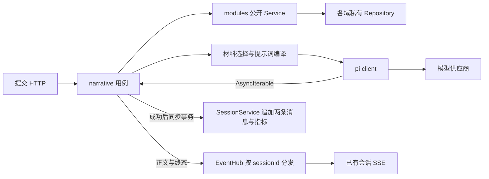

# Server V2 叙事首版方案

状态：待实施。本轮仅保存方案；任务见 [任务拆解](server-v2-narrative-v1-tasks.md)。

## 1. 产品目标与边界

在已有会话中提交一段玩家输入，读取会话绑定的世界、角色、预设和模型配置，构建上下文，调用一次模型，通过会话 EventHub 推送正文，成功后一次提交这一轮的用户消息与助手消息。

“一次提交”在本方案中的具体语义：一次用户操作对应一次模型生成；不自动重试。完整生成成功后，才在一个同步数据库事务里保存两条消息及本次指标、推进 tip。模型失败、主动停止或提交冲突均不保存这一轮的消息，不保留半截正文。客户端暂时显示的内容不是已提交历史。

首版包括：

- 读取已有会话与线性消息历史，支持空历史的第一轮。
- 根据预设顺序编译核心提示词、自定义节点、角色、世界书、历史和输入。
- pi 模型目录、模型解析、凭据读取、单次流式调用、错误与用量转换；提供基础连通性检测。
- 提交、正文流事件、成功/失败/停止终态；同一会话同一时间只允许一轮。
- 成功消息与指标的原子提交，继续使用现有 entries 表。

明确不包括：engine、通用任务系统、Agent/tool loop、自动重试、重启恢复、持久化执行状态、事件回放、请求去重、runs/run_preparations 表、滚动摘要、自动裁剪、状态更新、行动建议、分支/重新生成、开局初始化、StudioV2 运行页迁移。

保留原 Studio 与静态作者预览分离的逻辑；本方案不改预览服务、SDK 通信或开发启动拓扑。叙事调用使用 ServerV2 现有进程，不新增服务进程。

## 2. 当前实现与可借鉴部分

依据当前工作区源码，而非旧的 V2 目标方案：

| 当前代码 | 可保留的业务含义 | V2 的处理 |
| --- | --- | --- |
| `apps/server/src/runtime/config.ts` | 会话决定预设和模型，预设决定生成参数 | 经 V2 各模块 Service 读取；不读旧存储行 |
| `runtime/context/{snapshot,materials,node-compiler,activation}.ts` | 捕获输入、材料激活、模板替换、保持节点及消息角色顺序 | 迁移必要的纯计算，适配 V2 数据结构 |
| `runtime/runners/direct-runner.ts` | 消费 pi 流、检查终态、形成正文 | 去掉扩展解析、直接存储和回调透传 |
| `runtime/runners/story-writer.ts` | 消息 ID、正文增量 | 在叙事用例里直接发布 EventHub 事件；不双写独立 HTTP 正文流 |
| `runtime/model/{pi-gateway,model-client}.ts` | pi 目录与流式调用、凭据和错误处理 | 迁移薄适配，不带请求指纹、离线 payload 预演、记账日志系统 |
| `runtime/persistence/run-store.ts` | 混合了多个领域的数据与执行生命周期 | 不迁移；各表操作归自己的模块 |

V2 已有 `modules/{worlds,sessions,presets,models,settings,state,credentials}/service.ts`、同步 `TransactionRunner`、按 sessionId 分发的 `EventHub`。`SessionService` 已支持 `getHistory`、`appendEntry`、`listRunEntries` 和 `setMetrics`；entries 已有 `runId`、`payload`、`metrics`、`state`，无须增加执行表。

当前 `World` 顶层是驼峰领域字段，作者内容内部仍保持世界卡协议；`Preset.config` 已包含 `nodes/contextStrategy/modelParameters`。不能复制旧 Row 解码或对作者 JSON 递归改名。

当前 AGENTS.md 的“不新增模型执行”是上一阶段限制。本方案尚未更改它；正式实施时同步更新该阶段边界及事实文档，不能在实现前把新能力描述成已完成。

## 3. 目录与职责

```text
apps/serverV2/src/
  usecases/
    narrative/
      index.ts             # createNarrativeUsecases：submit、stop、shutdown；局部运行 Map
      execute.ts           # 一轮的模型流消费、正文聚合、成功提交、终态事件
      context.ts           # 从公开 Service 捕获会话配置、世界、历史和状态视图
      materials.ts         # 角色、世界书、加载条件与模板变量材料
      compile.ts           # 纯模板解析和节点编译，保持顺序及角色
      events.ts            # 叙事事件的类型契约，不实现新的消息总线
      types.ts             # SubmitInput、运行快照及执行结果
      *.test.ts
    test-model.ts          # 模型配置 + 凭据 + pi 的一次连通性检测
  infrastructure/
    pi/
      client.ts            # 薄 pi 适配：目录、解析、stream；只与 SDK/网络有关
      usage.ts             # SDK usage 到应用用量的纯转换
      *.test.ts
  modules/
    sessions/              # 现有消息/历史/指标持久化，不增加 RunRepository
    state/                 # 现有快照读取；增补必要的只读条件求值能力
    presets/               # 配置校验与领域类型，不承担模型执行
    models/                # 配置 CRUD，不塞入 HTTP 模型调用或叙事生命周期
    credentials/           # 保持密钥存储和访问边界
  routes/
    narrative.ts           # HTTP 参数/权限/状态码，调用叙事用例
    providers.ts           # 暴露 pi 目录的安全字段
    models.ts              # 增加已保存模型配置的连通性检测入口
  events/                  # 复用 EventHub 与 SSE，无运行状态和数据库依赖
  usecases.ts              # 显式注入 modules、PiClient、EventHub、TransactionRunner
  server.ts                # 创建同一 EventHub，处理关闭顺序
```

这些文件是具体职责划分，不预建 Runner 基类、Gateway 插件注册表、事件转发适配层或多套上下文策略类。pi 只有一个实现，测试用其公开方法的窄类型替身即可。

依赖规则：

- 叙事用例只从 `modules/*/service.ts` 导入业务能力和公开类型，不导入 repository/schema/parser，不直接访问 SQL。
- `context.ts` 只捕获本轮领域数据，不返回数据库记录；`compile.ts` 只计算，不读数据库或凭据。
- pi 层接收已经解析好的模型、上下文、密钥和 AbortSignal；不知道 session、entry、EventHub、数据库或 HTTP。
- 密钥由用例通过 CredentialService 读取，仅在调用时交给 pi，不放入事件、结果、日志或快照。
- 各模块不依赖 narrative。需要公开 `NarrativePresetConfig` 等类型时，从所属 Service 显式导出，不扩大模块内部访问。
- EventHub 由装配方创建一次，SSE 与 narrative 使用同一个实例。用例直接 `events.publish(sessionId, event)`；不传递 `emit/onDelta/onComplete` 回调链。pi 的 AsyncIterable 是读取模型输出的协议，不是业务事件回调。



## 4. 一轮执行流程

1. HTTP 层验证参数与会话访问权限。用例同步检查会话存在、expectedTipEntryId 与当前 tip 相等、当前会话无进行中的 run，捕获本轮领域输入。
2. 首次异步等待前，在实例私有 `Map<sessionId, ActiveRun>` 中占位；生成一次 runId、userEntryId、assistantEntryId，不给每个事件生成 UUID。
3. 返回 202 受理结果。用例管理本轮 Promise，所有异常都收敛到失败路径；不创建持久化任务、队列或自动调度器。
4. 读取凭据，解析模型并检查能力，编译上下文。发布 `run.started`，其含义是开始处理，不代表已经落库。
5. 调用 pi 一次。消费 text_delta，发布 `message.delta`；thinking 不进入正文。缓冲正文直到模型返回完整正常终态。
6. 收到正常 done 后校验非空正文、无 toolCall、结束原因是 stop。缺少 done、输出长度截断、异常工具调用或供应商 error 均失败。没有 delta 但 done 有正文时补发一次正文；有 delta 时与最终正文核对，避免展示内容与保存内容不同。
7. 重新检查停止标志；执行同步事务，要求当前 tip 仍等于提交时捕获的 tip，依次追加用户与助手消息，助手消息同时保存 metrics。提交后发布 `run.completed`。
8. 任意提交前失败发布 `run.failed`；主动停止发布 `run.stopped`。不落失败消息、不改 tip；finally 释放本轮 Map 项。已提交结果不再改成失败或停止。

占位是单进程的会话并发门闩，不是可恢复 RunStore。它只保存 runId、controller、完成 Promise 和取消标记，正文缓冲属于单次 execute 的局部变量。不同会话可并行，同一会话冲突直接返回 409，不排队。

提交期间没有 await；用户/助手任一写入失败则事务整体回滚。直接复用 `TransactionRunner` 包住两次 `SessionService.appendEntry`，两次调用都传明确 parentId，底层现有 savepoint 支持嵌套。不为这一种写法再增加批量 Repository 或跨表 RunStore。

运行过程中配置更新不改变已捕获请求，下一轮才生效；历史被追加导致 tip 变化则本轮提交失败。消息内容编辑不覆盖本轮已捕获内容，首版不引入全量历史指纹或多域版本协调。会话删除后不允许提交到不存在的会话。

SSE 或提交 HTTP 断开都不触发模型取消；停止必须显式调用 stop。服务器正常关闭时停止接受提交，标记所有运行取消、abort 模型，阻止迟到结果落库，再释放连接与数据库；不保存恢复记录，也不等待供应商无限返回。进程被强制结束则内存运行丢失，这是首版的明确行为。

## 5. 上下文：保留核心编译语义，暂不迁移摘要和扩展

### 配置来源

- 使用 session.presetId、apiModelConfigId、worldId、userCharacterId；已有会话不因应用默认值变化而切换模型或预设。
- 从 PresetService 取得 narrative 配置；ModelService 取得 providerId/modelId/credentialRef；WorldService 取得角色和世界书等。
- 从 SessionService 读取当前线性历史，仅将有效 user/assistant 消息作为对话材料。不把不合法 payload 默默变为空文本；首版发现已有 compaction 历史明确报不支持，不假装已经实现摘要边界。
- StateService 提供 global/session/message 只读视图；tip 为 null 或没有消息快照时，消息视图为空。首版不根据 opening 初始化消息或状态。
- 所有同步读取在凭据/模型 await 前完成，使用本轮独立数据对象，不通过层层 hash/deepFreeze/请求预演来实现快照。

### 编译规则

保留 `main → personaInfo → characterInfo → worldInfo → chatHistory → userInput` 的既有相对顺序；保留自定义 text 节点的插入位置、启用状态和消息角色。`history.messages` 展开为原角色消息，不能把整段对话拼成 system 文本；input 仅插入一次。模板解析保留转义和已验证变量白名单，不使用 eval 或对象路径执行模板。

角色、世界书使用现有 enabled、load.mode、keywords/keyword_logic、exclude_keywords、when、order 语义，扫描材料采用历史叙事与当前输入。移植必要纯函数，不能把条件全部当作 always。`when` 的运行求值放在 StateService 的只读能力中，采用旧 Server 受限 AST 解释规则；不导入 worlds 内部 validation.ts，不增加通用脚本引擎。静态卡验证仍属于 worlds。

`kind=postprocess` 的节点首版全部排除，尤其是默认启用的 worldState/actionSuggestions；否则会要求模型输出没有消费者的数据块。自定义模板中的 `state.entries` 可读取当前快照及声明，但不执行更新。`history.summary` 首版为空。

只读取 `contextStrategy.maxContextTokens/maxOutputTokens` 和 `modelParameters.temperature/thinkingEnabled`。完整历史直接参与编译，既不执行 rolling_summary，也不把它偷偷替换成 sliding_window。首版的有效能力固定为 `historyPolicy: full`、`postprocess: false`，在受理响应中明确返回；后续运行 UI 据此显示，不能宣称预设中的摘要策略正在生效。

输出上限不得超过模型 maxTokens，输入预算取预设上限与模型窗口扣除输出上限后的较小值；非正预算或明显超限直接拒绝。只做本地粗估，不移植旧的自校准估计、wireFingerprint 或隐藏模型预调用；供应商报告的上下文超限也直接失败，不重试、不自动删历史。

保持原 Server 对消息顺序的要求：含中途 system 消息的编译结果，只有 pi 适配确实能保持该顺序时才执行。不能为了扩大模型列表而把所有 system 消息前移。对无法保证顺序的模型返回明确错误；目录区分“pi 可识别”与“当前叙事可用”。旧 DeepSeek 特例若仍需要，应限于原条件并用函数测试覆盖，不推广成所有兼容接口都支持。

## 6. pi 底层能力

以当前原 Server 已安装的 `@earendil-works/pi-ai@1.5.0` 为基线，不顺带升级。使用现有 `builtinModels()`、`getProviders/getModels/getModel`、`streamSimple` 能力：

| 能力 | 首版职责 |
| --- | --- |
| 模型目录 | 返回 provider/model 标识、名称、窗口、最大输出、reasoning 与当前叙事兼容性；不持久化目录 |
| 解析 | 按模型配置的 providerId/modelId 查找，未知模型明确失败，不自动替换 |
| 调用 | 显式 apiKey、AbortSignal、maxTokens、temperature、reasoning；`maxRetries: 0`，无 tools |
| 流 | AsyncIterable 提供 text/done/error 所需信息，不发布业务事件，不存 entry |
| 错误 | 归一化凭据缺失、未知模型、能力不支持、上下文超限、供应商失败与取消；不泄漏供应商原文中的密钥 |
| 用量 | 转换 pi usage、记录本次时长/首段时长；没有可靠上报证据用 usage:null，不能把 SDK 默认 0 冒充零消耗 |
| 检测 | 对已保存配置发起一次短文本请求，返回连通结果；不创建会话、entry 或 run，不自动重试 |

pi usage 到现有 EntryMetrics 的映射沿用已验证语义：`inputTokens = input + cacheRead + cacheWrite`，cache 是包含在总输入中的细分；`outputTokens = output`，thinking 已包含在 output 时不得重复相加。totalTokens 使用有效上报值并校验口径。保留现有 `metrics.requests[]`，每轮仅一项；不增加 cost、累计账本或 request 表。首版失败轮次无持久化计费记录，不能把成功消息统计宣传成完整账单。

SDK 自身必要的 provider hook 仅留在 pi 适配内，用于确认 usage 上报等；不得变成贯穿业务层的 onDelta/onUsage 回调链。取消需要让本地消费者及时停止等待并丢弃迟到结果，不依赖第三方一定服从 AbortSignal；这是释放内存运行占位的必要条件，不是恢复机制。

## 7. HTTP 与事件契约

| 接口 | 用途与结果 |
| --- | --- |
| `POST /api/v1/sessions/:sessionId/runs` | body `{ input: { text }, expectedTipEntryId: string \| null }`；202 返回 `{ runId, userEntryId, assistantEntryId, capabilities: { historyPolicy: "full", postprocess: false } }` |
| `POST /api/v1/sessions/:sessionId/runs/:runId/stop` | 只停止该 session 当前匹配的内存运行；200 `{ runId, stopping: true }`；不匹配/已结束返回明确的 404 |
| `GET /api/v1/sessions/:sessionId/events` | 复用已有 SSE，连接独立于 run；客户端应先连接再提交 |
| `GET /api/v1/sessions/:sessionId/entries` | 复用已提交历史读取；刷新后以此为准 |
| `GET /api/v1/providers/models` | pi 静态目录，不返回密钥；HTTP 包络与 V2 一致 |
| `POST /api/v1/api-model-configs/:id/test` | 测试已保存配置，单次短请求；失败按 V2 错误包络返回 |

请求不接受 preset/model 覆盖、requestId、工具列表或旧 prepare 参数。expectedTipEntryId 必填，空会话传 null。普通返回统一现有 `{ success, errorCode, errorMessage, data }`；受理前校验错误用 HTTP，受理后的执行失败用事件。路由沿用现有 Origin 与会话权限检查。

不提供 GET run 状态/历史、恢复、重试接口。202 不是完成承诺；网络丢失或重启后无法恢复运行终态，客户端重新读取 entries 判断哪些内容已保存。事件可能先于 POST 响应到达，消费端按 runId/messageId 关联，不依赖响应与事件先后，不立即自动重发提交。

EventHub 的外层仍为 `{ event, data }`，sessionId 通过 publish 的参数确定；不加事件 id，也不发 SSE id：

| event | data 中的主要字段 | 含义 |
| --- | --- | --- |
| `run.started` | runId, userEntryId, assistantEntryId | 本轮开始处理，entry 尚未持久化 |
| `message.delta` | runId, messageId, offset, text | assistant 正文追加；offset 为已有正文的 JS 字符串长度，不是事件序号 |
| `run.completed` | runId, userEntryId, assistantEntryId, tipEntryId | 数据库提交成功；消费端可读 entries 获取最终正文/指标 |
| `run.failed` | runId, errorCode, errorMessage | 未提交，提示失败，不把暂存正文当历史 |
| `run.stopped` | runId | 已停止，未提交 |

一次运行只发布一个终态。EventHub 订阅者异常不得影响提交；慢连接由已有 SSE 队列限制处理，连接断开不取消模型。事件只供实时显示，不承担持久化命令或可靠消息职责。

## 8. 存储规则

不增加表、不改 schema version，不在 extData 里重建执行日志或隐藏 preparation。消息结构明确为：

```ts
// 两条 entry 的 runId 相同，ID 在开始时各生成一次。
user.payload = { message: { role: 'user', content: inputText, timestamp } };
assistant.payload = { message: { role: 'assistant', content: finalText, timestamp } };
// role 同时保存在 entry.role，并与 payload 中的 role 一致。
user.metrics = null;
assistant.metrics = { requests: [{ requestId, modelId, status: 'completed', usage, durationMs, firstTextMs }] };
// requestId 是这一轮唯一模型请求的标识，不是提交去重键或事件 ID。
```

runId 只关联成功的这两条消息。两条消息的 state 均为 null，沿用 StateService 前驱继承；extData 默认空对象。首版不写 global/session/message 状态、不写 session.usage 累计账本，不存 pi AssistantMessage 整体、thinking、provider 原始响应或 API key。

## 9. 验证与完成标准

只做函数级验证和 typecheck/lint，不启动真实服务、不调用真实模型、不做 HTTP/浏览器链路测试：

- 材料与模板：节点顺序/角色、变量转义、输入一次、历史展开、条件激活、排除 postprocess、空历史、明确不支持的历史与模型能力。
- pi：有限 AsyncIterable 替身覆盖 delta/done/error/缺少终态/无 delta/取消，usage 缺失、缓存统计与错误脱敏；不搭模拟供应商 HTTP 服务。
- 用例：使用现有临时库和最小凭据替身，验证只读模块快照、成功一次提交、第二条写入失败整体回滚、tip 冲突、同会话并发拒绝、不同会话独立、主动停止/迟到结果不落库。
- EventHub：直接订阅验证会话隔离、增量/终态顺序、只发一个终态、提交完成后才 completed；退订不取消运行。
- 静态：ServerV2 typecheck/lint；模块只经 Service 访问，业务用例无 SQL，不导入旧 Server。新增函数测试覆盖真实行为，不用大量逐文件快照测试代替业务验证。

实施完成后更新 `docs/runtime/server-v2-http.md`，补充 `docs/runtime/server-v2-narrative.md` 的已实现契约，并更新 ServerV2 与根 AGENTS.md 的范围。StudioV2 尚未接运行 UI 的事实继续保留，不能把后端完成称为前后端完整可玩。

## 10. 后续按需决策

核心闭环通过后，再逐项评估：开局初始化、StudioV2 运行页、历史策略、状态更新、行动建议。每项单独设计与实施；不因为未来可能需要，就先增加持久化执行层或抽象引擎。
