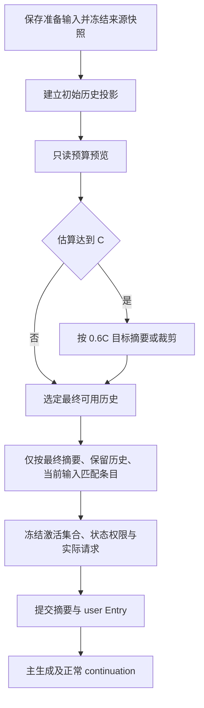
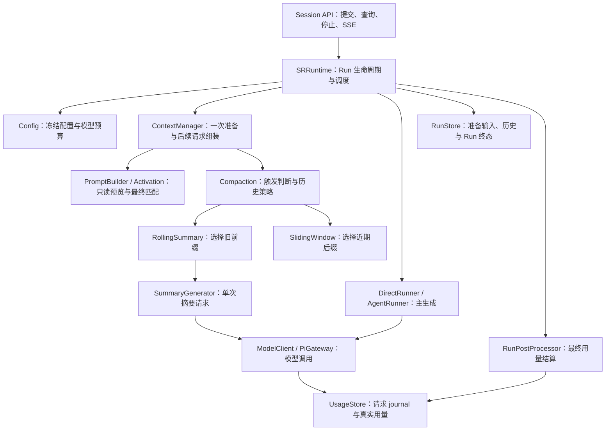

# SR 上下文压缩策略模块方案 v1

> 更新：2026-11-13。状态：Server 已实施并完成离线验收。
>
> 用户已授权执行本方案。已完成 Server、测试与现状文档；本期没有前端/SDK 工作，未迁移真实数据库、调用付费模型或提交／推送。
>
> 代码参考基线：`ca50e88`（SRRuntime v2）；替代 `21a4bd7` 中的配置、激活与准备失败设计。
>
> 最新用户决定：删除规范配置中的 `context_strategy`；两策略统一使用 `max_context_tokens`、`max_output_tokens`。上下文额度不超过模型窗口的 **80%**，达到额度的 **100%** 时触发，整理目标为额度的 **60%**。每 Run 只准备一次，摘要最多调用一次，不分批、不重试，失败即结束准备；Run 内不检查预算／压缩。激活范围是压缩后最终可用上下文。准备失败必须保存输入，由用户重试；本期不涉及前端。

## 1. 产品行为与范围

### 1.1 一次准备与一次用户重试

1. 完成同步请求校验、幂等及占用检查，取得锁。接受 Run 时先持久保存输入和准备记录，再返回接受结果；此时不创建叙事 user Entry，也不推进历史 tip。
2. 冻结模型、预设、世界定义、原始历史来源及权威状态基准。这里冻结的是数据快照，**不是最终激活集合或可写状态权限**。
3. 构造初始历史投影和完整请求的只读预算预览，决定一次是否触发所选整理策略。
4. 如触发，按 60% 目标整理历史；滚动摘要一次提交旧摘要和全部选中的待摘要历史，最多调用一次模型；滑窗不调用模型。未触发则使用初始投影。
5. 基于最终选定的可用上下文匹配角色、世界书、状态模块等条目，生成工具／能力规则，冻结本轮激活集合和权限。估算最终输入仅作报告，不开启第二轮整理。
6. 校验来源及候选，在同一事务提交完整摘要（如有）和当前 user Entry，并完成准备记录到正式 Run 的交接，再开始主生成。
7. Agent continuation 只追加本 Run 的合法 assistant／tool 往返，不再估算、检查预算或压缩。Direct 仍只有一次主模型请求及既有扩展尾块。
8. 准备失败时保留输入、终态、失败类型及实际用量；先持久化，再发布失败事件。用户主动重新提交时使用新 requestId／runId，重新读取配置和当前 tip；不自动重试、不改写原失败记录。

准备阶段属于 Run 生命周期。一次触发决策不限制策略内部的确定性选界、单次摘要请求预算检查及诊断计算，但禁止分批、递归启动压缩或在主生成中建立预算检查点。

### 1.2 范围与结果

| 情况 | 行为 |
|---|---|
| 输入估算小于触发线 | 使用初始投影 |
| 已整理但仍超目标／触发线，或没有可整理前缀 | 保留必要内容，继续主生成，报告原因 |
| 摘要执行／边界校验／准备持久化失败 | 不主生成，保存输入和失败原因；持久化不可用时保留已提交 journal，不伪报保存成功 |
| Provider 硬窗口拒绝 | 正常 failed，不自动压缩、重试或重放工具 |
| 用户停止 | stopped；未提交摘要丢弃，已提交摘要保留，准备输入仍可恢复 |
| 进程中断 | 保留输入和已知用量，恢复为 interrupted，公开映射 failed + RUN_INTERRUPTED |

原始 entries、权威状态、Direct 扩展完整性、Agent 工具执行／提交规则和 iframe 安全边界不改变。历史可恢复不代表全历史都参与激活。

本期后续实施只涉及 Server、API 契约及相应测试／文档；不修改 Web、Studio、Host、iframe 或 SDK，不实现重试按钮、提醒界面或预设表单。事件／查询为以后前端接入提供依据，不宣称现有前端已经能恢复输入或操作新配置。

不引入独立 CompactionRunner、Pi AgentSession、动态插件、独立摘要模型、自动策略切换或后台任务服务。不执行历史会话清理、预设删除或原始世界文件改写。

## 2. 统一预算与百分比规则

### 2.1 配置语义

```ts
type PresetBudget = {
  strategy: "rolling_summary" | "sliding_window";
  max_context_tokens: number;
  max_output_tokens: number;
};
```

`strategy` 仅区分摘要与滑窗算法，继续保留；删除的是旧容量档位 `context_strategy`。两策略的 token 字段和含义完全一致。

- `max_context_tokens`：完整**输入**的整理触发额度，包含 system、自定义提示、激活条目、权威状态／能力规则、摘要／历史、当前用户输入、工具及包装；不包含本次最大输出。
- `max_output_tokens`：每次主 generation／continuation 的输出上限，原样传给模型；不是整个 Run 的累计额度，也不是摘要输出长度。
- `summary_prompt`：滚动摘要使用；滑窗保留配置但不发送。
- 两个 token 字段均为正安全整数。新建默认 rolling_summary、上下文额度 32768、输出 2048；预设不绑定模型，实际是否可运行须按选定模型校验。

```json
{
  "budget": {
    "strategy": "rolling_summary",
    "max_context_tokens": 65536,
    "max_output_tokens": 4096
  },
  "summary_prompt": "概括已发生的事件、人物关系与未解决的线索。"
}
```

### 2.2 模型上限、触发与目标

```text
W = model.contextWindow
C = budget.max_context_tokens
O = budget.max_output_tokens
S = 1024

configurationCap = min(floor(W * 0.80), W - O - S)
要求：0 < C <= configurationCap，0 < O <= model.maxTokens

triggerThreshold = C
reductionTarget = floor(C * 0.60)
要求：reductionTarget > 0

E_before = 初始完整请求预算预览的输入估算
trigger = E_before >= triggerThreshold
```

**100% 是触发比例，60% 是整理后占用目标，80% 是相对模型窗口的配置上限。** 不是“压掉 60%”，也不是“摘要正文长度为原文 60%”。三者不能混用。

例：`W=200000, C=160000, O=4096`，输入达到 160000 触发，目标 96000；额度设到模型允许的 80% 时，目标相当于模型窗口的 48%。若 O 较大，`W-O-S` 可比 80% 更严格。不得静默降低用户输出。

配置无效与内容超额分开。显式数值配置在运行时超过上限，返回受控配置失败并保存已接受的输入；不得把非法配置当软目标放行。合法配置下，最终实际输入仍超过 C／目标时继续，不能伪造 fits 凭证，也不能把估算超额标为 Provider 硬窗口错误。

所有比例运算向下取整、验证结果为安全整数；实现宜用整数比例运算避免边界浮点误差。模型窗口缺失或无效明确失败。未绑定模型的预设保存只验证结构及数值，模型相关上限在 Run 准备中检查。

### 2.3 80% 上限的合理性与业界做法

2026-11-13 核对的第一方资料没有统一的“所有模型只能使用某个固定百分比”的规则：

| 来源 | 文档中的做法 | 对 SR 的启示 |
|---|---|---|
| [Pi 官方压缩文档](https://github.com/earendil-works/pi/blob/main/packages/coding-agent/docs/compaction.md) | 以窗口减 reserveTokens 触发，文档默认 reserveTokens=16384；按 keepRecentTokens 保留近期内容，默认 20000；支持 Run 内检查和溢出恢复 | 触发、近期保留和输出预算应分开；SR 不继承其自动恢复 |
| [Claude API 阈值压缩](https://platform.claude.com/docs/en/build-with-claude/compaction-threshold) | 可配置输入 token 阈值，默认 150000，最低 50000；不是统一百分比 | 可以把整理阈值作为产品参数，而不是等同模型硬窗口 |
| [LangChain Summarization](https://docs.langchain.com/oss/python/langchain/middleware/built-in#summarization) | trigger 与 keep 独立，支持 token／消息数／窗口比例；文档给出 0.8 触发、0.3 保留的示例，非通用默认最优值 | 使用高触发线和低整理目标，避免每轮都摘要 |

评估结论：对 SR 的固定粗估和 Run 内不再压缩政策，80% 是可解释的保守工程上限，比原提议 60% 更充分利用窗口；**不是有实测证明的最优值，也不能保证 Run 内无限工具往返不超限**。剩余窗口还需容纳输出、工具结果和估算误差，不能把 20% 全部当成工具额度。

100% 触发／60% 目标是本项目用户决定，不宣称来自上述产品的统一规范。应以离线场景评估触发频率、保留历史与摘要调用次数，付费模型质量／成本调优另行授权。

## 3. 历史来源与压缩后激活

### 3.1 三份数据的边界

| 数据 | 用途 | 是否参与最终关键词匹配 |
|---|---|---|
| 当前有效祖先链的完整原始净叙事 | 恢复、策略切换、选择连续前缀／后缀、验证覆盖 | 不能直接作为最终扫描范围 |
| 策略输出的可用历史 | 滚动摘要为有效摘要＋保留的原生历史；滑窗为保留的原生历史 | 是 |
| 当前用户输入 | 本轮意图；按既有 roleplay 过滤规则参与激活 | 是，只计一次 |

完整读取仅指当前会话有效祖先链，不含其他会话、非祖先记录、失败准备输入或被撤销的记录。Direct 尾块、thinking、私有内容和 nonNarrative 记录按现有规则过滤。

开场 assistant 消息没有前置 user，作为独立的最早历史组处理：未整理时保留；摘要可覆盖该组；滑窗可作为最早可选组裁掉，不能无规则消失。其他完整回合从 user 到下一 user 之前，保留参与投影的全部关联消息。工具调用及结果不能被拆成孤立协议消息；不新增历史工具回放。

### 3.2 激活扫描范围

最终扫描文本严格来自：**最终摘要（若有）＋最终保留的历史＋当前用户输入**，统一调用既有 `narrativeForActivation` 等过滤规则。

- 仅存在于被摘要覆盖原文、且未出现在摘要／保留历史／当前输入中的关键词，不再触发条目；摘要中仍存在的关键词可以触发。
- 被滑窗裁掉的关键词、排除关键词均不参与最终匹配。
- `always`／`never`、enabled、when、用户选定玩家等原有规则保持。`when` 读取冻结的权威状态基准，不从摘要推导权威值。
- 不扫描条目自身 prompt、被加载世界书正文或私有系统文本来递归激活更多条目。
- 角色、世界书、状态模块使用同一最终扫描范围；角色 description 仍不进入模型上下文，只有 prompt 按规则注入。
- 被取消激活的状态项不被删除或重置，仅不属于本轮动态注入／可写集合。Server 仍验证完整权威状态的结构和合法性。
- 只有在最终投影选定后，才创建不可变 active 集合、状态可写根、工具定义和扩展要求。本 Run 工具返回或主模型新输出不重新激活条目。

“冻结激活结果”现在仅表示最后一步结果在本 Run 内不再变化，**不表示压缩前激活后一直沿用**。

### 3.3 预算预览与实际激活的顺序

完整输入大小依赖条目匹配，而条目匹配又依赖最终保留历史。采用无副作用的预算预览解决该依赖，不把压缩前匹配当成本轮权限：

1. 对初始历史投影调用纯 `previewContext`，临时计算匹配及完整请求估算；不发布激活事件、不写 active、不赋予工具权限。
2. 用该预览决定唯一一次触发，并记录非历史部分预留 `B_before`（含当前输入、平台／自定义提示、临时条目／状态／工具及包装）。
3. 在固定的 `B_before` 预留下按目标选择历史；摘要另预留 summaryOutput 及摘要消息包装。策略只变换历史，不执行条目逻辑或状态写入。
4. 对最终候选历史重新做纯预览；摘要无收益被放弃时，以原投影作为最终候选。只有这一最终选择的匹配结果进入执行上下文。
5. 记录 `E_after`、实际非历史占用及偏差；正式冻结 active／权限后不再整理。

因此压缩前匹配只服务估算，最终激活始终来自压缩后实际发送的可用历史。已裁掉条目的费用预留不能让它继续获得权限。

关键词／排除词可能使非历史占用非单调变化。所称“最大连续后缀”是**固定预留下**的选界结果，不宣称对所有可能的激活组合求全局最优。最终激活使输入超目标时报告 `activation_over_target` 后继续；不反复裁剪／激活形成循环。首次模型发送必须使用最终预览对应的消息和权限。



## 4. 策略与百分比选界

### 4.1 共同行为

两策略互斥，共用 C、O、触发比例和目标比例。当前输入、固定规则、权限约束及协议必需内容不可丢弃。结束回合包括 completed、failed、stopped、interrupted；合法正文与受控 gaps 沿用原语义，不把失败或指令改写为已完成故事事实。

目标是完整输入的 60%，选界用目标扣除 `B_before` 及策略预留得到历史额度。若必要内容超目标，仍保留并继续；报告目标未达到，不擅自删权限规则。滑窗允许零旧回合，滚动摘要保留最近五个完整旧用户回合作为保护下限；五轮过大时允许超目标，不宣称一定能达到 60%。

### 4.2 滚动摘要

1. 初始投影为有效旧摘要＋全部未覆盖历史。旧摘要无效但原始来源完整可还原时重新投影；无法还原则失败。
2. 仅触发时选择边界。先为非历史部分及新摘要预留空间，从最新回合向前选取能够容纳的完整连续后缀，至少保护最近五轮；不足五轮全部保护。
3. 将该后缀之前的连续前缀和旧摘要组成一次逻辑摘要任务。这替代“每次把最近五轮之前所有历史全部摘要”的固定切点，尽可能保留近期原文。
4. 没有新的可摘要前缀则返回 `no_eligible_history`；不单独反复缩写已有摘要。
5. 单次摘要请求正常完成并产出有效结果后生成候选，验证边界、来源及 gaps，再根据候选最终激活组装请求。
6. 原投影与候选都使用同一固定全量估算比较完整输入收益；无收益则保留原投影、记录 `no_reduction`，费用仍结算，不再请求另一份摘要。
7. 有收益但仍超目标／C 时继续，完整摘要与 user Entry 原子提交。候选包含 text、coveredThroughEntryId、firstKeptEntryId、来源指纹、gaps 和模型请求 ID。

### 4.3 单次摘要请求与失败边界

```text
summaryOutput = min(2048, model.maxTokens)
summaryInputLimit = min(floor(W * 0.75), W - summaryOutput - S)
```

此处 W 是真实模型窗口；C 是主生成的整理额度，不再次作为摘要模型的窗口上限。完整摘要请求一次包含平台约束、渲染后的 summary_prompt、有效旧摘要、来源包装、gaps 和全部选中的待摘要历史正文。

不分批、不切片、不递归摘要，不保留旧版 12000 codepoint 限制或八次调用额度。选中来源一次完整发送，不为使摘要请求放得下而静默截断正文、遗漏历史或重新缩小覆盖范围；覆盖边界仍须落在完整历史组边界。

每 Run 最多一次真实摘要调用，无自动重试。完整摘要请求按固定规则估算超过 summaryInputLimit 时，直接以 `SUMMARY_CAPACITY_EXCEEDED` 结束准备，零摘要调用；估算允许发送但 Provider 拒绝时，按摘要调用失败处理并保留安全 causeCode。两者都不分批补救、不切换策略、不发送主生成。保存输入、失败原因和实际已知用量，由用户决定调整配置或重新提交；不承诺原样重试能解决容量问题。

结果必须正常 stop、非空、无工具调用、delta／final 一致。length、异常流、重复终态、无用户停止信号的 aborted 等失败立即结束，不再发起摘要或主生成。部分摘要不得成为有效历史或推进覆盖边界。

### 4.4 滑动窗口

从完整原始净叙事投影开始，忽略但保留已有摘要。未触发则使用全部初始历史；触发后以 `max(0, floor(0.6C)-B_before)` 为历史额度，从最新完整回合向前选取连续后缀，遇到相邻大回合放不下即停止，不跳过它选择更早的小回合。最新回合也放不下时可保留零旧回合。

最终再按实际后缀和当前输入激活条目。无摘要调用，无 compaction Entry，不建立永久裁剪水位；firstKeptEntryId 仅作本 Run 诊断。

### 4.5 策略切换

| 变化 | 下一个 Run |
|---|---|
| rolling → sliding | 忽略摘要，从完整原始净叙事选后缀 |
| sliding → rolling | 使用仍有效的旧摘要＋全部未覆盖历史，重新按百分比选界 |
| C 扩大 | 滑窗可恢复此前裁掉的历史；滚动摘要不自动逆向展开已有效覆盖的摘要 |
| 策略、C、O 或模型变化 | 重做新 Run 准备；旧 usage 基准按身份关系判断失效 |

策略切换不删除旧摘要／原文，不把滑窗起点当摘要覆盖边界；最终激活每次都按本 Run 实际可用上下文计算。

## 5. 估算、用量与请求一致性

### 5.1 固定估算

保留简单、版本化的规则：ASCII 1/3 token；Han／Hiragana／Katakana／Hangul 每字符 1 token；其他 Unicode 按 UTF-8 字节数。每条消息另加 16 tokens，请求级 64，每个工具另加 32；工具文本／schema 按实际序列化统计一次。合计向上取整并验证安全整数，多模态不支持则明确拒绝。

规则不是精确 tokenizer 或误差上界，不自动校准。按后续清理决定，删除旧 DeepSeek BPE 资源及计量接口；普通文本使用固定估算，Direct Provider 消息顺序支持限制独立保留。

### 5.2 usage 基准

只复用已正常完成、确有真实 reported usage 的主 generation／continuation 输入，并能证明本次初始预览原样保留其全部有效输入、仅纯追加：

```text
E_before = lastReportedInputTokens + fixedEstimate(实际新增内容)
否则 E_before = fixedEstimate(初始完整请求预览)
```

基准关联模型／Provider／API／序列化版本、输入身份、历史覆盖及激活／工具／状态身份。不能仅凭整请求 hash 或 Entry ID 推断纯追加；无法证明时全量粗估。动态 system、激活集合、状态、工具、摘要、非追加历史、模式或策略变化均重新验证。

Pi 的 SR inputTokens 口径已含 input + cacheRead + cacheWrite，不能再加缓存；不使用累计用量或最近 totalTokens 代替上下文长度。只计实际回填的回复，不计丢弃的 thinking／Direct 尾块。SDK 初始化零对象与真实报告零值区分，缺报告保持 unknown。

最终候选、收益比较和诊断使用全量固定估算；真实 usage 仅记账及供以后 Run 使用。摘要和主请求每次独立 ID 结算一次，失败／停止也结算，不用估算补写真实用量。

### 5.3 PreparedRequest

PreparedRequest 表达已组装、冻结、身份及权限一致的请求，不再要求主请求附带 fits=true。保留请求／实际 Provider payload fingerprint 检查，与计数解耦。continuation 使用自身新 fingerprint，不复用准备期请求身份，也不伪造预算报告。

## 6. 准备输入保存、失败类型与用户重试

### 6.1 输入与历史分离

撤销前版“在 usage_json 中仅保留最近 64 个无输入准备终态”的设计。输入是用户内容，必须可持久恢复，不能随计费诊断环形淘汰。

计划新增内部 `run_preparations` 表，复用既有 RunStore 管理，不创建新任务服务：

- run_id 主键，session_id 外键；(session_id, request_id) 唯一；expected_tip_entry_id。
- input_text 原始已接受输入；created_at／finished_at。
- preparing／failed／stopped／interrupted 状态，公开元数据、受控错误／恢复分类。
- 已结算的模型请求指标及 accounted 标记；不保存候选摘要、完整 prompt、凭据或原始 Provider 异常。

接受 Run 时，在同一短事务创建准备记录并建立 pending usage journal，成功后才返回 202／开始异步准备。同步参数错误、锁冲突、tip 冲突等未接受请求不伪造 Run。记录落库失败不得宣称请求已接受或输入已保存。

准备成功时，在 startRun 同一事务中验证来源／tip、保存摘要、保存 user Entry，并移除对应 preparing 记录；输入及幂等身份已由 user Entry 接管。交接失败整体回滚，原准备输入仍在。准备失败／停止则保留终态记录，不创建 user Entry、不改变 tip、不进入叙事 ancestry 或激活扫描。

准备终态输入不按 64 条自动淘汰；随用户明确删除所属会话／世界的既有流程清理。查询与去重覆盖全部保留记录。历史版本已丢失的准备输入无法反推，不制造内容。

### 6.2 最终化与恢复

准备失败事务：核对 preparing／pending → 去重汇总真实请求 → 保存终态及恢复分类 → 更新 cumulative／unattachedTotals → 清 pending。零模型调用也必须保存终态；重复封账不重复费用或通知。指标可用于诊断，不能在读取时再次累加。

RunStore.status／duplicate 先查正式 user Entry，再查准备记录；成功交接和准备终态不能同时成为同一 Run 的两个权威结果。重启扫描 preparing 记录，即使 pending 不完整也归档 interrupted；已有 user Entry 则沿用正式 Run 恢复路径。

持久化失败时不发布“已持久完成”的终态事件；保留已提交的准备记录和 pending 以供恢复，按现有持久化错误处理释放／恢复占用。禁止先清 journal 再保存失败。

### 6.3 Server 查询与事件契约

保留现有 errorCode／errorMessage、run.updated → run.failed 通道。增加可选公开字段，GET Run 和终态 SSE 使用同一投影：

```ts
type RunFailure = {
  stage: "preparation" | "generation" | "continuation" | "commit";
  type: "configuration" | "summary" | "context_window" |
    "context_integrity" | "provider" | "persistence" | "interrupted";
};
type RunRecovery = {
  inputSaved: boolean;
  action: "resubmit" | "adjust_configuration" | "inspect";
};
```

准备失败的 GET 返回既有 Run 字段、`messages: []`、`failure`、`recovery`，另在授权 Run 查询中返回 `input: { text: string }` 供恢复。事件仅携带分类、inputSaved 和建议操作，不广播额外输入全文。输入不得出现在错误消息、debug 日志或 Usage API 中。

`stage` 保留失败发生阶段，不能被最终 phase=finalized 覆盖；`type` 供前端判断失败类别，errorCode 保留具体原因；action 是建议操作，不承诺重试必然成功。stopped 可提供 recovery，但没有 failure，也不发 run.failed。

| 情况 | errorCode／分类 | recovery.action |
|---|---|---|
| C 超过模型配置上限、O 无效等 | INVALID_PRESET_BUDGET；configuration | adjust_configuration |
| 摘要返回空／截断／异常流 | SUMMARY_EMPTY／SUMMARY_FAILED；summary | resubmit |
| 完整摘要请求估算超过摘要输入预算 | 新增 SUMMARY_CAPACITY_EXCEEDED；summary | adjust_configuration |
| Provider 硬窗口拒绝 | 新增 PROVIDER_CONTEXT_WINDOW_EXCEEDED；context_window | adjust_configuration |
| 已知凭据／模型配置错误 | 对应受控错误；configuration | adjust_configuration |
| 其他 Provider 错误 | 既有受控错误；provider | resubmit |
| 来源、摘要边界或历史链无效 | 对应受控错误；context_integrity | inspect |
| 保存失败 | 既有持久化错误；persistence | inspect |
| 进程中断恢复 | RUN_INTERRUPTED；interrupted | resubmit |

摘要内部发生 Provider 错误，公开阶段仍为 preparation、类别为 summary；内部保存安全 causeCode，已知窗口／配置原因的操作建议为 adjust_configuration。不泄露原始异常。硬窗口识别依赖统一模型适配器的明确错误结构，未知错误不强行归类。

### 6.4 用户重试语义与无前端边界

不新增自动重试器。本期沿用现有提交 API：调用方读取失败 Run 的 input，用户决定后使用**新 requestId、当前 expectedTipEntryId 和保存的 text**提交新 Run。配置取当前值、激活重新计算；旧失败记录及费用保持不变。相同 requestId 重发仍幂等拒绝，不再次调用模型。

失败准备输入从未成为历史，因此重新提交不会在模型历史中重复出现。主生成已经创建 user Entry 的失败维持既有历史语义，不借准备重试功能删除／改写原回合。

现有 Host／SDK 可能忽略新字段；本期只交付 Server 能力和离线契约证据。前端后续负责选择提醒、恢复草稿或提供操作，并处理用户已写新草稿的冲突；本方案不实施这些 UI。

## 7. 配置兼容与非破坏性迁移

### 7.1 规范格式与旧入口

新增共用 `domain/preset-budget.ts`，Server 的路由、默认预设、导入导出及 Runtime 统一使用规范结构。规范响应／导出不再输出 context_strategy；两策略切换只改变 strategy，不重置两个数值字段或 summary_prompt。PATCH 可局部更新，合并后完整校验。

旧格式只在兼容读取／旧写入适配器中接受：compact／standard／extended 映射原窗口 131072／262144／524288；无 strategy 的当前旧格式默认 rolling_summary。旧档位曾表示输入＋输出窗口，因此转换为数值输入额度时扣除 O 和 1024，再按实际模型的 configurationCap 收紧。预设未绑定模型时只能得到未收紧的规范数值候选。

为避免原有预设一夜全部因 80% 上限失败，兼容来源在首次正常规范化保存前保留服务端内部来源标记：旧档位 Run 使用上述模型感知转换并记录 effective C；显式新数值配置按 §2 严格校验，不能假借 legacy 标记绕过上限。切到明确数值时清除旧来源标记；用户原存储值不批量覆盖。

旧客户端 PATCH 只有 context_strategy 时按兼容格式处理；只更新 O／其他字段且没有显式新 C 时保留正确的 legacy 来源或规范 C。混合提供 context_strategy 与 max_context_tokens 明确拒绝，不猜测优先级，避免旧表单误覆盖新数值。无 strategy 的数值新格式可默认 rolling_summary；明确 strategy 时严格枚举，未知字段／非法数字拒绝。

导出使用规范数值及 strategy，不导出内部来源标记；在未绑定模型时导出的候选额度可能超过目标模型上限，运行前明确要求调整，不能承诺跨模型自动适配。将旧的总窗口改成输入额度属于有意的配置语义变更，必须在契约中标明。

### 7.2 不修改前端的兼容限制

Web 当前读取／编辑 context_strategy，Studio 使用本地 fixture。删除规范字段后，现有三档控件无法正确表示任意新数值；本期不实现伪造档位回显或让服务端猜测用户意图。Server 保留旧格式入口、保护规范数据，但**新数值配置及策略选择以 API／导入导出为验收入口，旧 UI 新配置编辑不在交付承诺内**。混合字段被拒绝时现有通用错误展示可以显示信息，不等同新交互已经接入。

### 7.3 数据库迁移

新增 run_preparations 采用增量 schema 迁移，升级数据库版本并沿用升级前 SQLite 快照备份。迁移、结构校验及版本写入在事务内完成；失败回滚。保留 sessions、entries、presets、worlds/state、models、credentials、tags、app settings 和源文件。

旧 pending 有真实模型 usage 但无输入的，只保留可证实的指标／中断信息，inputSaved=false；不声称能恢复已经丢失的文本。新版本接受的 Run 必须保证输入先落库。

回滚使用升级前备份；回滚前须另行保留升级后的数据库，避免丢失新准备记录。旧程序不得直接写新版本数据库，不执行降级删表。测试仅用临时 SQLite，文档修订不启动服务、不迁移真实库。

## 8. 模块边界与实施路径

### 8.1 High-level 模块关系

产品主链路：接受并保存输入 → 准备可用上下文 → 按最终上下文激活条目 → 原子提交 → 生成故事 → 保存终态／通知。整理失败停在准备阶段，输入和失败记录保留，不进入主生成。



图中箭头表示职责调用关系，不代表所有组件都要新增类或服务。复用现有 Runtime、ModelClient、RunStore 等实例；策略以静态函数／模块实现即可，不引入插件注册框架。

| 模块 | 输入／输出边界 | 不承担的职责 |
|---|---|---|
| SRRuntime | 接受请求；准备完成后接受候选并调度 Runner；提交后发事件 | 不实现 token 估算、摘要选界或 SQL |
| ContextManager | 消费冻结来源；返回最终 PreparedRequest、active／权限、可选摘要候选和诊断 | 不自行提交历史／状态，不在 continuation 压缩 |
| PromptBuilder / Activation | 按给定历史投影纯匹配并组装；最终投影的结果才进入本轮权限 | 不读取全库寻找激活词，不从条目正文递归加载 |
| Compaction | 消费历史投影、预算和估算服务；返回所选历史及可选摘要候选 | 不写数据库、不决定 Run 终态、不修改状态权限 |
| SummaryGenerator | 接收选定旧前缀、旧摘要和摘要指令；返回一份完整有效摘要或错误 | 不分批、不重试、不裁掉来源补救、不调用业务工具 |
| ModelClient / PiGateway | 单次模型请求、取消、Provider 适配、usage 和受控错误 | 不决定何时压缩，不重新发起失败摘要 |
| RunStore / UsageStore | 权威数据、准备输入和原子交接；真实用量 journal／结算 | 不生成摘要，不以估算冒充真实用量 |

`prepareForRun` 是整理模块唯一生产入口，由 ContextManager 每 Run 调用一次；`buildContinuationRequest` 仅追加合法本轮往返并组装新请求。SummaryGenerator 通过注入的窄模型调用能力复用 ModelClient，不反向调用 Runtime，也不持有 RunStore。

整理模块返回的 SummaryCandidate 只是待接受结果。Runtime 调用持久化层完成摘要＋user Entry＋准备记录交接；错误时通过同一持久化层保存准备终态及结算。跨 RunStore／UsageStore 的原子操作复用同一数据库事务，内部步骤不各自开启嵌套事务。

### 8.2 目标目录结构

以下路径相对仓库根目录；仅列本方案相关文件，其他已有文件继续保留。标注“新增”的文件为计划新增，目录树不表示已经实现。

```text
apps/server/src/
├── routes/
│   ├── session-runtime.ts         # 提交／查询／停止／事件与恢复元数据
│   └── presets.ts                 # 数值预算与旧格式入口
├── domain/
│   ├── preset-budget.ts           # 新增：统一 schema、兼容转换与 PATCH
│   └── session/
│       └── run-result.ts          # GET／SSE 共用公开结果投影
├── common/
│   └── error-codes.ts             # 受控失败码
├── infrastructure/database/
│   └── database.ts                # 增量 schema、备份与中断恢复
└── runtime/
    ├── sr-runtime.ts              # 生命周期、锁、取消、调度与提交后事件
    ├── config.ts                  # 本轮配置／模型冻结与预算校验
    ├── types.ts                   # Run、执行上下文与跨模块结果类型
    ├── context/
    │   ├── context-manager.ts     # prepareForRun 编排；continuation 纯组装
    │   ├── prompt-builder.ts      # 只读预算预览与最终 Prompt 编排
    │   ├── activation.ts          # 给定可用上下文上的匹配规则
    │   ├── budget.ts              # 窗口数学与 PreparedRequest 身份校验
    │   ├── system-main.ts         # 既有平台提示与摘要约束
    │   └── compaction/            # 新增：仅上下文历史整理
    │       ├── index.ts           # prepareForRun：一次触发与静态策略选择
    │       ├── types.ts           # 投影、候选、估算基准及整理报告
    │       ├── estimator.ts       # 固定粗估／可证明的 usage 基准复用
    │       ├── history.ts         # 净叙事分组、原始来源及覆盖边界校验
    │       ├── rolling-summary.ts # 百分比选界与候选摘要投影
    │       ├── sliding-window.ts  # 连续后缀选择，无模型调用
    │       └── summary-generator.ts # 单次完整摘要、结果完整性校验
    ├── model/
    │   ├── model-client.ts        # 共用模型调用、取消及 usage journal
    │   └── pi-gateway.ts          # Provider／Pi 适配与明确错误归类
    ├── persistence/
    │   ├── run-store.ts           # 准备输入、entries、状态与原子交接
    │   ├── usage-store.ts         # 真实用量与幂等结算
    │   └── run-post-processor.ts  # 既有结算编排
    ├── runners/
    │   ├── direct-runner.ts       # 一次主生成及扩展处理
    │   └── agent-runner.ts        # 既有工具循环，续轮不管理预算
    ├── narrative/                 # 既有 Direct 扩展解析／验证
    └── tools/                     # 既有 Agent 工具执行／状态校验
```

旧 `context/history-compactor.ts` 的来源过滤和有效摘要结果校验迁入 history.ts／summary-generator.ts；分批实现及旧生产入口移除，更新所有消费者与测试，不并存两条压缩入口。新 run_preparations 表仍由 RunStore 管理，不另建 PreparationService、CompactionRunner 或计费服务。

通用数值窗口规则放 budget.ts；preset-budget.ts 只负责配置结构／兼容；estimator.ts 只负责估算；compaction/index.ts 使用规则作一次触发和选择，不在各策略重复维护阈值常量。

### 8.3 文件变更与实施范围

| 路径／组件 | 后续实施职责 |
|---|---|
| context/compaction/index.ts、types.ts | 统一策略入口、一次触发、C／目标及准备报告 |
| estimator.ts、history.ts | 固定估算、usage 覆盖证明、完整原始来源与原子组 |
| rolling-summary.ts、sliding-window.ts、summary-generator.ts | 百分比选界、单次完整摘要、无永久滑窗水位 |
| context/context-manager.ts、prompt-builder.ts、activation.ts | 分离只读预览与最终激活；最终匹配后冻结权限；continuation 纯组装 |
| context/budget.ts、runtime/config.ts、types.ts | 数值预算、80% 校验、请求身份与计数解耦 |
| domain/preset-budget.ts、routes/presets.ts | 新旧格式适配、规范 PATCH／导入导出 |
| runtime/persistence/run-store.ts | 准备输入、状态查询、幂等、摘要＋user＋准备记录原子交接 |
| usage-store.ts、run-post-processor.ts | journal、一次结算、准备终态原子持久化；不把输入放入 usage_json |
| infrastructure/database/database.ts | 增量迁移、备份、结构校验与中断恢复 |
| runtime/sr-runtime.ts | 接受前保存输入、生命周期、取消、提交后事件 |
| model/model-client.ts、pi-gateway.ts | 真实 usage 来源、Provider 错误分类、摘要不自动重试 |
| runners/direct-runner.ts、agent-runner.ts | 消费最终请求；移除 continuation 预算／摘要路径 |
| common/error-codes.ts、domain/session/run-result.ts、routes/session-runtime.ts | 受控 failure／recovery、GET／SSE 一致、输入查询 |
| Server tests | 配置、估算、策略、激活、事务、错误与恢复契约 |

没有 Web／Studio／SDK 代码任务。任务超过五项，具体顺序、依赖、文件边界及验收单列于 [实施任务](sr-context-compaction-strategies-v1-tasks.md)，由同一 agent 顺序实施及独立复核。

正式文档与 AGENTS.md 中“每次请求测量”“三档窗口”“压缩前冻结激活”等现状在实现通过验收后更新；本次仅在 plan 中定义未来行为，不提前改写现状。

## 9. 验收标准

### 9.1 配置与百分比

- [x] 两策略规范配置仅含 strategy、max_context_tokens、max_output_tokens；无 context_strategy。
- [x] C 等于 floor(0.8W) 且满足输出余量时合法，多 1 拒绝；O 更大导致 W-O-S 收紧时正确拒绝。
- [x] E_before < C 不触发；E_before == C、> C 触发；目标为 floor(0.6C)。合法内容超目标不本地失败。
- [x] 新旧格式转换、legacy 来源、仅更新 O、策略切换、混合字段拒绝、数值导入导出均有确定结果。
- [x] 每次主请求实际 maxTokens 等于 O；摘要输出独立。窗口／计数缺失和整数边界明确处理。

### 9.2 历史与激活

- [x] 只读完整原始祖先链；窗口扩大及策略切换可恢复合法历史，准备失败输入不进入历史。
- [x] 仅被裁掉／被摘要原文中的关键词或排除词不影响最终激活；摘要／保留原文／当前输入中存在的仍影响。
- [x] 角色、世界书、状态统一作用域；when 用权威状态，never 不加载，description 不进入模型上下文。
- [x] 预算预览没有权限副作用；最终 active、工具、状态可写根、扩展 required 与实际 Provider 请求一致。
- [x] 激活导致最终超目标只报告不重压缩；条目正文不递归激活，Run 内不变更激活集合。
- [x] 开场 assistant、五轮保护、大单轮、失败／停止正文、gaps 及工具关联均不丢失或拆坏。

### 9.3 策略与摘要容量

- [x] 100% 触发后按 60% 目标选连续前缀／后缀；保护内容超额有明确诊断。
- [x] 32K／128K／256K／512K 模型窗口下，完整摘要请求在独立预算内且结果有效时一次成功；不受旧字符天花板阻塞。
- [x] 长历史切回摘要时，完整请求估算超过独立预算则零调用失败，输入保留；不分批、不截断、不缩小覆盖范围补救。
- [x] 每 Run 摘要请求数只能为 0 或 1；Provider 窗口拒绝、空结果、截断和异常流均直接失败，无第二次摘要或主生成，无部分边界提交。
- [x] 有效摘要无收益使用原投影及其最终激活；目标未达仍继续；真实费用保留。
- [x] 滑窗零模型调用、不创建摘要／水位，保留固定预留下的最大连续后缀。

### 9.4 保存、错误和用户重试

- [x] 202 前输入和准备 journal 已落库；零调用失败、摘要失败、停止、重启均可查询已接受输入。
- [x] 正式 user Entry 与摘要及准备记录交接原子化；事务失败保持原 tip 和准备输入。
- [x] 第 65 次及更多准备失败不淘汰先前输入／幂等身份；会话删除按既有明确删除语义清理。
- [x] GET 与 run.failed 的 errorCode、failure、recovery 一致；事件不附加输入全文，Usage API／日志不泄露输入。
- [x] 用户用读取的输入、新 requestId 和当前 tip 发起新 Run；旧记录不改写、同 requestId 不重复执行。
- [x] interrupted 保留输入，inputSaved 如实反映旧版不可恢复情况；持久化失败不发布虚假已保存终态。
- [x] 用量精确结算一次，summary／主请求分开；未知保留未知，取消不抹去真实已发生费用。
- [x] Direct／Agent 都仅准备一次，continuation 无估算／压缩；已知 Provider 硬窗口拒绝分类不被 runner 泛化。

## 10. 验证与交付

后续实现使用临时 SQLite、fake Provider 和离线 SDK transport；不默认调用付费模型。重点测试 presets、budget-v2、summary-budget、compaction-lifecycle、usage、runtime、activation／context 及 Server API 契约；补充准备输入、迁移与最终激活场景。

实现阶段按实际脚本执行 Server typecheck、lint、tests，并检查未改前端下的既有契约兼容；本期没有浏览器／视觉验收，不把前端提示与操作算已完成。正式文档需要同步 context-compaction、runtime-context-v2、runtime-v2-contract、error-protocol-v2 和 AGENTS.md。

本次文档修订只验证链接、示例 JSON、规则一致性和 diff，不执行代码任务／数据库迁移／付费请求。

依据：本轮用户最新决定优先于旧计划；[当前上下文实现](../docs/technical/context-compaction.md)、[Runtime v2](../docs/technical/runtime-context-v2.md)、[错误协议](../docs/technical/error-protocol-v2.md)与源码作为现状证据。外部资料仅作为策略比较，main／latest 不作为本项目依赖版本。

## 10. 实施与验收记录

2026-11-13：T1–T8 完成。代码落在 `apps/server/src/domain/preset-budget.ts`、`runtime/context/compaction/` 及既有 Runtime/存储/路由；旧 history-compactor 生产链已移除。数据库 v3 的迁移只在临时库验证。

- 根 `pnpm typecheck`（Server + Web）、`pnpm lint`、`pnpm test`、`pnpm build` 通过；最后一次 Server typecheck/lint/test 复验通过，46 个测试文件、244 项测试。
- Web build 成功，保留已有的大于 500 kB chunk 提示；本期未修改 Web，也未执行新 UI 的浏览器/视觉验收。
- 实际 Pi 离线 mock transport 验证顺序、wire fingerprint、reported 零值与默认零/输出单项报告的区分、结构化 HTTP 窗口错误；无网络付费调用。
- 独立复核补齐：旧摘要回合边界验证、来源变化交接拒绝、准备和正式终态持久化失败不发布虚假终态、摘要安全 causeCode 内部保存、continuation 失败阶段、保护内容超目标诊断。
- 原有 Studio/设计文档并行修改保持原样。本期未改 Web/Studio/Host/iframe/SDK，未 commit/push。

现状说明：[上下文整理](../docs/technical/context-compaction.md)、[API 与存储](../docs/data-formats/runtime-v2-contract.md)、[耐久决定](../docs/decisions/2026-11-13-context-compaction-strategies.md)。旧前端档位表单不能表示任意数值；失败输入恢复与重试 UI 另期接入。

### 后续清理：旧 tokenizer 路径

按用户追加指令，删除 model/tokenizers 的词表/许可证/说明、@huggingface/tokenizers 依赖与锁文件记录、旧 BPE measure 接口、Measurement/BudgetReport/fits 检查及 fakeMeasurement 测试桩。保留摘要独立预算、请求身份与离线 payload 预览；DeepSeek 消息顺序适配移至 PiGateway 独立判断。相关回归直接验证 preview/发送一致性和 Direct 顺序。

清理后根 typecheck、lint、test、build 通过；46 个文件、239 项测试通过（移除已删除计量接口的 5 个参数化结果检查）。独立复核确认生产/测试无旧接口残留，锁文件仅删除 tokenizer 记录；未改前端、SDK 或真实数据。
