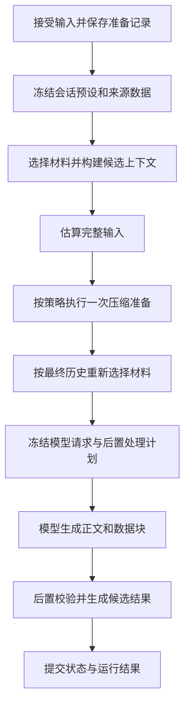

# SR 预设、上下文与后置处理目标架构

更新：2026-11-16。状态：方案，待实施。配套 [实施任务](./sr-context-output-runtime-refactor-v8-tasks.md)。

会话通过 `preset_id` 绑定预设。每轮读取并冻结一份配置，用它构建上下文、选择压缩策略，并决定世界状态与行动建议后置处理。

## 1. 预设配置

### 1.1 数据库

`presets` 固定为以下八列：

| 列 | 类型 | 内容 |
| --- | --- | --- |
| id | TEXT，主键 | 预设 ID |
| name | TEXT，非空、唯一 | 预设名称 |
| description | TEXT，可空 | 预设描述 |
| model_parameters | TEXT，JSON 对象 | 模型参数 |
| context_strategy | TEXT，JSON 对象 | 上下文策略、预算和摘要提示词 |
| config_json | TEXT，JSON 对象 | 节点配置及格式版本 |
| created_at | INTEGER | 创建时间，毫秒时间戳 |
| updated_at | INTEGER | 更新时间，毫秒时间戳 |

JSON 列在数据库保存为文本，在 API 中返回对象。基础字段、模型参数和上下文策略不重复存进 `config_json`。模型选择归会话，凭据由服务端单独管理。

默认 `model_parameters`：

```json
{"temperature": 1}
```

默认 `context_strategy`：

```json
{
  "strategy": "rolling_summary",
  "max_context_tokens": 32768,
  "max_output_tokens": 2048,
  "summary_prompt": "请将以下聊天历史整理成一份供后续故事续写使用的摘要。\n\n如果历史开头包含已有摘要，请将它与后续对话合并，输出一份完整的新摘要。\n\n摘要要求：\n- 按事件顺序概括重要进展，合并重复信息，省略无关细节。\n- 保留主要人物、人物关系及其重要变化。\n- 保留明确发生的时间、地点、物品和其他关键状态变化；同一信息发生变化时，以最新事实为准。\n- 保留重要约定、当前目标、未解决的冲突和线索。\n- 区分已经发生的事实与计划、猜测、承诺，不把尚未发生的事情写成结果。\n- 不补造信息，不继续故事，不生成行动建议。\n- 使用与聊天历史一致的语言，保持准确、简洁。\n\n只输出摘要正文。"
}
```

`strategy` 支持 `rolling_summary` 和 `sliding_window`。`max_context_tokens` 是输入预算，`max_output_tokens` 是叙事生成的输出预算；摘要请求的输出额度由压缩器单独预留。`summary_prompt` 只在滚动摘要调用时使用，采用 sliding_window 时保留配置但不执行。

### 1.2 节点配置

`config_json` 顶层为 `{"schemaVersion":2,"nodes":[...]}`。默认节点按下表排序：

| ID | 名称 | kind | role | 提示内容与材料 | 开关 |
| --- | --- | --- | --- | --- | --- |
| main | 主提示 | system | system | 基础叙事指令 | 固定开启 |
| personaInfo | 用户信息 | system | system | 当前玩家的角色 prompt | 固定开启 |
| characterInfo | 角色信息 | system | system | 激活角色的 prompt | 固定开启 |
| worldInfo | 世界书 | system | system | 激活世界书正文 | 固定开启 |
| chatHistory | 会话历史 | system | auto | 会话背景、已有摘要、原角色历史 | 固定开启 |
| userInput | 用户输入 | system | user | 本轮用户输入原文 | 固定开启 |
| worldState | 世界状态 | postprocess | system | 当前可更新状态、更新规则和格式 | 默认开启，可关闭 |
| actionSuggestions | 行动建议 | postprocess | system | 三种推进速度的建议指导和格式 | 默认开启，可关闭 |

前六个节点不可关闭或删除。两个后置处理节点各最多一个，以 `enabled` 为唯一配置开关：关闭时不注入提示、不执行对应处理；开启后由本轮实际材料确定是否加入上下文，世界状态没有可更新项时直接跳过。导入未包含某后置处理节点时，该能力不启用。

自定义文本使用 `kind: text`，排列在 main 后、用户信息前，保留各自角色与相对顺序。节点 ID 唯一，固定 ID 的类型、角色和材料来源受校验。

### 1.3 提示词配置

节点自身保存完整提示词。`prompt.parts` 按顺序组合两类内容：

| 部件 | 格式 | 作用 |
| --- | --- | --- |
| 静态文本 | `{"type":"text","value":"提示词"}` | 保存指令、标题、格式与示例 |
| 动态材料 | `{"type":"source","name":"state.currentValues"}` | 读取服务端允许的固定材料 |

材料来源只提供数据或消息，不暗中增加指令。角色、世界书和状态服从世界卡加载规则；历史和当前输入不进行二次模板执行。`chatHistory` 按原角色展开消息，不把整段历史压成一条 system 消息。

所有节点使用统一字段 `id`、`name`、`kind`、`role`、`enabled`、`prompt`，其中 prompt 只包含 parts。不为个别节点增加 empty、diagnostic、agent 等专用字段，也不配置空值提示或组合变体。

世界状态使用 `state.currentValues` 和 `state.updateRules` 两个来源；本轮无可更新状态时，不展开整个 worldState 节点，也不执行对应状态更新处理。预设中的节点和 enabled 保持原值，不因此修改存储配置。行动建议只需静态提示。

压缩 prompt 只保存于 `context_strategy.summary_prompt`，不进入叙事请求；chatHistory 节点只组织会话背景、摘要正文和历史，不保存摘要指令。叙事与摘要指令均从预设读取；代码只负责结构、序列化、校验和执行。默认预设资源仅用于初始化或明确恢复，运行时缺少必需提示应报配置错误。

### 1.4 完整导入文件

[默认预设 JSON](./sr-default-preset-v8.import.json) 是目标格式的完整导入文件，包含全部八个节点和完整提示词，不包含运行时状态值。目标导入接口接收 `name`、`description`、`model_parameters`、`context_strategy`、`config_json` 五个字段；`id`、`created_at`、`updated_at` 由服务端生成。导入创建新记录，同名时追加编号，不覆盖已绑定的预设。该文件须在目标导入器实现后使用，不代表已通过现有接口导入。

文件中的动态来源固定如下，不是待手工替换的占位符：

| source.name | 返回内容 |
| --- | --- |
| persona.prompt | 当前玩家通过加载规则的角色 prompt |
| characters.prompts | 其他激活角色的 prompt，按角色顺序分段连接 |
| world.lore | 激活世界书正文，按 load.order 和原始索引排列 |
| session.background | `data.state.scopes.session` 中通过加载规则的状态，以 `sessions.state` 当前值生成背景内容 |
| history.summary | 本轮采用的摘要正文：新摘要被采纳时用新摘要，否则使用当前历史链上有效的持久摘要；没有则为空 |
| history.messages | 摘要覆盖范围之后保留的 user/assistant 叙事消息，不含摘要本身，保持角色和顺序 |
| input.text | 本轮接受的用户输入原文 |
| state.currentValues | 本轮可更新状态的 key 与当前值 |
| state.updateRules | 同一组 key 的 description、type 和适用 min/max |

除 `history.messages` 返回消息序列，其余来源返回文本；数据编码不得意外闭合提示区块。`role: auto` 顺序读取 parts，连续文本及文本来源组成 system 消息，遇到 history.messages 时先结束文本消息，再展开原角色消息；不生成空消息，也不添加源码指令。摘要执行不展开这个节点的完整 parts，只读取 context_strategy.summary_prompt、旧摘要和待压缩历史。

目标预设只支持 Direct 叙事和摘要，暂不支持 Agent；不配置 Agent 提示、工具说明、工具循环或模式切换字段。模型连通性测试不作为节点用途纳入本次预设配置。

## 2. 上下文构建

### 2.1 叙事消息顺序

```text
system     main
节点 role  可选自定义提示（默认预设不包含）
system     用户信息
system     角色信息
system     世界书
system     会话背景及已有摘要（如有）
原始角色   保留的聊天历史
user       本轮用户输入
system     <世界状态>完整提示（节点开启且有可更新状态时）
system     <行动建议>完整提示（节点开启时）
```

世界共享状态不自动注入叙事上下文，也不迁移到其他节点作为背景。会话状态按 session.background 来源提供说明内容，不进入“当前可更新状态”。当前可更新状态只包含本轮获准的 message 状态；提示中的 key、当前值、更新规则与服务端写入权限来自同一集合。模型无需感知 scope。世界卡加载规则在服务端读取 global 值的能力不因此改变。

“世界书”节点只有 `world.lore`，读取通过加载规则的 `data.lorebook.entries[].content`，按 load.order 和原始索引排列。不追加世界共享状态，也不读取展示用的 `data.description` 组件。

chatHistory 的“会话背景”是会话级状态说明，不是聊天记录或摘要：定义来自 `data.state.scopes.session`，当前值读取 `sessions.state`。例如定义了“章节”，当前值为“第二章”，可展开为“章节：第二章”；没有激活的会话状态时材料为空。initial 仅用于初始化，不能覆盖当前值。

chatHistory 中的“摘要正文”与“摘要 prompt”是不同数据。编译器把 `history.summary` 填入节点的 `<已有摘要>` 文本区域，再展开 `history.messages`，例如：

```text
system：<会话背景>章节：第二章</会话背景>
        <已有摘要>玩家与莉娜来到河湾镇，准备调查失踪商队。</已有摘要>
user：向药店老板打听商队的去向。
assistant：老板说商队三天前走向北边的旧矿道。
```

这里第一条 system 消息及后续两条原角色消息都由 chatHistory 节点展开。本轮新输入仍由 userInput 单独提供。新摘要先作为本轮编译材料使用，并在准备交接事务中保存为 compaction 记录；后续从当前历史链的有效 compaction 记录读取摘要及覆盖边界。不把摘要写进预设，不重复注入被摘要覆盖的历史，也不把 summary_prompt 当摘要正文。

角色只使用 `prompt`，不把展示用 `description` 当角色指令。世界书按加载顺序排列。激活判断仅依据最终摘要、保留历史和本轮输入，不扫描提示词及格式示例。

### 2.2 执行流程



配置和来源在首次异步等待前冻结。预设修改只影响下一轮；本轮提示词与处理器使用同一个快照。配置执行指纹覆盖模型参数、上下文策略和全部节点内容。

同一个上下文编译入口服务于候选预览、预算估算和最终请求。压缩后重新确定可写状态，并产生 `PostprocessPlan`：启用哪些节点、状态是否必需、允许更新的根及协议版本。它是运行时派生结果，不再保存一套独立能力开关。

实际 Provider 请求保持上述角色和顺序；不支持用户消息后 system 的模型适配应明确报错。叙事只执行一次 Direct 请求，不注册工具、不进入工具循环；摘要使用下一节的简单消息构建。

## 3. 压缩执行逻辑

### 3.1 策略与预算

| 策略 | 执行方式 |
| --- | --- |
| rolling_summary | 选择需要压缩的历史，最多调用一次摘要模型，用完整新摘要替换被覆盖历史 |
| sliding_window | 保留连续的最近历史后缀，不调用摘要模型 |

每轮只在准备阶段执行一次压缩流程。估算完整叙事输入，包括全部提示、状态、背景、历史和当前输入；达到输入预算的100%时触发，压缩目标为60%。输入预算上限为 `min(模型窗口 × 80%, 模型窗口 − 输出预算 − 1024)`。

只压缩历史，保留受保护的近期消息。摘要不分批、不重试；最终请求合法但超过软目标时仍可发送，Provider 超限按请求错误处理。不增加后续模型轮次或二次压缩。

### 3.2 摘要上下文与提示词

摘要只使用 **压缩 prompt + chatHistory**：

```text
system     预设的 context_strategy.summary_prompt
assistant  已有摘要（如有）
原始角色   本次选中的待压缩聊天历史
```

这里的 chatHistory 是待压缩历史投影，包含旧摘要前缀；不包含会话背景、保留区历史、本轮新输入、世界状态或行动建议提示。只传可见叙事正文，不传工具记录或原始数据块，也不增加 previous/gaps/messages JSON 包装。

默认压缩 prompt：

```text
请将以下聊天历史整理成一份供后续故事续写使用的摘要。

如果历史开头包含已有摘要，请将它与后续对话合并，输出一份完整的新摘要。

摘要要求：
- 按事件顺序概括重要进展，合并重复信息，省略无关细节。
- 保留主要人物、人物关系及其重要变化。
- 保留明确发生的时间、地点、物品和其他关键状态变化；同一信息发生变化时，以最新事实为准。
- 保留重要约定、当前目标、未解决的冲突和线索。
- 区分已经发生的事实与计划、猜测、承诺，不把尚未发生的事情写成结果。
- 不补造信息，不继续故事，不生成行动建议。
- 使用与聊天历史一致的语言，保持准确、简洁。

只输出摘要正文。
```

摘要输入估算包含压缩 prompt、旧摘要与待压缩历史，并单独预留摘要输出额度。完整返回文本直接作为摘要候选，只做正常结束、非空、流式终值一致、取消和预算等通用检查；不创建后置处理计划，不解析标签，不更新状态，不生成行动建议。

摘要覆盖范围、采纳判断、Usage 和持久化交接由压缩器及运行时负责。内部恢复记录不作为额外模型提示。

## 4. 后置处理

模块命名为 **`postprocess`**，负责数据块解析和业务校验。只注册世界状态、行动建议两个处理器，按固定节点身份匹配；预设不配置解析脚本、模块路径或另一套插件开关。

### 4.1 世界状态

提示按“当前状态 → 更新规则 → 输出要求与格式”组织，当前值与规则按相同 key 展开。下面是展开示例，示例数据不写死在默认预设中：

```text
<世界状态>
当前状态：
- 金币：100
- 背包：{"治疗药水":2}

状态更新规则：
- 金币：
  - description：只按实际完成的交易、奖励或损失更新，金币不足不能购买成功。
  - type：number
  - min：0
- 背包：
  - description：获得或消耗物品时更新数量；数量归零时移除条目；交易需同步更新金币。
  - type：json

输出要求：
- 先完成叙事正文，再依据本轮正文中实际发生的事件更新状态。
- 遵守各状态的 description、type 和适用的 min/max。
- 不结算计划、猜测或行动建议，不重复结算历史事件。
- path 使用给定状态 key，子路径用英文句点连接，不使用数组下标。
- value 是完整新值，不是差额；替换对象时保留仍需存在的内容。
- 删除属性时替换所属对象，null 不表示删除。
- 正文后输出一个 state_update 块，最多100项；没有变化时输出 []。
- 每项包含 path、value，可选简短 reason；只输出发生变化的项。
- 如需行动建议块，将其放在状态块之后。最后一个数据块后不再追加正文。
- 实际数据块不用代码围栏或外层标签；正文要展示保留标签时使用 HTML 实体。

输出格式（仅参考结构，不照抄事件和数值）：
<state_update>
[{"path":"金币","value":80,"reason":"购买药水花费20金币"},{"path":"背包","value":{"治疗药水":3}}]
</state_update>
</世界状态>
```

服务端从世界卡定义和当前快照生成材料，例如 `{"path":"金币","type":"number","value":100,"min":0,"description":"……"}`。`description` 可描述 JSON 子字段更新规则；服务端强制校验权限、路径、类型和顶层 number 的 min/max。自然语言 check、嵌套范围、整数要求及跨字段业务因果仅作为模型指导，不增加规则执行引擎。

节点开启且存在可写状态时，状态块必需；没有变化提交 `[]`。没有可写状态时直接跳过本轮 worldState 节点，不注入任何替代提示，也不要求或执行状态块；运行诊断可标记为 `not_required`。是否存在状态按获准的状态项数量判断，值为0、false、空字符串或空对象不表示状态不存在。

更新先应用到工作副本：合法项按顺序执行，无效项跳过并报告；重复路径依次生效。缺少 reason 不算失败。处理器只产生候选状态，不直接写数据库。

### 4.2 行动建议

默认完整提示：

```text
<行动建议>
行动建议是提供给玩家选择的下一步行动，不代表已经执行。
根据本轮正文结束后的情境，按以下顺序生成三个建议：
1. 缓慢：停留在当前场景，通过观察、交流或细节互动展开故事。
2. 中速：采取具体行动，推进眼前事件或当前目标。
3. 快速：主动推动关键事件，尝试让局面进入新的阶段。

生成要求：
- 建议具体、简短，符合当前情境，三个方向有明显区别。
- 只描述玩家可以尝试的行动，不预先保证结果。
- 每条不超过50个字符，不附加速度标签或解释。

输出要求：
- 正文后输出一个 action_suggestions 块，内容为三个字符串的 JSON 数组。
- 本轮需要 state_update 时，将建议块放在它之后。
- 实际数据块不用代码围栏或外层标签，最后一个数据块后不再追加正文。
- 正文要展示保留标签时使用 HTML 实体。

输出格式（按当前情境重新生成内容）：
<action_suggestions>
["向店员打听最近的见闻。", "询问药水价格，为旅程准备补给。", "提议立即出发，前往失踪者最后出现的地点。"]
</action_suggestions>
</行动建议>
```

服务端要求恰好三条，去首尾空白后非空、互不相同，每条不超过50个 Unicode 码点；不补齐、截断或换序。三种策略由提示词指导，不声称能机器验证叙事语义。建议点击只填入玩家草稿，不自动执行。

### 4.3 行动建议的事件与展示生命周期

行动建议是本轮生成的临时交互数据：**不保存建议文本到数据库，通过事件通知 Host，绑定 assistant 消息 ID，展示到下一轮 Run 被接受为止。** 这个生命周期由运行时统一执行，不增加预设开关或修改模型输出格式。

建议通过校验、本轮正文与状态成功提交后，Server 先发布 Run 完成事件，再发布一次建议事件：

```json
{
  "event": "action_suggestions.changed",
  "data": {
    "sessionId": "session-1",
    "suggestions": {
      "runId": "run-1",
      "messageId": "assistant-message-1",
      "items": ["观察周围的动静。", "向店员询问补给价格。", "提议出发寻找失踪者。"]
    }
  }
}
```

`messageId` 必须是本轮已保存的 assistant 正文消息 ID，与流式正文的稳定 ID 一致，不是 user Entry ID、Run ID 或另外生成的 ID。状态 partial/failed、建议校验失败、取消或提交失败均不发送非空建议事件。

Host 只在当前会话内存中维护一组 `{runId, messageId, items}`，通过已有 MessageChannel 和 `SRSessionAPI.subscribe` 向 SDK 投影同名事件；清除时 `suggestions` 为 null。官方 WorldStory 将建议显示在对应消息下方，建议不并入 Run 历史 reducer；自定义组件使用同一公开 SDK 合同。新订阅者可取得当前尚未失效的内存投影，不查询数据库，不恢复历史建议。

| 时机 | Host 行为 |
| --- | --- |
| 收到本轮有效建议 | 按会话、Run 和消息归属校验后展示；目标消息尚未渲染时只暂存，不挂到其他消息 |
| 同一事件重复到达 | 按 sessionId/runId/messageId 去重，更新同一组展示，不追加第二组 |
| 点击建议 | 填入草稿，建议仍展示；不自动发送 |
| 新一轮被 Server 接受 | 清空上一轮建议，向 SDK 发布 null；受理依据为发送返回202或该 Run 的 preparing/created 事件 |
| 发送被拒绝，未创建新 Run | 保留原建议；不能只因点击发送或请求发出就清除 |
| 新一轮已受理但随后失败或取消 | 不恢复上一轮建议 |
| 刷新、离开或切换会话、Host 卸载 | 清除内存；再次进入时不从历史或恢复快照重建建议 |
| 断线与重连 | 断线期间不能选择；重连只核对最新 Run，若已推进则清除。漏收的建议不补发、不回放 |

Host 记录当前已接受的 Run 身份：同一 Run 的迟到202不得清除它刚生成的建议；新 Run 开始后拒绝旧 Run 的迟到建议。仅在匹配的最新 Run 已完成、对应 assistant 消息可信时展示。普通重渲染及同一 Host 下的组件挂载可复用当前内存投影，不算新的历史展示；不写 localStorage、sessionStorage 或 IndexedDB。

持久化投影与临时建议载荷分开：Run 结果只保存处理状态、数量及错误码等诊断，不保存 items、原始建议块或候选副本；`ready` 只表示生成校验成功，不表示客户端必然收到。HTTP Run 查询、历史分页、恢复快照和 Run 终态事件均不携带建议文本。建议事件没有持久回放或送达重试，提交后若连接中断，可能不展示建议，但不影响正文与状态。

废弃格式的会话、Run、历史建议及其恢复数据在切换时清除；不提供旧建议读取或旧协议恢复入口。

### 4.4 解析与执行顺序

模型返回“正文 → 本轮需要的 state_update → 本轮需要的 action_suggestions”，不要求 `<sr_extensions>` 外层。运行结果协议为 `sr-output-blocks/v1`，不通过模型文本猜测协议版本。

1. 切分器把流式正文交给界面，将保留数据块放入有界尾部缓冲；进入尾部后不再回流正文。关闭节点的意外数据块也不会展示成正文或触发处理。
2. 等待模型正常结束，校验流式与最终文本一致、正文非空、无工具调用，再处理完整尾部。截断、失败或提交前取消均丢弃候选。
3. 校验标签闭合、顺序、重复及尾随内容，再严格解析 JSON。扫描识别字符串和转义，字符串内标签不作为边界；拒绝重复 JSON 键。总尾部最多262144字节，JSON 深度最多32。
4. 根据冻结的 `PostprocessPlan`，先校验世界状态，再处理行动建议；状态部分失败或失败时不发布建议。
5. 由运行时统一提交状态与不含建议文本的 Run 结果；提交成功后发布权威通知，再将临时建议通过一次事件交给 Host，随后释放 Server 候选引用。

标签精确匹配且不接受属性。保留名称的错误写法、旧外层标记和 EOF 半标签应拦截并报告，不泄漏成正文；未知标签只在已进入尾部后作为结构错误处理。边界可信的关闭节点块忽略业务内容；节点开启但无可写根时同样不执行状态更新。

### 4.5 失败规则

| 情况 | 状态结果 | 行动建议 | Run |
| --- | --- | --- | --- |
| 节点关闭 | 不执行对应处理 | 不执行对应处理 | 由其他结果决定 |
| 无可写状态 / 合法空更新 | not_required / unchanged | 可正常发布 | completed，前提是其余检查通过 |
| 状态全部合法 | 提交合法更新 | 可正常发布 | completed |
| 状态项部分或全部不合法 | partial，仅提交合法项 | 不发布 | completed |
| 必需状态块缺失或块内数据不合法 | 不提交 | 不发布 | failed，保留可保存正文 |
| 建议块缺失，或边界可信但数据不合法 | 保留合法状态 | 不发布 | completed |
| 尾部结构不可信、重复/乱序块、尾随正文或超限 | 丢弃全部候选 | 不发布 | failed |
| 模型失败、截断、工具调用或终值不一致 | 丢弃全部候选 | 不发布 | failed |
| 提交前用户取消 | 丢弃全部候选 | 不发布 | stopped |
| 数据库提交失败 | 不宣称成功 | 不发布 | failed |

整体结构校验优先于块内数据校验。例如建议 JSON 有尾逗号但边界完整，可保留合法状态；建议字符串未闭合导致边界不可信，则整批不提交。

## 5. 模块职责

| 模块 | 职责 |
| --- | --- |
| `domain/preset`、预设 repository | 配置验证、八列读写、目标格式导入与保存冲突检查 |
| `runtime/context` | 冻结来源、选择材料、编译消息与 PostprocessPlan、预览和完整预算 |
| `runtime/context/compaction` | 选择压缩历史、构建摘要请求、采纳摘要或滑动窗口 |
| `runtime/postprocess` | 有界切分、标签/JSON 解析、世界状态和行动建议校验 |
| `runtime/runners` | 调用模型、消费文本流、保存正文、交接候选结果 |
| `runtime/sr-runtime` 与 persistence | 输入准备、并发与取消、最终事务、Usage、权威事件；建议仅事件发送 |
| Studio Host 与 SDK | Host 管理临时建议及清除，SDK 按消息 ID 展示，不从历史恢复 |
| `resources/presets/default.json` | 完整默认预设数据及所有用途提示词 |

`postprocess` 内按 `stream-splitter`、`parser`、`processor`、`state-update`、`action-suggestions` 划分职责；共享 JSON 校验复用纯函数，不建立可执行插件框架。派生处理计划统一命名 `PostprocessPlan`。

Direct 使用上述后置处理。摘要只返回文本，不注册工具、不进入后置处理。

### 5.1 目标代码目录

以下只列本次涉及的目标文件，包含新增文件和需要调整的文件；未列出的代码维持各自职责。默认预设 JSON 从本方案配套导入文件生成种子，不在源码另写一份提示词。

```text
apps/server/
  resources/presets/default.json             # 完整默认预设数据
  src/
    domain/preset/
      schema.ts                              # 预设、节点及动态来源校验
    domain/session/
      run-result.ts                          # 公开结果投影；过滤建议文本
      history-runs.ts                        # 历史读取；不恢复建议
    repositories/preset-repository.ts        # 八列持久化与编辑冲突
    infrastructure/database/database.ts      # 目标数据库结构与初始化
    routes/
      presets.ts                             # CRUD、导入导出、候选预览
      sessions.ts                            # 会话绑定、节点派生能力
      session-runtime.ts                     # Run API、SSE建议事件透传
      providers.ts                           # 固定文本连通性测试，不验证工具调用
    runtime/
      config.ts                              # 会话预设读取与冻结
      types.ts                               # PreparedRun、运行候选与事件合同
      context/
        contracts.ts                         # 上下文输入/编译结果类型
        snapshot.ts                          # 来源数据快照
        materials.ts                         # 数据与背景投影
        activation.ts                        # 世界卡加载规则
        node-compiler.ts                     # 节点→消息及PostprocessPlan
        context-manager.ts                   # 预算、压缩及最终请求装配
        budget.ts                            # 预算、请求指纹
        compaction/
          index.ts                           # 一次压缩流程
          types.ts                           # 压缩策略合同
          history.ts                         # 待压缩历史投影
          estimator.ts                       # 完整输入估算
          rolling-summary.ts                 # 摘要覆盖范围与采纳
          sliding-window.ts                  # 连续历史后缀
          summary-generator.ts               # 压缩prompt＋chatHistory
      postprocess/
        contracts.ts                         # 持久诊断与临时建议分开定义
        registry.ts                          # 两个节点与处理器固定映射
        stream-splitter.ts                    # 可见正文/隐藏尾部
        parser.ts                            # 标签顺序与词法边界
        strict-json.ts                       # 有界严格JSON校验
        processor.ts                         # 校验门槛、状态→建议依赖
        state-update.ts                      # 生成状态工作副本
        action-suggestions.ts                # 校验并返回临时三条建议
      runners/
        direct-runner.ts                     # 生成正文与后置处理候选
        story-writer.ts                      # 正文保存与稳定消息ID
      persistence/
        run-store.ts                         # 状态/Run事务；不写建议文本
        usage-store.ts                       # 用量持久化
        run-post-processor.ts                # 仅Usage结算，不处理行动建议
      model/
        model-client.ts                      # 请求、取消、模型事件
        pi-gateway.ts                        # Provider适配与请求顺序校验
      sr-runtime.ts                          # 受理、提交、一次性建议事件
  test/
    presets.test.ts                          # 配置与导入导出
    context.test.ts                          # 节点编译与真实请求顺序
    compaction-lifecycle.test.ts             # 压缩流程与摘要隔离
    narrative-extensions.test.ts             # 解析、校验及失败规则
    session-runtime.test.ts                  # 提交、事件及建议不落库

apps/studio/src/
  features/presets/
    types.ts                                 # 目标预设类型
    adapter.ts                               # API与编辑数据转换
    PresetStore.tsx                          # 保存、冲突、草稿
    PresetLibraryPage.tsx                    # 节点及策略设置
    PromptEditorDialog.tsx                   # 完整提示词查看
  features/sessions/
    action-suggestions.ts                    # Host临时建议状态及失效规则
    SessionSettingsDialog.tsx                # 节点派生能力展示
  host.tsx                                   # SSE接收、受理清除、消息通道
  frame.tsx                                  # 可信Host事件接入SDK
apps/studio/test/action-suggestions/          # 临时展示、清除与竞态用例

packages/sr-sdk/src/
  run-contract.ts                            # 建议事件；Run诊断不含items
  session-runtime.ts                         # 订阅和当前临时投影
  story-history.ts                           # 历史reducer不保存建议
  world-story.tsx                            # 绑定消息ID展示当前建议
  world-story.css                            # 建议展示样式
  index.tsx                                  # 导出公开类型，保持隔离边界
```

## 6. 接口、数据与交付边界

- 预设 API 按八列合同读写，相关字段在同一事务保存；使用记录 ETag 检查编辑冲突。前端展示六个固定节点、两个默认开启的后置处理节点，并支持查看完整提示词。保存失败保留草稿。
- 会话能力从绑定预设节点派生，不另存独立开关。界面区分下一轮配置与生成中已冻结配置；候选预览不调用模型、不写数据，只有内存中确有冻结请求时才提供该请求查看。
- 采用一次性切换，只接受目标格式。清除旧预设及旧会话运行数据，初始化目标默认预设，修正世界及应用的预设引用；仍被新架构使用的世界卡、世界共享状态、组件、模型及凭据保留。数据库清理在停服持锁状态下执行，完成后校验引用完整。
- 删除 Agent 执行入口、工具循环、执行模式字段、能力覆盖字段及相关 UI/API/测试；模型 test 接口固定发送普通文本，仅验证正常非空响应，不返回 toolVerified。
- SDK、Host 和 Server 仅支持目标协议；删除旧信封、旧结果投影和回退解析。建议文本只经实时事件发送，不写历史。
- 输入在返回202前保存到准备记录；准备失败保留输入，摘要与用户消息按事务交接。最终提交复核取消、tip 和状态基线，提交前不发布状态变更。正文可先独立保存；未保存的流式正文不承诺进程崩溃后恢复。
- 保持 iframe 隔离、Host 授权与凭据边界。提示预览仅供可信前端；普通日志不记录私有提示。实现验收使用临时数据库和 mock Provider，覆盖真实请求顺序、压缩、四种开关组合、解析边界、失败与取消、迁移、SDK 和预设界面。


## 7. 切换与废弃清理

实施前先提交当前工作区，记录重构前基线。随后按模块接入新链路，并在本次实施中删除被替换逻辑；最终运行时只有一套配置、编译和后置处理入口。不提供旧格式导入、旧版本读取、兼容字段或降级执行。

| 范围 | 删除内容 | 目标 |
| --- | --- | --- |
| 提示与编译 | 旧 prompt-builder/direct-prompt/system-main、源码叙事与摘要文案、builder 闭包及重复配置 | node-compiler 与预设数据唯一来源 |
| 生成模式 | AgentRunner、ToolExecutor、state-tool、continuation、toolVerified 与工具测试依赖 | 单次 Direct 生成，独立摘要请求 |
| 预设与会话字段 | 内嵌 budget/summary_prompt、独立 capabilities、execution_mode、capability_overrides_json、capability_revision | 八列预设、统一节点及派生处理计划 |
| 扩展 | 旧 narrative 实现、sr_extensions 信封及版本兼容分支 | postprocess 裸标签解析 |
| 行动建议 | items 落库、历史建议投影、恢复与此前建议 UI | 临时事件与 Host 内存 |
| 废弃数据 | 旧 presets、sessions、entries、run_preparations，以及旧预设标签关系和无效引用 | 新默认预设及从新格式建立的会话 |
| 文档与测试 | 本次领域已被目标架构替代的旧契约、过期断言和不再调用的测试辅助代码 | 新合同与目标流程测试 |

删除前核对调用方；新模块切换通过定向验证后删除旧实现，不长期双轨运行。通用状态校验、加载规则、取消/事务/Usage、iframe 安全等仍被目标架构使用的能力保留。清理清单不扩大为删除无关世界卡或模型数据。

验收必须证明：目标默认文件能导入；无旧运行入口及隐式回退；无废弃数据库列与旧运行记录；无建议文本落库；模型测试不依赖工具；全链路检查通过。
