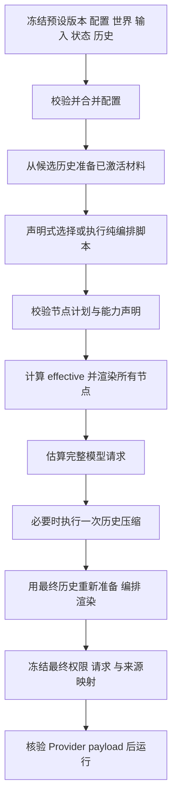

# SR 预设产品与运行时架构 v2

日期：2026-11-15。状态：提案，未实施。配套：[任务清单](./sr-preset-product-runtime-v2-tasks.md)。

本提案采用用户提出的八类固有节点与 JSON 配置面板，以此替代 `sr-preset-owned-prompts-v1.md` 中面向普通用户的多节点/program/group 结构。保留前案的提示透明、权限校验、无损迁移和请求冻结原则。没有执行代码、数据库或旧文档变更。

## 1. 产品结论

预设是一个可以配置的提示词程序：作者提供条目、配置面板和可选编排脚本；使用者调整选项；SR 用当前会话材料编译出本轮节点和请求。

推荐默认路径为“八类节点 + 参数化模板 + 声明式条件”，复杂组合才使用脚本。脚本不是每个预设的必需品，也不是隐式的第二套配置系统。

三个概念必须分开：

- **节点用途 slot**：main、用户信息、角色信息、世界书、会话历史、世界状态、行动建议、用户输入。说明条目的业务作用，不等于八种不可替换的内置文案。
- **条目库 entries**：预设保存的全部提示词条目，可以包含候选版本、自定义条目。各条目有稳定 ID。
- **本轮节点 nodes**：从条目库选择、排序并绑定变量后得到的执行实例。未选中的条目不进入请求。

“2个/3个/4个行动建议”可以是同一 slot 下的三个候选条目；推荐默认预设只保留一个参数化条目，三种数量共享同一段规则。内容语义确有差异时才拆成多个版本。

## 2. 八类固有节点

| 默认顺序 | slot / 建议 ID | 消息角色 | 默认职责 |
| --- | --- | --- | --- |
| 1 | main | system | 叙事原则、输入理解、默认文风、完整输出信封格式与教学示例 |
| 2 | personaInfo | system | 当前玩家角色通过 load 筛选后的 prompt；不是账号个人资料 |
| 3 | characterInfo | system | 其他激活角色的 prompt，保持 order 与原索引规则 |
| 4 | worldInfo | system | 已激活世界书正文，默认按 load.order 与原索引排序 |
| 5 | chatHistory | 原角色 | 一次展开摘要和保留历史，摘要不与覆盖历史重复，历史不含扩展尾块 |
| 6 | worldState | system | 当前可写/只读状态数据、状态语义及更新规则 |
| 7 | actionSuggestions | system | 建议数量、长度、方向、业务偏好与子块格式 |
| 8 | userInput | user | 本轮输入原文 |

八类是内置用途，不是强制每次发送八条消息：空玩家/角色/世界书材料可不产生消息；历史可展开多条消息；行动建议关闭时不产生节点。main、chatHistory、userInput 的结构必须存在，历史为空可以展开零条。默认保留 worldState 条目，实际有状态时填充；无状态且无规则需要时可输出零条。

作者可增加 `custom` 条目，选择 system/user/assistant 角色并插入合法位置。第一版不把普通用户页面变成无限嵌套节点树，不保留前案中的通用 group 节点编辑负担。

约束是数据完整性和模式契约：当前输入恰好一次且位于本轮末尾；历史恰好一次、保留内部角色及顺序；模型状态写入开启时当前状态材料必须位于历史之后。编译器对不合法顺序报错，不偷偷重排。main 文案可编辑；缺少文案不能靠平台补一段替代。

## 3. 预设包含什么

用户界面保留六个部分：名称、描述、上下文策略、提示词条目、配置面板、编排逻辑。底层区分定义与用户值：

```text
PresetDefinition
  schemaVersion / id / revision
  name / description
  contextPolicy              策略、输入/输出预算、可编辑摘要模板
  modelParameters            保留现有温度等配置，不在本次删除
  entries[]                  全部条目定义与默认顺序
  config.schema              字段类型、默认值、枚举、约束
  config.ui                  控件、分组、提示、显示条件
  variables                  作者声明的默认变量
  composer                   可选编排脚本及其语言版本
  auxiliary                  Agent/诊断所需的可见提示定义

PresetValues                 当前预设用户保存的选项
SessionPresetOverrides       当前会话覆盖项
CompiledPreset               本次冻结的节点、实际文本、能力与来源映射
```

这是逻辑结构，不要求拆成这么多数据库表。现有 presets.config_json 可继续作为定义与预设值的存储容器；新增会话覆盖需要版本迁移与引用检查。服务端存储 revision，保存使用预期 revision 检测并发覆盖。

导出包含定义、脚本、默认值及用户选择的预设值，不含会话覆盖、历史、状态快照或凭据。分享作者原始版本与分享自己的配置分别提供选项。复制预设复制当前草稿的明确快照，新建 ID，不共享可变对象。

## 4. 配置面板：验证和展示分开

采用明确版本的 JSON Schema 子集验证数据，另一个 ui 对象控制布局。无需引入自定义可执行 UI，也不把 HTML/JS 塞入控件标签。

```json
{
  "schema": {
    "type": "object",
    "properties": {
      "suggestionCount": {
        "type": "integer",
        "enum": [0, 2, 3, 4],
        "default": 3
      }
    },
    "required": ["suggestionCount"],
    "additionalProperties": false
  },
  "ui": {
    "fields": [
      {
        "key": "suggestionCount",
        "label": "行动建议",
        "control": "select",
        "options": [
          {"value": 0, "label": "不开启"},
          {"value": 2, "label": "2 个建议"},
          {"value": 3, "label": "3 个建议"},
          {"value": 4, "label": "4 个建议"}
        ]
      }
    ]
  }
}
```

用户保存的值是 `{"suggestionCount":4}`，不是整个表单定义。控件值必须保留数字类型，不能变为字符串 "4"。schema 中的 default 由 SR 显式填充并记录，不假设验证器会自动赋值。

初版控件：switch、select、number、text、textarea；支持分组和有限 visibleWhen 条件。控件配置必须匹配 schema 类型/枚举。隐藏字段保留值，隐藏不等于关闭功能；若父选项决定不生效，编排必须明确不读取或不选条目，并显示未生效原因。

解析顺序：schema defaults → 预设已保存值 → 当前会话显式覆盖 → 当前编辑草稿（仅预览）。字段级合并后再验证；嵌套对象递归合并、数组整项替换、null 仅在 schema 允许时有效；“继承”用删除覆盖字段表达，不能将 0/false/空串当作缺失。schema 版本变化时保留旧值副本并报告不兼容字段，不默默丢弃。未知字段不能进入运行时变量。

## 5. 条目定义与默认建议条目

条目基础字段：`id/name/slot/role/enabled/source/template/when/locals/provides`。source 只能引用 Server 允许的材料，角色/世界书条目可编辑包装模板，不能通过 source 绕过 load。

```json
{
  "id": "actionSuggestions",
  "name": "行动建议",
  "slot": "actionSuggestions",
  "role": "system",
  "enabled": true,
  "when": "config.suggestionCount > 0",
  "provides": {
    "actionSuggestions": {"count": "config.suggestionCount"}
  },
  "template": "【行动建议】\n正文结束后，在同一个 sr_extensions 信封内输出 action_suggestions。\n内容为 JSON 字符串数组，目标为 {{effective.actionSuggestions.count}} 条不同的建议，每条 1–120 个 Unicode 码点。\n建议符合正文结束后的情境，供玩家直接采用；不替玩家执行，不保证成功，不提前改变状态。确实没有合适建议时输出 []。"
}
```

这里的 when/provides 字符串是受限表达式，不是任意 JS。provides 表示选中该条目时请求启用的功能，是结构化声明，不是从 prompt 文字猜测能力。effective 来自验证后的最终计划，模板不得自行修改。

worldState 同理声明 stateUpdate；运行时只在最终激活 message 根内授权，required 还取决于实际根集合。能力声明不能扩大权限。一个 program 中同种能力最多一个提供者；同时选中“2 个建议”和“4 个建议”必须报错。

关闭建议时，该条目未入选 → 无建议能力 → main 骨架和示例不含建议子块 → Runner 不要求发布建议。不能继续保留 `config.ts` 当前的 Direct 强制 true，也不能让旧 capability_overrides 再作为不可见的第二套开关。

建议 count 是目标数，仍遵循现有 2–4 范围、单项长度、去重与数量偏差诊断，不把数量偏差改成致命错误。

## 6. 变量与脚本：提供自由度，但消除顺序副作用

变量命名空间：

| 名称 | 来源与权限 |
| --- | --- |
| config.* | 经过 schema 验证的最终用户选项，只读 |
| context.* | Server 冻结并筛选后的玩家、角色、世界书、当前状态、候选历史、当前输入，只读 |
| vars.* | 作者声明默认值、脚本集中计算的本轮派生变量 |
| local.* | 当前条目或本轮条目实例的局部绑定 |
| effective.* | 最终计划派生并由运行时验证的能力、数量及状态 required，只读 |

上下文包含的数据应有明确清单；不含凭据、任意数据库行、原始未激活模块、iframe 权限或系统文件。资料只能影响提示，不能产生授权。

模板支持 `{{变量}}`、if/else、限定的数组遍历和 JSON 序列化。控制分支与遍历只由模板自身定义，动态输入不二次解释；缺失变量是定位到条目的错误，空数组/空字符串是合法数据。保留旧 `{{user}}` 别名。

支持作者“设置变量”的意图，但设置发生在集中编排阶段，模板只读取变量。第一版不引入条目 A 内 setvar 影响后续条目 B 的跨条目可变副作用，也不引入跨 Run 持久化全局变量。否则拖动条目、预算预览和压缩后的重编译都会改变语义。跨轮事实继续由正式状态系统维护。

### 无脚本默认路径

按 entries 默认顺序选取 enabled 且 when 为真的条目；解析 locals/provides，验证能力，再渲染模板。日常的数量、语言、视角、篇幅、风格选择无需写脚本。

### 可选脚本路径

作者确实需要多条目替换、组合排序或复杂派生变量时，启用 composer。输入是已验证的 config、冻结 context、作者 variables、条目元数据。脚本返回显式计划，不调用模型、不改数据库：

```js
const count = config.suggestionCount;
return {
  vars: { suggestionCount: count },
  nodes: [
    { entry: "main" },
    { entry: "personaInfo" },
    { entry: "characterInfo" },
    { entry: "worldInfo" },
    { entry: "chatHistory" },
    { entry: "worldState" },
    ...(count > 0 ? [{ entry: "suggestions-" + count }] : []),
    { entry: "userInput" }
  ]
};
```

这正好支持用户提出的三个候选条目方案。候选条目可各自声明固定 count=2/3/4；当只有数量差异时采用前述单条目更省维护。

script 返回的节点实例支持 `entry/local/templateOverride`；修改模板也必须进入来源映射，显示脚本位置及生成结果，不回写原条目。角色、source、slot 身份不能通过 templateOverride 伪造。脚本模式中返回列表是顺序的唯一来源，不再同时施加另一份 UI 排序；返回禁用条目或 when=false 条目报错，不能静默改变脚本计划。UI 在脚本模式将“拖动排序”换成编辑脚本入口。

### 执行实现约束

建议 v1 使用受限 JS 语法的纯表达/编排执行器：支持 const/let 局部赋值、if/return、布尔/比较/基础算术、字符串、数组/对象构造、三元和 spread，以及明确白名单的数据变换函数；不支持任意函数定义/调用、循环、递归、import、Promise、时间、随机、网络与文件操作。复杂集合变换用有长度上限的白名单函数。所有返回值是有限 JSON 数据。

项目已有 acorn 可用于语法解析，但解析器本身不是隔离边界；必须按允许的 AST 节点自行求值，不得用 eval/Function 执行源码。不向求值器传入 Host 对象，只使用复制后的 JSON；阻止原型链属性、限制步数/深度/输出与输入大小。执行放到可终止的独立 worker，并验证超限回收；不能把主线程超时回调当作中断能力。

这不是完整 JavaScript，也不承诺酒馆宏或脚本直接兼容。语言版本、允许语法、资源上限写入正式契约；导入时先静态检查，超限/非法访问返回脚本行列和条目诊断。不得失败后偷偷回退默认预设或发送残缺请求。

## 7. 协议提示放在哪里

不额外增加第九个“平台协议”节点。默认分工：

- main 保存单一信封的顺序、闭合规则、空骨架、JSON 基础要求和一个完整示例；条件引用 effective.stateUpdate.required / effective.actionSuggestions.enabled。
- worldState 保存状态材料及 path/value/reason、整项替换、只读边界等状态专用规则。
- actionSuggestions 保存建议子块说明及业务偏好。

先解析节点选择和能力声明，再渲染全部模板。因此 main 虽在首位，也能知道最后有没有建议节点，不需要读后续节点的 setvar。

骨架、规则、示例与 Runner 共用同一个 effective 描述。静态示例与示例候选建议保存在预设；运行时仅序列化/按数量选择数据，不生成隐藏文案。可提供预设内具名文本片段减少复用成本，必须可见可编辑、无递归；片段不是新的顶层节点。

用户可改协议说明，但实际解析器仍按 sr_extensions/v1 工作。保存能发现结构错误，无法证明任意文案与语义完全一致；在发布/导出验证中校验实际渲染骨架与示例，并提醒自定义正文的语义风险。不自动修补文案。

## 8. 完整运行流程



纯编排可能对不同候选历史执行多次，不能承诺每个 Run 只执行一次脚本；每次相同输入必须相同输出。脚本不得自行压缩、重试、调用模型，也不得自行读取已丢弃历史或摘要所覆盖原文。算法仍保持 preparation 一次压缩、rolling summary 最多一次完整模型调用、100%/60% 阈值、连续历史后缀与现有预算上限。

若脚本依赖候选历史而造成压缩后 prompt 变大，按现有预算规则报告或继续合法请求，不能递归寻找固定点或追加摘要调用。预览与正式运行共用编译器；无模型调用的编辑预览标注为候选，真正的最终请求只能由 preparation 给出。

最终权限只来自最终摘要、保留历史、当前输入和状态定义；模板、示例和脚本生成文本不参与 load 扫描。状态写入请求只能收窄为不开启，不能授权新的根或 scope。

Agent continuation 复用冻结结果并追加真实工具消息，不重跑脚本/压缩。Direct 不注册工具。Provider 不支持历史后 system 时按现有契约拒绝，不能隐式改角色或移到前面。信封失败矩阵、逐项状态验证、取消/提交、preparation journal、锁、幂等、SSE 语义全部保留。

## 9. 普通使用与作者编辑

**普通使用**：列表选择预设 → 查看描述 → 调整 JSON 面板渲染出的选项 → 保存到预设或明确保存为当前会话覆盖 → 下轮生效。显示覆盖来源，提供恢复继承；不在修改会话设置时顺带修改共享预设。

**作者编辑**：四个工作页足够：基本信息/上下文、配置面板、条目与编排、预览。脚本编辑作为条目与编排里的高级模式。普通用户不必接触 JSON 或脚本。

**预览**：同时展示全部候选条目、本轮入选顺序、实际 prompt、变量值及来源、能力结果、未入选原因和 token 估算。无会话时使用明确标记的预览样本，不复制到真实世界；预览 sourceMap 可定位至条目/模板/脚本/世界材料。Host 管理面可见，不向创作者 iframe 开放。

**保存**：草稿可保留错误，正式可运行版本必须通过结构校验；配置改变实时重算候选预览，不自动发起模型请求。保存失败保留草稿，revision 冲突展示重载/比较入口。进行中的 Run 始终使用旧冻结版本。

**恢复与删除**：恢复默认针对所选字段/条目且展示差异，不覆盖整份已改预设。引用中的预设不可删除，默认项先更换。导入坏 schema/脚本返回明确错误，不半导入。取消编辑保留已保存版本。

**布局与状态**：沿用 Studio 语义 tokens 和控件，375px 下列表/编辑/预览分屏切换，1280px 下条目与预览并列；提供键盘焦点、disabled、loading、empty、error。实际浏览器验收，不以源码检查替代。

## 10. 上下文策略、摘要和 Agent

上下文策略仍是明确的类型化运行参数，不能通过 vars 修改预算或压缩算法。包含 rolling_summary/sliding_window、max_context_tokens/max_output_tokens，另保留可编辑的摘要请求模板。摘要在上下文页编辑，不占主请求八个节点；全部摘要指令仍存于预设，不能由 summary-generator 追加隐藏指导。

摘要输入仍为 previous/gaps/messages，保留 gap 与来源 ID，且不含 Direct 扩展协议。主请求 chatHistory 统一展开摘要和保留消息，避免再增加摘要节点导致普通用户混淆。

主视图以 Direct 八节点为默认。已有 Agent 预设不能丢失：辅助的模式视图保留 Agent 顺序、lore 锚点、工具说明和独立可见模板。Agent 当前按激活根要求 update_state，并没有 Direct 的同等开关语义；迁移时明确显示模式差异，不冒充已统一。工具 schema 与执行器留在 Server，说明正文存预设。

模型诊断文本也应成为可见独立诊断预设，不混入日常八节点。修改诊断模板后不得假装通过原来的标准认证测试。

## 11. 迁移、兼容和分阶段落地

当前代码证据：Studio types/adapter 主要暴露 style/customNodes/summaryPrompt；PresetStore 在客户端创建七个旧系统节点；Server presets route 强制旧节点契约；prompt-builder 的 Direct 分支忽略部分排序并追加 platform 提示；config 强制 Direct 两能力 true。这些都必须修改，不能只做新 UI。

新的预设格式使用独立 schemaVersion；旧内容转换时同时保留原始导入备份。由 Server 提供唯一默认种子，Studio 创建时不再另存一份默认节点/摘要文案。

保留 preset ID、引用、标签、预算、温度、原内容及未生效兼容数据。将 system main、Direct 协议、摘要指导和 Agent 工具说明显式物化。旧 postHistory 按当前 Direct 有效位置映射，同时为 Agent 保留原语义；不能突然让原来忽略的 worldState 文案生效。

旧 capability.prompt 迁入条目，enabled/count/会话覆盖转换为 config 值或明确会话迁移覆盖；保留旧存储备份。Direct 过去保存 false 却实际 true 的会话，转换报告必须体现差异并保留旧实际行为，后续用户可以明确清除覆盖。迁移后不能继续保留隐藏 platform=true，且只有一个设置入口/有效来源。

落地顺序：先实现配置 schema/值、八节点、模板和声明式选择；再实现有明确语法与隔离测试的可选 composer；最终接通完整 Studio 与迁移。第一阶段即可满足数量下拉的默认用例，不为了展示下拉框必须先建设通用脚本引擎。完整交付仍包含作者要求的可选脚本能力。

## 12. 验收与本轮边界

- 选 0 得到七类节点且 main/示例/校验均不要求建议；选 2/3/4 得到同一参数化节点，三个位置数量一致。
- 三个候选条目方式也可用，最多选中一个建议提供者；未知 ID、重复来源、非法顺序、能力冲突显式失败。
- config 值类型、0/false、默认值、隐藏字段、继承/覆盖、schema 变更、导入/导出/复制/保存冲突均覆盖。
- 相同脚本输入输出确定；未知 AST、循环/调用/原型访问、超时/超量、错误返回有可定位错误且不调用 Provider。
- 丢弃历史改变激活、摘要重激活、await 期间编辑、预算预览及最终 payload 验证，确保只用最终权限。
- 没有 SR 隐藏前后缀；所有指令来自条目/脚本/可编辑辅助模板，每个 Provider 文本段可追溯。
- 原有扩展失败矩阵、工具循环、只读边界、取消/提交和数据库无损迁移通过回归。
- 相关产品 docs 和 AGENTS 只在实施后更新，清除已被新方案替代的固定平台骨架说明。

验证以临时 DB、mock Provider、根 typecheck/lint/test/build 和相关 Studio 浏览器流程为准，报告脚本实际覆盖，不使用真实付费模型推断效果。本轮仅新增本提案及任务清单，未改实现、未运行测试或迁移。
