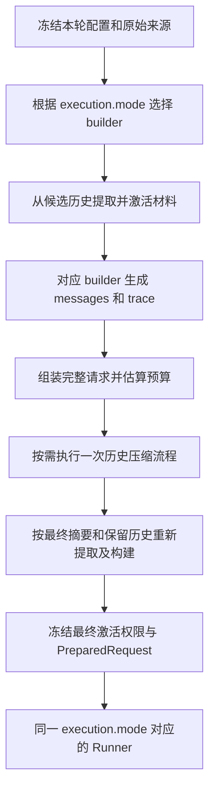

# SR Runner Prompt 构建隔离方案 v1

> 日期：2026-11-15。
> 状态：待实施；本次仅保存方案与任务，不代表目录拆分、Agent 提示恢复或新验收已经完成。
> 配套任务：[执行任务清单](./sr-runner-prompt-isolation-v1-tasks.md)。
> 实施方式：单 agent 顺序执行，并单独进行代码复核。

## 1. 目标与现状

优化 Direct 的模型输入，使模型更可靠地输出故事和完整扩展信封，同时让不同 Runner 的提示词可以独立维护。修改 Direct 的格式、示例或能力说明，不应隐式改变 Agent 或摘要请求。

### 已在当前工作区完成的 Direct 优化

- 状态以 `writable_state` / `readonly_state` 分组，每行一个 JSON 状态对象，明确路径、类型、当前值、说明和数值约束。
- `output_rules` 开头使用代码块展示完整空信封，最后只有一个完整 few-shot，覆盖 string、number、boolean、json 及对象、数组、null 和嵌套更新。
- 示例输出带 `sr_extensions`；提示说明实际模型输出不得携带代码围栏。
- Direct 暂时固定开启状态更新和行动建议，保留原始配置；有效开关来源报告为 platform，建议数量和业务偏好继续采用配置。
- 没有激活的可写 message 状态时，状态更新能力仍是 enabled，但本轮不是 required，不插入状态更新规则或子块示例。
- Direct 提示不再包含 synchronization_gaps、authority、state_sync_notice；reason 可选，省略不产生警告。
- 未放松扩展信封、JSON、状态权限和提交校验。

### 本次需要解决的结构问题

1. `context/prompt-builder.ts` 同时负责激活筛选、材料格式化、Direct 布局和 Agent 布局。
2. `context/system-main.ts` 的基础提示被两个 Runner 共用。上次重写它时，同时改变了 Agent 提示，超出 Direct 专属适配边界。
3. 摘要提示中的 `SR_RP_SUMMARY_GUIDANCE` 也被一并修改，应与叙事提示独立维护。
4. `runtime/types.ts` 使用具体 `buildContext` 函数的 `Parameters` / `ReturnType` 定义运行时类型，造成契约与实现耦合。
5. 当前预算预览和最终构建有共同入口，拆分时必须保留这一点，不能产生两套不一致的模型请求。

## 2. 范围与兼容边界

本方案包含：

- 分离上下文材料准备、Direct/Agent Prompt 构建和摘要 Prompt 构建。
- 恢复 Agent 基础提示及摘要指导在本次 Direct 优化前的内容。
- 保留已经确认的 Direct 提示与临时固定开启策略。
- 用显式内部类型替代对具体构建函数的类型推导依赖。
- 验证消息顺序、完整请求预算、最终激活权限以及不同模式之间的协议隔离。

不包含：

- 新增 Runner、新的能力协议、插件发现、动态脚本加载或通用插件框架。
- 修改 Provider 适配、Agent 工具循环、扩展失败矩阵、状态提交策略或 SSE 交付保证。
- 数据库迁移、预设/世界卡批量转换、历史数据清理、旧消息重写。
- 删除旧输入中的 sr_instruction 解析、展示或摘要过滤兼容链；这是另一项独立工作。
- 在前端隐藏畸形扩展块，或自动为裸 state_update 补信封后执行。

恢复 Agent 和摘要提示不代表重新向 Direct 加入玩家叙事指令。两套叙事提示和摘要提示分开持有，允许为了兼容而暂时不同。

## 3. 目录结构

```text
apps/server/src/runtime/
├── sr-runtime.ts                     # 生命周期与 Runner 选择
├── config.ts                         # 本轮配置冻结及有效能力策略
├── types.ts                          # Runtime 契约
│
├── context/
│   ├── context-manager.ts            # 准备、预算、最终请求冻结
│   ├── materials.ts                  # 从候选历史与冻结来源提取材料
│   ├── activation.ts                 # 共享激活规则
│   ├── budget.ts                     # 预算、请求指纹及一致性校验
│   └── compaction/
│       ├── summary-generator.ts      # 摘要请求执行与错误处理
│       └── ...                       # 保留现有历史选择和压缩实现
│
├── prompts/
│   ├── types.ts                      # 材料、节点、trace、构建结果类型
│   ├── shared.ts                     # 通用消息构造与安全序列化
│   ├── direct/
│   │   ├── system.ts                 # Direct 独立基础提示
│   │   ├── builder.ts                # Direct 固定布局
│   │   ├── extensions.ts             # 当前状态、规则和空信封组装
│   │   └── example.ts                # 单个完整 few-shot
│   ├── agent/
│   │   ├── system.ts                 # Agent 独立基础提示
│   │   └── builder.ts                # 预设布局及工具说明
│   └── summary.ts                    # 摘要消息的纯构建函数
│
├── runners/                          # 已准备请求的执行
├── narrative/                        # 扩展分割、解析、验证与处理
├── tools/                            # 工具定义和执行
├── model/                            # 模型调用与 Provider 适配
└── persistence/                      # 持久化与结算
```

`narrative/`、`tools/`、`model/`、`persistence/` 不随本次拆分重新归类。目录不决定执行权限，现有 Runtime 和领域校验仍是权威。

## 4. 模块职责与依赖

| 模块 | 输入与输出 | 禁止承担的职责 |
| --- | --- | --- |
| ContextManager | 冻结的世界、配置、状态、输入；准备最终请求和运行权限 | 内联某个 Runner 的大段提示文案 |
| materials.ts | 根据候选历史提取角色、世界书、结构化状态、预设节点及激活诊断 | Provider 调用、持久化、写入授权提交、最终文本布局 |
| Direct builder | 材料 → Direct 消息、trace | Agent 工具说明、数据库读取、扩展执行 |
| Agent builder | 材料 → Agent 消息、trace | Direct 信封、Direct few-shot、扩展能力固定开启 |
| Summary builder | 摘要输入 → 摘要消息 | 叙事输出协议、数据库读取、模型执行 |
| Runner | PreparedRun → 执行结果候选 | 重新选历史、重新选择提示模式、偷偷压缩上下文 |

依赖规则：

- `prompts/types.ts` 只依赖领域类型、独立契约类型及必要的模型消息类型，不依赖 `ContextManager` 或具体 Runner。
- `runtime/types.ts` 导入显式类型，不再导入 `buildContext` 取其 Parameters/ReturnType。
- `prompts/shared.ts` 可以共享消息构造、JSON 转义等纯函数，不默认共享整段系统提示。
- Direct/Agent builder 可以引用工具或扩展的独立契约，但不引用其执行处理器。
- `prompts/summary.ts` 不从 `prompts/direct/system.ts` 或 `prompts/agent/system.ts` 取文案。
- 提示函数不访问数据库、凭据、网络，也不自行读取全局开关。

确有必要共用的短文案必须有明确语义和独立测试，再由各模式主动引用；不以“消除字符串重复”为理由把基础提示重新合并。

## 5. 内部契约

显式类型至少覆盖以下对象，名称可按项目习惯微调，但职责不能混合：

| 类型 | 内容 |
| --- | --- |
| PresetNode | 当前节点契约、角色、启用标记、内容和原始顺序 |
| StatePromptItem | path、scope、type、value、description、min/max；不携带状态更新授权之外的新含义 |
| PromptMaterials | 候选历史、当前输入、玩家/角色材料、带原始顺序及锚点的世界书材料、状态项和预设节点 |
| ActivationResult | global/session/message 的激活集合和可安全报告的诊断 |
| PromptTraceRow | 节点 ID、名称、顺序、角色、来源、可编辑性和对应消息 |
| PromptBuildResult | 执行模式、messages、trace；不使用闭包偷偷复用另一份历史的激活结果 |

材料提取返回独立的材料及候选激活结果。ContextManager 使用同一候选历史完成提取和构建，不允许拿历史 A 的激活结果组装历史 B 的消息。

世界书材料必须保留原始索引、load.order、anchor/position 等信息：Direct 依照固定布局聚合，Agent 保持现有预设与锚点行为。不能在共享提取阶段提前按某个 Runner 的规则丢弃兼容数据。

字节统计辅助函数按真实消费者归入 `prompts/shared.ts` 或现有统计模块，保留“结构大小估计而非 Provider 计费 token”的语义，不顺带更换估算算法。

## 6. Context 的构建流程



实现约束：

1. 根据会话执行模式选择构建器，模式来自冻结的 `RuntimeConfig`，不是模型返回内容或后续修改的会话设置。
2. 世界、状态快照、预设和当前输入在首次 await 前冻结。
3. 预算 preview 和 final 共用一个候选请求组装入口。它先提取材料，再调用已选构建器，再按模式添加实际 tools/toolChoice。
4. Direct 不提供 tools/toolChoice；Agent 按现有规则提供 update_state。Provider 专用 toolChoice 适配保留在现有模型/请求组装层，不移进文案文件。
5. 估算包含完整消息、提示、few-shot、当前输入和工具声明，不只估算历史。
6. 压缩仍只发生在 Run preparation：100% 阈值触发、60% 目标、rolling summary 最多一次完整摘要调用，sliding window 保留连续后缀，不增加重试或批处理。
7. 最终激活与写入权限只从最终摘要、保留历史和当前输入确定。候选激活集合不得直接用作最终执行权限。
8. 冻结最终请求与其 trace/指纹，保持 debug、预算记录和实际 Provider payload 可对应；不是把内部 trace 当作实际请求验证的替代。
9. Agent continuation 复用冻结的基础消息、状态权限和配置，追加本轮 assistant toolCall/toolResult；不重新提取材料、重新估算或压缩。保留原有首次必要工具调用与后续 toolChoice 行为。

摘要是 preparation 中的独立请求用途，不是第三种会话 Runner。Summary builder 只生成摘要消息，调用次数、容量上限、取消与失败仍由 compaction 和 ModelClient 管理。

## 7. 三类提示的所有权

| 内容 | Direct | Agent | Summary |
| --- | --- | --- | --- |
| 基础系统提示 | 保留最新优化版本 | 恢复本次优化前版本 | 独立的摘要指导 |
| 状态表达 | JSON 状态对象，每行一项 | 原有状态文字与工具说明 | 不注入完整叙事状态协议 |
| 消息顺序 | 固定布局 | 保持预设节点和世界书锚点语义 | 保持摘要请求结构 |
| 扩展信封 | 使用 sr_extensions | 不要求该信封 | 不要求该信封 |
| 更新机制 | state_update 子块 | update_state 工具 | 不执行状态更新 |
| 行动建议 | action_suggestions 子块 | 不引入 Direct 建议协议 | 不引入建议协议 |

Direct 布局继续保持：平台基础提示 → 风格及前方自定义文本 → 玩家/角色/世界书 → 摘要与历史 → 当前状态、输出规则和示例 → 当前输入。custom 文本角色和顺序、postHistory 兼容视图等不改变。

Direct 当前保留以下能力策略：

- 两项 enabled 在有效配置阶段固定为 true，不回写用户已保存的开关。
- state_update 的 required 仍依赖最终激活的可写 message 根。
- action_suggestions 的 count 和业务偏好来自冻结配置；示例条数与 count 一致。
- API effective、sources 与 Run 元数据反映实际执行策略，不能由 Prompt builder 私自强行开启。
- 能力不适用时，不在该轮规则、信封骨架或示例中提及其子块。
- 目前只保留两个内置能力的清晰分支，不引入通用能力插件注册框架。

示例和规则必须由同一组有效能力组装成一个完整结果。模板中的骨架和 few-shot 使用代码围栏，实际模型输出仍须裸正文加完整信封。示例内容明确标为教学数据，不可用它激活世界卡内容或授予写入权限。

## 8. Agent 与 Summary 恢复基线

保存方案时 HEAD 为 `059547c7c91da80d9dfcb99acf10c31a66eb02c4`，本次提示优化尚在工作区；`system-main.ts` 最近提交为 `ca50e88`。实施时必须重新核对工作区和文件历史，不能把旧提交整文件覆盖到当前工作区。

恢复对象仅为本次 Direct 优化误改的 Agent 基础提示和摘要指导文案：

- 从历史版本读取原内容，人工核对后移入 Agent / Summary 专属文件。
- 不恢复旧版 Direct 文案，不撤销结构化状态、完整信封示例或当前固定开启策略。
- 若实施前其他任务已合法修改 Agent 或摘要行为，应以最新明确约定为基线，记录冲突，不静默覆盖。
- 现有旧输入解析、摘要过滤与显示兼容继续保留。Direct 平台提示中删除玩家叙事指令，不等于删除历史兼容。
- Direct 中移除同步提示字段不等于删除摘要链中的 gap 元数据或改变摘要事实保真规则。

## 9. 文件迁移映射

| 当前文件/内容 | 目标 |
| --- | --- |
| context/prompt-builder.ts 的材料筛选 | context/materials.ts |
| context/prompt-builder.ts 的 Direct 分支 | prompts/direct/builder.ts |
| context/prompt-builder.ts 的 Agent 分支 | prompts/agent/builder.ts |
| context/direct-prompt.ts 的状态与协议规则 | prompts/direct/extensions.ts |
| context/direct-prompt.ts 的示例数据与格式 | prompts/direct/example.ts |
| context/system-main.ts 的 Direct 文案 | prompts/direct/system.ts |
| 优化前的 Agent 文案 | prompts/agent/system.ts |
| 摘要指导及摘要 messages 构造 | prompts/summary.ts |
| Parameters/ReturnType 形式的隐式类型 | prompts/types.ts 中的显式契约 |
| 通用消息构造与安全 JSON 序列化 | prompts/shared.ts |

迁移期间允许保留临时转发入口以便分步验证，但最终不保留两份仍可被调用的主实现。删除旧文件前检查全部 import、测试和文档引用。

## 10. 验证与验收

| 验证项 | 验收标准 |
| --- | --- |
| Direct 协议 | 保留当前结构化状态、空信封、一个完整示例；每个状态对象单行，转义后仍可 JSON.parse |
| 示例真实性 | 骨架与 few-shot 通过当前扩展解析器；示例更新通过状态处理器；建议数量、字段类型、数组/对象替换和 null 合法 |
| 模式隔离 | 使用无自定义协议文本的受控夹具验证：Agent 不注入 Direct 协议或 few-shot，Direct 不注册工具，Summary 不注入叙事输出协议 |
| 恢复范围 | Agent 与 Summary 的预期文案/消息结构与确认的历史基线一致；不是把当前误改结果作为新快照 |
| Provider payload | 用本地 mock 捕获 Pi 实际发送内容，验证消息角色、顺序、tools/toolChoice 和 preview 指纹 |
| 激活与冻结 | 最终历史保留/丢弃、摘要激活、load.mode=never 和 await 期间配置变化等场景保持原语义 |
| continuation | 工具调用及结果成对保留，复用同一模式和冻结请求材料，不新增摘要或估算流程 |
| 执行边界 | 缺失或畸形信封继续失败；不解析裸块执行状态；状态/建议各自失败及停止/取消行为不变 |
| 配置兼容 | 无迁移，保存的 enabled/count/prompt/overrides 不被重写，查询与实际运行一致 |

优先扩展现有 `direct-prompt.test.ts`、`budget-v2.test.ts`、`roleplay-context.test.ts`、`runtime-config-api.test.ts`、`direct-runtime.test.ts`、`compaction-lifecycle.test.ts` 和 `narrative-extensions.test.ts`，必要时新增专门的 Prompt 隔离测试。

提示长度变化可能改变压缩触发点。测试应构造明确越过阈值且目标后缀可保留的夹具，记录原因；不得放宽生产预算算法或删除压缩断言来获得通过。

实施后从根目录运行 `pnpm typecheck`、`pnpm lint`、`pnpm test`、`pnpm build`，并记录独立复核结果。只使用 mock Provider 和临时数据库；没有实际模型对比时，不声称提示遵循率已得到实测提升。

本方案不涉及 UI 改动，默认不新增浏览器视觉任务；若实施范围扩展到 UI，应补充对应验收，不以现有后端测试代替。

## 11. 文档与交付

- 未实现的架构与任务继续保存在 plan/，不移入正式 docs/。
- 实施完成后核对 AGENTS.md 中 Direct 临时能力策略及提示隔离说明；只更新与本次改动直接相关的段落。
- 正式 docs/ 仅更新产品行为或 SDK 契约中确有变化的内容，不写入内部目录设计。
- 最终交付说明实际文件、验证命令、通过/失败结果和未验证事项。写入本文不授权执行迁移、提交或推送。
