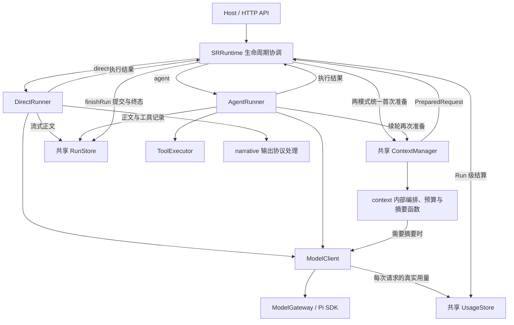
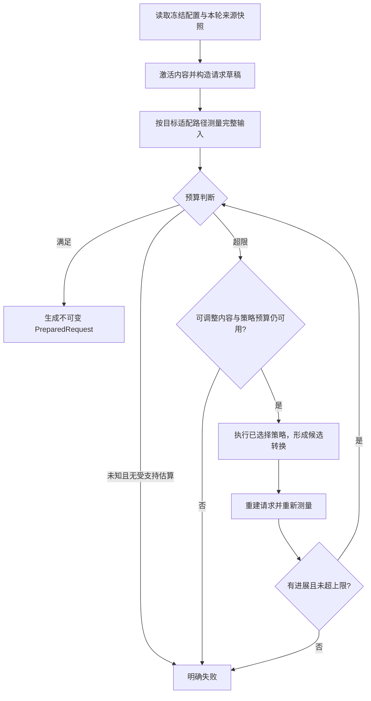

# SRRuntime、上下文策略与双 Runner 架构 v2

> 日期：2026-11-13。状态：已获用户授权完成 T0–T9 实现与离线验收，记录见任务清单与文末。
> 提案核对基线：`7aa4cf4`；实际实施基线：`f25d452`，开始时工作区干净。已修改运行时代码；未提交/推送，未升级真实用户数据库，未调用付费模型。
> 任务清单：[sr-runtime-context-architecture-v2-tasks.md](./sr-runtime-context-architecture-v2-tasks.md)。
> 本次修订已纳入用户确认的 `src/runtime/` 目标目录、双 Runner 共用上下文与存储、SRRuntime 内部收尾、摘要输入比例及 narrative 职责；实现与验证以文末执行记录为准。

## 1. 目标与适用范围

本方案整合已讨论的目标：

- `AgentRuntime` 更名为 `SRRuntime`，作为运行协调器。
- 默认直接生成，由 `DirectRunner` 执行；可选 `AgentRunner` 执行模型—工具循环。
- 每轮数据分为两类：冻结的 `RuntimeConfig` 和本轮 `ExecutionContext`。
- 上下文预算判断、超限策略及重新评估属于 `context` 模块；配置只描述策略，不执行策略。
- 两种 Runner 共用 ContextManager、ModelClient、RunStore、UsageStore 和同一套 sessions/entries 存储模型；只区分执行过程与必要的提交政策。
- 首期不新增独立 ConfigResolver、SummaryService、RunFinalizer 类，也不建设策略注册平台；配置合并、摘要和共同收尾分别作为所属模块中的函数实现。
- Pi SDK 继续作为模型接入实现；逐条验证实际请求语义，必要时最小适配。
- 为 Tools、Skills、内容来源和输出扩展提供边界明确的扩展位置，首期只实现已有需求。

本文接替[双 Runner 架构 v1](./sr-runtime-dual-runner-v1.md)及其任务清单，作为后续架构设计入口。Direct 的尾块语法、状态逐项处理、建议依赖和失败矩阵仍以[叙事扩展 v2](./sr-narrative-extensions-v2.md)为准；本方案细化运行框架，并提出新的当前请求预算流程。

**当前请求预算已在本次授权实施中替换旧政策。** 下节保留提案时的历史基线说明；生产实现与边界见 `docs/technical/context-compaction.md`。旧 Usage 政策只保留纯函数回归，不作为 unknown 计数的降级路径。

用户体验保持一条连续会话历史：切换执行模式不创建分支、不清历史、不回放旧工具/尾块。新会话默认 Direct；从当前工具基线迁移的旧会话建议保持 Agent，来自已上线单次叙事基线的旧会话保持 Direct，已有显式模式不改写。运行中禁止切换模式。

## 2. 提案时的预算与压缩基线（历史说明）

已核对：`apps/server/src/agent/context/context-manager.ts`、`history-compactor.ts`、`prompt-builder.ts`、`persistence/usage-store.ts` 及相关测试。

### 2.1 实际算法

1. 预设 `budget.context_strategy` 选择 compact / standard / extended，分别为 131,072 / 262,144 / 524,288。
2. 取模型 contextWindow 与所选档位的较小值。
3. 计算触发阈值：`window - max_output_tokens - 1024 - 2048`；后两项分别是安全预留和下一轮输入预留。
4. 读取 session usage 的 `latestContext`；模型匹配且含输出用量时，比较上次请求的 `inputTokens + outputTokens` 与阈值。
5. 达到阈值，或缺少可信上次用量/切换模型时，尝试压缩较旧历史，保留最近五个 user turn。
6. 历史不超过五轮时不压缩。旧摘要参与新摘要，原始 entry 保留。
7. 摘要按新片段序列化字符量最多 12,000 分批；该限制没有完整计入已有摘要、摘要指令、包装与输出预留。

### 2.2 当前缺口

- 没有测量本轮完整请求 token；新输入、预设和世界内容突然变大时，上一轮用量不能反映新增量。
- compact / standard / extended 实质是**窗口档位**，不是不同的压缩算法。
- `estimateContextComposition` 计算的是字节组成，用于 UI 展示，不是当前请求的 tokenizer 结果。
- 摘要后未重新验证最终生成请求是否装得下；“完成压缩”不等于“满足预算”。
- AgentRunner 的 continuation 直接追加工具往返后再调用模型，没有每次续轮预算检查。
- 摘要本身可能过大；现有摘要完成检查也不足以证明不是 length 等非正常结束。

这些是新架构需要解决的具体问题，不构成重写所有模型接入代码的理由。

## 3. 数据只分两类，服务不混入数据

### 3.1 RuntimeConfig：本轮冻结的规则

| 分组 | 内容 |
|---|---|
| execution | direct / agent，配置格式版本 |
| model | 模型配置 ID、Provider/model 标识、冻结的窗口/输出能力、凭据引用 |
| generation | temperature、最大输出等模型参数 |
| preset | 预设 ID、有效文本/参数、来源版本或 hash |
| contextPolicy | 窗口档位、测量政策、安全余量、超限策略、保留轮数、摘要输入比例/输出上限、策略调用上限 |
| extensions | Direct 的 state_update/action_suggestions 解析后配置 |
| agentPolicy | Agent 工具允许范围及循环政策；未来工具预算在此定义 |
| skills | 未来启用的 Skill ID/版本/参数与受限权限；首期不增加加载功能 |

SRRuntime 在入场占用内通过现有读取方法取得会话、预设和模型配置，由 `config.ts` 的普通函数合并默认/覆盖并校验，将冻结结果交给 Context 和 Runner。首期不创建独立 ConfigResolver 服务，执行过程中不重新读取预设并改变本轮规则。

不把运行阶段、workspace、累计用量等可变数据放入 RuntimeConfig。不保存明文 key，只保存凭据引用；也不把完整私有配置直接作为 SDK 返回值。

### 3.2 ExecutionContext：本轮事实、基准与进度

| 分组 | 内容 | 可变性 |
|---|---|---|
| identity | sessionId/worldId/runId、客户端 requestId、expectedTipEntryId | 本轮固定 |
| input | 当前输入及其解析结果 | 本轮固定 |
| source | 世界内容、净历史、摘要、同步缺口元数据 | 初始快照固定，派生请求视图可调整 |
| state | 权威基准、激活可写根、候选 workspace | 基准/权限固定；候选可变 |
| request | 当前待发送消息、工具定义、来源映射、测量报告及 request fingerprint | 每次请求重新派生 |
| progress | phase、请求序号、最新 entry/partial、正文缓冲、Agent 当前工具轮、执行报告 | 按所属模块更新 |
| control | 取消信号、截止时间等控制信息 | SRRuntime 掌握控制权 |
| accounting | 模型请求 journal 关联、计时和诊断 | 追加或幂等更新 |

sessionId/runId 等归入本轮执行身份，避免把事实标识与可复用配置混在一起；仍不单独引入第三个 metadata 顶层对象。现有仅用于计时和 Usage 请求标识的 `RunContext` 收入 ExecutionContext 的内部 accounting 组件，避免与 ContextManager 的“上下文”重名竞争。

ExecutionContext 是逻辑分类，不要求把所有对象塞进一个可任意修改的巨大对象。Runner、策略和处理器只接收所需的只读视图/受限写入接口；Context 策略不能修改 workspace 或运行配置。

Repository、ModelClient、策略实现、事件发布器等通过构造依赖传入服务，不塞入这两类业务数据。明文凭据由模型接入层按冻结引用解析并限制在调用局部，不进运行快照、日志或消息数组。

`ContextDraft`、`PreparedRequest`、`RunnerResult` 是上述数据的局部派生值/函数结果，不是第三套长期运行状态。

## 4. 模块责任与依赖方向



两种模式都需要上下文与压缩。首次准备统一由 SRRuntime 协调，准备成功并建立 user entry 后交给对应 Runner；Direct 使用该上下文生成一次，Agent 另在每次续轮调用同一个 ContextManager。这样保留现有“准备失败不伪造 user entry”的生命周期，无需为 Direct 再加一套准备逻辑。

| 模块 | 负责 | 不承担 |
|---|---|---|
| SRRuntime | 准入、占用、任务身份、冻结配置协调、分派、取消、内部 finishRun 收尾及释放 | SQL、token 算法、摘要 prompt、模型调用循环、工具执行 |
| config.ts 函数 | 配置默认合并、兼容映射和校验 | 独立服务生命周期、执行摘要 |
| ContextManager | 内容来源、激活、编排、测量、预算决策、策略应用与重测 | 会话锁、状态提交、工具执行 |
| history-compactor.ts 函数 | 在独立预算内分块生成摘要候选及覆盖证明 | 再次递归触发同一压缩策略、发布权威状态 |
| DirectRunner | 一次 generation、净正文流、扩展候选 | 工具调用、自动补救生成 |
| AgentRunner | 模型—工具循环，每次请求前经过 Context | 另建 Runtime、绕过预算、自行持久最终状态 |
| ModelClient | 请求计费 journal、取消竞速、调用适配器、结束/Usage 归一化边界 | 决定压缩策略、决定是否执行工具 |
| ModelGateway | 模型协议转换、测量所需的适配信息、实际传输 | 业务状态、模式选择 |
| ToolExecutor | 执行本轮允许的工具 | 自行提升权限、选择下一 Runner |
| ExtensionHandlers | 校验已生成尾块、形成候选状态与建议 | 发起模型修复、执行外部工具 |
| Repository / RunStore | 读取和数据库事务 | 模型和业务工作流选择 |
| UsageStore | 共同的请求 journal、真实用量记录与 Run 级结算 | 上下文压缩决策、按估算计费 |

配置、摘要和最终化是职责，不因此一一创建服务类。共同收尾使用 `SRRuntime.finishRun()` 私有方法；SQL、事务及持久标记检查仍在 RunStore 中。现有 RunPostProcessor 可暂时保留为用量结算辅助模块，不扩展成通用结束钩子框架。

### 4.1 两种 Runner 的共享关系

| 能力 | Direct | Agent | 共享实现 |
|---|---|---|---|
| 上下文准备 | 生成前需要 | 首次与每次续轮需要 | ContextManager |
| 预算与压缩 | 需要，可能产生独立摘要调用 | 需要，工具结果追加后重新检查 | budget.ts / history-compactor.ts |
| 模型调用 | 一次 generation | generation 与可能的 continuation | ModelClient / PiGateway |
| 流式正文与记录 | 净正文、摘要、扩展结果 | 正文、摘要、工具记录 | RunStore |
| 请求用量 | generation 与 summary | generation、continuation 与 summary | ModelClient 统一记录到 UsageStore |
| Run 级收尾 | 返回候选与结果 | 返回候选与结果 | SRRuntime.finishRun 调用共享存储与结算 |

“裸调用”不等于无上下文、无压缩、无持久化或无 Usage。不得新增 DirectRunStore、AgentRunStore、DirectUsageStore 或按模式复制上下文构建代码。共享的服务实例处理每轮独立数据，不在服务实例上存放会串到其他 Run 的候选 workspace。

## 5. Context 的完整流水线

### 5.1 分层

Context 内部区分四件事：

1. **来源与激活**：哪些历史、角色、世界书、状态、未来 Skill 内容进入候选上下文。
2. **编排**：按 Direct/Agent 规则构造实际消息角色、顺序、工具 schema。
3. **预算政策**：允许多少输入，测量可信度如何处理，哪些内容必须保留。
4. **超限策略**：超过预算后如何缩减或重组候选内容。

“摘要压缩”是 context 内的超限处理函数；“行动建议”是输出扩展；“搜索工具”是 Agent Tool。三者执行时机、权限和失败规则不同，不注册到一个万能 capability 引擎里。等实际出现第二种上下文策略时，再根据共同需求提取接口。

### 5.2 请求准备算法



关键规则：

- 先确定本轮激活集合和状态权限。摘要/裁剪后重建请求不重新扩大激活范围，避免压缩改变可写状态权限。
- 测量的是消息编排后的完整请求输入，包含当前输入、平台规则、角色/世界书、摘要、历史、状态、输出协议、工具 schema，以及未来 Skill 注入和当前 Agent 工具往返。
- 策略只改派生请求视图；数据库原始历史不被裁剪或覆盖。
- PreparedRequest 包含 mode、purpose、模型、输入 fingerprint、政策/适配版本、预算报告。发送前检查这些仍匹配，之后不得追加未测量的内容。
- 任何失败保留原历史与权威状态；不静默删掉当前输入、平台约束或状态规则以换取通过。

### 5.3 预算公式

目标采用：

```text
effectiveWindow = min(configuredWindow, modelContextWindow)
inputAllowance = effectiveWindow - reservedOutput - safetyMargin
inputTokensForDecision <= inputAllowance
reservedOutput <= modelMaxOutputTokens
```

- 窗口档位继续支持 compact/standard/extended，数值不变。
- 当前输入已经进入测量，不机械重复扣除旧公式中的“下一轮输入 2048”。若未来另设增长余量，应作为命名明确的独立参数。
- Direct 的 reservedOutput 是正文与尾块的共享额度，不能声称服务端能硬性保留其中一部分给尾块。
- Agent 的每次 generation/continuation 分别预留本次输出；这与整轮累计花费上限是两个概念。
- Provider 报告的 cache token 仍属于输入占用；不因缓存命中从上下文预算中删除。
- 模型特殊 token 规则由适配元数据说明；不能把所有模型都假设为“纯文本 token 数加一常量”。

### 5.4 测量精度与真实 Usage

`budget.ts` 的测量函数返回值应标明 `tokens`、`method`、`quality`、模型/计数器版本、测量对象 fingerprint；quality 至少区分 exact、estimated、unknown。不为测量与公式判断分别创建 TokenMeter/BudgetEvaluator 服务。内部可以包含分项估计，但不得标为真实分项计费。

| 条件 | 决策 |
|---|---|
| 有经过验证且覆盖目标协议包装的计数能力 | 按其明确保证使用；只有满足适用条件才标 exact |
| 有支持该模型/适配路径的本地估算 | 标 estimated，使用经过验证的安全余量；仍承认可能被 Provider 拒绝 |
| 只有无依据字符换算、未覆盖的内容类型或缺少模型信息 | 标 unknown；目标严格预算流程在发送前失败 |

不要求每次额外访问 Provider 计数接口。首期优先无网络本地计数/估算；将来若引入网络计数，需明确请求成本、取消与权限，并不能仍声称没有额外请求。

现有 Pi SDK 不一定暴露纯函数最终 payload 预览。优先复用可用的序列化/参数构造能力；无法预览时，对同一规范化请求作适配路径明确的估算，并用 mock transport 验证角色/内容/工具与计数对象一致。不能为了“精确”要求直接 fork SDK，也不能对只有 canonical messages 的测量宣称已精确覆盖全部 Provider 包装。若传输前 hook 才能发现额外结构变化，应拒绝该不一致请求；后续调整必须回到 Context 重测，不能在 hook 中自动开启压缩循环。

`latestContext` 的真实用量继续服务于 UI、计费和估算校准，不再作为目标流程唯一的压缩开关。新预算报告独立存储，绝不覆盖 reported Usage，unknown 不记作 0。首期不要求增加估算缓存；若性能证据表明需要，缓存键必须包含模型/适配版本、规范化消息与工具 schema 等 fingerprint，mode/model、Skill 版本或请求内容变化时不得复用旧计数。

若 Provider 最终仍返回上下文超限，本轮明确失败并记录安全诊断，不自动重新生成；错误记录可用于调整后续估算，但不擅自增大用户配置预算。

## 6. 超限策略与摘要预算

### 6.1 首期直接调用压缩函数

首期只有 `summarize_history`。ContextManager 直接调用 `history-compactor.ts` 中的压缩函数，再重建和重测；不先建 ContextStrategy 接口、注册表或独立 SummaryService。函数返回候选历史/摘要、是否发生变化、覆盖边界与安全诊断即可。

压缩函数只接收需要的历史视图、预算参数、取消信号，以及受限的摘要模型调用函数，不获得任意 DB 写权限、Runner 或 ToolExecutor。ContextManager 校验候选的覆盖边界、受保护内容及工具调用关联，最终预算是否通过仍由统一预算判断负责。

未来真正增加完整旧轮裁剪、分层摘要或可选来源缩减时，再提取共享策略输入/输出。首期不实现动态插件发现、任意脚本或 DAG 调度。

如未来需要策略组合，采用有序、有限的内部步骤，明确每步适用条件、优先级和失败策略；不能让所有策略无序试到“看起来能用”。未知策略 ID 在保存配置或准备阶段拒绝。

### 6.2 首期 summarize_history 规则

- 仅压缩已结束 Run 的历史连续前缀，沿用最近五个 user turn 保留规则；“已结束”包括保留正文的 completed/failed/stopped，不要求每轮状态更新成功。
- 当前用户输入、平台协议、权威状态、必需角色/世界设定、未来已声明必需的 Skill 指令不由该策略删除。
- 历史原文含 stopped/failed 净正文时仍作为已接受故事输入，但携带同步缺口与未完成信息，不补造事件或状态成功。
- 有现有摘要时将其纳入摘要候选；覆盖边界精确指向被替换历史的最后一个有效 entry。
- 若只有受保护部分、最近五轮本身过大、或固定内容已经超过预算，直接报告 CONTEXT_BUDGET_EXCEEDED；不暗中改为保留三轮或截断玩家输入。
- 重建后必须重新测量。摘要输出未缩小请求、重复相同候选或达到调整上限时结束，不能无限压缩。

建议首批有界默认：每个待发送生成请求最多 2 次策略变换；每个 Run 最多 8 次摘要模型调用，所有分块共享该额度，首期不自动重试失败摘要。摘要输出上限由独立的 `summary.maxOutputTokens` 指定，建议候选值为 2048，并校验不超过摘要模型输出上限；不以“摘要压缩比例”代替输出限制。安全余量沿用 1024 作为初始政策并依据测量方法评估是否足够。以上数值须在实施任务首步用目标模型离线数据固定并测试边界，不伪称通用最佳值。

### 6.3 摘要请求本身的预算

摘要请求采用**输入占比 + 模型硬上限**的预算。由 `history-compactor.ts` 构造完整请求，复用 `budget.ts` 的计数与预算函数：

```text
W = min(summaryModelContextWindow, configuredContextWindow)
R = summary.inputRatio
O = summary.maxOutputTokens
S = safetyMarginTokens

summaryInputLimit = min(floor(W * R), W - O - S)
sourceAllowance = summaryInputLimit
                  - summaryInstructionTokens
                  - previousSummaryTokens
                  - requestWrapperTokens
```

`R` 必须为有限数且满足 `0 < R <= 1`；`O` 必须是正整数且不超过摘要模型输出上限。输入额度非正或无法容纳最小片段时明确失败。`R=0.75` 是待离线验证的初始候选，不代表已经证明适用于所有模型。首期将该比例留在内部归一化配置，不新增必须由用户调整的设置项。

分项相减用于选取候选片段；拼出完整摘要请求后必须重新测量并确认不超过 summaryInputLimit，不能假定不同文本 token 数简单相加与最终序列化完全一致。

这里的百分比是摘要请求输入占模型窗口的比例，**不是摘要输出占原文长度的压缩比例**。输出长短仍受独立的 O 约束，摘要结果仍须在最终生成请求中重测；不能承诺模型按指定百分比精确压缩。

摘要使用独立的 summary request purpose，走同一 ModelClient、取消和 Usage 记录。首期沿用本轮模型；未来若明确支持选择摘要模型，其窗口、输出上限、凭据引用和测量版本都单独解析。

摘要内部采用有限分块：在剩余输入预算内选取可处理片段，完整测量后调用；结果正常 stop 且非空才能作为下一块的 previous。length/toolUse/异常断流不算成功，禁止调用工具。

**摘要请求不能再触发 summarize_history 策略。** previous summary 与固定摘要指令已占满窗口、无法容纳最小片段，或调用额度耗尽时直接失败。12,000 字符限制可以保留作内存保护，但不能替代 token 预算。

所有必要分块完成且最终生成请求重测通过后，摘要候选才具备持久化资格。初始准备摘要沿用现有 startRun 事务与 user entry 一起保存；后续故事失败不删除这份已验证摘要。失败或取消发生在该事务前时不保存候选覆盖边界，已发生摘要用量仍真实结算。

## 7. 两种 Runner 如何使用 Context

### 7.1 DirectRunner

SRRuntime 协调首次 Context 准备并建立本轮 user entry 后，DirectRunner 消费已通过预算的 PreparedRequest。只调用一次 generation，输出交给 splitter/parser 和内建处理器；生成后不再执行上下文缩减去修复已生成的尾块。

DirectPreparedRequest 的类型不允许 tools/toolChoice。收到工具调用视为不合规响应，不执行工具、不自动换 Agent。

Direct 的正文增量通过共享 RunStore 持久化，再发布给客户端；生成与可能发生的摘要用量由共享 ModelClient 写入 UsageStore。DirectRunner 返回候选状态/建议和结束结果，由 SRRuntime.finishRun 统一最终化；不会因为只有一次生成就省略存储或计费。

### 7.2 AgentRunner

Agent 第一次生成也消费已准备请求；每次把模型 toolCall 和执行结果加入本轮工作记录后，调用 ContextManager 准备下一次 continuation，再由 ModelClient 发送。

请求视图分开保存：

- 跨 Run 的净叙事历史，可由摘要策略调整。
- 当前 Agent Run 的原始模型—工具往返，保持协议结构和调用关联。

首期不压缩当前 Agent Run 的工具往返，不拆散同一 assistant 工具调用组与对应 toolResult。当前轮本身过大时明确失败；未来工具结果限长或摘要需要专门策略。工具已执行但续轮超限时仍按 Agent failed 提交政策处理，不能将候选状态冒充已提交，也不能自动回滚未来外部副作用。

可写根和工具授权固定于本轮入场。Agent workspace 可按合法工具执行变化；它是本轮候选，不替换已提交状态基准。重新组装时需要用到 workspace 的内容必须标明本轮候选语义，不能声称数据库已提交。首次迁移先保持现有 Agent prompt 语义，通过单独测试后再改变状态展示细节。

续轮中产生的历史摘要候选仅覆盖当前 user entry 之前已结束 Run 的祖先记录；不把当前工具轮写成历史摘要。首期将这些候选保留在 ExecutionContext，选择最新有效覆盖结果，在非 stopped 的最终化事务中追加 compaction entry；正文/Run 失败并不必然使已验证历史摘要失效，但所有权或 tip 冲突时必须丢弃。stopped 时丢弃尚未持久摘要候选。事务先校验当前本轮 tip，再追加摘要并更新 tip，最后写入同一事务的状态/终态；不得因自己追加摘要而误报 tip 冲突。崩溃前未持久的摘要不恢复执行，Usage journal 仍保留其费用。

### 7.3 narrative：叙事输出协议处理

`narrative/` 专门处理 Direct 模型输出的正文与 `<sr_extensions>` 尾块，不是第三种 Runner，也不承担上下文构建。

| 文件 | 职责 |
|---|---|
| extension-stream-splitter.ts | 在任意流式分片边界区分可见正文与隐藏尾块 |
| extension-parser.ts | 校验标签边界、完整性、大小限制、JSON 及重复键 |
| state-update-handler.ts | 复用领域状态校验，生成隔离 workspace 和处理报告 |
| action-suggestions-handler.ts | 校验建议，并依据状态处理结果形成可发布/阻止结果 |

调用方向为 `DirectRunner → narrative → 候选结果 → SRRuntime.finishRun → RunStore`。正文分割后仍由 DirectRunner 使用共享 RunStore 保存。这里不调用模型、不执行工具、不直接写数据库，也不复制状态领域验证规则；提交资格最终在共同收尾与存储事务中核验。Agent 的工具状态更新继续通过 ToolExecutor，不能同时执行同一份尾块。

## 8. Tools、Skills、上下文来源和输出扩展

| 扩展类型 | 所属模块 | 执行时机 | 权限与结果 |
|---|---|---|---|
| 上下文来源 | context 内现有读取/激活逻辑 | 构造请求前 | 提供带来源和优先级的内容，之后统一测量；首期不建来源注册表 |
| 上下文策略 | context/history-compactor.ts | 超预算时 | 调整请求视图，不写业务状态；第二种实际策略出现后再提取接口 |
| Tool | tools | Agent 模型提出允许的调用后 | 按工具契约执行，结果反馈模型 |
| Skill | 未来 skills/准备模块 | 本轮准备时解析受控资源 | 提供指令、资源引用和受限工具需求 |
| OutputExtension | narrative/extensions | Direct 生成后 | 校验尾块，产生候选状态/建议，不反馈模型续轮 |

检索属于来源获取/选择，不天然等同于超限处理；检索新增内容也要计入预算。未来若用检索替代部分历史，需定义事实保留与来源覆盖规则后实现对应策略。

Skill 不构成第三种 Runner。仅提供静态指令的 Skill 在未来可以经明确契约用于两种模式；需要工具往返的 Skill 只能在 Agent 模式启用。声明权限与平台授权取交集，Skill/模型文本不能扩大权限、更改预算或切换模式。Direct 选择不兼容 Skill 时在请求前明确失败。

首期只保留两个 Runner、现有状态工具、一个摘要策略和两个尾块处理器。未来增加外部工具前单独落实最大循环次数、总 token/费用预算、超时、确认机制及副作用记录；上下文窗口预算不能代替整轮资源限制。当前未定义的能力不以“插件框架预留”名义先开放执行。

## 9. 生命周期、持久化和公开结果

### 9.1 SRRuntime 的流程

1. 通过读取服务校验会话和 expected tip，获取会话/世界占用，建立本轮身份与 Usage journal。
2. 调用 config.ts 的合并/校验函数冻结运行配置；模式支持检查在任何摘要/生成付费调用前完成。
3. 协调 ContextManager 准备首次请求；预算处理可能执行 context 内部摘要函数，但 SRRuntime 不直接调用模型。
4. 通过 RunStore 的服务方法原子保存已验证摘要候选和 user entry。
5. 调度对应 Runner，接收执行结果。
6. 进入 SRRuntime.finishRun，按模式确定提交政策，调用共享 RunStore、现有用量结算逻辑并发送结果通知。
7. 无论准备/执行/通知哪个阶段出错，最终都释放占用并完成 task.done；不重复发布终态。

### 9.2 最终化规则

共同机制与模式政策分开。`SRRuntime.finishRun()` 负责协调，RunStore 负责同步事务内重查 run 所有权、最终化标记、tip 与状态基准，并原子写入候选状态、处理结果和终态。最后取消检查至提交之间不得 await；提交成功后停止和通知失败不回滚已提交结果。不得让两个 Runner 分别执行最终化或 Run 级用量结算。

RunPostProcessor 当前只是 UsageStore.settleRun 的包装，可保留并由 finishRun 调用；如以后有明确收益再合并到用量模块，不在目录迁移时顺手改写其语义。

Direct 继续遵守叙事扩展 v2：取消前未提交则丢弃候选状态，partial 提交有效子集并阻止建议，建议单独失败不丢弃合法状态。Agent 保持已有 stopped 可保存工具 workspace、failed 不保存 workspace 的兼容政策；重构公共收尾不能抹平差异。

摘要、工具执行、正文、状态候选和公开结果各自保留用途边界。数据库不可写时不声称终态已持久；已有 entry 重启按 interrupted 恢复，对外统一 failed + RUN_INTERRUPTED，phase finalized，Direct pending 结果收敛，旧 Run 缺字段保持缺省。

### 9.3 保存与公开

- 必要的私有 RuntimeConfig 快照、输入基准与执行报告白名单持久化；不序列化整个 ExecutionContext。
- 原始历史和世界文件保留，摘要/裁剪仅影响请求视图。
- budget report 只保存必要数值、method/quality、模型/策略版本、变换次数与覆盖边界；默认不保存完整 payload。
- 公开 Run 增加可选 executionMode；Direct extensions 使用 v2 形态。Agent 不伪造 sr_extensions 结果。
- preparing 未建立 entry 时通过 session GET 的 activeRun 摘要恢复；不承诺该内存窗口跨重启可查询。
- 公共 phase 仍 preparing/narrative/extensions/finalized；Context 详细阶段先作内部诊断，避免增加一套高频公共事件。
- 对外 budget estimate 如需展示必须标估算，真实 Usage 继续使用原规范化逻辑。
- phase 显式订阅、终态优先；HTTP 查询/历史/终态事件使用统一投影，恢复主动查询而不假设 SSE 回放。

### 9.4 两种模式共用同一存储模型

| 现有存储位置 | 两种模式共同使用的内容 |
|---|---|
| sessions | 会话配置、executionMode、当前 tip、会话状态与会话用量 |
| entries | 用户消息、助手正文、摘要；Agent 另有工具往返记录 |
| entries.ext_data.run | Run 标识、状态、模式和公开结果 |
| entries.ext_data 的私有命名空间 | 必要配置快照、Direct 扩展诊断和候选处理依据 |
| entries.state / sessions.state / worlds.state | 现有 scope 对应的权威状态；本轮候选仅在内存 workspace 中 |
| entries.metrics_json / sessions.usage_json | 模型请求用量、Run journal 与会话累计用量 |

不为 Direct/Agent 分表，不新增独立 runs 表来实现双 Runner，也不复制 RunStore/UsageStore。模式差异由明确的 mode 和受控可选结果字段表达。共享事务机制不等于两种模式的停止提交政策必须相同；查询与公开投影统一处理这些字段。

## 10. 配置兼容与变更边界

### 10.1 预算配置分离

内部将旧 `budget.context_strategy` 映射为 `contextPolicy.windowPreset`；将超限算法单独映射为 `overflow.strategy = summarize_history`。首期可继续接受旧字段，避免更名造成导入失败；若增加新字段，必须有版本化 schema 和明确优先规则，两个格式冲突时拒绝而不是猜测。

目标结构示意：

```json
{
  "contextPolicy": {
    "windowPreset": "standard",
    "measurement": "current_request",
    "safetyMarginTokens": 1024,
    "summary": {
      "inputRatio": 0.75,
      "maxOutputTokens": 2048
    },
    "overflow": {
      "strategy": "summarize_history",
      "keepRecentTurns": 5,
      "maxPassesPerRequest": 2,
      "maxSummaryCallsPerRun": 8
    }
  }
}
```

此示例是运行时归一化配置，数值是待验证候选，不要求立即在 UI 开放每个参数。特别是 summary.inputRatio 表示摘要请求输入预算比例，不表示摘要输出压缩比例。平台政策字段可由服务端固定，用户可编辑范围须由 strict schema 白名单限制；策略实现本身不保存到 JSON。

### 10.2 上线顺序

先抽取现有上一轮 Usage 判断为内部兼容政策，保证机械重构能回归；随后实现当前请求测量与摘要闭环，再显式切换目标政策。兼容政策只用于分步开发和明确版本迁移，不允许在“current_request”失败时悄悄退回旧判断。

目标发布前至少一条主用模型路径具有可信本地计数/估算，unknown 明确失败；同时说明支持范围。若无法提供，报告测量能力阻断，不把字符长度冒充 token 使测试通过。切换预算政策是可见行为变化，更新 fixtures、文档、配置提示和预期错误，而不是声称纯重命名。

会话模式仍仅会话级，运行中禁止切换；Direct 能力配置继续 v2 的继承/覆盖。Agent 中明确标明 Direct 尾块能力设置不适用，避免关闭 Direct 状态开关却误以为已暂停 Agent 状态工具。

所有迁移增量执行，依据来源版本回填模式/政策，不清空 sessions/entries/presets；与 v2 配置迁移按实际版本合并或追加，不能固定永久绑定 DB version=2。文档提交不执行迁移或恢复用户已删除的决策文件。

## 11. 落地组织与测试

用户已确认的目标目录为 `apps/server/src/runtime/`：

```text
apps/server/src/runtime/
├── index.ts
├── sr-runtime.ts                 # 生命周期、模式分派、共同收尾
├── types.ts                      # RuntimeConfig、ExecutionContext、执行结果
├── config.ts                     # 配置合并、校验、冻结；普通函数
├── runners/
│   ├── direct-runner.ts          # 单次生成与输出处理
│   └── agent-runner.ts           # 模型—工具循环
├── context/
│   ├── context-manager.ts        # 两种模式共享的上下文准备入口
│   ├── prompt-builder.ts         # 按模式编排消息
│   ├── system-main.ts            # 平台指令
│   ├── activation.ts             # 内容激活
│   ├── budget.ts                 # token 测量、预算判断
│   └── history-compactor.ts      # 摘要压缩、分块、候选结果
├── model/
│   ├── model-client.ts           # 请求、取消、请求级 Usage
│   └── pi-gateway.ts             # 复用 Pi SDK
├── persistence/
│   ├── run-store.ts              # 两种模式共享的记录与事务
│   ├── usage-store.ts            # 两种模式共享的请求与累计用量
│   └── run-post-processor.ts     # 暂保留现有 Run 级结算包装
├── tools/
│   ├── tool-executor.ts          # Agent 受控工具执行
│   └── state-tool.ts             # 现有状态工具
├── narrative/
│   ├── extension-stream-splitter.ts
│   ├── extension-parser.ts
│   ├── state-update-handler.ts
│   └── action-suggestions-handler.ts
└── shared/
    └── errors.ts
```

上述是目标结构，当前源码仍位于 `src/agent/`。实施时将目录迁移、类名更改和 import 更新作为独立的机械变更，验证旧行为后再修改执行逻辑；不要把整个目录搬迁与预算、协议和状态语义同时重写。需检查 app、routes、database 中的 UsageStore 导入以及全部测试消费者。

首期不生成 ConfigResolver、SummaryService、RunFinalizer 或通用 ContextStrategy 注册类；不建设单独的 strategies、skills 或 plugins 框架目录。预算和摘要保留可测试函数，实际出现第二种策略后再提取共同接口。RunPostProcessor 仅为已有代码的兼容保留，不扩展为通用后置钩子系统。

关键验收应覆盖：本轮超大输入而上一轮很小、无历史可压缩、固定内容超预算、正常摘要后仍超限、摘要自身超限、非正常摘要结束、策略无进展、调用额度耗尽、Agent 大工具结果、调用/结果配对保护、mode/model 改变计数缓存失效、压缩不改变状态授权、摘要缺口跨再摘要保留、取消/重启/事务失败、真实 Usage 与估算独立、最终 payload 与测量对象一致。

本次文档交付仅做源码核对、引用与一致性检查、架构复查。实际改造时按任务清单运行类型检查、测试、构建与浏览器流程，并更新 AGENTS.md、技术实施状态、API/SDK 文档和新架构决策记录。

## 2026-11-13 实施结论

T0–T9 已完成，逐项结果和关键用例见 [任务清单第 4 节](sr-runtime-context-architecture-v2-tasks.md)。Server/Web typecheck、lint、43 文件 205 项测试、Web build 和完整 browser 回归通过；末次变更按影响补跑 11 项 context/activation 测试及 26 项 runtime-v2 浏览器断言。

生产支持范围为官方 DeepSeek V4.1 Flash 文本请求；计量质量 estimated，unknown 明确拒绝。摘要 R=0.75 已完成离线边界验证，未做付费生成质量评测。实现状态见 [Runtime 技术记录](../docs/technical/runtime-context-v2.md)，公开/迁移契约见 [Runtime v2 数据契约](../docs/data-formats/runtime-v2-contract.md)。

未执行真实用户库迁移、提交或推送；原开发服务保持停止，避免自动升级。独立角色提及匹配等其他叙事产品条目未被本架构验收自动视为完成。
