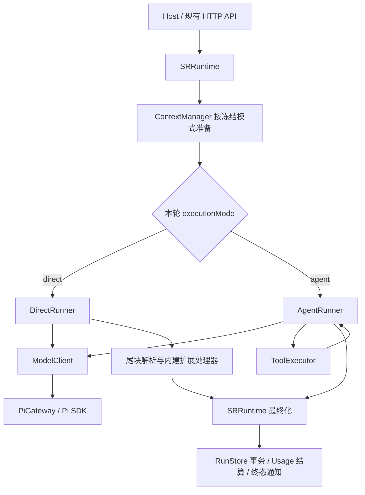

# SRRuntime 与双 Runner 技术方案 v1

> 日期：2026-11-12。状态：设计提案，代码未实施。
> 核对基线：`7aa4cf4`。本次仅新增本方案与任务清单，不修改运行时代码、不执行迁移、不提交或推送。
> 任务清单：[sr-runtime-dual-runner-v1-tasks.md](./sr-runtime-dual-runner-v1-tasks.md)。
> 后续整合：运行数据分类、Context 预算与策略、模块职责及实施顺序已由[架构 v2](./sr-runtime-context-architecture-v2.md)完善；本文保留为上一版设计记录，代码仍未实施。

## 1. 用户目标与决策边界

用户已明确：默认使用模型裸调用，支持可选 Agent 调用；Runner 分为两种；`AgentRuntime` 更名为 `SRRuntime`；未来可能增加 Tools、Skills 或其他扩展能力。

用户体验：新建会话默认“直接生成”；需要模型调用工具并根据工具结果继续处理时，在会话设置选择“Agent”。会话沿用同一历史与权威状态，切换模式不创建分支、不清空记录。运行中显示当前模式，停止操作保持统一。

本方案建议命名：

- `SRRuntime`：统一的运行协调层。
- `DirectRunner`：一次生成请求，支持叙事正文与受控扩展尾块的后处理。
- `AgentRunner`：模型请求、工具执行、工具结果回传的循环。

“裸调用”描述模型执行方式：Direct 不注册工具、不传 tool_choice、不执行工具循环、不自动补救生成；仍保留上下文准备、流式正文、扩展解析、状态校验与持久化。摘要压缩可独立调用模型，“一次”只约束生成阶段。

以下是建议决策，尚不代表用户已授权实施：从当前工具循环基线升级的旧会话显式保留 Agent，新会话默认 Direct；模式仅采用会话级配置；运行中禁止切换模式。其他来源版本按第 4.1 节分流。实施前将这些决策与错误码固定在首批契约中。

## 2. 与已有方案的关系

[单次叙事扩展方案 v2](./sr-narrative-extensions-v2.md) 继续负责 Direct 叙事的输出协议、能力配置、状态逐项语义、失败矩阵、Usage 和数据保护规则。

本方案补充或调整以下架构范围：

| 原描述 | 本方案目标 |
|---|---|
| AgentRuntime 管理叙事运行 | SRRuntime 管理两种执行模式 |
| 新 narrative-runner.ts | 新 direct-runner.ts；本期的 Direct 用例为叙事 |
| 叙事路径切换到单次生成 | 新会话默认 Direct，Agent 可显式选择 |
| 通用 AgentRunner 保留 | 同一 Runtime 中通过冻结的 mode 选择 |
| AgentRunner 自行结算与释放 | 迁移为 SRRuntime 拥有共同最终化流程 |

两种模式不混用同一轮协议：Direct 处理 `sr_extensions`；Agent 沿用工具协议，不同时解析尾块执行状态更新，避免同一事实被更新两次。

此前审查发现的恢复终态、摘要同步缺口、阶段事件合并问题纳入本方案任务。旧 v1 的清会话、删除预设内容和删除 sr_instruction 仍不属于实施范围。

当前仓库缺少 AGENTS.md 所引用的 `docs/PRODUCT.md`、`docs/technical/server-mvp-progress.md`、`docs/technical/web-session-mvp.md`，本方案依据当前明确指令、v2 计划及源码，不假定缺失文档中的产品决策。现有技术文档部分保留历史 v1 描述，实施时按本方案与 v2 的适用范围同步修订。

## 3. 现状与目标责任划分

当前 `AgentRuntime` 创建 ContextManager、ModelClient、RunStore、UsageStore、RunPostProcessor 和 AgentRunner，管理会话/世界占用及停止。AgentRunner 的 `execute()` 同时负责模型循环、流式持久化、工具执行、状态最终化、Usage 结算、终态通知和调用 release。

目标结构：



| 模块 | 负责 | 边界 |
|---|---|---|
| SRRuntime | ID、锁、去重、tip 检查、配置冻结、准备、Runner 分派、取消、最终化与释放 | 不写模型—工具循环，不解析标签 JSON |
| ContextManager | 历史、压缩、角色/状态激活，按模式构造 prompt 与 PreparedRun | 不通过配置变更修改在途 Run；不自己选择执行模式 |
| DirectRunner | 一次 generation、净正文流、完整结束校验、扩展候选结果 | 不注册工具、不续轮、不发布候选状态 |
| AgentRunner | generation/continuation 循环、工具调用及候选 workspace | 不另行释放 Runtime 占用、不重复最终化 |
| ModelClient / PiGateway | 统一模型接入、取消竞速、请求 Usage、适配器事件 | 不管理会话和业务状态，不决定下一轮 |
| RunStore | entry、正文、快照和最终事务 | 正文持久化先于 delta；候选状态只能通过最终提交门槛 |
| ToolExecutor | 受控工具分发，复用状态领域验证 | 当前仅有 update_state 能力；未来工具需要独立权限与副作用契约 |

维持一个 Runtime 实例管理两种模式。不能各建一套 Runtime，否则会话/世界锁和删除协调可能互相不可见。

### 3.1 最小文件调整

本期保留 `apps/server/src/agent/` 顶层目录，仅重命名类与文件，避免目录迁移扩大变更范围：

```text
apps/server/src/agent/
  index.ts                         导出 SRRuntime
  runtime/
    sr-runtime.ts                  原 agent-runtime.ts
    agent-runner.ts                保留工具循环
    direct-runner.ts               新增单次执行策略
    types.ts                       判别联合、快照与执行结果
    run-post-processor.ts          现有 Usage 收尾
  narrative/                       v2 的 splitter/parser/handlers/config
  context/                         共用准备 + 按模式编排
  model/                           复用 ModelClient 与 PiGateway
  persistence/                     共用事务与用量记录
  tools/                           Agent 工具执行
```

统一收尾先作为 SRRuntime 私有方法及 RunStore 专用事务方法；确实影响可读性时再提取小型内部 finalizer，不引入工作流引擎、抽象基类或可动态注册的 Runner 平台。

## 4. 模式配置与本轮快照

### 4.1 会话配置

最小模式配置采用 `executionMode: 'direct' | 'agent'`。本期不增加模式的预设继承、全局覆盖或单次 send 参数。

- sessions 新增 `execution_mode`，只接受 direct/agent。
- 新建会话未指定时默认 direct；create 接受可选 executionMode，供受信 Host 显式选择。
- 会话 GET、列表与 PATCH 返回/接受 executionMode；PATCH 沿用现有会话 busy 限制。
- preparing/running 都禁止切换，返回现有 SESSION_BUSY；非法值使用统一错误协议中的 INVALID_EXECUTION_MODE。
- 会话 PATCH 若因凭据读取等发生 await，模式落库前必须重新检查 busy；从最后一次检查到同步写入不得 await，防止请求入场与模式切换交错。多字段 PATCH 保持原子性。
- 空闲时切换后立即保存，下一个 Run 使用新模式；不改历史 Run，也不重算历史状态。
- 模式写入只开放给现有受信 Host API，不给 iframe 新增直接配置权限。

创建默认选择与迁移不同：从当前工具循环基线升级时，已有会话回填 agent；若 v2 单次叙事已先行上线，来自该 Direct 基线的会话应回填 direct；已有显式模式的会话保持原值。迁移按已验证的来源版本/发布能力分流，无法辨明来源则阻断，不凭当前类名或历史文本猜测。新会话默认 direct。重复启动不得重置用户选择。旧 Run 不补写推断模式，对外 executionMode 缺省表示历史未记录。

### 4.2 mode 与 capabilities 的适用范围

Direct 继续使用 v2 的平台→预设→会话能力覆盖，支持状态更新及行动建议。能力开关可以运行中修改并在下一轮生效；执行模式切换仍受 busy 限制。

本期 Agent 保留当前工具能力与状态工具规则。v2 的扩展能力配置仅在 Direct 中生效，不用 Direct 的开关悄悄改变旧 Agent 行为。切到 Agent 后配置仍保存；设置界面明确显示“仅直接生成模式生效”，Agent 状态更新由其工具策略控制。能力 GET 的可用性摘要返回 mode 及不适用原因，不能展示“关闭状态更新”却在同一模式下继续调用状态工具的误导状态。

Agent 不伪造 `sr_extensions/v1` 结果；公共 `extensions` 缺省，`executionMode=agent` 表示其执行路径。若未来需要 Agent 的建议或统一能力开关，独立确定生成方式与提交契约。

### 4.3 冻结和类型边界

在入场占用内冻结 mode 以及该模式相关配置。ContextManager 接收已冻结的选择，不能在压缩之后重新从会话或预设读取并改变本轮行为。

采用判别联合而非一份含大量 optional 字段的 PreparedRun：

```ts
type ExecutionMode = 'direct' | 'agent';

// 共有部分包含模型、凭据、消息、预算、状态基准、摘要等。
type DirectPreparedRun = CommonPreparedRun & {
  mode: 'direct';
  extensions: FrozenNarrativeCapabilities;
  tools?: never;
  toolChoice?: never;
};

type AgentPreparedRun = CommonPreparedRun & {
  mode: 'agent';
  tools: ToolDefinition[];
  toolPolicy: FrozenAgentToolPolicy;
};

type PreparedRun = DirectPreparedRun | AgentPreparedRun;
```

以上为类型轮廓，别名应复用当前领域/Pi 类型，无需为此重写 ModelGateway。每个 Runner 的 execute 只接受自己的 PreparedRun，并返回带 mode 的内部结果。Runtime 使用穷尽分支分派，不把 mode 放进一个内部充满条件判断的万能 Runner。

公开 Run 增加可选 executionMode；私有快照存入 entry 的受控元数据，禁止公开凭据、完整业务 prompt 或 reason。准备阶段尚无 entry 时由 RunTask 持有快照，不伪造可恢复的持久 Run。入场即向 Host 及显式订阅 phase 的客户端提供 preparing 信息；不能等 user entry 建立后才使旧建议失效。断线恢复时查询当前活动 Run 和历史，不把 preparing 尚未入库误判为会话空闲。

## 5. 共享最终化与不同提交策略

首先将旧 AgentRunner 的状态校验、最终化、Usage 收尾、终态通知与 release 移到 Runtime 的统一协调路径，保持现有 Agent 行为通过回归后再接入 Direct。

Runner 返回内容包括：本轮 mode、执行结束情况、最新持久 entry/partial 标识、隔离候选 workspace，以及对应模式的处理报告。Direct 另含协议完整性及扩展结果。候选结果不是提交授权；Runtime 按冻结 mode 选取提交策略并在事务前重查。

| 场景 | Direct | Agent 本期兼容策略 |
|---|---|---|
| 正常完成 | 按 v2 检查尾块、终止原因、tip、所有权后提交 | 保持现有 workspace 验证与完成提交 |
| 状态 partial | 提交有效子集，建议 blocked，Run completed | 保持现有逐项工具执行和错误反馈行为 |
| 提交前停止 | 丢弃候选状态，保存净正文与 stopped 结果 | 保留当前 stopped 可保存已执行工具 workspace 的语义 |
| 失败 | 无候选状态提交，按 v2 保存失败报告 | 保持现有 failed 不提交 workspace |
| 提交后停止 | 不回滚、不覆盖已持久化终态 | 同样保护已持久化终态 |

两种停止策略要在模式说明与测试中明确，不以“统一收尾”为由静默改变 Agent 的既有状态语义。未来新增有外部副作用的工具，需要单独设计取消与补偿；不能把 workspace 回滚等同于撤销外部动作。

共同保证：

1. 正文先持久化再发布增量。
2. 最后一次取消/所有权检查至同步事务提交之间不得 await。
3. 同一 runId 只最终化一次；状态、公开结果和终态按同一事务保存。
4. 事务失败可写时执行无状态最终化；持续不可写时保留中断恢复依据，不谎报已持久失败。
5. 请求级 Usage 由 ModelClient 记录；Run 级结算由 Runtime 调用 RunPostProcessor 一次，并保持幂等。
6. 事务成功后发状态通知，Usage 处理后发布 Run 终态；通知失败不重写已提交结果，释放必须在 finally 中执行。
7. 准备期异常、执行异常和数据库异常都由同一生命周期负责人收敛，避免 start() 的 catch 与 Runner 各发一次终态。

重启恢复需补齐：内部 interrupted 对外映射为 failed + RUN_INTERRUPTED，phase=finalized；Direct 中仍 pending 的状态结果转 failed，建议若启用且受状态失败影响转 blocked，否则转 failed；disabled/not_required 保留。原始历史缺少扩展字段时仍缺省，已提交终态不受恢复影响。已持久 entry 的恢复更新必须一致，不留下终态 Run 搭配 pending 扩展。

## 6. Prompt、Pi 接入与历史

### 6.1 复用模型接入

两种 Runner 共用 ModelClient → PiGateway → Pi SDK。本期不移除 Pi，不更换 Provider API，不把工具探测结果作为 Direct 的准入条件。

验证实际 payload：Direct 不含 tools/tool_choice，当前输入一次，后置权威状态位置符合 v2。此前离线检查中 `deepseek-flash` 的现有路径折叠了后置 system，因此仍需查明端点支持证据及最小适配方式。该结果不能证明端点一定不支持。

优先验证现有配置是否可满足；只有确有差异才局部适配。不支持时在任何摘要/生成模型请求前拒绝该 Direct Run，使用 NARRATIVE_SYSTEM_ORDER_UNSUPPORTED；Agent 模式独立判断支持性，不被 Direct 的顺序限制一并禁用。不得自动从 Direct 降级到 Agent，也不得自动改用户模型。

### 6.2 两条 prompt 编排

ContextManager 复用历史读取、激活、预算和压缩，再按模式编排：

- Direct 使用 v2 固定布局与非破坏性预设兼容视图，不带旧工具指令。
- Agent 本期保持现有节点/工具编排；不能全局替换 system-main 或 prompt-builder 后意外破坏 Agent。可用明确的构造函数分支复用共有片段，不复制整个 ContextManager。
- 保留旧节点及 lore 字段。Direct 中位置映射规则按 v2；Agent 沿用旧布局。预设编辑器应按选定的预览模式解释布局，通用固定顺序编辑器只影响 Direct 自定义区映射；旧 Agent 布局字段需仍可在 Agent 布局视图查看和编辑，不能保留行为却失去可维护入口。
- 世界详情/导入/导出提示改为“直接生成模式中不使用旧 lore 定位字段”，不再笼统宣称这些字段在所有模式失效。

### 6.3 模式切换后的连续历史

两种模式均从同一会话祖先链读取已接受的净 user/assistant 历史和权威状态，raw/toolResult/尾块/reason/建议不作为未来叙事事实。Agent 的工具往返只在当前 Agent Run 的 conversation 内回传。切换模式不重新执行旧工具或尾块。

为摘要补充内部 Run 终态与 Direct 状态同步状态；不把这些字段污染公开消息文本。压缩需要知道 stopped/failed/partial 的对应来源，并在 compaction 元数据中保留有界的缺口摘要，例如是否存在历史缺口、最近缺口 Run、结果分类及覆盖边界；旧缺口覆盖进入摘要后不能被一次后续成功清除。不保存 reason/raw，不允许缺口列表无界增长。下一轮动态提示读取该受控元数据，并强调权威状态为准、不自动补执行。新旧摘要字段缺省兼容。

SDK 的 phase 单调、终态优先。HTTP 历史返回 finalized 后合并缓存的 narrative/extensions 阶段事件不得回退；默认订阅保持原五类 RunEvent，phase 显式订阅规则沿用 v2。

## 7. API、UI 与数据兼容

保持现有 Run 创建、停止、查询和 SSE URL。sessionId/runId/entryId/parentId 的生成与关联不因改名而改变。

会话 GET 同时新增 `activeRun: {id, status, phase, executionMode} | null` 的公开摘要，由 SRRuntime 的内存任务提供，用于恢复尚未建立 entry 的 preparing 状态；与历史字段分开，不暴露快照私有内容。给 sessionRoutes 注入最小只读回调即可，不将整个 Runtime 内部任务表暴露给路由或 SDK。持久 Run 查询继续使用原有 endpoint。

新增/扩展消费者必须成组覆盖：

- Server：`app.ts`、`agent/index.ts`、`routes/session-runtime.ts`、`routes/state-updates.ts` 的 Runtime 引用；`routes/sessions.ts` 的创建/GET/列表/PATCH；两种历史投影、Run 查询与终态事件。
- SDK：Run 的可选 executionMode、Direct 扩展结果及阶段事件，SessionRuntime 与 story-history；不向创作者开放模式切换权限。
- Web：Host、frame 白名单、会话设置、预设的 Direct 能力及布局说明、WorldStory 阶段/错误提示；官方 UI 与自定义 UI 使用相同公共 SDK。
- tests：直接构造 AgentRuntime 或导入旧文件的测试、手写 fixture、模式迁移测试和双模式运行测试。

UI 至少覆盖：默认值、读取/保存中、保存失败、busy 禁用、Provider 不支持、旧会话兼容提示、Direct/Agent 能力差异，以及停止语义。Direct 建议复用 Host 草稿替换与有条件撤销；不自动发送，不允许旧建议在新的 Run 开始后继续作为当前建议。当前为 Agent 时禁用历史 Direct 建议；切回 Direct 后，只有无活动 Run、来源仍是当前 tip 对应的最新完成局面且结果 ready 时才能使用。若仅切换模式而未产生新 Run，允许恢复仍匹配该局面的建议，不新增缺乏持久依据的永久失效规则。

数据库采用新的独立增量版本：启动前独占锁、一致性备份、支持版本检查、事务回填旧模式、保留全部用户数据与原世界源文件、失败回滚。若与 v2 配置列同批发布可合并一次升级；若 v2 已实施则追加下一版本，不固定写死为 user_version=2。旧程序降级需停服恢复匹配备份，不能假定旧程序能安全写新库。

本次只写计划，不执行真实库迁移，也不修改现有删除中的 docs/decisions 文件。核心代码实际改造完成时更新 AGENTS.md、技术文档和新的架构决策记录；本次不将提案写成已实现事实。

## 8. 未来 Tools、Skills 与扩展能力

| 能力 | 接入位置 | 本期处理 |
|---|---|---|
| Tool | AgentRunner → ToolExecutor | 保留 update_state；不提前开放任意工具执行 |
| Skill | 未来准备阶段的指令资源与允许工具集合 | 预留概念边界；不引入第三种 Runner，不实现加载器 |
| 输出扩展 | Direct 生成后的受控解析处理 | 实现 v2 两个内建处理器 |
| 外部副作用/异步任务 | 需独立授权、预算、取消与持久化决策 | 后续另立方案 |

将来某能力需要读取外部结果再生成，应显式进入 Agent 模式。Skill 不能自行提升权限或隐式把 Direct 变成 Agent。若未来 Skill 只是静态文本，也须经独立契约定义后才能用于 Direct，不在本期猜测实现。

在扩展 Agent 工具种类前，另行落实循环次数、累计调用预算、工具超时、权限和副作用处理。当前改造保持已存在的工具能力，不能宣称已经具备通用安全 Skill 执行平台。

## 9. 交付与验收

按任务清单分成八个步骤，先验证模型路径和固定契约，再机械改名，随后共享生命周期、增加模式准备、实现 Direct、闭合公开契约、接 UI，最后完成双模式回归与文档。

关键验收：

- 新会话默认 Direct；来自当前工具基线的旧会话保留 Agent，来自已上线 v2 的旧会话保留 Direct，已有显式模式保留；在途不能切模式。
- Direct 一次 generation，无工具、无自动续轮；Agent 保留真实工具往返。
- 两模式共用锁、ID、取消、Usage 和事务服务，只有一个最终化/释放负责人。
- Direct 取消前未提交状态不落库；Agent 停止语义通过原有回归；未来差异有明确说明。
- HTTP/历史/SSE/SDK mode 与结果一致；重启无 pending 残留，事件缓存不回退终态。
- 原历史和数据保留；跨模式连续阅读、状态读取与摘要可验证。
- Provider 不支持时明确失败，不调用另一个 Runner 掩盖问题。
- 技术文档、数据契约与 AGENTS.md 在实施完成时同步；Tools/Skills 标注为未来能力。

本次文档检查只验证引用、术语、任务依赖和复查，不将未来的 typecheck/lint/test/build/browser 验收标为已通过。
