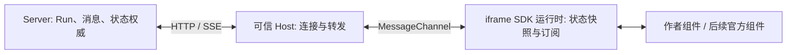

# SR 原子 SDK 与可信 Host 重构方案 v1

状态：实施中，尚未完成验收。Server、Host、SDK 已接入首版原子契约，并在临时数据库及模拟 Provider 下验证基本流程；旧同步流式 Run 测试按用户要求移除，现有自动检查通过，但原测试覆盖的部分边界场景尚待补测。官方组件尚未重写；旧业务数据已清理并保留模型配置。本文不以兼容现有官方组件为目标。Server 权威、iframe 隔离、安全校验与已提交状态通知的原则保持不变。

## 1. 目标与第一版边界

创作者在隔离运行环境里使用少量原子能力组合玩法：读写状态、订阅变化、设置输入框、发送用户消息、按 Run 获取历史及订阅 Run。创作者可编写组件与玩法逻辑；平台不内建怪谈、好感或阶段规则。

第一版可以重连，但不设计断线期间事件补偿、重放、消息历史重新读取或流式片段对账。断线期间错过的事件即丢失；重新连接后接收新事件，不保证断开的流式消息继续合并。**仅状态需在重连后重新读取最新快照，以恢复状态 Hook**。刷新页面、切换组件或 iframe 重建则重新初始化，按正常启动流程读取数据。模型事件、用户叙事消息和状态快照保持区分。

## 2. 架构与职责



- **Server**：验证请求、状态类型与权限，持久化状态、消息和 Run；发送已提交的状态变化与 Run 通知。SSE 不承诺重放。
- **可信 Host**：建立连接并转发通知；代理 SDK 命令与结果；编译、加载作者 TSX，处理运行错误与界面回退；管理 iframe 握手和生命周期。Host 不持有完整状态或消息快照，不聚合流式消息、不做历史对账；必要的连接状态和待处理命令只用于转发。
- **SDK 运行时**：提供 API、状态快照、Hook、草稿和订阅；接收 Host 转发的最新通知；生命周期开始或重建时初始化，重连时仅重新读取状态。SDK 只管理本地可见数据，不成为持久化权威。
- **组件**：通过 SDK 使用能力，用 React 自行组织玩法、显示和局部状态。组件无法直接访问 Server 受保护接口、父页面 DOM 或凭据。

创作者代码和官方组件使用相同 SDK，在隔离 iframe 内运行；不得为旧脚本放宽 sandbox、CSP 或导入限制。未经信任的消息内容不是可自动执行的脚本。

### 2.1 Host 内部模块

以下是**目标设计**，不是当前实现。这些模块只是 Web 内的职责划分，不引入新进程或服务；文件名不作为公开契约。

| 模块 | 职责 | 不负责 |
| --- | --- | --- |
| `SessionHost` | 持有当前 sessionId，创建和销毁隔离 iframe，协调页面生命周期及错误回退 | 不理解剧情规则，不存完整消息/状态快照 |
| `Connection` | 建立当前会话 SSE、转发事件、断线后重连并通知 SDK 恢复最新状态 | 不缓存断线事件、不重放、不读取历史对账、不合并流式片段 |
| `Bridge` | 验证 iframe 命令格式与大小、将允许的命令代理至 V1 HTTP、返回数据或错误 | 不决定状态值、游戏流程或权限最终结果 |
| `UI Runtime` | 加载并编译作者 TSX，在隔离 iframe 内运行，处理编译/运行错误和官方界面回退 | 不向作者暴露 Server 凭据、受保护 HTTP 或父页面 DOM |

Host 只保留连接与生命周期所需的 sessionId、iframe、MessageChannel、SSE 连接、等待响应的命令和界面运行状态；这些不是状态权威。创建/恢复连接与退出时清理旧连接、监听器和待处理命令，不能让上一 iframe 的响应流入新会话。

### 2.2 请求与事件链路

1. **SDK 调用与 HTTP 代理**：SDK 经 MessageChannel 发 `{type:'request',id,method,data}`，Host 按允许的命令映射 V1 HTTP，检查消息结构与大小；Server 验证并返回统一 HTTP 响应。Host 用同一个 id 返回结果或错误，SDK 完成对应 Promise。消息格式为内部协议示意，须在实现前固定；不得把错误吞掉或把未知结果伪造为失败项。
2. **状态写入**：`updateState(path,value)` → SDK 发命令 → Host 代理 `PATCH /api/v1/sessions/:sessionId/state` → Server 校验并提交 → Host 返回 `data` 结果数组。Host 不计算状态，也不缓存旧值。写入与之后的 `send` 是独立调用，不承诺跨请求事务。
3. **状态读取**：显式 `getState` / `batchGetState` 经 Host 请求 `GET /api/v1/sessions/:sessionId/state`；SDK 从本次响应取指定路径。Hook 维护的值仅供 React 显示，不替代 Server 读取，也不由 Host 缓存。字段缺失、null 和读取错误分别处理。
4. **状态通知**：Server 在实际值变化并提交后发布 `{event:'state.changed',data:{path,scope,value}}`，Host 原样转发给 SDK；SDK 更新 Hook 并通知状态订阅者。Host 不合成 `oldValue` 或比较完整状态。无变化不发事件；模型工作状态未提交时不能对外通知。
5. **Run**：`send` 经过 Host 调用 V1 Run 接口，服务端保留 tip 冲突、幂等和互斥校验；返回 Run ID 不代表生成完成。`getHistoryRuns` 显式通过 Host 读取历史。Server 的 `run.created/run.delta/run.completed/run.failed` 以 `{event,data}` 经 Host 转发，SDK 不再定义另一套事件命名；Host 不拼接文本。
6. **草稿**：`setDraft` 只改变 iframe SDK 及后续官方输入组件共享的草稿；不经过 Host 或 Server，也不发消息。

### 2.3 连接、重连与界面重建

- 首次打开：建立通道和 SSE；SDK 按正常初始化读取 Hook 状态和页面所需历史。初始化细节不得让创作者访问受保护 Server HTTP。
- 断线：Host 尝试重连，不缓存断线期间事件，不恢复流式拼接。
- 重连成功：Host 通知 SDK；SDK 经 Host 读取一次最新状态供 Hook 使用，不补发中间 `state.changed`，不读取历史或对消息做对账。之后只转发新事件。
- 刷新、切换组件或 iframe 重建：清理旧订阅与请求，再建立新运行时，正常重新读取所需数据；待处理请求不能无限悬挂。断线前后的 Run 事件不保证连续。

### 2.4 信任与失败边界

Host 是平台的可信代理而非状态权威；Server 负责状态、tip、Run 生命周期、权限和持久化的最终校验。iframe 消息必须校验来源/通道与命令，不能把认证信息发给作者组件。HTTP 统一响应与 SSE 事件分别按第 6 节处理；在发生网络错误、取消、组件卸载、编译或渲染失败时返回/展示可理解错误。不得降低 iframe sandbox、CSP、导入限制或直接执行消息内脚本来实现交互。

## 3. 公共 SDK 契约

以下为第一版设计，不是当前实现。第一版禁止状态字段名包含英文句点；具体大小限制及发送请求错误码在实施前按本文约束补齐，不通过引入新业务概念解决。

### 3.1 状态

```ts
type StateScope = 'global' | 'session' | 'message';
type StateValue = null | boolean | number | string | StateValue[] | { [key: string]: StateValue };

type StateEvent = {
  event: 'state.changed';
  data: { path: string; scope: StateScope; value: StateValue };
};

interface SRStateAPI {
  getState(path: string, scope?: StateScope): Promise<StateValue | undefined>;
  batchGetState(entries: Array<{ path: string; scope?: StateScope }>): Promise<Array<{
    path: string;
    scope: StateScope;
    value: StateValue | undefined;
  }>>;
  updateState(path: string, value: StateValue, scope?: StateScope): Promise<Array<{
    path: string;
    scope: StateScope;
    success: boolean;
    message: string;
  }>>;
  batchUpdateState(entries: Array<{
    path: string;
    value: StateValue;
    scope?: StateScope;
  }>): Promise<Array<{
    path: string;
    scope: StateScope;
    success: boolean;
    message: string;
  }>>;
  subscribe(listener: (event: StateEvent) => void): () => void;
}
```

- 省略 scope 一律为 `message`；结果和事件始终返回实际 scope。用户提出 `getState` 直接读取服务端最新状态；建议 `getState` 和 `batchGetState` 通过 Host 异步请求 Server，故返回 Promise。缺失返回 `undefined`，`null` 是存在的 JSON 值；读取失败拒绝 Promise。目标读取端点见第 6 节，尚未实现。
- 返回数组按输入顺序逐项对应，容许相同 path 出现多次。单项更新也返回一个元素的数组；没有额外的 `StateUpdateResult` 包装。每项覆盖对应路径，不支持增量。批量按输入顺序逐项处理，一项失败不阻止后续项；状态不存在也返回对应失败结果，不承诺整批全成全败。
- Server 对可判定的每项写入返回成功/失败和说明；断网、请求超时或响应丢失导致结果未知时 Promise 拒绝，不编造逐项结果。`await` 写入不等于等待模型，也不承诺其他并发写入不会随后覆盖结果。
- 事件仅表示已提交且值确实改变的路径，携带最新值；实际值未变不发送 `changed`。批量可对成功且变化的路径逐项通知；更新父对象仅通知实际写入路径，不虚构每个后代的事件。`json` 对象/数组以结构相等判断无变化；非有限数字等非法 JSON 不允许写入。值按快照传递，不暴露可直接修改服务端状态的引用。
- 断线期间不补发 `StateEvent`。重连后的最新状态快照更新 Hook，但不生成或补发断线期间的 `changed`；正常连接后接收新通知。

### 3.2 State Hook

```tsx
const [favor, setFavor] = useSRState(
  '白川绮罗香.好感度',
  0,
  { scope: 'message' }
);

const results = await setFavor(10);
```

scope 可省略，默认 `message`；setter 与 `updateState` 返回同样的结果数组。SDK 使用共享不可变快照，Hook 订阅快照变化并卸载时取消订阅；初始未就绪或路径缺失时使用默认值。不提供 `useSRStateReady` 或其他加载状态；默认值不保证等于服务端实际值，读取成功后 Hook 更新。读取失败不得伪造真实值或成功结果。

多个 Hook 同读一个路径共享快照；提交事件到达时按路径更新快照并触发渲染，父路径覆盖时子路径 Hook 也重新取值。重连后重新读取三个作用域最新状态并更新快照。SDK 需要简单的请求序号或串行机制，避免较早读取响应覆盖较新快照；这只是本地异步防乱序，不是事件补偿或消息对账。旧连接的通知不可覆盖新初始化状态。更新成功后 SDK 更新当前已知快照并通知 Hook；服务端异步通知重复到达时按值去重。写入失败不更新快照。

导出 `useSRStateAPI(): SRStateAPI` 供组件使用完整状态 API。Hook 不创建额外的 Server 连接。

### 3.3 会话、历史 Run 与草稿

```ts
type ChatMessage = {
  id: string;
  role: 'user' | 'assistant';
  text: string;
};

type Run = { id: string; status: string; messages: ChatMessage[] };
type HistoryRunsResult = { runs: Run[]; nextCursor: string | null; hasMore: boolean };
type SendResult = { runId: string; requestId: string };

type RunEvent =
  | { event: 'run.created'; data: { runId: string; messages: ChatMessage[] } }
  | { event: 'run.delta'; data: { runId: string; messageId: string; text: string } }
  | { event: 'run.completed'; data: { runId: string; messages: ChatMessage[] } }
  | { event: 'run.failed'; data: { runId: string; messages: ChatMessage[]; error: string } }
  | { event: 'run.stopped'; data: { runId: string; messages: ChatMessage[] } };

interface SRSessionAPI {
  setDraft(text: string): void;
  send(text: string): Promise<SendResult>;
  getHistoryRuns(options?: { cursor?: string; limit?: number }): Promise<HistoryRunsResult>;
  subscribe(listener: (event: RunEvent) => void): () => void;
}
```

- `setDraft` 整体替换 SDK 内共享草稿，不发送消息；官方输入框随后重构为使用该草稿。第一版不附加草稿读取、选区和追加 API。
- `send` 提交用户文本并请求启动 Run，返回 Run ID 和请求 ID；返回不代表模型生成完成。平台维护请求幂等和 tip 冲突等现有服务端不变量，但 SDK 不承诺跨独立状态写入与 send 的事务。状态成功、发送失败时前一步不会自动回滚。
- `getHistoryRuns` 按 Run 分页，每页 `limit` 为 1–20，缺省 20；无 cursor 获取当前分支最新一页，页内按历史从旧到新，`nextCursor` 指向更早页，游标不由作者解析。一个 Run 内包含多条可见 ChatMessage，包括开局 Run；不把 raw tool entries 伪装成可见消息。Run 边界不得被分页拆开。
- `subscribe` 订阅之后的新 Run 通知，返回取消订阅函数；不自动返回历史。`delta` 是尚在生成中的文本片段，`completed` 是完成结果，不能将中间片段当作必然持久化结果。非流式也通过 run.created/run.completed 或 run.failed 表达；断线后新事件可独立到达，订阅方不得假定已收到该 Run 的全部前序事件。
- 导出 `useSRSession(): SRSessionAPI`；事件仅针对当前会话。显式调用历史接口可以读取历史，但自动重连不调用历史接口，不尝试修复缺失片段。刷新或切换组件后的初始化可以按正常页面需要读取历史。

## 4. 状态类型与 JSON 说明

第一版仅支持：

| 类型 | 值与约束 |
| --- | --- |
| `string` | 字符串，不接受 null；可选值由创作者维护 |
| `number` | 有限数字，不接受 null；保留 min/max，允许小数 |
| `boolean` | true/false，不接受 null |
| `json` | 任意合法 JSON 值，包括对象、数组、标量和 null；不限制内部业务结构 |

JSON 字段使用普通 `initial` 值和自然语言 `description`，描述可说明多级字段、动态键和例子；模型获取当前值与说明，说明不作为内部 schema 强校验。世界卡保存的是 JSON 数据和文本，不执行创作者输入的对象字面量代码。需要确定性 min/max 的字段单独使用 number。

更新路径替换完整目标值，不能自动合并或加减：JSON 整体可替换为任意合法 JSON；可在已有父对象下替换/新增最后一级对象键，缺失父对象不自动创建；数组整体替换，不支持下标更新、追加、插入或删除。删除对象键由作者构造不含该键的新父对象再覆盖；null 不是删除。非法路径、原型污染键、不可序列化值、超大或超深值必须拒绝。根模块/命名空间如何表达及具体限制在数据格式设计中确定。

## 5. 内部协议、初始化与生命周期

1. Host 建立带校验的 MessageChannel 与隔离 iframe；SDK 注册命令请求与响应，不暴露认证或受保护 HTTP；命令通过统一 HTTP 响应解包，事件保持 `{event,data}`。Host 将来自该通道的有限命令映射到 Server，校验消息形状及大小，并返回具体结果或错误。
2. 首次初始化：Host 建立连接，SDK 读取 Hook 所需状态；所需历史由组件显式调用 `getHistoryRuns`。状态响应未到时 Hook 返回默认值；不公开加载状态。
3. 连接中正常转发 RunEvent 与已提交 StateEvent；SDK 接收并通知订阅者。状态通知只包含路径、scope、新值，无 oldValue；值不变不通知。监听器异常不影响其他监听器。
4. 断线：Host 标记断开并自动尝试连接，不在断线期间缓存、补发或修复 Run 事件。重连成功后 SDK 读取最新状态一次，并继续接收后续通知；不拉取历史、不合并旧流。状态读取失败时保留先前 Hook 值并处理错误，不提供加载状态，也不捏造状态事件。
5. iframe/组件重建：关闭旧连接/监听器、清理组件、草稿及未完成命令，重新握手和初始化。未完成 Promise 应以明确错误结束，不无限等待。页面刷新同样重新初始化。
6. 状态订阅只提供已提交变化，不支持断线事件重放；组件基于 Hook 最新值自行判断。作者脚本在界面未运行时不会执行；不承诺后台自动化。

## 6. 后端路由统一为 V1

用户决定目标架构只保留 `/api/v1` 路由，不保留历史 API 兼容层；实施时合并现有会话路由职责，移除无用路由和 `session-v2.ts` 这类版本拆分文件，并同步修改 Host、SDK、测试及文档。接口路径和数据模型需作为一次整体重构确定，不能只机械替换 URL；不保留 V2 兼容映射。

当前代码确认：`apps/server/src/app.ts` 同时挂载 `/api/v1/sessions` 和 `/api/v2/sessions`，并将 `session-v2.ts` 的数据、状态、SSE、Run 端点挂在 V2；Host 使用 `v2/sessions`，其他页面还使用 V1。上述只是当前代码状态，不代表目标设计，也不是本次执行删除的授权。旧 API 不兼容不等于授权删除用户数据库或历史会话数据；数据迁移仍应另行设计。

### 6.1 统一 HTTP 响应

所有后端 HTTP JSON 接口统一响应体；成功 `code` 约定为 `OK`：

```ts
type HttpResponse<T> = { code: 'OK'; message: string; data: T };
type HttpErrorResponse = { code: string; message: string; data: null };
```

```json
{ "code": "OK", "message": "", "data": { "id": "session-123" } }
```

```json
{ "code": "SESSION_NOT_FOUND", "message": "会话不存在", "data": null }
```

保留 HTTP 状态码表达成功/客户端错误/服务端错误，业务错误码由 code 表达；SDK 解包 `data`，失败传递 code 和 message。逐项状态更新的成功或失败保留在成功响应 `data` 数组中；整体请求失败使用统一错误响应，不编造逐项结果。请求已发出但响应丢失时仍可能结果未知。

SSE 是持续的流而不是一个可用单一 JSON 响应体包裹的数据对象：建立连接前失败使用统一 HTTP 错误响应，建立成功后按第 6.4 节的 `{event,data}` 事件流传输。统一包装适用于 `application/json` 响应；下载文件仍是原始世界卡或预设 JSON，不采用响应包装。

### 6.2 错误码统一声明

Server 在一个全局位置集中声明错误码和默认信息，按领域分组并注释，例如：`通用`（`INVALID_REQUEST`）、`会话`（`SESSION_NOT_FOUND`、`SESSION_BUSY`、`TIP_CONFLICT`）、`Run`、`状态`（`INVALID_STATE_PATH`、`INVALID_STATE_VALUE`）、`世界`（`WORLD_BUSY`、`WORLD_NOT_FOUND`）、`预设`、`模型连接/Provider`、`权限`。这些名称是候选而非完整错误表；实施前对照所有现有业务接口整理，统一唯一 code、默认 message 与 HTTP 状态码，同一错误复用定义，不在各路由散落定义。异常和日志不暴露凭据、用户内容或私有提示词。

### 6.3 SR SDK 所需的目标 HTTP 接口

以下 `:sessionId` 均属于 `/api/v1/sessions/:sessionId`；HTTP 响应一律包裹在 `{code,message,data}` 中。具体字段是目标设计，并非已实现。

| SDK / 初始化 | 方法及路径 | data |
| --- | --- | --- |
| 初始化会话 | `GET /api/v1/sessions/:sessionId` | `{id,worldId,title,presetId,userCharacterId,tipEntryId}` |
| `getState` / `batchGetState`、Hook 初始化和重连 | `GET /api/v1/sessions/:sessionId/state` | `{global,session,message}` 当前状态 |
| `updateState` / `batchUpdateState` | `PATCH /api/v1/sessions/:sessionId/state` | 按输入项对应的 `Array<{path,scope,success,message}>` |
| `getHistoryRuns` | `GET /api/v1/sessions/:sessionId/runs?limit=20&cursor=...` | `{runs,nextCursor,hasMore}`；limit 1–20 |
| `send` | `POST /api/v1/sessions/:sessionId/runs` | `{runId,requestId}`，HTTP 202 表示接受而非生成完成 |
| `setDraft` | 无后端接口 | SDK 本地草稿 |
| 两种 `subscribe` | `GET /api/v1/sessions/:sessionId/events` | 单条 SSE，见下文 |

状态单项或批量更新都请求：

```json
{ "updates": [{ "path": "游戏状态.灵力", "scope": "message", "value": 5 }] }
```

响应例如：

```json
{ "code": "OK", "message": "", "data": [{ "path": "游戏状态.灵力", "scope": "message", "success": true, "message": "" }] }
```

send 请求包含用户文本、由平台产生的 requestId 及所需 expectedTipEntryId；返回的 `data` 为 `{runId,requestId}`，accepted 不代表最终成功。保持 Server 幂等、tip 冲突及 Run 互斥；如何获取 tip 与失败恢复应在接口评审中定稿，不得因 Host 无消息快照而移除冲突校验。

历史 `data.runs` 中每个 Run 为 `{id,status,messages}`，messages 按顺序排列，ChatMessage 只有 id/role/text；`nextCursor` 不透明，页内从旧到新，不拆分 Run，缺省及最大 20。`GET /state` 返回三作用域的当前值，SDK 每次 `getState` / `batchGetState` 通过 Host 异步读取；Hook 单独维护渲染用快照，不提供加载状态。JSON 路径缺失与 `null` 的区别由 SDK 在读取返回快照时判断。

### 6.4 SSE 与 SDK 事件同形

服务端事件与 SDK 订阅均使用 `{event, data}`；Host 只转发，SDK 不再把 `type` 转成另一套命名。事件名称在本节集中定义，并区分 Run 与状态，SDK 订阅各自过滤对应类别。每个事件的 `data` 与下方类型一致；SSE 传输可使用 `event: <名称>`、`data: <JSON 数据>`，SDK 交付 `{event, data}`，只做传输封装，不改事件语义。

```ts
type SREvent =
  | { event: 'run.created'; data: { runId: string; messages: ChatMessage[] } }
  | { event: 'run.delta'; data: { runId: string; messageId: string; text: string } }
  | { event: 'run.completed'; data: { runId: string; messages: ChatMessage[] } }
  | { event: 'run.failed'; data: { runId: string; messages: ChatMessage[]; error: string } }
  | { event: 'state.changed'; data: { path: string; scope: StateScope; value: StateValue } };
```

`run.delta` 是流式临时片段，完成状态通过 run.completed/run.failed 表达；断线期间丢失，不重放、不对账。`state.changed` 只在值实际变化且提交后发送，包含最新值，不包含 oldValue；重连只读最新状态、不补发事件。用户主动停止时发送 `run.stopped`，不将 stopped 静默当作 completed 或 failed。


## 7. Server 配套与数据格式

本设计虽然聚焦 SDK / Host，Server 仍必须提供对应能力：四类型声明/初始化校验，JSON 对象路径覆盖，状态批量结果、已提交变化通知、Run 分页最多 20，以及模型 `update_state` 与作者状态 API 一致的类型/路径校验。`global`、`session`、`message` 的归属、Server 权威、运行互斥与历史祖先链不因本次设计改变。

实际值不变不发送 changed，Server 应在提交边界判断并只发布成功变更的最新值；仅更新 SDK 自己的内存不能作为持久化成功。模型修改只在其工作状态实际提交后通知；不泄露未提交状态。不同 scope 的读写、批量结果及通知与 Server 合作定义，不能由 iframe 自行认定成功。

现有世界卡/状态包含旧类型，用户明确不要求兼容旧状态，并授权清空现有业务数据、保留模型 API 配置。实施与隔离测试完成后，核对清空范围、备份及回退，保留 `api_model_configs` 和其凭据引用/凭据；不得清理模型配置。此处不承诺兼容旧官方组件，不默默转换旧世界卡。作用域直接声明命名状态项，开局 JSON 初始值的覆盖方式仍待用户确认。

## 8. 任务与验收

1. **冻结类型和协议**：落实字符串路径、状态命名空间、全局领域错误码、统一 HTTP 响应与大小限制；明确一次写入的成功/未知状态。确认接口中 `Run`/`ChatMessage` 和事件的精确序列化形状。
2. **Server 状态能力**：实现四类型、JSON 子路径覆盖与自然语言说明、状态读取和逐项结果，提交后仅对变化值发送新值事件；保留安全与作用域边界。
3. **Server Run 和路由能力**：统一 `/api/v1`，合并会话路由并删除不再使用的 V2 路由与文件；历史按 Run 最多 20、有效游标和顺序；发送及 Run 通知支持流式/非流式；保留并发、幂等、tip 和中止规则。
4. **Host**：改用 V1，实现连接、受控命令代理、通知转发、TSX 加载与清理；不持有完整消息/状态快照或做自动历史对账。
5. **SDK 与 Hook**：实现公共类型、Hook 内部状态、订阅、API、草稿；首次初始化和重建读取，重连只刷新状态；处理局部异步顺序、异常与取消订阅，不恢复丢失事件或流。
6. **官方组件重构**：仅在 API 完成后，基于新 Run、草稿、状态与订阅接口重新实现；不要求兼容原有组件实现。
7. **测试与文档**：临时 DB 验证四类型、null/min/max、JSON 路径及无变化事件、逐项结果；SDK/Host 测试消息和状态订阅、刷新/切换/断线重连、无事件重放、流式断线、默认值及旧请求不覆盖新状态；浏览器验证组件、焦点和隔离。更新产品、API、状态、存储、SDK 文档与必要 AGENTS；运行仓库 typecheck/lint/test/build，报告真实验证边界。不能使用真实用户 DB 或真实付费 Provider 做例行验证。
