# SR 多主题与主题开发：任务拆解 v1

日期：2026-11-15。状态：**待批准实施，全部任务未开始**。

主方案：[sr-theme-system-v1.md](./sr-theme-system-v1.md)。只在用户明确授权代码修改后执行。本文件的任务状态不因方案撰写而改为完成。

全部任务由同一主代理顺序负责设计、实现、验证和独立复核；不启用子代理。每个任务提交范围应可单独审阅，不自动 commit/push。

## 1. 顺序与里程碑

```mermaid
flowchart LR
  T01[T01 基线与契约清单] --> T02[T02 共享主题契约]
  T02 --> T03[T03 内置主题与视觉迁移]
  T03 --> T04[T04 Server 外观持久化]
  T04 --> T05[T05 Store 与启动]
  T05 --> T06[T06 跨环境主题桥]
  T06 --> T07[T07 外观设置]
  T07 --> T08[T08 A 阶段验收]
  T08 --> T09[T09 用户包注册表]
  T09 --> T10[T10 导入预览与版本管理]
  T10 --> T11[T11 公开作者主题能力]
  T11 --> T12[T12 开发工具与发布门禁]
```

顺序代表当前单代理执行安排；任务中涉及多个目录时先确定合同，再修改生产者和消费者，最后检查完整链路。

## 2. A 阶段：内置多主题

### T01 · 建立迁移基线和表面清单

- 依赖：方案整体范围确认。
- 文件边界：只读 `apps/studio/src`、`packages/sr-sdk/src`、相关测试；记录放 `plan/`。
- 工作：盘点每个现有变量及硬编码色的角色；区分布局 mask、媒体遮罩、状态与装饰；记录当前 dark/light 的 375/1280 截图和核心操作。
- 同时确认 AppShell、Session 输入框、WorldStory、作者舞台、介绍/开局 frame、静态文档、Portal 的 theme ownership。
- 验收：所有现有主题 consumer 有归属；记录现有失败，不能把旧用例通过当作新多主题通过。
- 产物：迁移清单、稳定基准、必需公共 token 列表；不进行主题大改版。

### T02 · 实现纯主题契约与解析器

- 依赖：T01。
- 拟新增：`packages/sr-theme/src/{contract,registry,validate,resolve,serialize}.ts` 及纯单元测试、package.json。
- 拟改：workspace 依赖与根检查脚本，按当前包约定使用 pnpm。
- 工作：版本化 Schema、每个 token 的类型/范围/默认值、三组 treatments、完整快照、有限值序列化、颜色组合检查。
- 保持纯函数，无 DOM/React/DB/文件读写；包导出分清公共类型与内部验证。
- 验收：合法/未知/越界/缺项/超量/原型键/恶意字符串、system 与缺失 variant、可选值补齐均覆盖；禁止依赖当前 CSS 作为默认值。
- 约束：不实现任意 CSS、alias/extends、资源下载或通用插件系统。

### T03 · 内置主题和 Studio 视觉角色收敛

- 依赖：T02。
- 文件：共享包内置定义、`styles/themes.css`、`styles/tokens.css`、`styles/business.css`、AppShell / Sessions / WorldLibrary / Modal / Button 等被清单确认的样式。
- 工作：先将现有 SR dark/light 转为内置主题，通过旧变量别名保持视觉；再加入炭灰主题，选择 neutral action / edge-glow / glass 的受测实现。
- 逐项迁移玻璃、媒体遮罩、错误与 Usage 系列色；保留非主题布局常量。
- 验收：原生主题与 T01 基准一致；第二主题不残留紫灰硬编码；组件 Selected+Hover、焦点与命中区正确。
- 约束：不为了示范主题重做导航、世界详情滚动或会话输入结构。

### T04 · Server 外观选择与 additive migration

- 依赖：T03。
- 拟新增：Server 外观 domain/repository/routes 及迁移、接口测试；纯内置主题注册表查询。
- 拟改：`database.ts`、`server.ts`、error codes；确定实际数据库版本后编排迁移。
- 工作：独立 app_appearance 单行表、完整 selection、revision CAS、GET/PATCH appearance、内置 themes 查询；使用统一 HTTP envelope。
- 验收：旧数据库所有业务表不变；备份、事务失败回滚、重启幂等；unknown theme/version、模式、并发冲突和 opaque-origin 请求有明确结果。
- 约束：只用临时数据库；不运行用户真实库升级；不扩展用户包存储到本阶段。

### T05 · ThemeStore、首帧缓存与模式解析

- 依赖：T04。
- 拟新增：`apps/studio/src/theme/{store,bootstrap,dom-adapter}.ts` 及 React 适配。
- 拟改：`hooks/useTheme.ts`、`main.tsx`、`index.html`。
- 工作：单一 store、OS 监听、一次性旧 localStorage 迁移、Server 读取与保存、缓存白名单验证、完整 CSS 替换、meta/color-scheme 同步。
- 验收：同模式换风格也通知；缓存坏值安全 fallback；CAS 首次竞争不覆盖；Server 离线不假保存；监听正确清理；减少效果优先；旧主题变量不残留。
- 约束：不把字号或 composer bottomInset 并入主题所有权；不把其他 localStorage 偏好一起迁移。

### T06 · 统一各展示环境的主题桥

- 依赖：T05。
- 文件：`host.tsx`、`frame.tsx`、`frame.css`、`WorldComponentView.tsx`、`world-component-frame.tsx/css`、SDK `WorldDocumentRenderer.tsx` 与 `world-story.css`。
- 工作：共享白名单快照、protocol version、revision、握手先主题后渲染、原子单文档应用、重连重放最新快照、legacy 别名适配。
- 静态文档主题变更只更新受控样式，不重建 srcDoc；容器底色逻辑保持，inline 消息不增加 frame。
- 验收：三类 frame 与 Studio 同步；乱序/坏包/重连正确；不 remount 作者组件；不清空字号与 bottomInset；scriptless 仍无脚本，运行作者代码的 frame 仍无 allow-same-origin。
- 必测：流式生成、Portal、历史分页锚点、未发送草稿与 IME、只读世界预览权限。

### T07 · 外观设置与受控预览

- 依赖：T06。
- 文件：`features/settings` 下外观分区/页面，App 路由、AppShell、MorePage；主题样本组件放正式外观功能内，开发 fixture 不进入生产。
- 工作：风格/模式分离；当前版本标识；局部样本预览；Apply/Cancel；失败保留草稿；恢复默认、安全主题入口；入口状态统一。
- 验收：桌面/移动、加载/空用户包/错误/取消/返回/冲突；Portal 预览 scope 正确；保存确认后才全局应用；返回焦点正确。
- 约束：预览不需要真实 Provider 或模拟运行链路；不新增历史 preview transport。

### T08 · A 阶段独立复核与文档归档

- 依赖：T07。
- 同一代理单独回读 diff，检查契约、权限、状态所有权、迁移和视觉。
- 检查：根 typecheck/lint/test/build；新共享包与 Studio 单元入口；相关生产浏览器、composer、WorldStory font、world-document 测试。
- 实看：内置主题 × 支持模式 × 375/1280；焦点、错误、禁用、长内容、200% 放大、减少效果。
- 修复发现后只重跑受影响检查与必要整体验证；记录未测项。
- 实施属于核心跨环境外观链路调整时，更新根/相关 AGENTS 和设计文档，说明已实现范围；纠正已确认的数据库版本说明。不要用提案冒充完成状态。
- A 退出条件：两种主题完整可用、原生视觉回归受控、切换不破坏会话、没有关键失败。

## 3. B 阶段：用户主题开发契约

### T09 · 用户主题注册表与版本生命周期

- 依赖：T08；B 范围批准。
- 文件：Server theme domain/repository/routes、独立 additive migration、主题 package 测试。
- 工作：theme_packages；validate/import/export/delete；保留命名空间；规范 JSON hash；不可变版本；使用中删除检查；禁止自动升级。
- 验收：同版本同内容幂等、不同内容冲突、坏版本拒绝、导入不启用、删除当前引用拒绝；恢复默认后可删；用户包不触及 worlds/session 数据。
- 校验覆盖：64KiB/深度/token 数、所有值类型与组合、未知字段、危险 URL/表达式/元数据。

### T10 · 导入预览与主题版本管理 UI

- 依赖：T09。
- 文件：外观设置页、API 客户端、主题样本展示与错误组件。
- 工作：文件选择→只校验→显示诊断/支持模式→导入→显式应用；升级先装新版本、人工切换；导出/删除/恢复默认。
- 验收：错误路径可定位；本地预览与 Server 校验结果一致；网络失败不丢文件候选；并发选择冲突可恢复；不在 preview 时修改当前全局主题。

### T11 · 公共只读主题 SDK

- 依赖：T10。
- 文件：SDK theme context/hook/public types/export、WorldStory、session frame 与 world-component frame 的显式 SDK facade、SDK 与编译器测试、作者指南。
- 工作：发布 versioned 公共 CSS 变量和 `useSRTheme()`；只提供视图信息，不提供 setter 或 transport；官方组件消费同一契约。
- 验收：会话作者、介绍与开局都可读取与响应主题；standalone SDK fallback 有效；不引入第二份 React；不增加状态订阅、Session API 或 Server HTTP 权限。
- 兼容检查：旧作者组件完全不改也可运行；硬编码风格不被强制覆写；所有既有 import allowlist 和 sandbox 测试通过。
- 更新 docs/design 与世界卡作者指南中的**已实施**契约，保留该方案作为历史提案依据。

## 4. C 阶段：开发工具

### T12 · Schema、校验命令、样式工作台与最终门禁

- 依赖：T11；C 范围批准。
- 拟新增：`tools/theme/` 或仓库既有 scripts 目录中的 validate 命令、JSON Schema、模板、开发入口与组件样本，位置在实施时按实际目录约定确定。
- 工作：共享包生成/发布 Schema；`pnpm theme:validate`；开发时合法文件热预览；设计角色说明、版本升级说明与完整示例包。
- 约束：不为工作台新增一套 Provider/mock runtime，不把开发样本带回生产业务入口；无后台文件系统权限扩展。
- 验收：主题作者不改应用源码即可编辑、验证、预览并导入一个主题；错误输出可供 CI 使用；生产构建不包含开发监听和工作台入口。
- 最终独立 review：数据包无法执行 CSS/JS、完整状态可读、模式/版本/回退行为明确；测试与截图证据完整。

## 5. 暂缓项

- 任意 CSS、React 组件替换、脚本、插件权限。
- 远程字体、图片、ZIP 资源包、自动下载更新。
- 在线主题市场、账号、签名发布、跨设备同步。
- 世界专属自动切主题、会话专属平台主题、布局密度重排。
- DTCG 全规格导入、复杂 token aliases 和跨包继承。

这些都不是主题包 v1 的隐式能力；后续立项时分别评估，不预先建立空的扩展层。

## 6. 执行与记录规则

- 每个任务开始检查 git status 与文件现状，保护已有用户改动。
- 涉及 public API/SDK/数据库的任务先核对所有生产者消费者和测试再动手。
- 首期实际执行 A，B/C 保留边界与契约演进路径；不一次性把全部生态工具做完。
- 任何测试或视觉检查失败须记录证据与修复，不以“功能可跑”代替验收。
- 最终记录精确运行的脚本及范围；当前 `pnpm test/lint` 主要覆盖 Server，不能据此声称新包和前端全部验证。
- 不提交、不推送、不部署、不调用真实付费 Provider、不执行真实数据库迁移。
