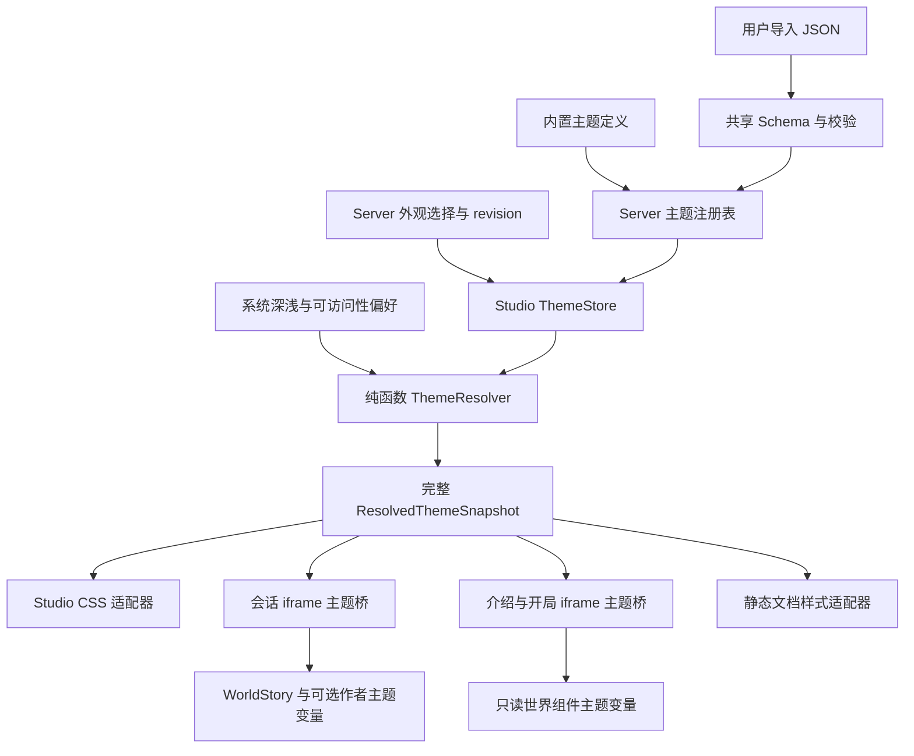

# SR 多主题与主题开发方案 v1

日期：2026-11-15。状态：**技术与产品方案草案，未批准实施**。

配套：[可执行任务](./sr-theme-system-v1-tasks.md)。参考：[DSH 风格指导](../docs/design/theme/dsh-quiet-futurism.md)。本次仅撰写方案，不修改应用代码、SDK、数据库或现有主题。

## 1. 建议与用户体验

建议采用 **版本化主题数据包 + 受控视觉组件样式 + 单一主题解析器 + 多展示环境适配**。

主题可以改变界面的颜色、边缘、圆角、阴影、玻璃材质和有限的动效参数；布局结构、点击目标、导航、状态含义、权限和会话逻辑由产品保持稳定。主题不等同于任意 CSS，更不等同于可运行的 React 插件。

### 1.1 用户看到什么

1. 在“外观”中选择风格，例如 SR 原生、静谧炭灰；再选择浅色、深色或跟随系统。
2. 在当前页面的样式样本区域预览文字、按钮、选中态、输入框、菜单和故事排版，取消不影响当前主题。
3. 点击应用后，Studio、官方 WorldStory、静态世界文档和采用平台主题变量的创作者组件更新外观；当前会话、流式生成、草稿、分页位置保持。
4. 未来可导入 `.srtheme.json`，查看支持的模式、版本与校验结果，预览后再应用。导入不自动启用，升级不自动替换当前版本。
5. 外观页提供“恢复 SR 默认”；主题损坏、删除当前版本、网络失败均有明确恢复路径。

主题开发者编辑的是有 Schema 和说明的设计参数，通过校验工具和样式工作台检查结果，无需修改 Studio 源码，也不需要了解业务 DOM 或 CSS Modules 类名。

### 1.2 必须拆开的概念

| 概念 | 示例 | 所有者 |
| --- | --- | --- |
| 风格 / themeId | `sr.default`、`local.quiet-charcoal` | 主题包 |
| 模式选择 / mode | `light / dark / system` | 用户设置 |
| 实际模式 / resolvedScheme | `light / dark` | 当前浏览器结合系统偏好解析 |
| 阅读偏好 | 当前会话 13–21px 字号 | 现有 Host 阅读设置；不由主题覆写 |
| 可访问性策略 | 减少动态、减少透明度 | 用户与操作系统优先 |
| 创作者舞台 | 世界卡 React UI 与剧情视觉 | 世界卡作者，在隔离边界内 |

`data-theme` 继续表示 `light / dark` 以兼容现有代码，另设 `data-sr-theme-id`、`data-sr-theme-revision`。不能把 `data-theme="quiet-charcoal"` 当成多主题方案。

## 2. 当前实现与问题证据

本节基于当前有大量未提交改动的工作树；不把历史文档或未来计划当成现状。

| 位置 | 已有能力 | 扩展多主题时的缺口 |
| --- | --- | --- |
| [useTheme.ts](../apps/studio/src/hooks/useTheme.ts) | `Theme='dark'\|'light'`；localStorage `sr-studio-theme`；effect 设置根属性 | 风格与模式混在一起；无 system、主题注册表、预览事务与共享 store |
| [themes.css](../apps/studio/src/styles/themes.css) | 两组语义色变量 | 只能切一套视觉的亮暗；不是外部主题契约 |
| [tokens.css](../apps/studio/src/styles/tokens.css) | 尺度、圆角、动效 | 公开可配置值与受保护结构值尚未区分 |
| [AppShell](../apps/studio/src/app/AppShell.tsx)、[MorePage](../apps/studio/src/features/more/MorePage.tsx) | 桌面切换按钮、移动端浅深选择 | 多主题需要统一外观入口与清楚的模式选择 |
| [host.tsx](../apps/studio/src/host.tsx) | 从根 CSS 提取七个颜色传给会话 frame；另传字体和 bottomInset | 依赖 DOM MutationObserver；仅监听 data-theme/data-palette，风格变化可能漏同步 |
| [frame.tsx](../apps/studio/src/frame.tsx) | theme/appearance 两类消息；白名单写入 `--sr-story-*` | 消息拆分；没有版本化完整快照和旧变量清除规则 |
| [WorldComponentView](../apps/studio/src/features/worlds/WorldComponentView.tsx) | 介绍 / 开局 frame 获得四个颜色 | 与会话 frame 的集合和监听条件不同 |
| [WorldDocumentRenderer](../packages/sr-sdk/src/world-document/WorldDocumentRenderer.tsx) | 根据宿主与容器取字色/底色；静态 iframe 保持 scriptless | 主题变化参与 srcDoc 生成；需要稳定内容文档、只更新主题样式 |
| [world-story.css](../packages/sr-sdk/src/world-story.css) | 官方 `.sr-story` 使用 `--sr-story-*`，不改作者外层舞台 | 基础已具备；危险色有 fallback，但当前 Host 七色桥未传入 |
| [app-settings.ts](../apps/server/src/routes/app-settings.ts) | Server 持久化默认预设和模型 | 当前主题未进入 Server 持久化契约 |
| [production.mjs](../apps/studio/tests/visual/production.mjs)、[document-theme.tsx](../packages/sr-sdk/test/document-theme.tsx) | 真实 Server 浏览器流程、静态文档亮暗测试 | 缺多风格同模式、system、原子切换与主题包测试 |

### 2.1 不能只增加 themes.css

目前仍有硬编码视觉，例如 AppShell 移动导航与 Sessions 输入框的紫灰玻璃色、WorldLibrary 的封面遮罩、Modal 的遮罩、Usage 图表系列色。需要按角色迁移：

- 玻璃导航与输入框 → `material.glass.*`。
- 图片上的文字、遮罩 → `media.overlay.*`，保持图片上的可读性；不直接替换成普通 `text.primary`。
- 错误 / 成功 / 警告 → `status.*`；主题可以提供可读配色，但不能改含义。
- Usage 系列 → 固定语义键 `chart.usage.*`；禁止每个主题改变系列意义。
- 纯布局 mask 的黑白值不属于主题色，不机械替换所有十六进制颜色。

### 2.2 现有文档差异

根 AGENTS 与代码当前数据库已到 v5；`apps/server/AGENTS.md` 仍有“当前版本 4”的旧说明。实施时以合并后的实际迁移序列确认新版本号，不预先写死 v6，更不能复用已占用版本。本方案不顺手修改这些用户文件。

Roadmap 将“开放 CSS 主题 / 创作者主题包”列为候选，并提到 Token/CSS Schema。本方案细化为先开放声明式主题包，将任意 CSS 扩展留给独立插件安全设计；这是建议的范围裁决，尚不是已批准产品决定。

## 3. 范围和阶段

| 阶段 | 交付 | 暂不包含 |
| --- | --- | --- |
| A：内置多主题 | 共享主题契约、原生主题迁移、第二种视觉、light/dark/system、Server 设置、完整跨环境同步 | 主题市场、自定义文件导入 |
| B：声明式主题包 | JSON 导入/导出/校验、版本管理、预览、删除/恢复、公开 SDK 只读主题能力 | 任意 CSS、JS、React、远程资源 |
| C：主题开发工具 | JSON Schema、文档、validate 命令、样式工作台、开发时热预览、版本升级诊断 | 在线商店、签名发布系统、付费和多用户 |

A 阶段必须使用与 B 相同的解析器与 token 契约，避免把两个内置主题硬编码后再重写。A 只需要内置注册表；B 再新增用户包存储。

第二主题选用 DSH 参考中的炭灰方向，用来证明主题系统可以改变中性按钮、选中边缘与材质。其浅色版本应单独设计和检查，不能声称 DSH 原图已经给出浅色规范；若暂不提供浅色，明确标记只支持深色。

## 4. 主题可控制的边界

### 4.1 可配置表面

| 层次 | 允许 | 不允许 |
| --- | --- | --- |
| 颜色 | 背景、表面、文字、边界、强调、焦点、状态、图表、媒体遮罩 | 任意属性、远程 URL、表达式、脚本 |
| 形状与深度 | 注册的圆角等级、结构化阴影、受限 blur | 改 display、position、z-index、点击区域、DOM |
| 文字 | SR 认可的字体 preset；平台默认文字颜色与有限字重 | 覆盖用户阅读字号、任意加载字体、极小正文字号 |
| 动效 | 有界时长、认可的 easing preset、预定义效果开关 | 任意 keyframes、无限闪烁、主题脚本、修改加载行为 |
| 组件视觉 | SR 提供的样式枚举，如按钮填充方式和选择轮廓 | CSS 选择器注入、替换 React 组件、覆盖业务布局 |
| 创作者内容 | 提供可选公共变量 / 只读主题快照 | 强制改写作者已有 CSS、检查并插入 WorldStory |

尺寸与密度首期仍由产品控制，主题不提供全局字号倍率、间距倍率或侧栏宽度。否则一次主题切换会变成布局系统替换。

### 4.2 预定义组件样式让主题超越换色

建议首批最多开放这三组枚举，名称均为拟议契约：

```ts
type ThemeTreatments = {
  primaryAction: 'accent' | 'neutral';
  selection: 'tonal' | 'outline' | 'edge-glow';
  floatingSurface: 'solid' | 'glass';
};
```

由 SR 为这些分支写受测样式。主题只能选枚举和合法参数，不能新增实现。`edge-glow` 仅在具有语义选择状态的组件上生效，不能让整个世界卡库默认发光。`glass` 必须有 solid fallback，降低透明度偏好优先。

DSH 参考可映射为 `neutral + edge-glow + glass`，但保留 SR 已确认的导航结构、Selected+Hover 规则和输入框职责。

## 5. 契约与数据形状

### 5.1 Token 三层

1. **主题原始值**：作者定义颜色等具体值；可以带备注，不直接被业务组件消费。
2. **公共语义 token**：`color.canvas`、`color.text.primary`、`color.focus` 等，版本化、稳定。
3. **内部组件变量**：比如 composer glass、侧栏 hover，映射到公共语义或组件视觉槽，不开放任意 CSS 类名。

首期公共组：`color`、`radius`、`shadow`、`material`、`motion`、`typography`、`treatments`。`color` 下覆盖 canvas/surface/text/border/accent/focus/status/chart/media 与 story 语义。Story 默认继承平台配色，但允许包内注册的 story 角色覆盖，不能只导入“皮肤的一半”。

现有 `--canvas`、`--surface`、`--text` 等作为内部别名保留，逐项映射；不要求所有组件一次性改名。对作者公开的 CSS 变量使用 `--sr-theme-*`，不公开短名内部变量，也不承诺 CSS Modules 产物稳定。

### 5.2 包格式示意

下面是**局部示例**，完整必填键由契约任务定义。SR 包格式不是 DTCG 完整实现。

```json
{
  "format": "sr-theme",
  "schemaVersion": 1,
  "tokenVersion": 1,
  "id": "local.quiet-charcoal",
  "version": "1.0.0",
  "name": "静谧炭灰",
  "author": "Example",
  "defaultScheme": "dark",
  "variants": {
    "dark": {
      "tokens": {
        "color.canvas": "#26272D",
        "color.surface": "#2A2B2E",
        "color.text.primary": "#F9FAFB",
        "color.text.secondary": "#ADB2B9",
        "color.accent": "#3A87FF",
        "color.focus": "#6799FE",
        "radius.card": 24,
        "motion.feedbackMs": 180
      },
      "treatments": {
        "primaryAction": "neutral",
        "selection": "edge-glow",
        "floatingSurface": "glass"
      }
    }
  }
}
```

契约要点：

- `schemaVersion` 管文件形状，`tokenVersion` 管视觉契约，包 `version` 管作者版本，三个概念独立。
- 每个 variant 要提供核心必填颜色；可选键由**固定 tokenVersion 对应默认表**补齐。补齐后校验组合，不能靠用户浏览器当时主题补缺省值。
- v1 不支持远程 extends、第三方依赖、跨主题继承或任意表达式；先使用字面量，未来有真实作者需求再加本地有界 alias。
- 作者信息只是元数据，不代表经过验证的身份。内置 `sr.*` ID 为保留命名空间；用户包不能覆盖。
- 深浅 variant 是完整解析分支，不逐色自动反转。

### 5.3 值的校验

所有数值界限为本方案建议，T02 固定为实际注册表并做边界测试。

| 类型 | 接受形状 / 限制 |
| --- | --- |
| color | v1 只接受 `#RRGGBB` / `#RRGGBBAA`；需不透明的文字、底色和焦点角色禁止 alpha |
| radius | 有界有限数值，例如 card 8–28px、control 4–16px；不同槽分别限幅，越界拒绝 |
| shadow | 最多两层 `{x,y,blur,spread,color,inset}`，有限范围；不接受原始 box-shadow 字符串 |
| gradient | 最多四个 `{color,position}`、有界角度；只有选中边缘等注册槽接受，不允许 url |
| material | blur 0–16px，overlay 颜色允许 alpha；需要指定不透明 fallback |
| motion | 反馈 0–240ms、切换 0–400ms，easing 只选 SR preset；系统减少动态可以归零 |
| typography | 从 `system-ui / system-reading / system-mono` 中选，映射由 SR 提供 |
| metadata | 长度限制、纯文本渲染；未知字段拒绝；不接收 HTML |

建议单包不超过 64KiB UTF-8、嵌套深度不超过 8、token 不超过 256；用 strict schema 拒绝危险键和未知字段。校验不是搜索几个关键词：值先转换成有类型的规范数据，再由受控序列化器生成 CSS。

关键文字 / 底色组合与焦点 / 邻接表面做对比度检查，考虑 alpha 合成。普通文字至少 4.5:1，符合大字条件的文字及必要图形至少 3:1，焦点在其预期邻接表面上至少 3:1；不满足最低门槛阻止启用，次要装饰问题给警告。对比度不是全界面无障碍认证，仍需要真实组件验收。组合出错应指明 JSON 路径和受影响组件。

### 5.4 模式解析

1. 用户明确选 light/dark → 选择对应 variant。
2. `system` → 当前浏览器订阅 `prefers-color-scheme`，计算期望模式。
3. 主题缺少对应 variant → 使用该主题声明的 defaultScheme，并在 UI 显示“此主题仅支持深色/浅色”。不拼接另一套风格的缺失颜色。
4. UI 禁用不支持的显式模式；切换到单模式主题时，预览显示即将调整的模式。旧记录或 system 变化仍按第 3 条安全解析。
5. 更新根 `color-scheme`、`data-theme` 和 `theme-color`，并同步所有展示环境。

## 6. 模块边界与数据流



### 6.1 一个小型共享包的理由

建议增加 `packages/sr-theme`，仅包含纯数据契约、固定 token 注册表、默认值、验证、解析与序列化逻辑。Server、Studio、frame 都需要执行一致的白名单和规范化；这不是为未来平台预造抽象。

- 无 React、DOM、HTTP、数据库或文件系统依赖。
- 不成为通用设计系统，不放 Button、Layout 或主题编辑器。
- DOM 应用逻辑留在 Studio；SDK 只消费公开的类型/映射和只读上下文，不引入另一份 React。
- 编译前的输入验证与编译后的 resolved snapshot 验证分开；跨 frame 消息仍重新检查。
- 现有工作区方式支持该包，但实施时需要显式纳入 pnpm workspace 依赖与类型检查范围。

### 6.2 ThemeStore 与解析器

Studio 单一 store 向 React、Host 和非 React 桥提供 `getSnapshot/subscribe`；React 可用 `useSyncExternalStore` 适配，避免每个 `useTheme()` 都持有独立状态。

`ThemeResolver` 输入已校验主题、选择模式、系统偏好及视觉限制；输出完整不可变快照。不要把 `getComputedStyle(document.documentElement)` 作为主题事实来源。它只用于必须读取实际容器背景、布局与 legacy fallback 的局部场景。

快照包含 `themeId/themeVersion/tokenVersion/resolvedScheme/tokens/treatments/effectiveEffects`；本地单调递增 `revision` 表示这次解析结果。**Server 设置 revision 与运行时 theme revision 分开**：系统模式变化会改变后者，但不写数据库。

### 6.3 原子应用与残留清理

1. 校验新输入，完整解析到内存，失败时保留旧结果。
2. 为每个环境准备完整属性集，限定在其拥有的变量命名空间。
3. 在同一同步提交中替换主题变量、根属性、color-scheme 和 meta，再发布 store 通知。
4. 从旧集合中删除新快照已不存在的主题变量，防止“上个主题的阴影遗留”。
5. 字号、bottomInset、运行状态属于不同所有者，不被“清空主题属性”误删。
6. 跨 iframe 不能保证同一绘制帧的全局原子性；保证每个 frame 一次处理完整快照，并最终使用最新 revision。不能宣传零帧跨文档一致。

不要为切换主题更换 React key、iframe src、重新编译作者模块或重建 SessionRuntime。纯配色变化不得触发历史加载与重新发起 Run。

## 7. 持久化、启动与回退

### 7.1 Server 的职责

按项目“Server 权威持久化”规则，新外观选择迁入 Server；localStorage 只作为首帧缓存与旧值迁移输入。现有阅读字号仍保持自己的所有权和行为，不在本期顺手迁移所有偏好。

A 阶段建议独立 `app_appearance` 单行表：`id=1, revision, selection_json nullable, updated_at`。独立于默认模型/预设配置，避免并发设置保存互相覆盖。

`selection_json` 形状：

```ts
type AppearanceSelection = {
  themeId: string;
  themeVersion: string;
  mode: 'light' | 'dark' | 'system';
  motion: 'system' | 'reduced';
  transparency: 'system' | 'reduced';
};
```

B 阶段再增加 `theme_packages`，以 `(theme_id, version)` 唯一存规范化 JSON、content hash、时间；不把用户主题放入 worlds/components，也不导出到世界卡里。包不可变，同版本同 hash 重导入幂等，同版本不同内容返回冲突；新版本单独安装。

### 7.2 拟议 API

所有成功/失败响应继续使用当前统一 HTTP envelope。表中的数据指 envelope 的 data，不另外造响应包装。

| API | 阶段 | 语义 |
| --- | --- | --- |
| `GET /api/v1/themes` | A | 已安装主题与版本、支持模式、内置标记；A 仅内置 |
| `GET /api/v1/themes/:id/versions/:version` | A | 精确版本的合法包或适合客户端的规范表示 |
| `GET /api/v1/appearance` | A | `{selection, revision, initialized}`；未初始化时返回默认有效值与 initialized=false |
| `PATCH /api/v1/appearance` | A | `{selection, expectedRevision}`；完整选择替换，校验主题版本存在；CAS 失败 409 |
| `POST /api/v1/themes/validate` | B | 只校验，返回 `{valid,errors,warnings,summary}`，不保存不启用 |
| `POST /api/v1/themes` | B | 保存合法新版本，不更改当前选择；精确重复返回既有版本 |
| `GET /api/v1/themes/:id/versions/:version/export` | B | 导出规范 JSON，无会话、用户偏好或其他数据 |
| `DELETE /api/v1/themes/:id/versions/:version` | B | 内置不可删；当前选择正在引用时 409，先切换再删 |

沿用 Server API 授权边界，opaque-origin 创作者 frame 不能调用这些接口。校验服务不能代替客户端接收边界检查。

选择主题时的版本存在性检查与 CAS 写入必须在同一事务中完成；删除时的使用中检查与 DELETE 也必须在同一事务中完成，防止删除与应用竞争产生悬空选择。文件解析等 await 放在事务之前，事务内不跨异步等待。

### 7.3 旧选择与首帧

- 首次迁移创建 initialized=false 的外观行，不替用户猜主题。
- 启动读取可信内置 fallback。缓存只包含经过本地再次校验的白名单快照，按服务 origin/base path 与契约版本区分；缓存永远不解释原始 CSS 或运行脚本。
- 读取 Server。若已有设置，以 Server 为准；若未初始化，可把旧 `sr-studio-theme` 的 light/dark 配合 `sr.default` 通过 expectedRevision=0 写入一次；没有旧值时保持当前默认深色，而不是擅自改为 system。
- 多标签首次迁移竞争时只允许一个 CAS 成功，其他标签重新读取；不在失败后重复覆盖用户新选择。
- Server 读取失败时显示合法缓存或内置主题，标记设置未同步；不给“已保存”提示，不排队静默补写。
- 首帧读取缓存由有界 bootstrap 完成，避免等 React effect 后再变色。缓存失效时允许先显示 fallback，不能承诺所有冷启动完全没有颜色变化。
- 应用或升级成功后更新缓存；失败保留草稿，继续显示旧的已确认全局主题。

### 7.4 回退与并发

- 内置 `sr.default` 必须可用。主题不存在 / 不兼容时在运行时回退并提示，**不静默覆写 Server 记录**。
- 内置主题升级需要明确兼容映射或保留旧版本，不能随发版删除用户被 pin 的版本；用户包从不自动升级。
- 恢复默认通过同一受保护外观入口与 CAS 保存。可增加仅当前页面生效的 `?safeTheme=1` 恢复入口：强制内置外观但不自动持久化。
- 同源标签可用 BroadcastChannel 发送“设置已变更”通知，收到后重新读 Server；通知本身不是权威设置。窗口恢复焦点也刷新 revision，不承诺跨设备实时同步。
- CAS 冲突保留用户草稿，展示当前已保存值，允许重新预览并明确应用，不自动合并覆盖。

### 7.5 数据库迁移

沿用现有备份与事务机制，新增表而不修改世界、会话、消息或原始附件。A/B 若分版本交付分别执行 additive migration；版本号在实施时按实际数据库头确定。

使用临时数据库验证旧库行值不变、失败回滚、备份可读、重启幂等。升级后的数据库不直接交给不支持新版本的旧程序；回退使用匹配备份和旧二进制，不执行删表式降级。本次写方案不运行任何迁移。

## 8. Studio、SDK 与 iframe 的外观边界

### 8.1 五个表面

| 表面 | 平台负责 | 作者可控制 |
| --- | --- | --- |
| Studio 外壳 / 输入 / 设置 | 全部主题语义和交互 | 不开放主题包执行代码 |
| 官方 WorldStory | 注册的故事配色、形状和排版默认值 | 作者若嵌入，可在自身作用域使用公开覆盖点 |
| 自定义会话舞台与消息组件 | 提供只读主题变量，维持 iframe 与 SDK 权限 | 自愿采用、局部覆盖或自有风格 |
| 世界介绍 / 开局预览 | 同一只读主题能力；仍无会话、写入或状态订阅权限 | 自愿消费变量，不得到 Host transport |
| scriptless 文档 / inline 消息 prose | 基础可读字色与正确容器底色 | 已允许的静态样式仍遵守现有 sanitizer |

用户切平台主题不代表作者所有硬编码页面都同步换色。产品说明应明确“作者自定义界面可能保留独立风格”。不重写世界卡源码，也不改变导入/导出格式。

### 8.2 新主题快照消息

拟议内部消息：

```ts
type ThemeSnapshotMessage = {
  type: 'theme.snapshot';
  protocolVersion: 1;
  revision: number;
  snapshot: PublicThemeSnapshot;
};
```

- Host 与 frame 通过现有验证后的 MessageChannel 发送，不把主题变成 SDK 通用命令执行器。
- PublicThemeSnapshot 只包括白名单公开角色、已解析色彩/有限数值、mode、effectiveEffects；不含注册表原文、存储路径或其他设置。
- ready 握手后先发送最新主题，再 render，减少 frame 首帧使用另一套颜色。每次重建连接从最新完整快照起步。
- 接收方整包校验后应用；旧 revision 丢弃，非法包整体拒绝并保留上个合法快照，不部分写入。
- 接收 revision 以当前 channel 生命周期为界；旧 channel 关闭，新连接重新初始化，避免新 Host 的计数被旧值永久屏蔽。
- `fontSize` 与 `bottomInset` 继续为 Host 拥有的阅读/布局通道；不能混入可导入主题包。

为了渐进升级，可在过渡期由同一个快照产生旧 `theme/appearance` 消息及既有 `--sr-story-*` 别名。协商支持新协议后只发新主题消息，避免两套主题事实竞写。现有未改造测试与 standalone SDK 仍有有效 fallback。

### 8.3 公共创作者能力

B 阶段可增加只读 `useSRTheme()` 与公共 CSS 变量；A 阶段先完成平台桥和官方组件，不提前承诺完整公共 SDK。

示例：`--sr-theme-canvas`、`--sr-theme-surface`、`--sr-theme-text-primary`、`--sr-theme-accent`、`--sr-theme-focus`。只读 hook 提供 resolvedScheme 和允许公开的快照，不暴露 setter、Server API、window.parent 或底层消息端口。

会话 SDK 和 `world-component-frame.tsx` 的显式只读 SDK facade 都要适配该 hook；不能只在公共导出加一个函数而让介绍组件运行时找不到它。主题订阅属于外观能力，不新增世界状态订阅或 Session API。

继续使用 `@sillyrealms/sdk` 单一作者导入入口，官方 WorldStory 与作者使用相同的公开外观能力；不建立官方私有绕过通道。

### 8.4 静态文档要保持 scriptless

`WorldDocumentRenderer` 当前 scriptless frame 与执行作者 React 的 frame 是不同安全模型，不能强行统一 sandbox。

建议主题变化不再成为重新生成内容 srcDoc 的原因。利用现有 scriptless、可由可信父页面访问的文档，load 后及外观变化时只更新受控颜色变量，保留内容、文档滚动与媒体状态。不加入任何脚本，不给执行作者代码的 frame 增加 allow-same-origin。

文档背景仍按所在容器决定，不能把每张卡内的 prose 都涂成页面 canvas。优先通过显式 appearance prop / context 传入；独立 SDK 使用保持现有 CSS 读取 fallback。inline 模式继续继承当前消息作用域，不新增 iframe，不打断 Portal。

### 8.5 覆盖优先级

平台表面：可信产品默认 → 主题语义 / 注册组件样式 → 用户阅读偏好（仅阅读）→ 可访问性约束。

作者表面：平台提供默认变量 → 作者自己的局部风格；平台无法保证任意作者代码遵守所有视觉偏好，因此不能承诺强制统一。SDK 官方组件仍执行平台的可访问性和阅读限制。

## 9. 外观设置与主题开发流程

### 9.1 设置页

- 外观入口集中到专属页面或设置分区；桌面侧栏和移动“更多”指向同一状态来源。
- 当前主题、可选风格、模式选择分开；原太阳/月亮快捷键可保留为模式快捷操作，不能改成不可预测地循环所有主题。
- 默认预览在样式样本容器中进行，不影响整个 App。样本使用真实公共展示组件；不创建模拟 Provider、业务 fixture 或新的生产 preview transport。
- 预览弹层与 Portal 需要明确 theme scope；不能把“浅色弹窗”意外传送到深色 root。主题编辑与恢复控件使用可信固定样式，不消费导入者的危险视觉值。
- Apply 在 Server 返回确认后更新全局；失败保留选择草稿和错误。Cancel / Back 丢弃预览草稿，不改已应用主题。
- 运行中允许换颜色；不取消 Run，不卸载舞台，不改变当前输入草稿。涉及官方故事排版几何变化时复用现有滚动锚点处理。

### 9.2 状态覆盖

| 状态 | 体验 |
| --- | --- |
| Loading | 内置合法主题可用；显示设置加载；不跳回初始化向导 |
| 无用户包 | 显示内置主题与导入入口 |
| 校验失败 | 指明文件、JSON 路径、期望类型与对比度问题；当前主题不变 |
| 不兼容版本 | 显示支持的契约范围，不尝试猜测转换 |
| 保存失败 | 草稿保留，可重试或取消 |
| 设置冲突 | 显示最新设置，保留本地候选，需再次应用 |
| 使用中删除 | 明确要求先切换主题；服务端仍做引用检查 |
| 恢复默认 | 独立可信入口，不受用户包配色影响；成功后同步缓存 |

### 9.3 开发者工作流 C

1. 从官方模板复制 JSON，编辑 token 和有限 treatments。
2. 用 Schema 提示与 `pnpm theme:validate <path>` 检查；输出结构化诊断，可在 CI 中运行。
3. 在开发模式打开主题工作台，加载已校验包，观察组件全状态、375/1280、两个模式、减少动态/透明度。
4. 文件改动触发重新校验；仅新版本合法时替换临时预览，不保存用户设置、不编译执行主题代码。
5. 导出规范 JSON；导入正式应用后进行人工预览和应用。

工作台仅开发环境启用。构建入口、fixture、文件监听放开发/测试目录；不能把历史产品预览 transport 重新带回 Studio 生产路径。工作台只覆盖视觉部件，不伪造运行能力。

### 9.4 以后再评估的扩展

本地字体、图片、主题资源包要单独增加资源类型、大小、来源和路径校验；不能现在允许任意 url 作为“预留”。同理，任意 CSS/布局替换属于更高权限扩展，不伪装成主题文件。

DTCG 可作为未来设计工具互操作输入/输出，通过适配器转换成 SR 的受限语义契约。无需首期实现整个通用 Token 标准。

## 10. 兼容与验证

### 10.1 必须保持

- 原生 dark/light 的外观与快捷行为先以迁移前截图为基准；改动不得悄悄重做整个 Studio 视觉。
- 所有世界、会话、Run、消息、预设、模型、密钥、状态与附件不变；主题导入不进入模型上下文。
- 作者 SDK 导入、React singleton、卡内模块解析、CSP、授权与 sandbox 保持。
- iframe 不因换主题重建；消息 ID、Portal key、历史分页和临时流式内容保持。
- 用户故事字号、composer 高度测量与 bottomInset 归属不变。
- 不对单用户本地产品增加账号、同步服务或主题市场依赖。

### 10.2 测试矩阵

| 层 | 关键用例 |
| --- | --- |
| 解析器 | 同风格亮暗、不同风格同模式、system 切换、缺失 variant、默认补齐、未知 token、坏值、超量输入、不可变输出 |
| 持久化 | CAS 冲突、首次旧值迁移竞争、导入幂等、同版本内容冲突、使用中删除、更新失败、重启恢复、备份与迁移回滚 |
| Studio | 预览取消、应用、失败留草稿、恢复默认、首帧缓存损坏、同源标签通知、模式 OS 监听清理 |
| 主题桥 | ready 前后的最新快照、乱序 revision、重连、非法数据整体拒绝、移除旧变量、不触碰 font/bottomInset |
| SDK / 文档 | WorldStory 同步、作者自愿采用、作者独立风格、只读预览、静态文档不重载、inline Portal 保持 |
| 会话 | 生成中切主题不停止、草稿/IME 不丢、阅读锚点不跳、历史不重载、状态提交不受影响 |
| 视觉 | 内置主题 × 支持模式 × 375/1280；选中+hover、焦点、错误、禁用、长文、200% 放大、减少效果 |
| 安全 | CSS/URL/表达式输入拒绝、原型键、越界数值、超大包、内置 ID 覆盖、opaque-origin API 拒绝 |

静态对比度检查只覆盖已知配对；图像背景与作者页面需实看。先跑必要单元与集成，再跑真实浏览器核心链路，不因样式工作台通过就宣称生产 UI 已验收。

### 10.3 检查命令和当前覆盖

当前根脚本：`pnpm typecheck` 覆盖 Server + Studio；`pnpm lint`、`pnpm test` 主要覆盖 Server；`pnpm build` 构建 Studio；`pnpm test:browser` 汇总真实业务浏览器流程、composer、WorldStory 字号及 world-document 用例。

新增共享包与 Studio 主题单元测试必须真正接入检查入口，不能仅创建 test 文件。最终按实施后的 package scripts 记录实际执行范围。所有 DB / Provider 验证使用隔离测试数据和离线 Provider。

本轮仅源代码阅读、方案与任务文件校验，未运行这些构建/测试命令，也未完成 UI 验收。

## 11. 外部依据

- [DTCG Format 2025.10](https://www.designtokens.org/TR/2025.10/format/)：类型化 token 的数据交换参考；SR 包的 metadata、语义角色、权限与限制仍由 SR 定义，不声称符合完整标准。
- [MDN：CSS 自定义属性](https://developer.mozilla.org/en-US/docs/Web/CSS/Guides/Cascading_variables/Using_custom_properties)：解释变量继承与作用域；自定义属性不是自动跨文档主题协议。
- [MDN：color-scheme](https://developer.mozilla.org/en-US/docs/Web/CSS/Reference/Properties/color-scheme)：用于浏览器默认表单控件等颜色方案，不代替应用语义色。
- [MDN：prefers-color-scheme](https://developer.mozilla.org/en-US/docs/Web/CSS/Reference/At-rules/@media/prefers-color-scheme)：系统模式响应依据；frame 可感知相关 scheme，并不等于获得 Host 的完整 token。

## 12. 建议首先确认的产品取舍

推荐采用的默认取舍已经贯穿本方案：首期支持内置多主题并从一开始使用声明式契约；第三方包不运行代码；作者舞台自愿跟随；外观持久化归 Server；先做两种视觉证明契约，再开放导入和开发工具。

实施前需对这个范围做一次整体确认，尤其是“任意 CSS 不在 v1”和“主题不会重排产品布局”。当前讨论与文档落盘不等于授权执行代码、数据库迁移或更改公开 SDK。
