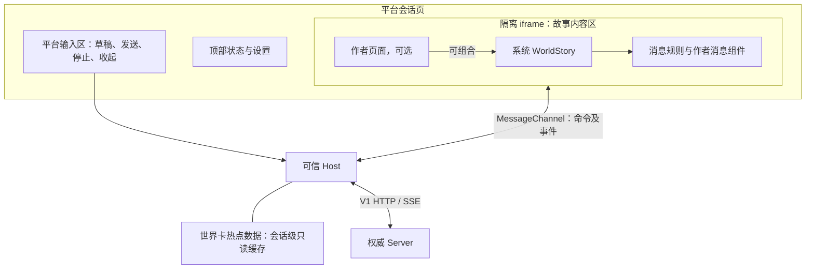

# SR.WorldStory、平台会话区与交互消息设计

状态：首版已实施，自动检查与隔离浏览器验证已完成；断线不重放、首屏读取竞态及富文本限制仍按本文约定。本文基于本次对话中的产品决定和实施时的代码调查，不以旧设计文档作为现状依据。执行拆解见 [任务清单](sr-worldstory-tasks.md)。

## 1. 目标与边界

- 平台始终提供会话顶部栏、连接及运行状态、设置入口，以及默认展开、用户可收起并可重新打开的输入区。创作者不能遮挡、替换或禁用这些平台入口。
- 故事内容区由创作者控制；世界卡未配置自定义页面时使用系统内置 `SR.WorldStory`。已配置的作者页面整体异常时显示“世界卡数据异常”，阻止继续会话，不切换或回退至 `WorldStory`。
- `SR.WorldStory` 展示按 Run 组织的历史、实时消息和状态，并支持世界卡的消息展示规则。它是随产品发布的代码组件，可被作者页面直接组合；它不承载平台输入框。
- 正则仅用于消息展示；作者可以把匹配片段替换为静态 Markdown/HTML 或注册的 React 消息组件。所有消息组件共用一个 TSX 模块 `component_source`。
- 组件通过公开 SDK 更新状态、发消息；消息原文、模型上下文与已持久化数据不因展示转换改变。
- 本期实现基础输入、发送、停止、历史和显示规则；AI 帮答、直接续写、重生、生图、语音只是未来的平台能力，不实现或预置占位按钮。尤其重生的历史与多 scope 状态回退需另行设计，不能用删除最新消息冒充实现。
- 不实现酒馆卡或脚本直接兼容、自动导入、任意 JS HTML 或第三方服务接入。可用怪谈社的交互作为手工改写的验收样例。

## 2. 现状调查（本次以源码为准）

1. `apps/web/src/host.tsx` 持有 SSE、处理 MessageChannel、读取世界卡并编译 `ui.source`；仅渲染顶部栏与 iframe，没有平台输入区。输入区不是当前已实现功能。
2. `apps/web/src/frame.tsx` 在 `sandbox="allow-scripts"` 的 iframe 内执行创作者 TSX；无自定义页面时 `PendingOfficial` 只是占位。`packages/sr-sdk/src/index.tsx` 的 `SR = {}`，没有 `WorldStory`。
3. `SessionRuntime.setDraft()` 目前只更新 iframe 内存中的草稿；Host 不认识草稿命令。将输入区移出 iframe 必须改此链路，不能沿用原有本地草稿。
4. `RichText` 当前基于 marked + DOMPurify 静态渲染；没有消息正则、交互组件映射或完整的作者 HTML 文档能力。原 `apps/web/src/live-messages.ts` 使用旧事件格式和旧历史结构，不能直接当作 V1 实现。
5. `world-card.ts` 仅声明 `ui: {type:'react',source:string}`，未声明的普通字段经 Zod 解析会被剥离。消息规则需要明确加入 schema、导入、存储、读取与导出，并增加失败诊断。
6. Server 创建会话时即持久化一条 Assistant 开局消息，状态初始化来自所选开局；`GET /sessions/:id/runs` 返回 `{id,status,messages}`，最新历史页按时间正序，每页最多 20 Run。会话创建前的开局切换是当前行为；不在本期承诺会话内切换开局或回滚初始状态。
7. SSE 提供 `run.created/delta/completed/failed/stopped` 和 `state.changed`；`run.failed` 可能发生于用户消息创建前。提交 Run 返回 202，代表接受而非模型生成成功。Host 现以读取最新 tip 后提交 Run；不承诺断线事件重放或流式缺口修复。
8. `frame.html` 使用隔离 iframe、`connect-src 'none'` 和固定 import allowlist。编译器以 esbuild 生成 CJS；目前 frame 只接受默认导出的页面函数。新增消息模块需要独立导出校验，不能当成页面默认导出执行。
9. 前置工作已将原先引用已删除文档的测试样本改为测试目录内的独立夹具；最终 `pnpm test` 为 27 个测试文件、74 项测试通过。既有旧同步流式回归仍按用户要求移除，本方案实施时需补充与本期相关的行为测试。

## 3. 页面组成与交互



- 默认路径：创建会话后打开会话；顶部呈现会话名称、连接/运行状态；内容区加载 `WorldStory`，第一条历史为开局；输入区可输入、发送和收起。
- 输入区收起后显示始终可键盘操作的展开按钮；展开状态仅本页内存，不新增持久化。新会话和刷新默认为展开。内容区跟随容器收缩；375px 与 1280px 均应能操作，不覆盖内容或横向溢出。
- 输入区是平台 React 界面，不位于作者 iframe 内；Host 不维护消息历史或状态快照，输入区可维护草稿和提交过程所需的轻量 UI 状态。
- 作者内容区在受约束的 iframe 内全尺寸布局；作者可通过自己的页面放置多种组件、按钮、抽屉和弹窗，但只影响 iframe 内区域。状态栏不做一套新的布局 DSL；缺省 `WorldStory` 提供标准可展开状态概览，作者需要自由布局时组合系统组件及自己的组件。
- 键盘：发送默认 Enter，Shift+Enter 换行；中文输入法组合期间 Enter 不发送；提供明确发送/停止按钮及标签。收起时将焦点移至展开按钮，错误可被屏幕阅读器感知。状态变化与错误不能仅靠颜色传达。
- 页面加载、空会话、不存在、初始历史失败、断线及局部消息组件失败均有可读提示和对应恢复入口；作者自定义页面整体异常按第 4.4 节阻断会话。默认 WorldStory 首屏已订阅且初始化完成前，平台发送按钮禁用；作者自定义页面不强制依赖 WorldStory，但需完成配置加载、iframe 握手、页面根组件首次挂载及事件连接后才可发送；首次挂载成功只代表当前就绪，不保证后续异步代码不会报错。初始历史失败允许重试；断线期间阻止发起新 Run、保留草稿，恢复后允许发送；停止按钮仅在已知活动 Run 时启用。

## 4. 输入区、SDK 与 Host

### 4.1 草稿所有权

草稿由平台会话页持有，每个已打开会话实例独立，组件切换或 iframe 重建不清空；刷新和切换会话按新实例初始化为空，不写 DB、localStorage 或模型上下文。`SRSessionAPI.setDraft(text): void` 语义不变（整体替换、不发送），实现由 iframe 本地改为经受限 MessageChannel 单向 `session.setDraft` 发送至平台。无需新增公开的草稿订阅或读取 API。

平台验证发送者端口、字段类型与大小后更新草稿；消息端口不可用时调用无交付保证，Host 不持久化命令、不补发。输入区按同一长度限制校验文本。`setDraft` 不自动展开或聚焦输入框；用户主动展开后可见最新草稿。

### 4.2 发送及停止

输入区和 SDK `session.send(text)` 复用 Host 的同一命令执行器：前端校验非空，生成 requestId，读取当前 session tip，提交 `POST /api/v1/sessions/:id/runs`。服务端保留 world/session 锁、tip 冲突和幂等规则。发送成功仅代表 202 已接受；状态由 SSE 驱动，失败显示错误。

输入区点击发送后，冻结本次文本并防重复提交；202 接受且当前草稿仍等于本次文本时清空，否则保留用户后来输入；同步拒绝时保留草稿。作者 `session.send()` 不修改输入草稿。发送期间禁用提交；生成中允许编辑下一条草稿但禁用发送，并允许停止。

Host 保存当前活动 runId 和轻量生命周期状态，供平台按钮使用，不保存消息或状态快照。`run.created/delta/completed/failed/stopped` 按 runId 跟踪；请求 202 返回之前可能收到终态，按 runId 暂存本次请求的短生命周期终态，不能在 202 到达后重新标为运行；预检失败可能没有 `run.created`。停止使用 `POST /sessions/:id/runs/:runId/stop` 并等待响应，最终显示以服务端事件/结果为准；失败或重复点击不能创建新的 Run。

刷新或连接中断时只恢复接收后续事件，状态 Hook 按既有契约重读；本期不重放事件、不对历史或 delta 做重连对账，不保证断线前的流式消息继续合并。若无法确定活动 Run，则不伪造状态或展示可用停止按钮；刷新后历史按 Server 最新结果初始化。

### 4.3 Host 世界卡热点数据与 iframe 获取配置

Host 内增加独立的会话级世界卡热点数据模块，缓存当前会话关联世界卡中经校验的 `message_render`、状态声明及加载页面所需的 `ui.source`；编译结果也可按当前 source 复用。它是非权威的读取缓存，不是数据库，也不是消息或状态快照。Server 仍是世界卡与状态的权威来源。

进入会话时 Host 根据 session 的 worldId 获取世界卡，先加载并校验缓存，再编译页面和消息组件模块，通过已握手的 MessageChannel 将规则、状态声明和编译产物作为 frame 初始化只读配置发送。默认 `WorldStory` 与作者页面中的 `WorldStory` 读取同一份 iframe 内配置；自定义组件可按已定义的上下文读取相关配置，但不可获得 Server HTTP 能力或凭据。发送与接收应限定字段、来源、大小与版本，TSX 仅在 iframe 内执行。`message_render` 规则由系统渲染器消费；不因此新增未确定的公开 SDK 配置 API。

热点数据生命周期限定于当前会话：切换会话时清除旧缓存并重新读取，刷新页面重新加载；iframe 切换或重建时复用当前会话缓存并重新传入。会话运行中不监听世界卡修改、不承诺热更新；如需要读取新版，用户重新进入会话或刷新页面。异步请求须按会话代次丢弃迟到结果，防止串会话；读取失败显示错误并允许重新加载；作者自定义页面编译失败按第 4.4 节阻断会话，不回退到系统界面。缓存与当前状态无关，`SRStateAPI` 的读取仍直接通过 Server，不得从该缓存返回状态值。

### 4.4 作者自定义页面整体异常

已配置 `ui.source` 时，源码加载、编译、模块求值、默认导出校验、页面根组件挂载或渲染失败，进入平台级阻断状态并显示“世界卡数据异常”。不自动切换或提供手动切换到 `WorldStory` 的入口，也不在尚未完成源码加载时误把空编译结果当成无自定义页面。用户可返回世界卡或会话列表，也可重新加载并重新尝试同一作者页面；仅成功重新初始化后才能恢复会话。

进入阻断状态后，平台输入区禁用新发送，Host 拒绝该 iframe 的新 `session.send`、`state.write` 和 `session.setDraft` 命令，卸载/隔离出错页面；保持退出入口可用。若已知有正在运行的 Run，Host 发起停止请求并显示停止进度/失败结果；若阻断前已发出的创建请求稍后才返回 Run ID，接到结果后也发起停止；停止由 Server 确认，不能承诺已经提交的状态更新或已经发出的请求被撤销，发送/状态写入在阻断前已进入 Server 的结果按服务端实际提交结果处理。不能创建新的 Run 或恢复执行作者交互来继续会话。

消息匹配失败及消息组件自身被局部错误边界捕获的渲染错误，仍按第 8 节保留原文和局部提示，不等同于作者页面根组件整体异常。全局未捕获异常或异步错误若无法归属具体消息组件，按页面整体异常处理；错误边界不保证捕获所有异步异常，也不能保证发现阻塞线程的死循环。记录规则/错误类别而非源码、提示词或消息正文。

## 5. WorldStory 契约

建议公开 API，具体样式名称在实现中固定并文档化：

```tsx
import { SR } from '@sr/sdk';

export default function MyWorld() {
  return <main className="layout"><Map /><SR.WorldStory /><MyPanel /></main>;
}
```

- 无自定义 `ui.source` 时，frame 内自动挂载 `SR.WorldStory`；有自定义页面时作者可嵌入零个或多个组件。每个 `WorldStory` 实例拥有独立视图状态；一般推荐只渲染一个以免重复展示。
- 默认提供垂直消息流、顶部加载更早 Run、生成中反馈、空/错误/重试及滚动到最新消息；上拉加载保持原有可视锚点，用户阅读历史时不强制滚动到底，提供“回到最新”按钮。
- 默认状态概览使用 SDK 的状态订阅/读取，不依赖 Host 快照；宽屏右侧、窄屏默认收起并可打开。它是系统的默认可视化，不限制创作者在自己的页面里以多个组件自由实现状态交互。根据现有只按 path 查询的 SDK，状态概览所需声明与初始路径由 Host 从世界卡传入 frame 的只读配置；当前值通过 SDK 获取。不可直接向作者暴露 Server HTTP 或凭据。
- 初始化先订阅 Run 事件，再读取第一页；加载期间临时缓冲事件。历史已包含的 Run 以查询快照为初值，不重复追加其缓冲 delta；历史未包含的新 Run 按接收顺序应用缓冲事件。已有 Run 的缓冲终态仍应用其完整 messages。历史查询取快照至响应之间，该 Run 的部分 delta 可能暂时缺失；收到后续终态时显示其完整 messages。之后只处理实时事件，不读取/补偿断线期间的事件。此规则无需修改现有公开 RunEvent，但不保证进入正在生成的会话时首屏流式文本无缺口；不做 offset 对账或断线重放。按最新历史页正序呈现，分页游标沿用服务端，limit 不超过 20。
- `run.created` 添加其 messages；`delta` 按 messageId 追加到相应 Run 的 Assistant 消息；终态用事件中的完整 messages 替换该 Run 的可见消息并设置状态，避免遗漏最终文本；失败无 messages 时显示 Run 级错误。不同 Run、不同 messageId 不拼接。流式渲染数据只保存在 `WorldStory`，不是 Host 的权威状态。
- 为历史首屏与实时事件竞争编写确定性测试，明确展示允许出现的临时缺口及终态修正；终态消息可能为空，不得据此删除其他 Run。失败和停止状态需可见；当前没有 Run 暂停事件，不承诺展示暂停状态；不在 `ChatMessage` 新增 status/createdAt。

## 6. 世界卡数据契约

在现有 `data` 下新增可选 `message_render`，沿用 `ui.source` 作为自定义**页面**模块；消息组件使用单独且唯一的 `component_source`。两者职责不同，不需要把页面与消息组件强行合并；创作者只需消息组件时可以省略 `ui`。示例是相关字段片段：

```json
{
  "message_render": {
    "rules": [
      {
        "id": "cover",
        "roles": ["assistant"],
        "pattern": "<KaidanCoverImpl\\s*/>",
        "flags": "g",
        "replacement": { "type": "component", "component": "KaidanCover" }
      },
      {
        "id": "ritual",
        "roles": ["user"],
        "pattern": "\\[怪谈社·仪式开启：(启封初遇|逢魔照夜)\\]",
        "flags": "g",
        "replacement": { "type": "html", "content": "<div class=\"ritual\">✦ $1 ✦</div>" }
      }
    ],
    "component_source": "export default { /* TSX 中定义的组件 */ }"
  }
}
```

- `message_render`、`rules`、`component_source` 可选；无规则时按普通消息渲染。`rules` 有序，`id` 非空且唯一；`roles` 必填、非空且仅支持 `user`/`assistant`；开局是 assistant 消息，不新增 message 元数据或专用角色。
- `pattern` 是 JavaScript 正则源字符串，不包含 `/` 分隔符；JSON 中反斜杠按 JSON 转义。`flags` 允许 `g`, `i`, `m`, `s`, `u`，字符不重复；省略为 `g`。禁止 `y`/`d`/`v`；`g` 存在时替换所有非空匹配，否则替换首个匹配。禁止零长度匹配：某条规则匹配到空字符串即停止该规则并回退原片段，给出可诊断错误。
- `replacement` 为判别联合：`{type:'markdown'|'html',content:string}` 或 `{type:'component',component:string}`。字符串替换支持 `$$`、`$&`、`$1`…`$99` 和 `$<name>`，采用 JS replace 对应语义；未命中的捕获组为空字符串。组件名称为非空标识符，引用不存在时显示规则错误并原样呈现该匹配，不隐藏消息。
- `component_source` 仅一个 JS/TSX 模块，默认导出名称到 React 组件的普通对象；名称唯一。只有组件类型规则才要求存在该字段；导入阶段验证结构、正则语法和组件字段存在，编译及注册表校验发生在运行时；不可静态声称能确定动态导出是否有效。设置大小上限：规则最多 100 条、pattern 最多 2,000 字符、单个替换最多 100,000 字符、组件源最多 1 MiB；沿用服务器既有上传上限。
- 当前 `world-card.ts` schema、读取/导出路径及前端类型需共同增加字段；导入导出应无损保留顺序、字符串和源码。旧世界卡省略字段照常使用默认渲染，不需要迁移其内容。无须为这些配置另建数据库表；它们属于世界卡数据，导出随世界卡携带。

### 6.1 单一消息组件模块

```tsx
import React from 'react';
import { useSRSession, type MessageComponentProps } from '@sr/sdk';

function KaidanCover() {
  const session = useSRSession();
  const [busy, setBusy] = React.useState(false);
  const [error, setError] = React.useState('');
  async function start() {
    if (busy) return;
    setBusy(true); setError('');
    try {
      // 初遇状态由创建会话时选中的 opening.initial_state 设置。
      await session.send('[怪谈社·仪式开启：启封初遇]');
    } catch { setError('操作未完成'); }
    finally { setBusy(false); }
  }
  return <section><h2>怪谈社</h2><button disabled={busy} onClick={start}>启封初遇</button>{error && <p role="alert">{error}</p>}</section>;
}
// srDisplay 缺省为 block，显式声明有助于阅读。
KaidanCover.srDisplay = 'block';
function Choice({ namedGroups }: MessageComponentProps) {
  return <button>{namedGroups.text}</button>;
}
Choice.srDisplay = 'inline';
function StatusPanel() { return <aside>作者自定义状态栏</aside>; }
export default { KaidanCover, Choice, StatusPanel };
```

这是目标 API 示例，`send()` 返回 202 并不代表生成成功。开局的默认状态由 `opening.initial_state` 在创建会话时初始化；按钮只需发送用户消息。另一个选项若需要不同状态，可先逐项更新并检查结果再发送，每项独立提交，部分失败不会回滚；这不是事务。重复点击锁只在组件当前挂载期间有效，重载后是否允许再次执行由作者根据已持久化状态判断；不能宣称跨刷新恰好一次。

组件均接收以下只读 props，捕获内容视为不可信纯文本：

```ts
type MessageComponentProps = {
  match: string;
  groups: Array<string | undefined>; // 下标 0 对应正则的第一个捕获组
  namedGroups: Record<string, string | undefined>;
  message: { id: string; role: 'user' | 'assistant' };
  runId: string;
};
```

`match` 为完整匹配，`groups` 是编号捕获组，`namedGroups` 是命名捕获组；捕获值为原始字符串或 `undefined`，组件负责按需解析并校验数字、JSON 等。无命名组时 `namedGroups` 为空对象；正则多次匹配时每次独立创建组件实例和 props。组件通过 `message` 和 `runId` 识别所属消息与 Run。不要以捕获文本直接当做动作命令或执行代码。

组件自身的静态属性 `srDisplay` 声明排版：`inline` 为行内，`block` 为块级，未声明默认 `block`。模块加载后、消息解析前读取并验证该属性；其他值视为注册错误，相关匹配保留原文并显示诊断。世界卡规则不配置 `display`，避免重复；同一组件需要两种布局时注册两个分别声明布局的包装组件。属性只声明插入位置，不改变组件最终输出：作者应保证 `inline` 输出可合法嵌入段落，不能返回块级 `<div>`；运行时若可检测到无效嵌套则隔离该匹配并提供诊断，不能承诺穷举验证任意自定义组件的最终 DOM。

不向组件传入可变原始消息对象、HTTP 客户端或凭据；组件可通过既有 SDK 读取状态和订阅事件。

## 7. 规则执行与流式渲染

- 正则先对完整原文查找原始 UTF-16 区间，再将区间映射到 Markdown 结构。按规则顺序、匹配顺序接受无重叠范围；较早规则优先，后续与已接受范围重叠的匹配跳过。替换结果不可作为后续规则的输入；每次始终从原文重新计算。组件注册、捕获组和 UI 替换不改变原文。
- 匹配整个 `<KaidanCoverImpl/>` 等自闭合占位标签时允许替换，即便 Markdown 把它识别为 HTML 节点；普通行内文本、完整原始 HTML 节点及完整连续块范围可作为匹配，支持多行捕获。静态替换与组件规则均遵守相同的范围选择，`inline` 只能映射为合法行内位置，`block` 在段落内会将前后文本拆为合法块。
- 保留 fenced/缩进代码块、行内代码、链接目标和 HTML 标签/属性的保护：不得替换这些区域内部的局部范围；完整占位标签例外。切穿 Markdown 标记、HTML 属性或其他无法形成合法节点的匹配应保留原文并诊断，不影响其他匹配；不承诺任意跨结构正则均可替换。通过结构化解析和源位置映射实现，不把原文按匹配位置简单拆成独立 Markdown 字符串。规则匹配不自动执行状态操作。
- 未命中文本与 Markdown 替换由 Markdown 解析器处理，HTML 替换走安全 HTML 管线，组件是受控 React 节点；保持解析器、规则执行及组件注册分层，以便将来替换为支持组件的 MDX 渲染实现。第一版不对 AI 消息执行 MDX 的 JS 表达式、import/export，不承诺直接兼容任意 MDX 或酒馆 HTML；后续选择 MDX 前需验证流式不完整语法、HTML 兼容、输入隔离与渲染性能。DOMPurify 是 HTML 清理工具，并非 CSS 清理器；CSS 安全另行验证。参见 [MDX 官方介绍](https://mdxjs.com/docs/what-is-mdx/) 和 [DOMPurify 安全边界](https://github.com/cure53/DOMPurify/wiki/Security-Goals-%26-Threat-Model)。
- 流式 delta 到来时在消息级合并后重新计算展示；完整占位符出现才挂载组件，部分匹配保持原文。稳定键由 messageId、ruleId、该规则匹配在消息中的序号及起始位置组合；已有匹配未变化时应保持组件实例，匹配本身改变则允许卸载重挂。不得在 render 阶段发消息；组件按钮由用户点击触发。
- 在最终事件收到完整消息后用最终文本重新渲染；停止和失败仍展示已提交文本。断线期间丢失的 delta 不补偿；终态若在重连后收到则按其完整 messages 呈现，不承诺终态一定送达。
- 匹配耗时不能阻塞 iframe 或主线程。当前 `sandbox="allow-scripts"` iframe 为 opaque origin，经 Chrome 小原型验证无法直接 `new Worker('/worker.js')`（SecurityError），即便指定 `worker-src 'self'` 亦如此。因此由可信 Host 创建同源打包的固定平台正则 Worker，iframe 通过已校验的 MessageChannel 提交规则与消息，Host 临时转发并返回结果，不持有消息快照。只允许运行固定 worker 代码，不能把 source 当脚本执行；限制并发与请求大小，页面切换时销毁 worker、拒绝挂起任务，不记录正文。
- 为单条规则和整条消息分别设置时间预算，并限制匹配数量、输入/输出大小（初始验收建议每规则 50ms、每消息总预算 250ms、最多 500 个匹配、输出不超过 1 MiB；worker 启动开销单独计量）。超限终止 worker，未完成部分保留原文并提示；流式更新合并调度，带消息版本的旧响应不可覆盖新结果。Host worker 在其响应设置严格 CSP，限制网络与可加载资源；浏览器端验证 CSP 和超时，不能假定继承 iframe 的 CSP。该方案已用简化 Chrome 测试验证可跨 opaque iframe → Host → Worker 传递并匹配占位符，未证明生产集成、性能或安全验收已完成。

## 8. HTML、TSX 与隔离

- 作者代码只在 `sandbox="allow-scripts"` 的 opaque-origin iframe 内执行；保留现有 CSP 对脚本连接的 `connect-src 'none'`、禁止动态 import、保持 import allowlist，不暴露父 DOM、凭据或受保护 HTTP。当前 CSP 允许 HTTPS 图片和媒体资源请求，不能称为完全禁止网络；保留现状不等于无信息外传风险，远程资源策略需独立评估，不为本功能放宽。系统 `WorldStory` 也在 iframe 中，以同一个 React/SDK 实例挂载。
- 原消息、正则替换文本、HTML 内容、捕获组均是不可信数据；默认不执行 script、`on*`、javascript URL、表单、iframe、外部样式与主动网络请求。替换 HTML 经过 DOMPurify 等白名单处理；不得通过 `dangerouslySetInnerHTML` 直接插入未净化字符串。
- 本期 HTML 替换支持安全的 HTML 片段与内联样式；不承诺 `<html>/<head>/<style>` 完整文档或任意全局 CSS 生效。需要复杂布局、样式和交互时使用作者 React 组件。富文本可通过 HTTPS/data 图片展示，资源策略以现有 iframe CSP 为上限。
- 两个作者模块由编译器分别编译；共享 frame 的 React、SDK，但模块作用域独立，互不自动 import。消息模块必须默认导出普通对象，值是有效 React 组件；页面模块仍默认导出 React 页面组件。消息组件模块只在加载成功时注册；不支持跨模块动态 import。
- 组件按消息实例隔离 React 错误边界：组件渲染及生命周期错误回退该匹配内容并提示，不影响其他消息和平台输入区；React 错误边界不保证捕获事件处理器/异步回调错误，也不能中断死循环，需分别处理全局错误及故障回退，不能声称 iframe 必然具备 CPU 隔离；模块编译/导出错误则所有引用该模块的匹配退回原文，同时提供诊断。作者自定义页面整体失败时按第 4.4 节阻断会话，不切换系统界面；没有自定义页面的系统模式应用世界卡消息规则，消息模块失败可降级为原始消息。
- creator 代码可自行调 SDK；事件通知只反映服务端已提交结果。原始消息/状态值不得写入普通日志，诊断仅记录规则 id、错误类别和范围，不输出源码、消息内容或凭据。

## 9. 开局、状态与怪谈社验收映射

当前会话创建已经把所选 opening 持久化为第一条 Assistant 消息；不另建特殊“按钮开局”对象。怪谈社可将开局改写为 `<KaidanCoverImpl/>`，配置组件规则；将 `initial_state` 设为初遇选项的默认状态。`KaidanCover` 显示多个选项：初遇按钮直接 `send()`；夜话按钮对与默认状态不同的字段调用 `batchUpdateState()`，检查逐项结果后再 `send()`。用户消息通过第二条静态规则展示。可把状态面板作为另一个消息组件，或作者页面中的独立组件，位置由作者布局控制。

初始状态和按钮状态更新遵循现有四种类型、scope 默认 message、JSON 字段整体替换、批量逐项结果；不把状态变化和发送伪装成事务。不依赖酒馆 DOM、MVU 或执行其原始脚本。世界书激活需按当前 Server 的共享 load 规则单独配置；正则展示不改变触发文本。

## 10. 验收与验证

1. 无 ui、无规则的世界卡可从开局进入默认界面，输入、发送、流式展示、停止；375/1280 可访问，输入区可收起/打开。
2. 自定义页面中同时组合 `SR.WorldStory`、多个状态组件和按钮；组件弹窗不覆盖平台栏。作者页面加载、编译及运行时整体报错显示“世界卡数据异常”，阻止新请求及继续会话，不出现系统界面回退；重新加载成功后才恢复。
3. 普通消息、开局、用户和 AI 消息分别命中正确规则；Markdown/HTML 与组件混排；两个以上组件出现在同一条消息；完整匹配及编号/命名捕获组、行内/块级及缺省 block、规则顺序、未匹配、无效引用/布局、超时、恶意 HTML 与空匹配可验证。
4. 开局默认按钮无需更新状态，另一个按钮可更新状态并发送消息；部分失败不发送、已成功项不回滚；`setDraft` 显示在平台输入区，输入区收起仍保留草稿；作者直接 send 不清除草稿。
5. 历史按 Run 分页、实时多消息、初始拉取竞争、预检失败无 created、停止、断线后无事件重放、iframe 重建及组件错误均可复现；不承诺未实现的对账。
6. 导入/导出保留消息规则和组件 source，旧卡不带字段可使用；消息原文与 Server 历史、构建的模型上下文未被 UI 转换改写。
7. 执行 `pnpm typecheck`、`pnpm lint`、`pnpm test`、`pnpm build`；使用临时数据库和模拟 Provider 做端到端，浏览器在 375 与 1280 检查显示与键盘交互；记录验证结果、已移除旧测试造成的覆盖缺口和未覆盖项。不得使用真实计费调用或清理用户数据库。
