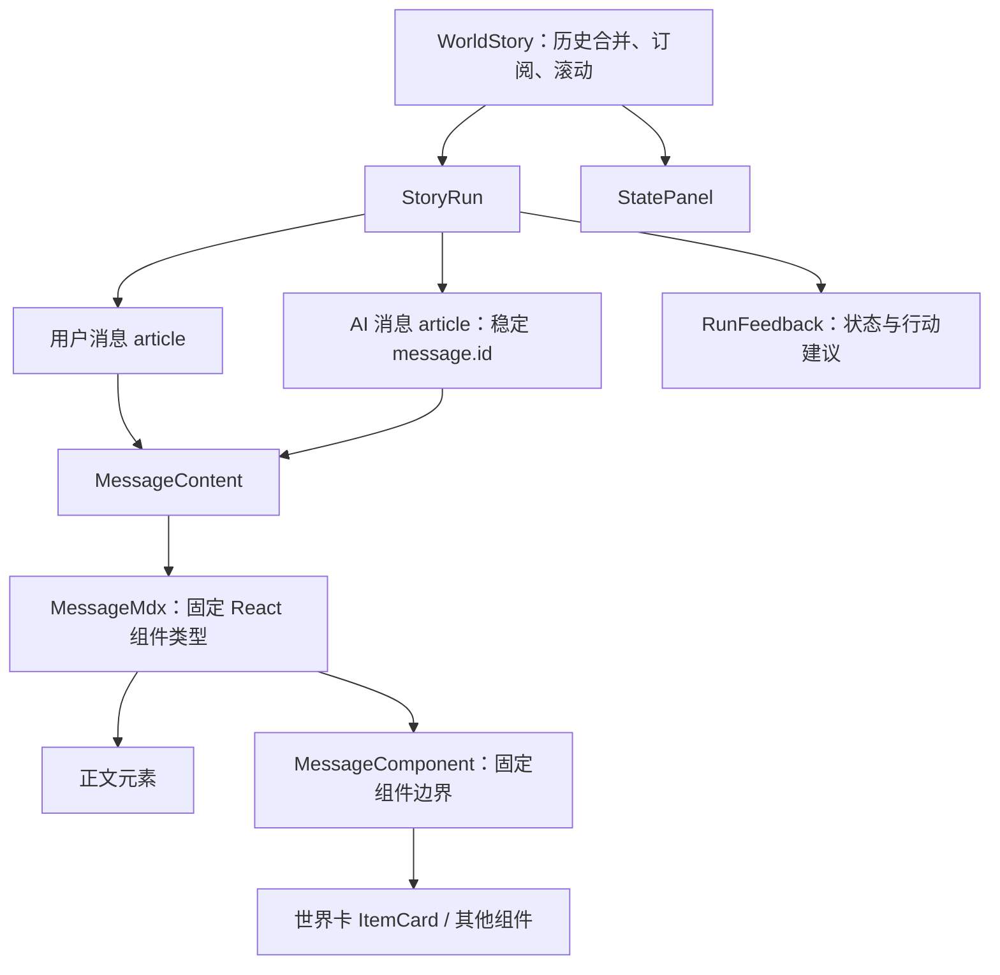

# WorldStory 消息 MDX 渲染方案 v1

> 状态：待实施方案；本文和任务清单的写入不代表代码已改造或验证已通过。
> 日期：2026-11-15。
> 配套任务：[执行任务](./sr-worldstory-message-mdx-v1-tasks.md)。
> 基线：当前工作区的 Studio + Server、世界卡共享 components、SDK MessageContent；工作区存在其他未提交重构，本方案以当前文件为证据，不覆盖这些变更。

## 1. 产品效果与范围

玩家继续在 WorldStory 中阅读会话。每条消息的正文通过 MDX 编译链生成 React 内容，正则匹配片段成为世界卡组件；普通段落、列表与交互组件处于同一棵 React 树。世界卡作者继续配置正则、提供 React 组件，不要求模型生成组件代码。

本次替换的是消息展示链路，不改变 SRRuntime、模型请求、状态提交、Run 生命周期、消息存储、Host 输入框或 SSE 协议。不新增数据库字段、迁移、服务端 MDX 接口、公共 SDK 渲染 API，也不自动修改世界卡。

具体覆盖：

- WorldStory 中普通 assistant/user 消息共用新正文渲染器；规则仍按 roles 筛选。用户消息保留角色扮演指令与转义语义。
- 第一条 origin=opening 的消息使用同一安全正文渲染链，但继续跳过 message_render 规则。
- 世界介绍、开局预览、角色/世界书静态文档不改为消息 MDX；它们的独立 iframe 和权限保持现状。
- RunFeedback、状态面板、行动建议、加载历史和输入框不进入 MDX。
- 作者舞台只有主动使用 SR.WorldStory 才进入这条链路，不向自定义舞台注入 WorldStory。

第一版将 MDX 作为内部编译与渲染机制。原始消息仍是 Markdown/兼容 HTML 文本；只有平台根据有效规则生成的节点才能调用组件。开放模型直接书写任意 JSX、表达式、import/export 不属于本次范围。

## 2. 最终结构与示例



例如模型原文为：

```text
商人把装备放到柜台上。

[物品:长剑|价格:100]
[物品:皮甲|价格:80]

“选一件吧。”
```

沿用现有世界卡规则结构：

```json
{
  "id": "item-card",
  "roles": ["assistant"],
  "pattern": "\\[物品:(?<name>[^|\\]]+)\\|价格:(?<price>\\d+)\\]",
  "flags": "g",
  "replacement": { "type": "component", "component": "ItemCard" }
}
```

作者组件继续使用现有 props：

```tsx
export default function ItemCard({ namedGroups }) {
  return (
    <section className="item-card">
      <strong>{namedGroups.name}</strong>
      <span>{namedGroups.price} 金币</span>
    </section>
  );
}
```

展示层构造的内部 MDX 等价形式为：

```mdx
商人把装备放到柜台上。

<SRMessageComponent bindingId="item-card:16" />
<SRMessageComponent bindingId="item-card:32" />

“选一件吧。”
```

上面的 ID 仅为示意，实际使用原文 UTF-16 start 和 ruleId 生成。生成的是带来源标记的 AST 节点，不把用户内容拼成 MDX 字符串。bindingId 对应本条消息的内存参数表，表中包含 componentId、match、groups、namedGroups、message、runId。它不写入数据库、不嵌入源码、不接受原文伪造。

最终渲染相当于：

```tsx
<article data-message-id={message.id}>
  <span className="sr-message-source">故事</span>
  <div className="sr-story-content">
    <p>商人把装备放到柜台上。</p>
    <ItemCard {...firstMatchProps} />
    <ItemCard {...secondMatchProps} />
    <p>“选一件吧。”</p>
  </div>
</article>
```

`<ItemCard name="长剑" price="100" />` 可以用于解释视觉效果，但不是本版新增的公开契约。第一版不增加 props 模板、表达式求值或自动把 namedGroups 展开到 props，避免覆盖 message/runId、children 等字段。需要数字时由作者组件显式转换字符串。后续直接 props 映射另立小范围契约变更。

## 3. 当前实现与改造点

| 当前模块 | 当前行为 | 本方案变化 |
| --- | --- | --- |
| SDK world-story.tsx | StoryRun 按 message.id 渲染 MessageContent，RunFeedback 独立 | 保持层级与历史 reducer |
| SDK message-content.tsx | 正则匹配后生成 HTML 插槽；清洗后手工更新 DOM、createPortal 挂组件 | 保留准备/回退职责，正文换成固定 MessageMdx |
| SDK message-matching.ts / message-ranges.ts | 提取原始偏移、捕获组、保护语法区间、规则优先级 | 保持语义与原始 UTF-16 坐标；输出交给 AST 转换 |
| Studio message-matcher.ts / worker | Host 调度受限正则 Worker | 保留现有消息匹配协议与限制 |
| Studio frame.tsx | 在隔离 iframe 内缓存加载规则引用的世界卡模块 | 复用组件注册表和模块实例 |
| SDK world-document/render.ts | marked + DOMPurify，URL/CSS/内部属性限制 | 静态文档保留；消息 AST 清洗必须保持同等策略 |
| SDK message-dom.ts | 手工协调消息 DOM 与 Portal 插槽 | 验收后删除无消费者的消息 DOM 路径 |

当前组件 props 是 `match/groups/namedGroups/message/runId`；srDisplay 为 inline 或 block，未声明按 block。现有 message-portal 浏览器用例已验证追加文字后计数器状态不丢失，这是迁移基线，不是可选优化。

## 4. 技术路线：Markdown 兼容输入，MDX 统一输出


### 4.1 输入与规则顺序

1. 冻结当前 text、role、origin、规则/组件版本，生成本地 revision。
2. 继续通过 Host 正则 Worker 在原始文本上匹配；角色扮演解析也使用同一份原文。
3. 校验 text.slice(start,end) 与 match 一致；先排除代码、链接目标、标签属性、指令和跨结构的无效匹配，再按规则声明顺序解决重叠。后续规则不能作用于前面规则生成的内容。
4. 使用原文区间构建转换片段。component 生成 bindings 和内部节点；markdown/html 替换继续支持现有 `$&/$1/$<name>/$$` 语义，但替换结果仍作为不可信显示内容，不能生成可执行节点。
5. 完整文本作为一个文档解析，不简单按空行切割；保留引用式链接、列表、表格、围栏和跨段语法。变换必须维护原文到展示文本的区间映射。

不承诺任意正则可以自动判断“未来不会再变化”。只对当前快照中成功匹配、结构合法的范围生成组件；追加文本可能改变贪婪匹配结果，此时重新校验并更新参数。

### 4.2 MDX 编译配置与 HTML 兼容

建议使用 `@mdx-js/mdx` 的 Markdown 输入模式（`format: 'md'`），通过平台固定插件注入受控 MDX JSX 节点，最终输出 `function-body`。普通 `{...}`、import 文本不会因为进入渲染器变成 JavaScript。原始 `<ItemCard/>` 只有被展示规则完整匹配时才调用组件。

首个技术验证必须证明所选 MDX 版本的完整插件顺序：Markdown 解析 → 规则区间转换 → 原始 HTML 结构化 → HTML/属性清洗 → 仅平台节点转为 MDX 组件 → 编译。不能只验证一个普通 JSX 示例便认定旧消息兼容。

HTML 不能简单删除或按 JSX 解释。保留现有允许的 HTML、软换行、GFM 表格/删除线、链接图片、内联样式及 data-sr-markdown 展开效果；整篇 HTML 消息提取安全正文，文档 head 不进入会话。AST 属性须正确转换为 React 属性（例如 className/style），不重新开放原来禁止的标签/属性。

允许复用现有 DOMPurify、CSSOM/URL 校验函数做规范化，再转为 AST；这只产生编译数据，不向实际消息 DOM 写入插槽。roleplayMarkers/applyRoleplayMarkers 的语义也可先在脱离页面的安全片段中复用，之后映射回 AST，避免一次重写角色扮演格式。若使用标记连接阶段，必须是单次准备生成的不可预测标记，经过来源表核验并在编译前全部消费；不成为持久或公共协议。

MDX 标准解析与 marked 不完全一致，标记保护与最终 AST 必须共同校验插入合法性。兼容测试不通过时不能静默丢弃历史格式，也不能在生产中按解析成功与否来回切换两套含组件的渲染器。

### 4.3 外部组件引用与参数

世界卡仍保存 `components: [{id, component}]`，replacement.component 仍引用 ID。模块编译/加载复用现有 ui-compiler 与 iframe createModuleLoader；不增加第二个 React，不通过网络加载消息依赖。

内部 MDX 只映射平台组件 `SRMessageComponent`。它按 bindings 查找 componentId，再从已有 StoryConfiguration.components 取组件，传入完整的旧 props。组件 ID 不必是合法 JSX 标识符，也不会与原生标签或 MDX wrapper 名冲突。

组件映射概念示意：

```tsx
const mdxComponents = { SRMessageComponent: MessageComponent };

// 示意：render 是平台受限编译得到的无 Hook 纯渲染函数。
// bindings 通过本条消息的内部 Context 提供，不写进编译代码。
function MessageMdx({ render, bindings }) {
  return (
    <MessageBindingsContext.Provider value={bindings}>
      {render({ components: mdxComponents })}
    </MessageBindingsContext.Provider>
  );
}
```

MessageComponent 类型与 mdxComponents 映射必须稳定，不能每次创建绑定闭包作为新组件类型。世界卡组件作为 React 元素挂载，正常使用 Hooks；禁止直接调用作者组件函数。编译器产出的纯渲染函数是唯一可直接调用的特殊情况，须由技术验证检查其生成代码不含 Hook、用户函数定义或新建 wrapper 组件。

每个 MessageComponent 保留独立错误边界。缺失/失败组件只回退对应原始匹配文本，不拖垮整条消息。相同失效输入不会在每次 token 更新时重试挂载；组件版本改变或用户显式重试后才重置错误边界。MessageMdx 外层另有消息级错误边界，捕获生成函数执行阶段的异常，使用当前安全正文回退；不能只捕获 compile Promise 的异常。

## 5. 流式更新与 React 状态

### 5.1 固定渲染边界

禁止每次编译后以 `<NewCompiledMessage />` 替换整条消息的根组件。MessageMdx 始终是同一个 React 类型，通过调用受限生成函数得到元素树，让 React 对同类型元素进行协调。生成树必须固定根 Fragment/容器，避免从单个子节点变为多个子节点时改变根层级；这也属于编译产物验证和状态保持测试范围。

组件 key 使用 message.id、ruleId、原文 UTF-16 start 的稳定组合；不使用数组下标、文本全文哈希、revision 或随机值。绑定数据可更新，key 不随尾部追加改变。start 相同但命中规则或目标组件变化，按新的组件语义处理。

稳定 key 只能在稳定父节点下保持状态，不能保证跨父节点迁移。需给内容容器分配稳定标识，并在技术验证覆盖段落、强调、列表等常见追加场景。对于追加文本将既有组件包进新父节点的结构性重解释，本版允许该局部组件重挂载，不承诺任意 Markdown 改写下保留 Hook 状态；普通尾部追加不允许重挂载。若验证表明常见追加也频繁重置，则本方案不得直接替换 Portal，必须先修订渲染策略。

### 5.2 调度、竞争与结束

- 以现有约 60ms 合并更新为起点，始终处理最新快照；不对每个 token 同步编译。
- 同一消息最多一个执行中任务和一个待处理最新快照，旧结果根据 message.id/revision/规则版本丢弃。取消 useEffect 只能防止结果应用，不等于中断计算。
- 首次准备显示安全文本；更新中保留上一份有效渲染。不要把“旧渲染 + 原文新增后缀”直接拼接，否则规则扩展或重叠会重复内容。
- render、bindings、诊断和 revision 作为同一份准备结果原子应用；保留旧 render 时必须同时保留对应旧 bindings，不能让旧节点误读新参数表。
- terminal 到达后立即排入最终快照，排除旧流式结果覆盖；状态结束可以先显示，但正文渲染必须收敛到权威最终文本。显示层错误不得修改 Run 状态。
- 卸载时清理定时器、待应用结果和消息级缓存；迟到结果不得更新新会话。
- 停止时未完成标记作为文本；已完成匹配仍能显示。停止不因 MDX 触发任何状态写入。

### 5.3 缓存与性能门槛

终态历史消息按消息内容及规则/组件版本缓存；只保留已挂载消息的最近有效编译结果和当前任务，不建立无界全局编译缓存。翻页新增历史不应重新编译所有已有历史消息。

MDX 编译默认位于现有会话 iframe，正则继续位于 Host Worker。`compile()` 返回 Promise 不代表脱离主线程。首先记录 2K/20K/100K 字符、1 MiB 输入上限附近、500 个匹配、20 条已加载历史的耗时、内存和 gzip 包增量。基准使用固定浏览器版本、设备与 375/1280 视口，记录现有实现对照。

候选验收目标：20K 字符常规消息准备耗时 p95 不超过 100ms、普通流式追加不持续制造超过 50ms 的主线程长任务；超大消息不能让停止输入和会话切换失去响应。这些是待测目标，不是已验证结果。

若主线程方案不达标，实施前修订为有界 Worker 编译方案并单独评估 iframe CSP、浏览器 Worker 限制、清洗代码环境依赖及销毁超时，不通过增大防护限额或放宽 CSP 来掩盖问题。本版不提前建设通用编译任务平台。

## 6. 权限与失败行为

消息不可信，世界卡组件源码也不可信；二者权限不同。消息只提供显示数据，世界卡代码仍在现有隔离 iframe 内按 SDK/Host 权限运行。

- 不对原始消息使用 evaluate，不允许源文本或替换结果创建 ESM、动态 import、JS 表达式、spread、事件函数或任意 JSX 标签。
- 内部 JSX 仅由平台 AST 构造，只有受控组件名、bindingId 和稳定 key。校验绑定归属当前消息，排除 __proto__/constructor 等属性注入；HTML 清洗不能把伪造节点提升为平台节点。
- HTML/URL/CSS 继续遵守现有 message profile。组件白名单不能替代 HTML 清洗，DOMPurify 也不能替代 MDX AST 来源校验。
- MDX 生成代码仅在现有 iframe 执行；Host/Server 不执行消息代码。复用 iframe 的 React JSX runtime，不传入凭据、HTTP 客户端或任意模块解析能力。
- 现有 sandbox、CSP、connect-src、Host API 鉴权不放宽；编译加载方式必须在生产 build 和真实隔离 iframe 下验收。
- 显示组件的渲染/挂载不得被新增逻辑解释为自动执行状态更新。已有作者组件通过 SDK 发起的行为仍受原有权限控制。
- 保留当前匹配限额：输入/结果约 1 MiB、100 条规则、500 个匹配，Host 最多 4 个活跃任务、排队上限 100、单规则 50ms/总执行 250ms。分别处理匹配失败和编译失败，不宣称现有限额覆盖 MDX 计算。

| 情况 | 玩家看到的结果 | 生命周期/数据影响 |
| --- | --- | --- |
| 空消息、准备中 | 既有加载状态，不出现空组件报错 | 无 |
| 未完整匹配 | 普通文本 | 后续快照可以转换 |
| 单条规则超时或无效 | 原文 + 非阻塞提示；保留有效规则结果 | 不改变 Run |
| 匹配整体失败 | 当前安全正文 + 提示 | 不沿用旧 bindings |
| 组件缺失/报错 | 该片段原文 + 局部提示 | 其他组件和正文保留 |
| HTML/危险语法被过滤 | 安全正文；必要时合并显示诊断 | 不执行源文本 |
| MDX 编译/结构校验失败 | 当前完整安全正文 + “组件展示暂不可用” | 清除失效组件结果，不修改原文 |
| 流式旧任务迟到 | 忽略 | 不覆盖较新正文 |
| terminal/停止/历史恢复 | 以当前权威消息快照重新展示 | 不增加回放或持久化保证 |

整条消息回退可以复用现有安全文档渲染函数，但只显示普通正文，不回到旧 Portal 组件路径。回退必须保留用户指令面板、转义和 opening 语义；不能直接显示原始 HTML。

## 7. 兼容性与不扩大范围

| 合约 | 本版决策 |
| --- | --- |
| SR.WorldStory / SRSessionAPI / SRStateAPI | 公共签名不变 |
| 世界卡 components / stage_component | 不变；复用共享模块缓存与错误规则 |
| message_render 三种 replacement | component、markdown、html 全保留；不新增 mdx replacement 类型 |
| MessageComponentProps / srDisplay | 不变；block/inline 的合法插入位置继续验证 |
| message.text、id、runId、历史/SSE | 不变；原文是唯一持久化正文 |
| 原始 HTML、GFM、角色扮演格式 | 兼容用例通过后才能切换，差异必须列明处理 |
| 开局、介绍、静态文档 | 开局正文跳过匹配，其余展示入口不迁移 |
| `<sr_extensions>` | 不作为 MDX 组件协议，继续由叙事服务端处理 |
| React Portal 内部实现 | 拟由 React 子树替代；保留状态/身份要求，需要更新相关实现约束 |

当前 AGENTS.md 中“保留 keyed React portal slots”描述的是旧实现。本方案建议在验收后将其调整为“保留稳定消息/组件身份与流式交互状态”；规划阶段不改写现行约束。历史架构计划、technical 文档有部分已从工作区删除，本方案不恢复它们。世界组件现有正式规则以 docs/design/world-components.md 与现行代码核对，若冲突必须报告。

新增依赖限定为 MDX 编译器和兼容性验证必需的固定解析插件；候选为 remark-gfm、remark-breaks、rehype-raw。是否需要新增 AST 清洗依赖，由现有 DOMPurify 复用验证决定。使用 pnpm 锁定经过测试的具体版本，报告 gzip 增量，不增加 @mdx-js/react Provider、第二套 React、Next.js 或新 workspace 包。

## 8. 目标目录与职责

```text
packages/sr-sdk/src/
  world-story.tsx                 # 保持会话、Run、消息外壳
  message-content.tsx             # 调度、指令面板、错误/文本回退
  message-matching.ts            # 保留正则提取
  message-ranges.ts              # 保留区间与结构保护
  message-mdx/
    prepare.ts                   # 原文转换、AST、bindings、来源校验
    compile.ts                   # 固定 MDX 插件/配置、编译缓存键
    MessageMdx.tsx               # 固定渲染边界、bindings Context
    MessageComponent.tsx         # 组件查找、旧 props、局部错误边界
  world-document/render.ts       # 静态文档与安全正文回退；复用清洗策略
  world-story-roleplay.ts        # 保留语义，按需适配 AST 准备阶段
  message-dom.ts                 # 无消费者且迁移验收后删除
packages/sr-sdk/test/
  message-mdx.html
  message-mdx.tsx                # 原 Portal 用例迁入，增补流式/安全测试
apps/studio/src/
  frame.tsx                     # 复用现有模块加载，必要时稳定映射引用
  message-matcher.ts             # 保留现有 Worker 协议
apps/studio/test/world-document/run.mjs  # 注册新的浏览器测试入口
apps/server/test/
  message-matching.test.ts       # 保留规则语义
  message-ranges.test.ts         # 保留结构边界
  message-mdx.test.ts            # 新纯转换/编译测试，接入当前 Vitest 入口
```

以上四个新增 SDK 文件是职责边界，不要求为每一步建立类、注册表或插件框架。纯编译逻辑留在 SDK 内，避免反向依赖 Studio；作者 TSX 模块编译继续归 ui-compiler，本次不混成一个通用编译服务。

## 9. 验证与实施优先级

按配套任务 T1—T8 顺序执行。最优先是技术验证，不先删除 Portal 或修改世界卡契约。

必须覆盖：

- 同消息两个同名组件的不同捕获组、重复匹配、中文/emoji 的 UTF-16 偏移、缺失捕获组、引号/换行/花括号等数据。
- 单行/块级组件、代码块/行内代码/链接目标/HTML 属性保护、重叠优先级、零长度规则、Worker 超时。
- 现有 markdown/html 替换、GFM/软换行/HTML 文档/内联 CSS/data-sr-markdown、原始 `{}` 和 `<`。
- user 指令面板、对白/心理描写、转义、opening 禁用匹配。
- 计数器与输入框焦点在普通尾部追加中保持；重复编译不是重复挂载；结构性重解释的局部重挂载行为明确。
- 编译乱序、规则版本变化、会话切换、停止、失败、terminal 之后的旧结果、分页历史不重复编译。
- 伪造 binding、JS/ESM/spread/onClick 注入、危险 URL/CSS、模块循环/缺失、React 单例、Host 权限与 iframe CSP。
- 375px/1280px 实际截图、键盘交互、滚动位置、运行状态、组件失败及正文回退。

实施验证命令：`pnpm typecheck`、`pnpm lint`、`pnpm test`、`pnpm build`、`pnpm test:browser`。当前 lint 仅覆盖 Server；SDK/Studio 需要通过其类型检查、构建和浏览器用例，不得把 lint 成功说成全仓 lint。SDK 浏览器新入口必须接入 runner，不能只新增未执行的测试文件。

切换条件：技术验证、兼容/安全/流式状态门槛全部通过，才启用 MDX 正常路径并清理旧 Portal 路径。测试期允许内部选择新旧实现做对照，不新增用户设置或长期双引擎。回退版本只涉及渲染代码和依赖，无数据库回滚。

## 10. 资料与规划审查记录

官方能力依据：

- [MDX 编译器](https://mdxjs.com/packages/mdx/)：支持 md/mdx 输入、function-body 输出与运行阶段；运行生成代码仍涉及 JavaScript 执行。
- [MDX 组件注入](https://mdxjs.com/guides/injecting-components/)：components 映射可以传入外部 React 组件。
- [MDX 扩展点](https://mdxjs.com/docs/extending-mdx/)：支持固定 remark/rehype/recma 插件转换。

本方案的内部 binding、源码来源限制、直接调用纯生成函数以保持 React 身份、HTML 兼容桥接和性能目标是 SR 的工程设计，尚需 T1 验证，不是 MDX 官方提供的自动保证。

规划阶段已检查当前渲染/匹配/模块加载/清洗源码、相关单测与浏览器入口，未运行实现测试、安装依赖、修改产品代码或执行迁移。项目提及的 project-kickoff/product-design/quality-review skill 未在可用目录找到，本次采用项目工作流在同一 agent 内做独立复核。
