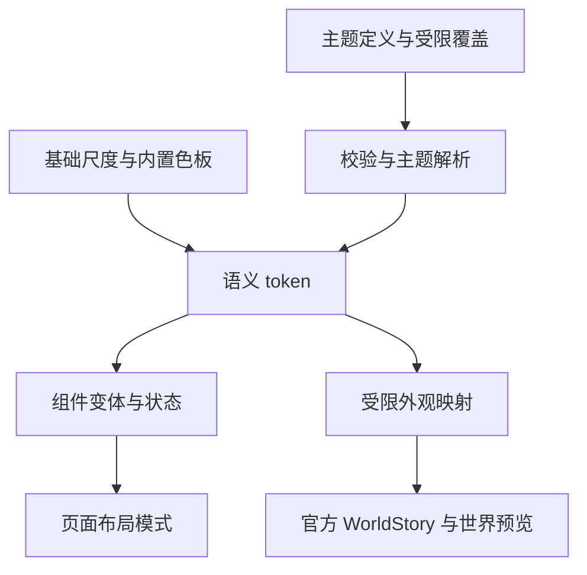

# Studio 组件、主题与布局统一设计

状态：设计方案已落地；现行组件 API、命名和验收以 [UI SPEC](../docs/design/UI-SPEC.md) 为准。日期：2026-11-18。
产品类型：具有世界卡创作、配置和故事阅读能力的应用界面。
配套任务：[studio-design-system-tasks.md](./studio-design-system-tasks.md)。

## 1. 目标与边界

统一的是组件的职责、视觉层级、状态与尺寸规则，而不是所有组件的外观。用户在页面之间切换，应能预测标题位置、操作等级、选择反馈、表单行为与导航行为；切换主题后，同一语义的颜色和材质应同时改变。

保留 React SPA、CSS Modules、CSS 自定义属性、Lucide 图标和现有双主题基础；Studio 本身不迁入 Tailwind，不引入新 UI 框架。iframe 中已有的 Tailwind 浏览器运行时只服务作者组件，不作为 Studio 设计系统的实现依赖。

产品方向：现代、克制、以内容为主；管理界面紧凑但有分组，故事阅读独立控制字号和行宽。沿用现有品牌方向，修正不合格的颜色配对，不在本轮重新选择品牌配色。营销站的大首屏、装饰性动效、整屏章节规则不适用于这些管理页面。

本方案涉及所有平台自有界面：五个主入口、世界／预设／模型详情、会话宿主、官方 WorldStory、弹层和反馈。作者内容保持隔离；不强制覆盖世界卡作者的明确样式。暂不制作主题商城、服务端主题同步或可视化主题编辑器。

## 2. 当前问题与需要保留的基础

- 已有 `styles/tokens.css`、`styles/themes.css`、共享 Button/Select/Modal，继续演进这些实现。
- 页面头部存在多个复制版本；相同语义的移动标题为 23/27/28px，顶部留白为 16/20/23px。
- 全局 `.button`、共享 Button、页面选择器同时定义控件；预设导入与新建采用不同实现。
- `business.css` 的 `.page button`、`.page label` 等广泛选择器使容器决定子组件样式，无法可靠复用。
- 规范记录混合了历史原型与现状；视觉测试命令指向已不存在的文件。
- Host 到 iframe 的主题映射不完整：世界预览只传四种颜色；故事桥接发送/允许 `--sr-story-border`，SDK CSS 实际读取 `--sr-story-line`。仅切换 light/dark 无法支撑自定义主题。
- 浅色 `--text-muted` 对基础 canvas/surface 的计算对比度约 4.11/4.43，普通文字不达 4.5:1。最终应检验实际组合，包括透明材质。

## 3. 四层设计契约

### 3.1 基础尺度

基础层提供有限的间距、字号、字重、行高、圆角、尺寸、边框、动效、层级和颜色资源。组件使用语义 token，不直接绑定某个色阶。

保留现有间距 4/8/12/16/20/24/32/40，按实际布局需要补 48/64；不为单个页面新增 23、27、34 等近似间距。计算尺寸、百分比、图片比例、1px 边框和滚动测量属于有理由的几何值，不能机械禁止。

初始语义排版建议：

| 角色 | 桌面字号/行高 | 移动字号/行高 | 字重 |
|---|---|---|---|
| 一级页面标题 | 28/36 | 24/32 | 600 |
| 详情标题 | 20/28 | 20/28 | 600 |
| 分组标题 | 16/24 | 16/24 | 600 |
| 正文、表单标签、标准操作文字 | 14/22 | 14/22 | 400，强调用 600 |
| 辅助说明、日期、元信息 | 12/18 | 12/18 | 400 |
| 可编辑输入内容 | 14/22 | 16/24 | 400 |

移动输入字号单独定义，避免 iOS 聚焦时触发不必要的页面缩放；不能通过禁止缩放解决。12px 仅用于非主要信息；操作名称不能依赖 10/11px 排版。故事阅读字号沿用用户阅读偏好，不被管理界面字号覆盖。中文不套用大幅负字距。所有控件高度均为最小高度，字体放大或长文案时允许合理增长。

沿用现有圆角尺度，给出用途别名：control、item、panel、overlay、floating-nav。形状一致体现为同类组件一致，导航浮层与普通输入框可以使用不同圆角。阴影按平面、浮动控件、菜单、对话框提供有限语义档位，不为每个页面单独编写。z-index 分为内容、粘性头部、导航、弹出层、模态、通知；嵌套弹层由共享层级容器管理。

### 3.2 语义 token

| 类别 | 代表性名称（规范名） | 作用 |
|---|---|---|
| 表面 | `surface.canvas / panel / raised / inset` | 页面、分组、弹层、输入内部 |
| 文字 | `text.primary / secondary / muted / disabled / onAction` | 信息等级和特定背景上的前景 |
| 边界 | `border.subtle / default / strong / focus` | 分隔、控件、突出边界、焦点 |
| 操作 | `action.primary.bg/fg/hover/pressed`、`action.secondary.*` | 操作等级，前景背景成对定义 |
| 选择 | `selection.bg / fg / border / indicator` | 选中项，与主要操作分离 |
| 状态 | `status.success / warning / danger / info` 的 bg/fg/border | 状态表达，不复用品牌色冒充错误或成功 |
| 浮层材质 | `overlay.scrim / glass.bg / glass.border / glass.shadow / glass.fallback` | 遮罩、底栏和输入条的玻璃材质及不透明降级 |
| 阅读 | `reading.bg / surface / text / muted / border / speech` | 官方故事正文；speech 默认保留橘黄色语义 |
| 数据可视化 | `usage.input / output / cacheRead / cacheWrite / system / summary / history` | 用量图表与图例一一对应 |
| 布局 | `layout.pageInset / pageTop / headerHeight / sectionGap / navClearance` | 同类页面的空间约束 |

规范名落地为统一前缀的 CSS 自定义属性，例如 `--sr-color-text-primary`。前缀和目录由同一契约定义，不由页面另起名字。公开语义 token 保持稳定；组件内部派生变量使用私有命名。

组件 token 只在需要独立语义时增加，例如 `control.height`、`dialog.padding`，不为每个按钮复制完整色板。主题提供显式的状态配对，禁止在页面中通过任意透明度或 color-mix 临时发明 hover/selected 色；渐变、阴影、透明材质允许在集中 token 定义中表达，并按实际背景验证。

普通文字对比度至少 4.5:1，大文字至少 3:1；有操作含义的控件边界、状态指示和焦点至少 3:1。装饰分隔线不按文字对比度强行加深。禁用状态独立设计，不将整组父容器降低透明度。

### 3.3 组件

组件负责外观、可访问语义和交互状态；页面负责业务内容、动作排序和组合。页面可通过公开属性选择变体、通过外层布局放置组件，不能通过后代选择器修改组件内部颜色、字号、边框和 padding。

优先扩展现有组件。仅对确实重复的模式建立共享实现，不制造一个包含所有业务分支的万能组件。

### 3.4 页面模式

统一页面骨架，再根据内容选择浏览、配置、编辑或阅读模式。卡片网格、会话行、预设编辑器不强制使用同一种排列。平台头部与作者舞台分属不同责任域。

## 4. 组件族的具体设计

### 4.1 操作组件

按钮采用三个独立维度：`variant` 表达层级，`intent` 表达行为语义，`size` 表达场景密度。图标按钮、链接操作、文件导入触发器复用同一外观配方，同时保留正确的 HTML 行为。

| 维度 | 选项 | 使用规则 |
|---|---|---|
| 层级 | primary | 当前任务的主要下一步，最高视觉强调 |
| 层级 | secondary | 与主动作并列的辅助操作，低强调表面或描边 |
| 层级 | ghost | 更多、展开、行内管理等工具操作，默认弱背景 |
| 层级 | text | 正文关联动作或低频辅助入口；仍保持可点击范围 |
| 语义 | neutral、danger | 删除通常为 ghost + danger；确认删除才为 primary + danger |
| 尺寸 | compact、standard、prominent | 桌面最小高度 32/40/48；移动控件触控区域至少 44，prominent 为 48 |

尺寸不决定动作等级。列表“更多”可用小图标与透明的 44px 命中区域，不能为扩大触控范围给标签增加大量可见留白。相邻命中区域不重叠。标准按钮的文字 14px、图标 16px、内部间隔 8px；图标按钮标准图标 20px，特殊紧凑工具可用 16px，均由命名规格选择。

同排按钮共用高度、对齐和圆角，长度随文案变化。窄屏通过压缩低优先级文案、更多菜单或预定义换行策略处理，不能随机缩小某个按钮字号。

动作排序示例：
- 世界库：导入世界卡为 primary。
- 预设库：新建为 primary，导入为 secondary；编辑工作区激活时，保存成为当前任务的主要动作，库级创建入口降低强调。
- 模型库：添加模型为 primary；详情编辑为 secondary；删除为 ghost + danger。
- 开局：开始会话为 primary，查看初始状态为 secondary，左右翻页为 ghost 图标。
- 确认弹窗：确认开始为 primary，取消为 secondary；弹窗打开后背景任务不可交互。

“一个主要动作”以当前交互任务为准，页面存在独立区域不意味着所有主要操作都必须删除，但不能出现多个无主次的竞争焦点。

### 4.2 输入与选择

共享 Field 管理标签、描述、必填、错误和关联 ID；Input、Textarea、Select 使用统一 control 的高度、内边距、边框和焦点状态。搜索框复用输入能力，不另造一套边界样式。

- 普通输入显示焦点边界；会话输入条由外层表达焦点，内部编辑区域不重复高亮。
- Select 保留现有共享实现，菜单与 trigger 同步主题；长选项完整显示在菜单中，触发区可省略并提供完整可访问名称。
- Checkbox、Radio、Switch 的语义分别为多选、互斥选择、开关，不可互换；视觉本体可以小，标签行提供足够命中范围。
- 校验错误在字段旁说明，不能只改边框颜色；表单保存失败保留输入。
- 只读和禁用分开：只读内容可阅读、选择、复制；禁用明确不可操作。
- 设置、世界运行配置不能重新引入“未配置”选项；无可用资源时给出明确状态，遵守既有业务限制。

### 4.3 列表、卡片和状态标签

共享可交互行的 leading/content/meta/actions 排列规则、整行 hover/focus-within 和可访问行为；会话条目沿用现有 SessionRow，避免覆盖其业务逻辑。

有导航及独立操作时使用链接与操作按钮的兄弟结构，不嵌套可点击元素。更新时间和操作始终在尾部，长标题在自身区域处理。双行列表行高由字号与组内间距决定，不机械将所有行强制等高。

Card/Panel 提供内容分组、可点击媒体卡、编辑分组三种已存在的用途。世界卡封面保留媒体形态；表单不必套卡片；同层级不用边框、强阴影和强底色同时反复强调。

Badge 为非交互信息，不能继承按钮高度；“可扮演／已选中”属于选择操作，使用紧凑视觉标签和足够触控范围，选中时同时提供文字与头像边框。默认、运行中、错误等状态不能仅以颜色区分。

### 4.4 导航、标签页与折叠项

共享导航选中态语义，保留不同导航形态：桌面侧栏、移动底栏、世界详情章节、编辑器 tabs。它们不应全部显示成一排填充按钮。

选中态优先于 hover；focus-visible 独立保留。Tab 按其语义支持键盘导航和关联面板；路由导航使用链接。折叠项有清晰标题、元信息、展开标记和 aria-expanded；世界书条目遵守已确定的详情高度/独立滚动规则。

移动底栏顺序保持“世界卡、预设、会话、模型、设置”，PC 顺序不改。详情页导航仍可见，不恢复左上返回占位。

### 4.5 弹层与反馈

复用 Modal，统一 Dialog/ConfirmDialog 的标题、正文、动作区、焦点锁定、关闭行为和焦点归还。尺寸按内容类型定义窄／标准／宽三档，移动端采用可用宽度与最大高度，长内容在正文区域滚动，动作可达。

Select、DropdownMenu、Popover 共用浮层外观与定位边界能力，但保留各自的键盘语义。支持视口避让、滚动重新定位、Escape 关闭；菜单中的危险动作有独立分组。

Tooltip 只提供补充解释，不能承载唯一的操作名称，触屏不依赖 hover。Toast 用于短暂结果；InlineNotice 用于需要持续处理的错误；FieldError 用于具体字段。EmptyState、LoadingState、ErrorState 共享间距、文案层级和重试样式，无需每页单独设计。

## 5. 状态契约与交互密度

| 状态 | 统一要求 |
|---|---|
| hover | 仅适用于支持悬停的指针；小幅表面变化，不位移整行或改变尺寸 |
| pressed | 即时按下反馈；不影响布局，不替代持久选中态 |
| selected/current | 与 hover 分离；选择标记、文本或 aria 状态同时存在 |
| focus-visible | 可见焦点圈不被 overflow 裁掉；与 selected 共存 |
| disabled | 不响应操作，明确禁用外观，必要原因在邻近内容提供 |
| loading | 保持按钮宽度和名称，增加忙碌状态，阻止重复提交；不全页闪烁 |
| invalid | 错误说明关联字段；颜色之外有文字信号 |

提供 standard、compact 两种工作密度，先由页面模式选定，不立即新增用户密度设置。compact 用于桌面密集编辑器，移动端仍满足触控下限。主题不能将最小命中范围调小。动效集中复用已有 duration/easing；尊重 reduced-motion、reduced-transparency，性能敏感的阅读滚动不叠加装饰动效。

## 6. 页面布局契约

引入共享 PageLayout/PageHeader（命名可按现有代码习惯调整）。共享头部负责 title、可选 description、actions；说明文字有独立区域，不改变标题行对齐。不强迫没有说明的页面添加空文案。

| 指标 | 桌面基准 | 移动基准 |
|---|---|---|
| 页面顶部 | 32px | 20px + 顶部安全区 |
| 页面左右 | 32px，由布局统一管理侧栏变化 | 16px + 左右安全区 |
| 标题栏最小高度 | 48px | 44px |
| 标题栏到内容 | 24px | 24px |
| 内容组之间 | 24/32px，按模式选择 | 24px |

主入口共享标题锚点；详情标题与阅读工具栏使用自身语义规格，不硬套一级大标题。世界详情的展开/收起交互保持；共享规范覆盖其平台控件、元信息和间距，而不是替换为普通列表页。

预设/模型的列表详情模式统一按工作区可用宽度决定单栏或双栏，独立于全局导航的移动断点。初始布局门槛建议采用 240px 列表 + 24px 间距 + 480px 可用详情宽度；实施时以真实表单、200% 字体和长名称校验后固定为命名布局规则。

明确滚动所有者：列表可由主区域滚动；编辑工作区由指定内容区域滚动；世界详情保留外层概览收敛与正文独立滚动。不得为了视觉统一恢复双重无意滚动。

世界、预设、模型详情继续铺到视口底部，从半透明导航背后透过；在真正的滚动容器末尾加入 nav 高度 + 底部偏移/安全区 + 间距。不能再次缩短详情视口或在多个祖先重复添加 padding。弹窗、键盘弹出和阅读输入条的遮挡空间分别处理。WorldStory 的底部阅读留白保持固定，不随输入框开关变化。

## 7. 自定义主题契约

### 7.1 主题数据与解析

定义版本化、类型化的 ThemeDefinition：`version`、`id`、`name`、`baseMode`（light/dark）、语义覆盖表。当前继续以本地选择为主，不为主题设计增加服务端依赖。

主题覆盖分级：
- 第一阶段支持颜色、表面、边框、焦点、阴影和浮层材质，作为所有内置主题使用的同一通道。
- 后续可开放受限字体栈、圆角配置；字号、密度、动效和阅读设置通过独立的受限配置组合，不能让主题直接改页面坐标、导航高度或任意 CSS。
- 不接受脚本、CSS 选择器、远程样式、url() 资源或任意注入。按 token 类型验证值、范围和长度，名称使用白名单；无效主题不部分应用。

解析顺序：内置基础主题 → 主题的合法语义覆盖 → 用户可访问性/阅读偏好。派生组件值随语义变化；任意主题不能通过 component override 绕过语义层。纯色、阴影和透明材质采用各自受限结构；运行时解析输出原子性更新的一组 CSS 变量。

缺少可选 token 时回退至选定 baseMode 的完整内置语义值；未知字段给出诊断，不静默执行。已知文字/背景配对不达标时，主题预览明确指出并阻止激活，保留上一有效主题；不宣称能自动验证任意作者背景上的对比度。未来主题导入/编辑 UI 可复用该解析器，但不属于本轮交付。

实现阶段优先用一份 TypeScript token/主题契约同时服务 Host 与 iframe，基础尺寸保留 CSS 定义；内置主题与自定义覆盖经过同一解析过程。避免再手工维护一份独立 JSON 和两份颜色 CSS。旧内部变量可短期作为单向别名，禁止新代码继续使用；迁移完成清理。公开 SDK 变量的兼容策略单独处理，不将内部清理变成无关的外部契约破坏。

### 7.2 跨 iframe 的外观同步

沿用现有经来源/nonce 校验建立的 MessagePort，发送版本化、白名单化的外观快照；不传主题 CSS 文本、卡片对象、服务端配置或其他业务数据。iframe 不从父页面读取 DOM。

- Host 从解析后的语义值生成快照；挂载先发送一次，主题变化后更新，不重挂载组件、不清空阅读位置或输入状态。
- 官方 WorldStory 映射 reading、action、selection、status 与 focus token；统一解决 border/line 命名不一致，并同步 danger、speech 等遗漏项。
- 世界介绍/开局获得受限的公开外观变量，默认跟随应用；作者可在自己的根容器覆盖外观，无法修改 Host。平台对作者硬编码颜色不作全局主题适配保证。
- 文档嵌套 iframe 的默认文字、背景、表格、引用等使用同一外观映射；保留作者文档明确的样式和安全处理边界。
- 这是平台内部外观通道，不增加 SR 状态权限或事件订阅 API。介绍/开局仍仅允许只读世界状态，禁止 session/message、session API、订阅和直连 Server。

## 8. 实施结构与迁移策略

在 `apps/studio/src/styles` 演进尺度与语义样式；在现有 `components/ui` 扩充共享组件；在应用布局层管理页面骨架。跨 Host/renderer 共用纯外观契约，避免 SDK 依赖 Studio 业务组件，也不为了主题提前创建通用大包。

每次迁移一个组件族，同时替换该组件族的已知调用点、删除对应旧选择器。文件导入触发器、普通按钮、链接操作共用样式配方，不必全部变成 button 标签。先完成标准示例，再迁移页面，避免建立变量但仍允许各页面任意覆盖。

新增仅开发/测试使用的组件展示入口，使用静态非业务文案展示状态矩阵，不向生产业务添加 mock 数据或入口。展示内容用于检查主题和交互，不建立一套新的产品页面。

本轮落地顺序与验收见任务文档。涉及外观桥接和组件边界时同步更新相关 docs 与 AGENTS.md；将历史视觉记录明确标为历史，只保留必要的现行约束。现阶段本文为提案，不覆盖代码事实。

## 9. 验收标准

- 五主入口在 320/375/390、768/820、1280/1440 的标题锚点稳定；同尺寸横向位置和标题行几何偏差不超过 1 CSS px。不同字体用标题排版框比较，不用单个字形墨迹作为硬断言。
- 同操作栏按钮统一高度，primary/secondary/ghost 可区分；加载、禁用、错误、选中与焦点均有明确状态，不出现双重边框或焦点圈。
- 浅色、深色、一个非品牌色的内部验证主题全部覆盖：文字、输入、菜单、dialog、toast、底栏、会话输入、WorldStory、介绍/开局默认外观；验证主题不作为业务样例。
- 对比度矩阵通过；透明材质在明暗内容上可读；关闭透明效果时有正确降级。
- 键盘、触控、200% 文字/缩放、长中文/英文名称、软键盘和安全区检查通过；桌面紧凑控件与移动命中范围分别验证。
- 导航、角色选择、开局确认、预设编辑、模型编辑、会话阅读等业务行为不因样式迁移改变。
- 恢复可运行的视觉检查入口，截图人工查看；组件状态用行为测试，标题对齐/溢出用几何断言，避免用脆弱的全页像素匹配替代交互验证。
- 静态约束检查页面新增硬编码颜色、私自定义组件内边距、宽泛后代控件选择器；允许集中 token、媒体内容和有说明的几何例外。类型检查、构建及相关 SDK/桥接回归通过。
