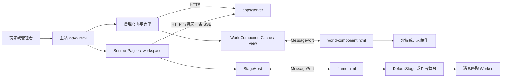

# 前端架构现状

**基线：`34ca083`，2026-11-26。** 本文按实际挂载的 Web 路由、两个隔离入口和组件调用链描述本版行为。官方组件包括主站管理页面、会话宿主控件、隔离舞台默认实现、SDK 展示组件以及共享 UI。世界卡自带的组件属于作者内容，本文追踪其加载、执行和替换位置。与本文逐项对应的设计见[前端目标架构](前端目标架构.md)。

## 运行拓扑与分层

| 层 | 代码与职责 | 状态保存位置和寿命 |
|---|---|---|
| 入口与路由 | [main](../apps/web/src/main.tsx) 初始化主题、React、i18n、BrowserRouter；[App](../apps/web/src/app/App.tsx) 组合 ManagementProvider、PresetProvider、AppShell。根路由与兜底转向预设，旧 providers 路由转向 models。 | URL 负责选择资源；切换 sessionId 按 key 重建会话页。 |
| 视觉与交互 | [UI primitives](../apps/web/src/components/ui)、styles、hooks/useTheme、i18n；业务 CSS Modules 决定页面布局。 | 控件本地持有焦点、展开与键盘选择；主题 token 作用于当前文档。 |
| 管理数据 | [api](../apps/web/src/api.ts) 解开 Server 响应信封并抛 ApiError；[data](../apps/web/src/data.ts) 管理详情、游标页、取消与按 ID 合并。ManagementData 管设置、模型/会话/世界失效计数及文件清理重试；PresetStore 管预设基线和草稿。 | Provider 跨路由，列表与表单有各自生命周期。选择目录可加载全部页。 |
| 会话功能 | [workspace](../apps/web/src/features/sessions/workspace.ts) 组合 history、narrative、state、suggestions、character-sprites、世界资源、配置和同一条事件通道。SessionPage 另组合 reply-assist、输入草稿、工具栏、配置和布局。 | 跟随会话页；HTTP 接管确认后的记录，生成中的输出在内存里。 |
| 隔离承载 | [StageHost](../apps/web/src/stage-host/StageHost.tsx) 与 [WorldComponentView](../apps/web/src/features/worlds/WorldComponentView.tsx) 分别管理 iframe 握手、端口、外观、错误和销毁。 | 每个 iframe 有自己的端口与 React 树，frame 重载不等于停止本局。 |
| 编译与渲染 | [sr-ui-compiler](../packages/sr-ui-compiler/src) 检查依赖图、转译 TSX，iframe 内 loader 求值；[sr-sdk](../packages/sr-sdk/src) 提供舞台镜像、命令、正文、文档与组件上下文；[sr-roleplay](../packages/sr-roleplay) 共享角色扮演文本语法。 | 编译结果可复用；作者回调、Portal、滚动锚点和文档样式位于渲染文档内。 |

管理站开发端口默认 5176，API 经主站代理；5177 的独立静态来源承载两个 frame 入口。会话从 runtime/config 得到实际舞台 origin/entryPath/debug。校验来源、源窗口和 nonce 后转交 MessagePort；宿主把请求绑定到其持有的世界或会话，校验方法与参数。详情预览端口只开放指定 global 路径查询。主题、阅读字号、输入区底部避让量和语言按适用入口下发。部署入口见 [Vite 配置](../apps/web/vite.config.ts)。

## 管理主站的官方组件与功能

下表用功能编号标识现状和目标中的同一个用户操作。一个表格行内列出的组件共同完成该操作。

| 编号与界面 | 用户操作 → 数据处理 → 可见结果 |
|---|---|
| M01 应用导航 | AppShell 切换五个入口、桌面收起侧栏或打开移动菜单；URL 确定选中项，侧栏偏好在本地保存。最近会话和模型用摘要请求，预设快捷项取自 PresetStore。会话详情让出底部导航空间。五个主管理页面使用 PageHeader。 |
| M02 世界列表与导入 | WorldLibraryPage 按 URL 的标签查询摘要、分类与游标；加载下一页追加卡片。UploadButton 选 JSON/ZIP → FormData 发给 worlds/import → 刷新世界并导航到新详情。WorldCard 展示标签、会话数量和 WorldCover；封面开关启用时 MosaicCover 在 Canvas 缩小采样再近邻放大，标题不参与处理。 |
| M03 世界详情导航 | WorldDetailPage 按 id 取详情；WorldDetailView 协调折叠概览、RoleStrip 两种布局、选中角色与角色说明 Modal。展开/紧凑切换恢复角色条锚点与焦点。WorldDetailContent 保留开局选择，六个 Tab 为介绍、世界书、世界状态、开局、关联会话、配置；内容独立滚动并支持窄屏返回。 |
| M04 世界内容 | LoreList 展开时提取 when 表达式所引用的作用域/路径并展示原文和正文。WorldState/StateBrowser 按定义及 rules 构建可展开的说明树，数组显示元素模板。OpeningState 则按开局覆盖整根后的真实初始值展示，数组每次展开更多实际元素。StateHelp 和深层导航保存返回位置，两处数据来自定义与开局配置。 |
| M05 介绍、开局与静态文档 | 旧文本介绍、角色说明、开局无组件时用宿主 WorldDocumentRenderer 显示清洗的静态文档；组件引用交给 WorldComponentCache。开局支持左右切换和滑动、查看初始值、选择本开局创建会话。预览只展示，开始游戏需要显式提交创建请求。 |
| M06 世界管理 | WorldActions 打开更多菜单，WorldMetadataForm 改名称/标签，WorldDefaultsForm 改叙事/帮答预设、模型与封面开关。WorldForm 提交变化项与 expectedRevision，冲突保留草稿。导出当前世界和下载导入原件是两条操作。删除遇到关联会话二次确认，文件清理失败由 WorldCleanupNotice 提供重试。 |
| M07 预设库 | PresetLibraryPage 与 PresetProvider 分别显示叙事、帮答摘要，选中后才读详情。创建、复制、修改、还原草稿、设默认、删除、文件导入导出经 store 与 adapter 转换。跨路由保留编辑草稿；保存按 revision 校验，冲突后可确认重载。 |
| M08 预设编辑 | PromptEditorDialog 编辑节点提示词、角色和可用变量；节点菜单按节点类型启停、插入、移动、删除或恢复。固定世界状态与可选后处理独立。表单配置滑动窗口/滚动摘要、上下文和输出预算、摘要提示、思考档位、模型关联。SamplingRow 的四项采样参数分别处理模型默认、拖动和精确输入，保存时保留零值。 |
| M09 模型 | ModelsPage 分页、选详情、创建或修改配置；先选 provider 再选目录模型，ModelMetadata 展示上下文/输出上限、思考、协议、输入和缓存信息。密钥字段只提交输入值，列表只读保存状态。删除与设默认更新共享数据。ModelConnectionTest 由用户触发，对已保存 id 发 test 请求，客户端校验时长、模型与可选用量，按钮回显测试中、已连通或失败，失败详情见悬浮提示；切换目标取消过期请求。 |
| M10 设置 | SettingsPage 切换中英日保存后更新界面；主题切换更新本地主题与 token。Range 调整马赛克密度先更新共享显示，再保存，失败可重试。默认叙事、帮答和模型允许置空，保存提交相对基线变化的字段。 |
| M11 会话列表与创建 | SessionListPage 或世界详情的 SessionSection 用 SessionRow 展示摘要，支持按世界筛选、继续、删除确认和分页。CreateSessionDialog 读取世界、可扮演角色、开局及配置目录，世界详情入口预填上下文。提交 openingId、角色和 runtimeConfig → Server 原子创建首条助手消息及初始状态 → 刷新会话信息并进入 /sessions/:sessionId。 |

代码入口：[世界管理](../apps/web/src/features/worlds)、[世界详情](../apps/web/src/features/worlds/WorldDetailPage.tsx)、[预设](../apps/web/src/features/presets)、[模型](../apps/web/src/features/models)、[设置](../apps/web/src/features/settings/SettingsPage.tsx)、[会话列表](../apps/web/src/features/sessions/Sessions.tsx)。

## 会话宿主与隔离执行

| 编号与组件 | 从输入到画面 |
|---|---|
| S01 SessionDetailPage、SessionPage、SessionView | workspace.start 建立 EventSource，读取 session 和 runtime/config，绑定 state，加载世界组件并同步。workspace 发布展示快照，SessionView 通过 useSyncExternalStore 订阅。宿主本身呈现连接、准备、摘要、停止等状态以及重试，不依赖舞台成功挂载。 |
| S02 RoleplayComposer | Lexical 编辑节点与 SR-RP 文本互转，输入只改本地草稿。普通段落回车换行，特殊块回车退出、空块退格删除，粘贴按上下文规范化，输入法组合期间不误提交。Ctrl/Cmd+Enter 或发送按钮提交；外部 setDraft 更新编辑器并展开；成功后仅清除仍是提交时版本的草稿。 |
| S03 叙事、停止与重新生成 | narrative 控制器带实际 tip 提交。HTTP accepted 与 run.created 按消息和本次执行身份协调，用户消息可以立即出现；delta 累计或 snapshot 整体替换临时助手。停止使用 runId 和 assistantEntryId；ComposerMoreMenu 仅为最新用户轮次发起重生成/重试。删除后旧回复退出，失败保留用户轮次，迟到的旧执行不复活。 |
| S04 已存轮次与重连 | history 持有有序记录、afterSeq、游标和加载状态；workspace 合并已存和活跃的展示轮次，同 ID 消息只显示一次。摘要参与 seq/tip，正文不显示摘要气泡。普通终态补查覆盖最后 seq；断线保留画面并标记不连续，重连替换最近页、使旧页失效、复核状态与建议，不重发玩家输入。 |
| S05 状态与建议 | state 按三个 scope 归一化，真实 state.changed 修改指定路径，空路径替换整域，tip 改变后确认 message 视图；写后按回执、事件和回读更新。suggestions 用同一次执行身份清空/替换 items，恢复只看最新轮最后一条普通消息，迟到确认不擦除新建议。 |
| S06 AI 帮答 | 更多菜单 → reply-assist 以 requestId 和当前 draft 发起 → 同一会话 SSE 的宿主专用事件更新草稿。停止、中断或冲突按 controller 保留已有部分或原稿；未配置、叙事占用等由宿主反馈。不保存为聊天消息，不转交给作者 frame。 |
| S07 快捷按钮与输入区布局 | 舞台回调留在 frame，Host 验证最多五个描述；ComposerActionRow 按声明渲染，点击携带端口和声明版本回传。输入区展开/收起、软键盘与尺寸变化由 useSessionLayout 计算避让；过期回调忽略，frame 断开清除按钮。 |
| S08 悬浮立绘 | SpriteToggle 开关由 Host 根据能力显示。character-sprites 根据事件 messageId、目录和真实 tip 父链恢复最近有效完整画面，成功空数组清场。CharacterSpriteOverlay/Portrait 解码可用资源后显示在 iframe 上方，尺寸决定槽位并避让输入区；翻阅旧页不驱动当前画面。 |
| S09 会话设置与用量 | SessionConfiguration / SessionSettingsDialog 保存标题、叙事预设、模型、帮答预设/目标和字号；字号可临时预览，取消撤回，保存后更新 workspace。SessionTokenUsage 按会话及刷新键读 narrative/usage，SessionUsagePopover 定位、重试、关闭；累积 Token 与最近请求的上下文组成分列，缺失用量保留未知。 |
| S10 世界详情预览宿主 | WorldComponentCache 按介绍/开局身份固定 DOM 位置，最多十个实例、先进先出；重访不晋升。共享源码加载，重试只重建本实例，详情退出时取消共享加载并释放端口。隐藏暂停媒体、CSS 动画和高度测量，普通作者 JS 仍可运行。WorldComponentView 校验请求，只向当前世界查询具体 global 路径并投影回传，错误时局部重试。 |
| S11 会话舞台宿主 | StageHost 使用配置地址与持有的 iframe 窗口完成握手，下发编译产物、主题、语言、字号、inset、快照和允许转发的事件；command 交由 workspace 或宿主草稿处理。frame.tsx 内绑定 StageProvider、StoryContext、SRAssetProvider 并挂载主组件；独立 frame 错误可重载，workspace 和事件连接仍属于会话页。 |

代码入口：[会话宿主页](../apps/web/src/features/sessions/SessionPage.tsx)、[事件通道](../apps/web/src/transport/session-events.ts)、[历史](../apps/web/src/features/history/controller.ts)、[叙事](../apps/web/src/features/narrative/controller.ts)、[帮答](../apps/web/src/features/reply-assist/controller.ts)、[立绘](../apps/web/src/features/character-sprites/controller.ts)、[详情入口](../apps/web/src/world-component-frame.tsx)、[舞台入口](../apps/web/src/frame.tsx)。

### 宿主读写的实际边界

下表路径以 `/api/v1` 为前缀。前端可据此从一个按钮追到最终的数据源。

| 请求或信道 | 消费者及更新结果 |
|---|---|
| `GET /sessions/:id`、`GET /runtime/config?sessionId=…` | 初始化基本配置、tip、舞台地址和能力；世界目录、人物资源及编译源再按绑定 worldId 获取。 |
| `GET /sessions/:id/events` | workspace 独占 EventSource，分发给叙事、状态、建议、立绘与宿主帮答。独立 frame 不重复建连接。 |
| `GET /sessions/:id/narrative/runs` | cursor 读近期或更早轮次，afterSeq 用于增量补读；history 归并已存项。向作者执行独立 query 时只返回查询页。 |
| `POST /sessions/:id/narrative/runs`、`…/runs/regenerate`、`…/runs/:runId/stop` | 分别提交、替换最新回复、停止指定执行；受理与保存终态是两个时点。 |
| `/state/global/…`、`/state/session/…`、`/state/message/…` | 会话 Host 按所有者和 tip 读写实际值。详情宿主 GET 当前世界 global 数据后，只取作者请求的路径过桥返回。 |
| `GET /worlds/:id/character-sprites`、`GET /sessions/:id/entries/:entryId/character-sprites` | 分别读取资源目录和指定消息快照，结合消息父链决定显示；资源本体走 worlds/:id/resources。 |
| `/sessions/:id/reply-assist`、`GET /sessions/:id/narrative/usage` | 前者只产生宿主草稿，后者提供已记录用量。两者不作为 frame 消息正文。 |

详情中还有两种寿命不同的缓存：每个打开的详情最多保留十个 iframe，按首次打开顺序淘汰；应用级编译缓存按 worldId 和组件源码快照复用结果，最多保留四个世界的成功结果，失败项可重试。前者持有活的组件状态，后者只保存代码。[详情实例池](../apps/web/src/features/worlds/WorldComponentCache.tsx) · [编译缓存](../apps/web/src/features/worlds/preview-compilation-cache.ts)

## 官方渲染组件逐项追踪

| 编号与组件 | 输入、处理、输出 |
|---|---|
| R01 DefaultStage | 未声明自定义舞台时，默认布局挂 SR.WorldStory；读 useSRActionSuggestions，items 非空才挂含留白的整个行动区。作者声明舞台时，由作者决定是否组合这些组件。 |
| R02 SR.WorldStory、StoryRun | 同时读 useSRStageSnapshot 和 useSRHistory；按轮次/消息 ID 绘制气泡、等待与终止提示。加载更多改变 Host 的展示页，刷新重同步；组件自己保存阅读锚点，处理前插消息、改变字号/宽度、贴底与“回到最新”。 |
| R03 StatePanel、MessageReasoning | StatePanel 按绑定世界的状态根和 stage 快照列出三域有效值，宽屏停靠、窄屏对话框并归还焦点；showState=false 移除入口。MessageReasoning 仅在存在思考正文时显示折叠内容，按是否正在接收决定提示，思考文本不进入消息替换规则。调试开启且该助手有 output 时，StoryRun 额外显示折叠的处理结果。 |
| R04 MessageContent、ComponentBoundary | 解析角色扮演标记；消息匹配 Worker 按角色执行规则，有队列、单规则与总时间限制。选出合法非重叠片段，处理 Markdown/HTML 与包内图片；组件替换用 Portal 注入 match/groups/namedGroups/message/runId，支持 srDisplay 行内/块级。失败时有原文或局部错误，单组件异常不应吃掉整条消息。 |
| R05 SR.ActionSuggestions | 读当前 items、连接/发送状态，点击后用 session.setDraft 替换并展开草稿。组件防重复点击并显示失败信息；作者可自绘同一数据，调用普通 send。 |
| R06 LoadingText / SR.LoadingText | 正文等待、历史翻页、思考、状态读取共用字素动画；完整文本一次提供给辅助技术，减少动态效果时静态显示。管理页另用 Loading 呈现管理请求状态。 |
| R07 RichText、两个 WorldDocumentRenderer、WorldDocumentContent | RichText 把 text 交给 inline 渲染；SDK 根的 WorldDocumentRenderer 以正文清洗规则处理 content/density。宿主子路径 renderer 可在受限 iframe 中展示 document 或 inline，处理样式警告和主题。WorldDocumentContent 位于已有隔离文档内，使用 document 规则保留允许样式。 |
| R08 资源与外观 | WorldAssetsProvider/SRAssetProvider 提供当前世界基址，WorldAssetImage、SDK 图片和文档解析器据此校验并编码资源路径，失败显示空态或提示。外观按白名单传播到官方组件，阅读 token、字号、滚动尾部与输入区避让分别生效。 |

舞台把整个 SDK 根注入作者模块，详情仅注入 world 查询、同名只读别名、RichText、WorldDocumentContent 和资源 URL Hook。会话作者能同时获取完整展示快照、历史视图、原生事件和持久化查询；`session.getRuns` 与 `history.query` 调用同一命令，独立查询不改变展示页。按路径读写的 useSRState 与命令式 useSRStateAPI 并存；详情的后者实际是只读 global 别名。详见[根导出](../packages/sr-sdk/src/stage/index.tsx)、[命令代理](../packages/sr-sdk/src/stage/runtime.ts)、[默认布局](../apps/web/src/default-stage.tsx)、[消息渲染](../packages/sr-sdk/src/message-content.tsx)、[文档渲染](../packages/sr-sdk/src/world-document/WorldDocumentRenderer.tsx)。

## 全局基础组件如何配合

| 组件 | 交互路径 |
|---|---|
| PageHeader、Panel、Badge | 页面传入标题、说明、操作或状态；共享组件应用统一层级、间距和语义外观，具体布局由页面决定。 |
| Button、IconButton、ActionLink、UploadButton | 分别处理动作、带无障碍名称的图标动作、导航和文件选择；业务回调决定请求，loading/disabled 避免重复操作。 |
| Field、Input、Textarea | Field 关联标签、说明和错误，表单拥有输入值和基线。 |
| Select、Switch、Range | Select 提供主题化下拉、键盘定位、原生 change 语义；Switch 映射开关；Range 将滑块值交给采样、密度等业务控件决定精度及提交时机。 |
| Modal、ErrorNotice、Loading | Modal 管 Esc、遮罩、焦点循环及归还，保存中可阻止关闭。ErrorNotice 将技术错误映射为当前语言和重试动作；Loading 显示请求等待。 |

## 三个区分职责的现场问题

1. **为什么另一组件翻页会改变官方阅读器？** 当前 loadMore 发往 Host 的 history；官方阅读器观察的是同一个展示投影。独立 query 走单独读取。这解释了目标设计为何把查询页交还给阅读组件。
2. **为什么世界状态 Tab 与舞台状态面板内容不同？** 前者展示作者定义与规则，OpeningState 展示选定开局的初始值，StatePanel 展示当前会话 tip 的有效值。三者回答不同问题。
3. **为什么刷新 iframe 不会重发模型请求？** 请求、活动执行身份与 SSE 都属于 SessionPage 的 workspace；frame 重建后重新接收快照。刷新整个会话页面才重新建立 workspace 并读取持久化事实。

现状依据为上述源码、[主管理契约](../docs/runtime/web-management.md)、[舞台运行契约](../docs/runtime/web-runtime.md)和[官方组件测试目录](../apps/web/tests)。此清单记录源码路径与数据流；实际导入、浏览器交互及模型运行属于独立验证。
