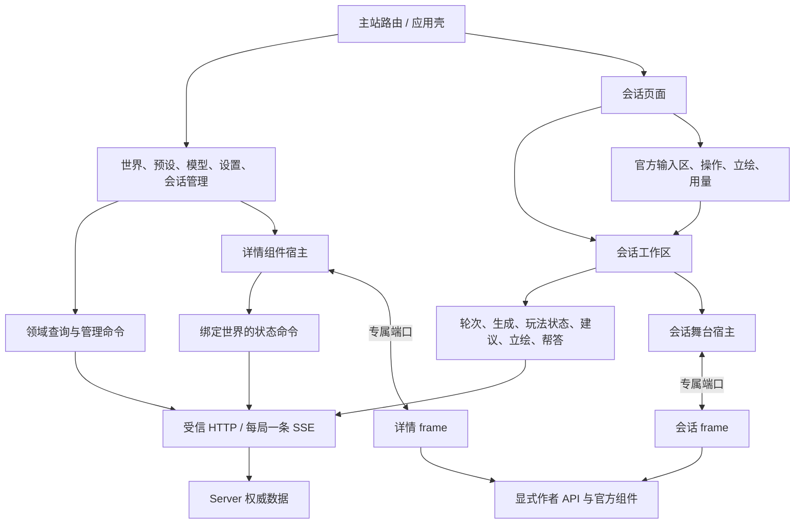
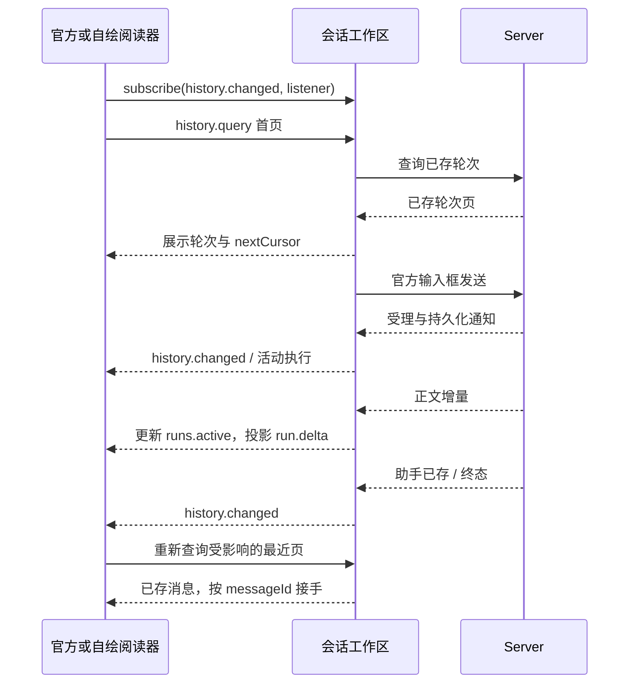

# 前端目标架构

**设计稿，待实施。** 面向五个管理入口、运行中的会话、详情作者组件和会话舞台。比较基线见[前端架构现状](前端架构现状.md)。作者公开签名、返回值和兼容约束见[作者 SDK 方案](作者SDK重构方案.md)；本文决定这些接口在整个前端由谁实现、官方组件如何消费、出现错误或重连时谁修正画面。

## 1. 模块和依赖方向



| 层 | 模块和主责 | 谁可以依赖它 |
|---|---|---|
| 应用与设计系统 | App/AppShell 选择路由与外壳；共享控件负责键盘、焦点、语义、主题与语言。 | 五个管理路由、会话 Host；各个 frame 接受校验过的外观参数。 |
| 管理领域 | worlds 管作品与世界配置，presets 管节点和草稿，models 管配置和测试，settings 管默认值，sessions 管列表、创建、修改、删除。各领域提供 URL/HTTP 适配与保存回执。 | 页面拥有选中项、弹窗、滚动、表单正在提交等界面状态。跨页共享仅限确有共同消费者的数据，如预设草稿、目录更新和应用设置。 |
| 会话工作区 | 以 sessionId 绑定唯一会话通道，协调 active 执行、最新有效 tip、重连、状态、建议、立绘及帮答请求，产生最小展示投影与失效通知。 | 官方主站控件及授权 frame 命令。Host 为恢复保留的少量最近数据是内部工作集，独立于每个阅读器取过的页。 |
| 隔离承载 | StageHost 和详情宿主分别绑定世界/会话身份、frame 窗口、端口和生命周期；共用已有参数校验、外观与资源解析能力。 | frame 只能使用其上下文的领域命令。宿主从绑定关系推导目标 ID，并在接收端复核权限。 |
| 作者接口与官方视图 | SDK 包根导出少量 Hook 和组件。SDK 将端口数据投影成作者类型，官方阅读器管自身分页、重试和滚动。 | 默认舞台、自定义舞台、消息组件、详情介绍与开局组件。编译器检查实际挂载环境和传递依赖。 |
| 传输与持久化 | HTTP 返回命令回执或查询页；SSE 通报已发生的动作；Server 验证、加锁、持久化并发布真实变更。 | 管理领域与受信工作区。iframe 中的组件不能选择任意 endpoint、绕开宿主直接修改数据。 |

**同名“状态”归属不同。** 模型是否正在生成由工作区回答；某个阅读器是否在加载第 2 页由阅读器回答；本局有多少金币由状态数据源回答；玩家是否展开背包由背包组件回答。类型、订阅粒度与清理时机都应体现这个差别。

## 2. 宿主契约与作者能力

SDK 的入口清单、示例和事件载荷统一维护在[全局 SDK 目标方案](作者SDK重构方案.md)。Host 从当前端口推导世界、会话和消息身份，并在执行受限命令前校验。详情预览仅可按路径读取绑定世界的 global 状态。会话 stage 与消息组件可以使用其环境授权的公开能力。官方内容组件和作者组件共享同一 SDK，模型诊断、帮答草稿和主站操作由可信 Host 管理。

## 3. 五个管理入口怎样工作

| 编号与官方组件 | 目标数据流、失败或生命周期 |
|---|---|
| M01 AppShell、ManagementProvider、PresetProvider、PageHeader | 改路由 → 管理领域按摘要提供最近项和默认项 → 壳层选择对应入口。默认设置由 settings 维护，选中 ID 由 URL 维护。移动会话页退出时沿导航返回；侧栏偏好与世界数据独立。 |
| M02 WorldLibraryPage、WorldCard、WorldCover | 选标签或导入 → 世界查询/导入命令 → 返回一页或新世界标识 → 本列表合并页或导航详情。标签切换使旧请求失效；列表摘要足以显示封面与数量。MosaicCover 只处理像素图层，密度来自共享显示设置。 |
| M03 WorldDetailPage、RoleStrip、WorldDetailContent | 加载详情后由页面协调折叠、角色选择、键盘/触摸和六个 Tab；角色说明打开 Modal。源码引用或资源版本决定预览失效，名称修改只更新页面文字。 |
| M04 LoreList、WorldState、OpeningState、StateHelp | 世界书关联从条件表达式静态提取；结构说明从定义及 rules 投影；初始值从默认值和开局覆盖计算。共用导航/帮助控件，各自保持展开与返回位置。玩法状态 Hook 专供运行值，不能代替这三个不同输入。 |
| M05 作者介绍与开局、StartSession | 作者入口交详情宿主，纯文档交 Content 对应的安全渲染路径；主站对独立文档仍保有隔离容器。左右切换或重访落到对应缓存实例。点击开始才将 openingId、角色和默认配置交创建命令。 |
| M06 WorldActions、WorldMetadataForm、WorldDefaultsForm、WorldCleanupNotice | 编辑草稿 → 带 revision 提交变化字段 → 回执更新摘要及详情；冲突保留草稿等待选择。导出当前版本与下载原件保持独立。删除相关会话继续二次确认；业务记录已删但文件清理失败时单独恢复清理。 |
| M07 PresetLibraryPage、PresetProvider | 列表读两类预设，选中后查详情；编辑按 ID 保存基线和草稿，导航返回可继续。复制、设默认、导入、导出、删除都经同一领域适配；文件格式转换只在读写文件的边界发生。 |
| M08 PromptEditorDialog、SamplingRow | 编排节点的增删、顺序、启停、提示与变量进入草稿；固定节点和可选能力分别验证。摘要策略/预算/思考档位、帮答模型和独立采样值按类型提交。保存冲突可重读，精确输入与显式零在来回编辑中保留。 |
| M09 ModelsPage、ModelMetadata、ModelConnectionTest | 查询目录 → 选提供方/模型 → 保存配置或更新凭据 → 刷新摘要。测试只针对已保存 ID；测试按钮显示待定/成功/错误，取消旧响应，不把密钥下发 UI。旧目录缺项仍能辨识原配置并重新选择。 |
| M10 SettingsPage | 保存语言后传播给主站与仍在线的 frame；主题通过验证的 appearance 更新。马赛克密度先反馈再提交。默认项按变化字段串行保存，失败保留可重试的用户选择，避免同时操作时互相覆盖。 |
| M11 SessionListPage、SessionRow、SessionSection、CreateSessionDialog | 全局列表和世界详情复用创建命令和会话摘要行。角色/开局取世界详情、默认项按来源填充，Server 原子建立首条消息与状态。成功跳转本局，失败保持选择。删除确认后更新列表、世界计数和壳层快捷项。 |

## 4. 会话宿主与隔离入口怎样工作

| 编号与官方模块 | 目标数据流、失败或生命周期 |
|---|---|
| S01 SessionPage、SessionView、workspace | 页面按 sessionId 创建工作区 → 先绑定事件通道并同步最近事实，读取配置、世界和状态 → 提供独立的连接、执行及显示投影。刷新舞台只换端口；离开会话才释放工作区、订阅和挂起请求。 |
| S02 RoleplayComposer | Lexical 管编辑和选区，宿主管理规范化草稿与编辑版本。键盘、粘贴、输入法和角色扮演语法在编辑层处理；官方发送获受理才清理同版本草稿。作者 setDraft 通过宿主更新草稿并展开，不会自动发送。 |
| S03 narrative、ComposerMoreMenu | 官方发送、停止、重新生成均走会话命令；宿主使用实际 tip 与助手执行 ID。HTTP 和 SSE 可任意先后，按执行身份去重。重新生成删除旧助手后再建立同轮新执行，失败允许在用户轮次重试。作者只开放发送和填草稿。 |
| S04 runs 查询与恢复 | 读者各自持有页；工作区维护活动身份、当前 tip 与必要的恢复工作集。保存、删除、终态持久化和重连校准合并发布 history.changed。正文 delta 更新 active，并向订阅者发送可见正文。重连后校准断线期间的变化，绝不自动重提交。 |
| S05 state、suggestions | Host 按上下文解析目标并验证请求，Server 持锁完成写入并返回逐项结果，宿主发布真实有效值；区分相同、缺失、修改和失败。建议跟随当前执行，接受新轮次时和用户消息同批清空，恢复只采信最近适用的回复。 |
| S06 reply-assist | 宿主菜单提交草稿与请求身份，回调只更新仍匹配的草稿；保留停止/断线时的原稿或部分稿，显示配置和冲突错误。叙事和帮答由 Server 协调准入；作者看不到请求流或帮答专用命令。 |
| S07 ComposerActionRow、useSessionLayout | 可信侧渲染已校验按钮及官方开关；当前端口按声明版本回传点击。展开/收起、字号、键盘和窗口变化更新底部占用，立绘与正文各自应用相同 inset，避免重复留白。 |
| S08 SpriteToggle、CharacterSpriteOverlay、Portrait | 能力受预设/世界目录约束；启用偏好与实际快照独立。按 tip 父链查找适用的消息立绘快照，空快照清场；资源解码成功再显示。阅读器向前翻十页也不会改变当前人物层。 |
| S09 SessionConfiguration、SessionSettingsDialog、SessionTokenUsage、SessionUsagePopover | 会话设置以已有值建草稿，取消还原字号，成功回写标题和运行配置并刷新相关事实。用量查询独立更新官方详情；请求上下文比例和实际计费分别呈现，失败可重试。 |
| S10 WorldComponentCache、WorldComponentView | 保留十个 FIFO 实例、固定位置、共享源码请求及隐藏策略。绑定该世界的端口只接受指定 global 路径的查询；世界切换或实例销毁使旧端口失效。 |
| S11 StageHost、frame、StageProvider | 可信页面持单条会话通道；桥接仅转发已授权命令、选定投影和失效通知。初始化、语言主题、源码变更和 UI 重载分别处理。frame 消费展示数据并持有作者函数，回调和错误均局限于相应挂载实例。 |

### 一次接近真实操作的时序



Host 对服务端返回的每一页执行字段投影。读者先订阅再查询；查询在途时收到通知需再读或丢弃过期结果。重连、删除或重新生成可能使旧游标视图失效，先替换近期页再恢复阅读锚点。不同组件的加载态、错误、已取页数互不影响。最后可见的助手正文保留到持久化数据接手或确认删除，避免闪白和重复气泡。

## 5. 官方渲染组件怎样工作

| 编号与组件 | 输入 → 行为 → 输出 |
|---|---|
| R01 DefaultStage | 组合 SR.WorldStory 与 SR.ActionSuggestions；订阅 items 决定是否连同行动区外层一起挂载。自定义主组件替换组合根，可复用两个官方组件中的任意一个。 |
| R02 SR.WorldStory、StoryRun | 自己订阅持久化失效、请求游标页、保存锚点和加载错误，另观察 runs.active。以 run ID 分组、消息 ID 去重；prepend、字号改变、滚动到最新时保住读者位置。showState 决定状态入口。两个阅读器分别翻页不会互相挤走页或滚动位置。 |
| R03 StatePanel、MessageReasoning | 状态面板声明所需作用域，读 value/loading/error；宽屏停靠、窄屏焦点管理属于面板。主站专属的思考与诊断展示由可信 Host 承载。普通作者消息类型只承诺 id、role、content、timestamp、saved。确需保护的调试信息放在可信 Host 面板；同一个作者文档内的 DOM 不能作为私有数据容器。 |
| R04 MessageContent、ComponentBoundary | 对正文执行角色扮演解析和有界 Worker 匹配，清洗文本后再按安全位置挂匹配组件；通过 MessageComponentProps 注入匹配组、消息、runId 与 inline/block 布局。组件异常回退原文，过期结果不得替换已经重生成的新消息。 |
| R05 SR.ActionSuggestions | 订阅 useSRActionSuggestions，点击一项调用 setDraft；只订阅所需命令/状态。失败可提示和再次操作。外层无建议即卸载。选择立即发送属于自绘行动的显式决定。 |
| R06 LoadingText | 作为平台内部等待指示，供正文、思考、翻页、状态面板复用；朗读完整字符串、减少动画时静态显示。管理 Loading 根据管理请求状态显示。动画帧和单字 DOM 不进入作者契约。 |
| R07 SR.Content 与宿主文档展示 | prose 与 document 分别选择清洗策略再解析资源。原 RichText、根 WorldDocumentRenderer、WorldDocumentContent 的作者用途收敛到一个 Content；宿主嵌入文档所需的隔离 iframe、标题、样式警告、主题映射仍属于宿主渲染器。 |
| R08 资源及外观 | 宿主为挂载目标提供资源位置、验证后的颜色/字号/底部避让；SDK 仅暴露 useSRAsset 向当前世界解析。WorldAssetImage、WorldCover、立绘各自处理加载或解码失败。主题更换只更新外观，不重置作者舞台或改变权限。 |

**共享 UI 的执行方式。** PageHeader、Panel、Badge 只接受文案、状态和操作入口；Button、IconButton、ActionLink 和 UploadButton 传递动作/导航/文件选择；Field、Input、Textarea 关联标签、说明及错误；Select、Switch、Range 传递选择值，精度和保存时机仍由领域表单决定。Modal、StateHelp、Popover 按各自焦点范围处理 Esc、归还焦点和移动视口；ErrorNotice 把错误与可执行的重试动作关联。控件保持主题 token、键盘操作与可访问名称，不参与 HTTP、业务锁或世界绑定。

## 6. 预计变更文件树

这是方案范围。花括号列同目录多个文件；未列出的页面继续使用原有实现。管理页面无需为目录整齐而整体搬迁。类型/组件具体签名及 Server 写回执的相关文件另见[SDK 变更树](作者SDK重构方案.md)。

```text
SillyRealms/
├── apps/web/src/
│   ├── app/{App,ManagementData}.tsx                  核对 · 路由及共享状态边界
│   ├── features/
│   │   ├── sessions/{workspace.ts,SessionPage.tsx}    修改 · 执行状态与宿主操作，建立失效时机
│   │   ├── history/controller.ts                     修改 · 组件查询与宿主校准分开
│   │   ├── narrative/controller.ts                   修改 · 提供活动执行展示及持久化交接
│   │   ├── state/index.ts                            修改 · 查询、范围绑定、逐项回执
│   │   └── worlds/
│   │       ├── {WorldComponentView,WorldDetailPage}.tsx 修改 · 详情渲染及绑定入口
│   │       └── world-component-protocol.ts            修改 · 绑定世界的 global 按路径只读
│   ├── stage-host/{StageHost.tsx,commands.ts}         修改 · 投影与命令白名单
│   ├── stage-frame-protocol.ts                        修改 · 端口绑定与公开数据形状
│   ├── {frame,world-component-frame,default-stage}.tsx 修改 · 两端注入、官方组合
│   └── world-assets.tsx                              修改 · 宿主资源上下文入口
├── packages/
│   ├── sr-sdk/src/author-contract.ts                  新增 · 作者字段、公开值及可用环境
│   ├── sr-sdk/src/stage/{runtime.ts,context.tsx,index.tsx,world-story.tsx}
│   │                                                  修改 · 查询、选择订阅、阅读器和导出
│   ├── sr-sdk/src/stage/{state-panel,document,action-suggestions}.tsx
│   │                                                  修改 · 官方组件适配
│   └── sr-ui-compiler/src/modules.ts                  修改 · 作者导入与共享组件挂载检查
├── apps/web/tests/{history,narrative,stage-host,stage-frame,session-workspace,state,worlds}.test.mjs
│                                                      修改 · 竞态、端口、回执和职责回归
├── apps/web/AGENTS.md、AGENTS.md                       修改 · 正式实施时更新核心契约
└── docs/{runtime,design,sdk,creator}/                  修改 · 运行规范、SDK 签名及创作示例
```

移除范围是新版作者入口中的完整快照、重复查询、文档组件别名与资源基址等导出；方案不要求物理删除仍供平台或旧卡使用的实现。现状与目标两份架构文档不是新的运行时依赖。

## 7. 迁移与验收

| 阶段 | 落地界线 | 完成判据 |
|---|---|---|
| 一、固定基线 | 核对五个入口和 M01–R08 的数据所有者，盘点已分发、内置、已导入和用户修改卡；明确旧版识别策略。 | 新导出与旧适配器边界清楚，已导入数据不会因覆盖示例 ZIP 被静默改写。 |
| 二、实现 Host 契约 | 先实现 runs 游标/失效、活动执行、详情与会话统一状态操作。复用现有信道、命令及写事务。 | 两个读者分别查 1 页和 2 页互不干扰；写事务可区分修改、同值、缺失与失败；断线及 iframe 重建不重发请求。 |
| 三、迁移官方组件与样例 | 用新接口迁移默认舞台、阅读、状态、建议、文档、雾港和小饭馆，并同步作者类型与挂载校验。 | 保存/重生成/断线衔接只出现一条助手消息；详情按路径只读 global，会话可按授权读写；后台帮答和原始存储字段未进入作者公开对象。 |
| 四、验证发布 | 分层检查管理表单冲突、真实业务回执、端口销毁、局部失败、键盘焦点和视觉退化。函数测试、typecheck、构建、制卡检查分别记录；实际导入及游玩需要独立记录。 | 能分别回答“源码契约通过”“构建通过”“示例可导入”和“功能已实玩”四个问题。具体 SDK 实施事项见[任务清单](作者SDK重构任务.md)。 |

设计延续现有的管理路由、Server 权威数据、每局一条 SSE、独立静态来源与预览实例池。变化集中在作者公开面、阅读分页所有权和状态访问边界。这使管理端的默认值、立绘、帮答和用量等能力可以继续演进，而作者只需依赖领域数据和少量稳定命令。
