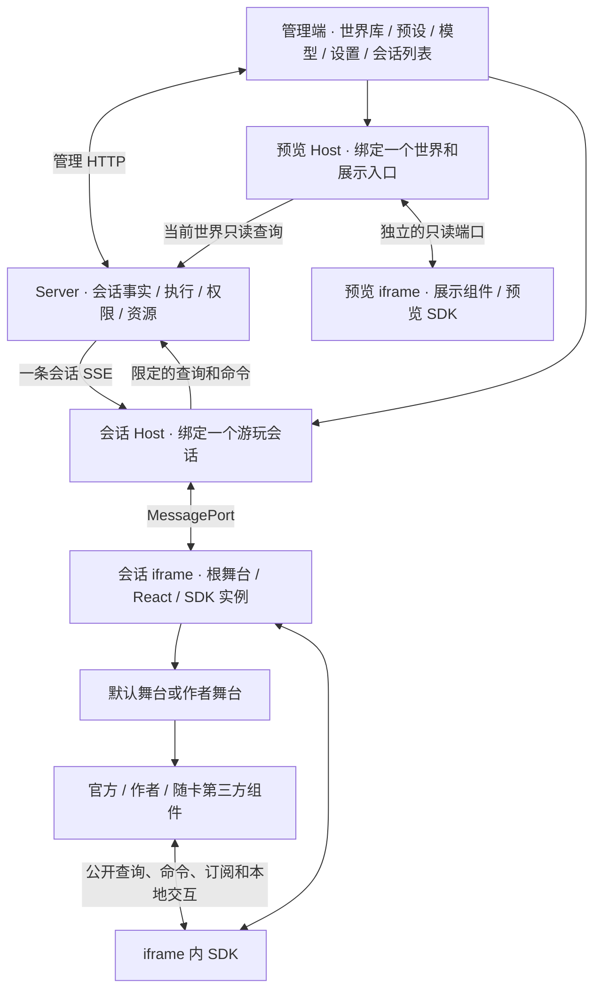
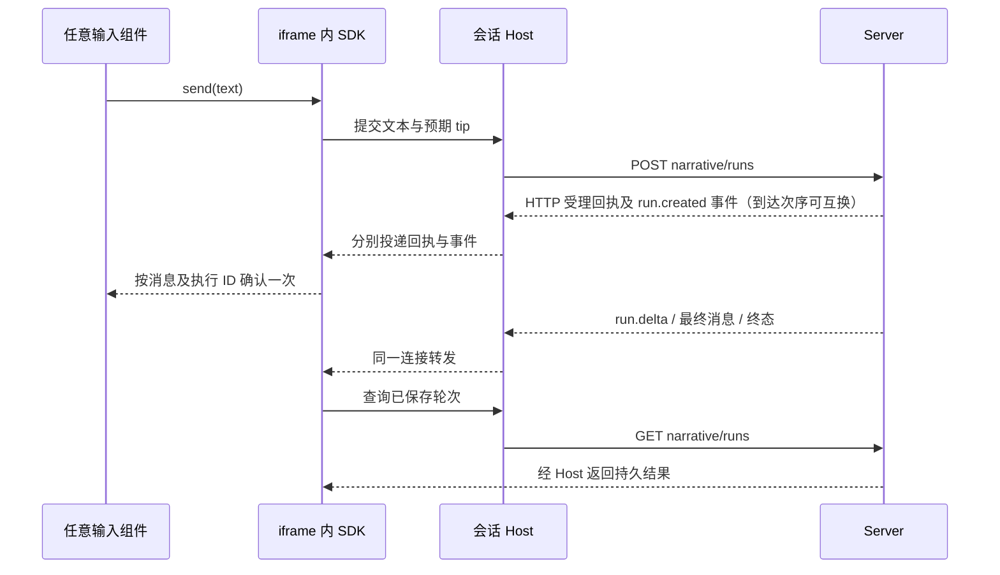

# SR 前端架构提案：让世界拥有完整的游玩界面

2026-11-28 · 设计提案，供评审和分阶段实施。本次提交的立绘事件与 HTTP 路由调整已经实现，以下舞台架构属于后续工作。实施顺序、文件树和验收见[配套任务](可组合舞台与薄宿主架构任务.md)。

## 1. 用一个作品检验架构

SR 的目标是让作者把角色、设定、玩法和素材做成玩家真正能进入的世界。最有区分度的问题是：同一台 Server 能否同时承载一部文字小说和一张完全没有聊天列表、只有场景与选项的冒险卡？后者点选“推开门”，仍可提交叙事、更新状态、换场景、保存进度。退出再进入，两部作品各自按自己的方式恢复。平台无需为第二部作品改一行 Host。

我建议让**整个游玩界面归舞台**。官方提供一个开箱即用的完整舞台，也单独交付正文、输入框、立绘、行动建议等可组合部件。作者可以只替换其中一件，也可以从空白舞台开始。第三方部件进入同一模块系统，以同一公开 SDK 运行。玩家始终有平台自己的返回、会话设置和故障恢复入口。

给讨论草图补上三个边界：

1. “会话”是 Server 上的一次持久游玩，具有会话 ID、世界、角色、配置、消息父链、运行和状态。页面、SDK 实例、iframe 都可以销毁，再连接到同一个会话。
2. 图中 WorldState 和 Runs/Messages 是可查询的领域资料。React state 是组件在本次挂载中拥有的视图。两者生命周期不同。消息历史、状态字段、流式分片也有不同的一致性规则。
3. 跨网络采用 HTTP 查询/命令和 SSE。提交、停止和重新生成各有业务前置条件，保留语义化命令比开放消息表 CRUD 更合适。跨 iframe 还需要一个有边界的端口协议。组件间的草稿联动、菜单和布局则可以完全留在 React 内。

产品依据见[项目愿景与雾港示例](../README.md)、[世界组件边界](../docs/design/world-components.md)、[目前会话契约](../docs/runtime/web-runtime.md)。

## 2. 现有架构的出发点和代价

| 已有能力与证据 | 带来的价值 | 重设计处理 |
|---|---|---|
| [workspace 的 project 与 synchronize](../apps/web/src/features/sessions/workspace.ts) 合并历史、流式输出、状态和建议，并处理删除和重连 | 一处消化 HTTP 与 SSE 竞态，保护重生成和分页正确性 | 保留经过验证的领域规则，放到 iframe 内按领域消费的 SDK 模块。去掉跨桥全量聚合 |
| [StageHost](../apps/web/src/stage-host/StageHost.tsx) 传递 snapshot、原生 event、render、appearance；[StageRuntime](../packages/sr-sdk/src/stage/runtime.ts) 冻结整份显示镜像 | 新 iframe 可以直接显示宿主已知画面 | 当前流式更新有事件及整份舞台投影两条交付路径。目标只转事件和显式查询结果；组件按需订阅 |
| [SessionPage](../apps/web/src/features/sessions/SessionPage.tsx) 持有草稿、帮答、输入框、作者按钮、立绘和布局 | 官方操作在不同卡上行为一致 | 阅读、输入、帮答、立绘组成默认舞台。平台壳只留下玩家控制和故障出口 |
| 桥的 history.refresh 当前连带刷新会话状态、配置和世界；多个地方检查允许发送的条件 | 刷新一次可以恢复整页 | 收窄每个公开动作的范围；“重新连接游玩页”由平台单独命名。执行锁、tip 冲突仍归 Server |
| [Web 三域状态控制器](../apps/web/src/features/state/index.ts) 与[预览桥](../apps/web/src/features/worlds/WorldComponentView.tsx) 仍请求旧状态地址 | 控制器已有批次结果和事件同步逻辑 | 两处都接到 Server 已存在的 POST state/query、state/update；先修复这一可独立验证的问题 |
| 立绘 SSE 已有 asset，历史保存角色与素材 ID；历史读取与生成结果已分离 | 实时可直接画，旧消息可按当前发行版解析 | 沿用此契约。已删除的世界立绘目录和两个通用消息写入接口不再作为依赖 |

## 3. 五个主体与管理端



| 主体 | 拥有的职责及存活期 | 数据与权限边界 |
|---|---|---|
| **Server** | 保存世界发行内容、会话和消息；上下文准备、模型调用、锁、生成、摘要、后处理、计量、状态写入、事件发布及资源校验 | SQLite、世界文件和已提交结果是恢复依据。作者组件不持有凭据、运行许可或直接改写历史的能力 |
| **会话** | Server 创建的独立游玩实例。管理端选择世界、开场、角色和配置；打开游玩路由时绑定已有 sessionId | 一个世界可有多会话；多标签页可读同一会话，写入竞争由 Server 原有锁和预期 tip 处理。每个打开的游玩页有自己的连接与视图 |
| **会话 Host** | 创建独立来源 iframe，绑定 sessionId、worldId、发行版本、端口代次和能力；打开一条 SSE；校验、路由和撤销请求；提供主题、语言、可用资源根及故障操作 | 可短暂持有连接句柄、在途请求、请求 ID、部署/挂载材料、错误和外观。与一个打开的会话页同寿。禁止以历史、三域状态、当前立绘、建议、草稿或流式回复作为恢复缓存 |
| **预览 Host** | 绑定一个世界的介绍、角色或开场入口；复用已编译资源、显示/隐藏、尺寸、弹窗焦点、重试、FIFO 淘汰与清理 | 只有所绑世界允许的全局路径查询和资源。保留现有最多十个预览、隐藏暂停媒体/动画和离开取消加载的契约。无需会话、模型、SSE 或写命令 |
| **舞台 iframe** | 一个作品界面的 React 根、模块加载器、错误边界、布局和生命周期。选择默认或自定义 Stage，装载同一 React 与 SDK 实例 | 作者代码仅在隔离来源执行。挂载时可重新查询会话；舞台出错、重载、关闭不撤销已受理的叙事 |
| **SDK** | 明确区分无头客户端、可订阅领域数据、React hooks、可选官方 UI。将作者方法翻译成受限端口请求；在 frame 内对同一语义执行一次订阅和归并 | 仅当前 frame 有效，按需创建/释放。对等订阅者共享查询中的 Promise 和同一执行的流式归并器。没有隐式整会话预加载 |
| **组件** | WorldStory 选择历史窗口；Composer 负责文字输入；Portraits 选择画面；作品根决定布局。官方也只用公开 API | 加入同一作品、同一 iframe 的模块共享作品级信任边界。来源标签不产生额外权限 |
| **管理端** | 世界导入、版本、预设与模型、凭据设置、应用默认项、会话创建/配置、导航、玩家返回/重试/使用默认布局 | 直接走现有管理 API。管理与游玩共用路由壳、主题和客户端基础设施，管理 Store、凭据和可写管理 API 不注入作者环境 |

两类 Host 复用握手、端口请求/响应、结构校验、错误转换和清理函数；保留两份显式的能力表。把差异写成各自允许的操作，避免通过“是否预览”在每一个业务方法里临时决定权限。

## 4. Snapshot 可以删什么，必须留下什么

| 数据 | 权威或所有者 | 创建、更新与释放 |
|---|---|---|
| 世界、配置、持久轮次、消息、状态、用量 | Server | 按需 HTTP 读取；写入成功后以回执、查询和已提交事件确认。资源文件交给现有 HTTP 缓存 |
| 一页历史与阅读位置 | 发起阅读的组件 | WorldStory 挂载时查询，向上翻页时追加。滚动锚点、展开推理文本等仅存组件。切换布局可丢弃；两个阅读器可保持不同游标 |
| 共用的近期历史查询、在运行的助手输出 | iframe 内 SDK，相同 sessionId 的本次挂载 | 按需去重并按执行身份归并；终态被持久记录接管后释放临时输出。独立页查询不移动别的组件的分页 |
| 已订阅的状态、正在显示的建议和立绘 | 对应领域 hook | 订阅时构建所需视图，重连按领域重新读取。消息状态按 entryId 区分。世界换版清理该版派生资源 |
| 草稿、输入法组合、选区、输入面板、动画 | 输入组件和舞台内的草稿上下文 | React 局部状态，建议可触发 setDraft。组件局部重挂可由根 Provider 保留草稿；整 frame 刷新会丢失未发送文本。计划中的主动切版先提示有未发送草稿，异常崩溃无法保证恢复 |
| 玩家偏好 | 平台或浏览器中按作用域保存的偏好 | 主题、语言、会话字号沿用现有设置。立绘显隐按会话保存，通过狭窄的偏好接口或舞台内受限存储访问；键按作品和会话隔离 |
| 挂载材料和桥状态 | Host | 部署来源、入口、编译模块、规则、资源基址、能力、端口代次属于挂载材料；世界切版使旧材料失效。传递查询结果后释放引用 |

建议移除 Host 的 `StageSnapshot` 聚合、每帧全量 postMessage 和 SDK 的全量镜像。**一致读取某一刻的数据仍然必要**。Server 的最终模型消息 snapshot 可修正先前 delta；立绘的完整 items（含清场空数组）定义画面；React 的 useSyncExternalStore.getSnapshot 可返回某一领域稳定的只读值。这三类机制各自解决具体问题，无需让 Host 保存“此刻整页长什么样”。

WorldStory 可以自行查询历史，但让每个组件分别解析 SSE、解决重生成竞态会造成重复。建议提供两层：作者可直接用 history.query 做一次性请求，也可使用官方与第三方共享的历史/活动执行 hook。共享的是正确读取和归并的规则；当前读到哪一页、怎么画、保留多少旧页由组件决定。

## 5. 通信协议与作者 API

### 5.1 网络与端口

管理端继续复用应用 HTTP 客户端。游玩路径为 “组件 → SDK → MessagePort → 绑定会话的 Host 适配器 → Server”。包内图片、音频、字体直接访问已校验的世界资源 URL，远程素材按当前资源解析与 CSP 处理。默认每个打开的会话页一条 SSE，多个组件和 iframe 重载共享连接；没有消费者的业务事件可丢弃，下一次挂载按查询恢复。

端口初始化含协议版本、挂载代次、环境（会话/预览）、作品发行标识、受限能力、语言/主题和资源基址；render 传入口、已编译模块及显示规则。请求含 requestId、操作名、类型化参数；响应同 ID 返回业务数据或可识别错误码。另有订阅就绪/断开/重连、事件、取消读请求、卸载和 UI 故障消息。沿用 source/origin/nonce、sandbox 和端口身份校验。宿主只接受明确操作，将 ID 从绑定上下文补入 URL/body，按需验证传入的消息归属于会话。Server 仍独立做存在、归属、锁与写入验证。帧换代撤销旧端口，晚响应不得投递新帧。超时只表示调用结果未知；不可自动重发有副作用的命令。

SSE 无端到端重播承诺。Host 传输层可按运行代次丢弃已失效端口的投递；具体去重、UI 选择、何时读历史由 SDK/组件处理。若出现背压导致无法保持流顺序，标记流不完整并重新查询，不能静默当作完整输出。保持有界请求尺寸与并发，避免把通用 fetch、任意 URL 或任意 HTTP 方法开放给组件。

### 5.2 目标能力表

下表是拟议的公开能力，方法名用于说明语义。已有入口优先沿用；新 hook 的签名在契约任务冻结。HTTP 均省略 /api/v1。

| SDK 能力 | 底层契约 | 数据/权限 |
|---|---|---|
| session.info、部署与显示能力 | GET /sessions/:id，GET /runtime/config?sessionId=… | Host 向 frame 暴露游玩需要的会话、当前 tip 和能力子集。会话标题、模型选择等设置经平台可信 UI 修改 |
| history.query、阅读分页 | GET /sessions/:id/narrative/runs，cursor 或 afterSeq、limit 1–5 | 持久轮次，保留父链、seq、已公开结果；便捷 hook 拥有自己的分页窗口。history.refresh 只刷新指定历史视图 |
| narrative.send / regenerate / stop | POST 同会话 narrative/runs、runs/regenerate、runs/:runId/stop | 明确 expectedTipEntryId；重生成指向用户与目标助手，停止同时绑定 runId 和 assistantEntryId。无通用消息写接口 |
| state.query / update / subscribe | POST /state/query、/state/update；state.changed | 限定 global/session/message。query 可按路径读取；未传 paths 才取全域根。区分字段缺失与显式 null。update 按输入顺序返回逐项结果；Server 对缺失或同值可成功忽略，读回有效值 |
| narrative / session 事件订阅 | GET /sessions/:id/events | 支持 run 生命周期、删除、状态、建议、立绘、世界更新；订阅 connection/status。帮答为单独 opt-in 能力和请求通道 |
| suggestions、sprites | 已提交事件、history.query，必要时 GET /sessions/:id/entries/:entryId/character-sprites | 建议只恢复最新轮最后普通消息；立绘按真实 tip 父链恢复最近有效快照。实时直接读取 asset；历史按世界角色/素材 ID 解析 |
| composer 草稿和按钮 | frame 内 React Provider / 注册与点击 | 草稿、快捷动作、setDraft 和定向订阅均为本地 UI 通信。默认组件和作者同用。发送草稿才产生网络请求 |
| replyAssist.start / stop | POST /sessions/:id/reply-assist、/:requestId/stop；reply_assist.* | 从现有“只限宿主”升级为明确的新舞台能力。仅在玩家使用具备此能力的输入体验时由 SDK 生成 requestId 并路由该请求的增量；不广播到普通 session.subscribe，不写入叙事历史 |
| world.presentation / asset、state definitions | GET /worlds/:id、/components、/resources/* | Host 绑定当前世界和发行。提供渲染所需角色/素材、公共展示、状态定义与规则；不把预设提示、凭据和管理对象整体塞入 frame |
| usage、appearance 与反馈 | GET /sessions/:id/narrative/usage、已有主题与语言契约 | 可组合展示已记录计量及经审查的展示字段。平台保留完整可信设置入口；故障可交给外壳重载或返回 |
| preview.worldState.query / asset | POST /state/query，仅绑定 worldId/global 和显式路径；/resources/* | 预览没有 sessionId，运行时拒绝会话命令和整域写入。声明可用性与真实能力表一致 |

架构不要求另起 WebSocket、事件账本、专用 Backend-for-Frontend 或通用 state 总线。核心写入的事务与原子性留在 Server。若以后产品要求“重连后从任意 token 无损续显”，那需要单独设计服务端游标/可查询的临时流；当前方案只承诺最终持久内容可恢复。

### 5.3 为何选择这条路径

| 可行做法 | 适用情形 | 本方案的判断 |
|---|---|---|
| iframe 直接连接业务 HTTP 和 SSE | 另有经过验证的、短期有效的会话限权凭证，Server 能独立区分舞台和管理请求 | 当前应用依赖主站与独立舞台的来源边界，单纯向舞台放开 CORS 会扩大权限。暂用端口代理，维持只对包内资源开放的跨域访问 |
| Host 保存完整数据镜像 | 多个渲染窗需要无查询开销地立即复原同一画面 | SR 的两个 Host 面向不同权限和生命周期；全面推送增加了与组件无关的数据传输，而且掩盖了渲染者真正需要的查询 |
| 每个组件独立查询并解析全部 SSE | 一次性的小组件、无共享写操作的静态视图 | 保留一次性查询自由；历史恢复、删除和活动执行身份统一放在可复用领域 SDK，组件只负责订阅和自身显示 |
| 薄 Host + 可按需使用的领域 SDK | 一个作品可自由组合或省略阅读、输入、状态、立绘，必须兼容旧会话 | 推荐。Host 无须知道什么叫“建议清空”；SDK 可以提供一致读取；组件可以用更低层接口实现另一种叙事体验 |

端口能力按字段投影。平台设置仍在可信主站；例如运行时能力可以披露立绘是否可用，计量可以披露数值和类别，但凭据、帮答私人目标和未经审查的管理对象不会随启动包下发。对已经公开的 history.query 原生条目，迁移应逐字段核对现行 SDK 暴露范围，保持旧版兼容；若新版缩窄字段，使用显式新版 DTO 并记录差异。隔离来源防止作者修改主站 DOM；同源的多个作者 iframe 也不能把浏览器存储当作每个世界独享的保密空间。需要隔离的偏好只提供绑定上下文、按键验证的读写能力。

## 6. 六条决定实际可用性的运行路径

### 首开、晚挂载、重连

1. 管理端创建会话和开场消息，游玩路由拿到已绑定的 sessionId。Host 建立连接，读取舞台部署信息与当前世界发行材料，握手后告诉 SDK 连接代次及当前连接状态。
2. SDK 先注册需要的事件，再发初始查询。先挂载的 WorldStory 请求近期历史；没有阅读器的作品仍可仅挂载输入或状态面板。新增消费者读取当前领域值或按需发请求，组件数量不改变 SSE 数量。
3. 控制器记录查询代次和当前事件版本。在途查询期间收到相关删除、状态或执行切换时，使会覆盖该事件的旧响应失效并合并补读。同一活动执行按 assistantEntryId 归并；HTTP 初始页是持久事实，SSE 中的部分输出只作临时显示。避免把读前的字段变化重新套在读后的状态上。
4. 重连或重新挂载以有限近期页替换旧前沿，失效旧分页；按需重读最新 tip 和已订阅状态。序号可复用，单靠 afterSeq 无法发现删除。断开期间错过 delta 时显示“输出同步中”，待最终整条消息或已保存结果接管。Server 没有可查询的活动正文时，SDK 不拼造缺段。两个标签页的草稿独立。
5. useEffect 严格模式双挂载、晚回调、卸载/重试都按 sessionId、端口代次、查询键和执行身份忽略过时回执。对于重连发出与查询重叠的 state.changed，按受影响 scope 标为需刷新并合并重读；必要时等写入平稳后再宣布该 scope 已同步。

### 发送、停止与最终保存



草稿提交前记下文本修订号；受理后只清掉该次草稿。受理未知，刷新当前 tip/近期轮次，保留文本供玩家核对，避免重复生成。Server 最终发来的输出快照可以替换流式文本；正文“显示完毕”和记录“已经持久化”是两个独立状态。遇到 409 刷新相关数据，呈现实际执行或冲突原因。停止必须匹配当前执行的双 ID。关闭组件/iframe 只取消读取和订阅；停止模型须显式发命令。

### 重新生成与删除

发送旧 userEntryId、目标 assistantEntryId 和期望 tip。Server 受理后重用 runId、分配新 assistantEntryId。SDK 依据 HTTP 回执、message.deleted、run.created 里的真实 tip 和 deletedMessageIds 使旧消息失效；可能先到的任一路都不能把同一用户消息追加两次。旧执行的迟到 delta、stop 回执、建议和立绘不能覆盖新执行。受理后失败保留真实的“只有用户消息”状态，玩家可以重试。进行中的向前翻页和历史立绘查找也要检查代次。

### 状态、建议和立绘的恢复规则

- **状态面板**可独立请求某个键。message 查询绑定明确的 entryId；tip 变化撤销旧的 message 查询，global/session 不需要随之失效。事件 path 为空时整域替换，非空时只更新相应路径。写入返回逐项成功/失败，成功但无事件时通过重读确认。预览可见范围、读写校验和 Server 实际授权分别测试。
- **建议**按当前执行在受理时清空，从有效建议事件填入；首次恢复只查最新轮最后普通消息。点击项是舞台内 setDraft 或普通 send，默认不引入 suggestion 专属网络命令。
- **立绘**以整幅画面为单位应用 success/partial_success。success 加空数组清场，失败或无输出不清场；跨页恢复沿消息父链，先用 history 中的结果，再按需查指定已提交的助手消息。世界版本变化使旧派生 URL 失效，已有消息保持原始 ID。折叠、显隐或无素材的处理由舞台决定。

### 回复帮答、未发送草稿和信任变化

输入框迁到作者 iframe 会带来真实的权限变化：同一 JS 环境中的作者及随卡第三方模块原则上可以观察输入，分发函数、React Context 和 SDK 方法名都不能形成组件级隐私隔离。若帮答也迁入，帮答建议同样是作品可见的草稿内容。建议将“使用作品输入界面”在进入此类舞台时明确展示，玩家可以选择**平台提供的独立默认舞台**。该选项使用全新的 iframe，仅加载官方代码，禁用作者主舞台、作者按钮和自定义消息组件，正文回退官方渲染。普通“用官方 Composer 拼入作者舞台”仍处于作品的信任域。需要可信草稿的玩家使用独立默认舞台。

新舞台内，帮答请求由输入动作明确启动，SDK 限定当前会话、requestId 和端口代次；收取部分文本、取消、使用终态校准。断线保留已显示文本并尽力停止；无结果还原原稿。重挂不自动认领旧帮答。兼容期旧作品继续按原宿主草稿边界执行。主动更新舞台涉及未发送内容时，SDK 只向可信外壳报告 dirty 布尔值；平台提供稍后切换或明确放弃本次本地草稿的选择。延迟期间停用会触发新运行的操作并提示世界已更新；已经成功安装的服务端世界版本仍然有效。

### 失败、世界变更与退出

编译失败、组件 render 抛错、桥握手失败、模型失败、网络断开分别反馈到对应层。单个消息组件故障回退正文；舞台根故障显示外壳恢复操作。角色/开场预览故障局限在该实例。world.updated 或重连发现发行版本变化后，Host 撤销旧端口、旧模块和资源绑定，重建 frame；同一作品的管理名称或主题变化只更新必要的配置。世界热更新不能重置 sessionId、历史和有效状态。退出时取消跨桥读取、清理监听与编译引用，后续重新进入从 Server 恢复。

## 7. 组件生态与开发方式

**公开三层入口。** 无头 API 提供类型化 query、command、subscribe；React hooks 提供领域订阅、错误/加载/失效和分页；UI 组件只是这些能力的一种消费方式。已有包根 @sillyrealms/sdk 继续作为作者入口，纯数据类型和协议子入口保持无 React 依赖，让 Server 可以使用现有纯函数。避免把 React 组件引入 Server 的校验路径。沿用 sr-ui-compiler、现有包内模块 ID、相对素材和资源解析器。

**官方默认组合。** 默认 Stage 提供 Story、Suggestions、Portraits、Composer、运行反馈和适配移动端的布局。Composer 内可组合输入编辑器、Send/Stop、帮答、重生成和作者快捷操作。已有 Roleplay 编辑和无障碍键盘行为直接迁移。空建议不占布局；无立绘不留遮挡层。让每个作者能只用公开资料重做官方交互。平台设置、连接到哪个账号/会话、模型凭据和可信退出入口继续由外层掌握。

**一个作者视角的例子。** 以下是拟议接口用法，示例组件名不代表已经发布。Story 内部调用 history 的 hook 或 query；作者替换 Composer 无需接触 SessionPage。

```tsx
function HarborStage() {
  return <HarborLayout>
    <SR.WorldStory />
    <SR.Portraits />
    <CluePanel />
    <SR.ActionSuggestions />
    <HarborComposer />
  </HarborLayout>
}

function HarborComposer() {
  const session = useSRSession()
  const [text, setText] = React.useState('')
  // 最小例子。与行动建议联动时改用舞台的 composer 草稿 hook。
  return <>
    <input aria-label="行动" value={text} onChange={e => setText(e.target.value)} />
    <button disabled={!text.trim()} onClick={() => session.send(text)}>提交行动</button>
  </>
}
```

上例的输入部分可直接换成预设选项或地图点击。生产版 Composer 还需处理受理、失败和编辑修订；官方 Composer 提供完整参考。没有 WorldStory 的舞台可以根据房间状态画地图，并用同一 send 命令执行自然语言行动。没有 Composer 的只读舞台仍可查历史。已有 useSRComposerButtons 兼容为舞台根的本地注册；没有工具条时由作者决定是否渲染，回调与组件同寿。

**第三方组件的第一种交付方式是随卡分发**：作者选择、审阅和打包确定版本的模块与素材；复用当前 components/、静态导入与绑定的 React/SDK，无需新增卡格式、在线 npm 安装、远程代码市场或全局注册表。保留来源、版本和许可证信息，跨作品包内 ID 冲突在编译阶段报告。组件声明支持的 SDK 主版本和所需能力，用于兼容检查和作者提示；宿主权限仅由可信产品策略决定。未来若要求“第三方部件无法看到同作品其他组件的草稿/状态”，需另建隔离执行域和跨域 props 协议，不能从来源标签推导出隔离。

## 8. 兼容、切换与验收

- **两条版本轴。** world.spec_version 当前 0.2，描述世界数据。舞台 SDK/桥协议另行版本协商。提案采用新根舞台组件显式声明静态 SDK 主版本（例如随组件 default export 声明 srStageApiVersion）；构建/导入工具据此记录挂载信息，加载声明不得在主站执行作者代码。声明影响协议选择，不赋予额外权限。无自定义根的卡使用平台默认组合。未声明的已有自定义根保持旧交互，暂不假设作者曾画过输入框。
- **逐世界切换。** 兼容窗口内允许平台选择旧实现；一个页面一次只挂一套运行时、一条 SSE、一个写命令执行者。旧 Host 的全量投影仅保留在显式隔离的旧路径。更新后的兼容 facade 可从 iframe 内各领域订阅合成旧 hook 所需的只读视图；仅在被旧代码实际消费时创建，设置淘汰条件。不要全局双跑生成验证。
- **退出条件。** 默认卡和内置卡已通过新架构；雾港示例、带作者按钮的旧卡、纯自定义无聊天列表卡、包含第三方部件的卡均可独立操作；有可用的迁移指南、旧输入框布局兼容和可信回退。只有兼容路径能支撑已承诺的旧用法，或明确发布结束支持的主版本，才删除旧 workspace。world:check/pack 检查 SDK 声明、模块 ID、导入与资源引用。
- **回滚。** 选择旧渲染入口只作用于支持旧协议的卡；纯新版卡退回可信默认舞台并显示不兼容原因。切换保留 Server 的世界/会话/历史；绝不重播已受理命令。协议或资源缺失给出可定位至组件的错误。整个提案不依赖清库和数据库升级。
- **可观测、可验证。** 对单会话统计 EventSource 数、按操作名统计 HTTP 次数、跨端口消息种类与字节、组件卸载后仍存活的订阅、有效历史页数。记录元数据即可，排除草稿、凭据、模型正文。用固定历史分别装载 5 轮和 50 轮；同一 delta 的稳态跨桥负载应只随事件本身变化。只订阅状态的舞台不应为了渲染去查历史，两个阅读消费者不应多开 SSE。静态检查、进程内功能验证、真实导入和浏览器试玩分开记录。
- **明确的取舍。** 收益是完整 UI 可替换、强边界、领域独立迭代。代价是 iframe 重挂需要重读，活动中途可能短暂缺字，草稿涉及作品级信任，SDK 开始负责一部分会话一致性。把所有控制器原样搬入一个 SDK 单例只会转移耦合。验收以“某组件可以不挂载，或被公开 API 的替代品换掉，其他功能仍工作”为准。
