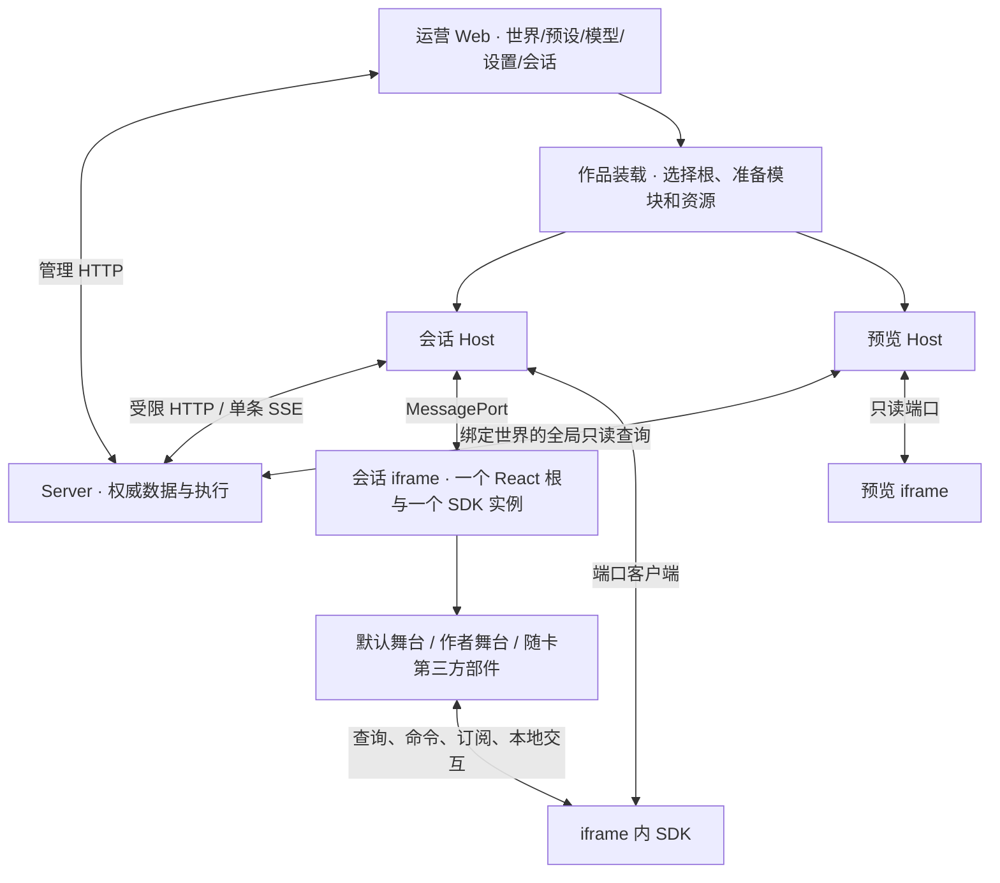
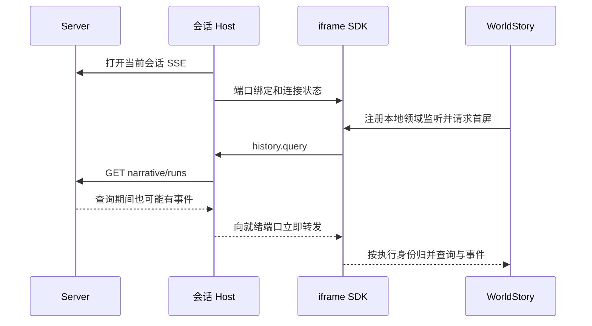

# SillyRealms 首发前端重构方案

**评审稿 · 2026-11-28。** 本文定义首发目标；可实现的作者接口见[SDK 契约与用例](首发舞台SDK契约与用例.md)，文件树、依赖与上线门槛见[实施任务](可组合舞台与薄宿主架构任务.md)。本次更新计划文档。下述目标尚待开发、导入验证与试玩。

## 1. 产品决定

SR 交付的是可以进入、持续游玩的世界。一部小说可以用官方舞台，一张地图卡可以只显示场景和几个行动按钮，两者能使用相同的会话、状态、生成和保存能力。在地图上点“推门”应与在输入框键入“推门”走相同的命令。作者换界面时无需修改 Web 或 Server。

1. 平台承担两类职责。**运营面**负责世界、预设、模型、应用设置、会话创建和配置，以及玩家退出和故障恢复。**基础设施**提供 Server 和隔离舞台的传输。平台团队另以普通作者身份发布官方舞台。这里的划分描述软件职责；会话归属、管理访问、状态写锁仍由各自契约检查。
2. **整个游玩界面归 iframe。** 输入框、草稿、快捷按钮、正文、行动建议、立绘、状态面板、帮答、生成反馈及可选用量展示均可替换。外壳保留返回、设置、加载失败和恢复入口。必要时运营面可直接查询当前执行并请求停止，即使舞台根组件崩溃也能退出或停止。
3. **Host 只承诺四件事**：iframe/MessagePort 生命周期、绑定目标的命令白名单代理、会话 SSE 的连接与转发、外观下发。Host 的业务缓存容量为零，包括活跃 run、上一轮结果和未发送文本。预览没有会话，启用其中适用的三项。
4. **一条作者管线。** 显式 data.stage_component 选择作品根；缺省则选择已安装的官方默认舞台。两种根的包格式、编译白名单、SDK、模块解析和发布工具完全相同。非法声明、模块缺失、运行抛错均给出错误与显式恢复操作。
5. **单版本首发。** 本轮允许重写整个前端，无旧客户端适配、双轨开关、旧卡识别、数据转换或兼容镜像。使用新数据根做安装验收。实施前提不授权删除已有玩家数据；发现不支持的库/作品应报错，示例及内置包由项目主动更新重打。
6. **HTTP 查询/命令 + SSE 就够用。** 首发不建消息总线服务、WebSocket、运行回放表、组件市场、第三方远程代码装载或通用插件权限系统。Server 的流式断点续传作为独立未来能力。

## 2. 实物基线与重构理由

| 当前实物 | 首发去向 |
|---|---|
| [workspace](../apps/web/src/features/sessions/workspace.ts) 合并历史与流式文本、恢复状态/建议/立绘，并发布 StageSnapshot；[StageHost](../apps/web/src/stage-host/StageHost.tsx) 又转发事件 | 删除全页投影、快照消息、Host 业务恢复和 SDK 冻结镜像。将可重用的去重、查询与恢复函数迁进 iframe |
| [SessionPage](../apps/web/src/features/sessions/SessionPage.tsx) 承载输入、帮答、立绘和配置；history.refresh 实际触发全页刷新 | 页面收敛为运营外壳；输入、状态显示等在卡内组合；每个刷新只影响对应查询 |
| [frame](../apps/web/src/frame.tsx) 内置 DefaultStage，私下接入故事渲染配置；官方部件现在和 Web 功能目录混合 | 删除内置根组件分支；导入普通官方世界包，所有作品同享公开的正文渲染、输入原语和领域 API |
| [状态控制器](../apps/web/src/features/state/index.ts) 和[预览](../apps/web/src/features/worlds/WorldComponentView.tsx) 使用旧的分 scope 路径 | 改用 Server 实际注册的 POST /state/query、/state/update；一次查询只针对一个 scope，并返回字段行 |
| [运行查询](../apps/server/src/usecases/narrative/index.ts) 已返回 activeRunId，当前轮含 assistantEntryId、running/stopping；最终消息有完整 snapshot | 足以区分“空闲、正在运行、已结束”。对中途加入的流显示缺段状态，无需为首发新增活动输出端点 |
| 角色立绘事件带 asset；历史保存有效 ID/位置；已删除独立世界立绘目录和通用消息写接口 | 继续复用世界资源、世界详情和指定消息立绘查询；任何输入组件都通过叙事命令写消息 |

## 3. 概念模块与数据所有权

| 模块 | 所有者、输入与输出 | 生命周期和禁止依赖 |
|---|---|---|
| 世界卡 | 可移植的作品定义。拥有角色、开场、状态声明、组件、消息规则和素材；发行标识确定版本 | 不包含本地会话、模型凭据或玩家草稿 |
| 会话 | Server 上的一次游玩。sessionId 绑定世界、玩家身份、开局、运行配置、消息链和有效状态；runId 表示一轮，assistantEntryId 表示一次生成执行 | 页面退出、换组件或 SSE 断开均不删除会话、不等于停止模型；两个标签可各自打开同一会话 |
| Server | 世界安装与资源读取、访问检查、执行和写锁、模型调用、上下文/摘要、持久消息、状态更新、用量与结算后事件 | 唯一持久事实源。HTTP 受理、停止请求和最终终态有独立语义，不把 SQLite 模型搬进组件 |
| 运营 Web | 现有五个管理页及详情、导入导出/发行应用、预设模型与凭据、会话创建/配置、主题语言及字号。游玩路由只选会话、提供可达的退出/设置/重载 | 直接走管理 HTTP。管理 store 不注入作品。平台停止按钮自行按需查执行身份，不要求 Host 保存 run |
| 作品装载器 | 输入 worldId、发行和入口；读取详情及组件源码，复用编译器，生成挂载材料；处理换版、取消旧读、错误和重试 | 是 Web 的资源装载函数。可按发行复用编译物；不读叙事历史。世界详情预览池负责十实例 FIFO、显示/隐藏、尺寸和弹窗焦点 |
| 两类 Host | 接受已授权的会话/世界绑定与挂载材料，使用精确来源/窗口/nonce 握手；按各自白名单代理；下发外观。会话 Host 打开一条 SSE | 只保留 iframe、port、连接状态、代次、在途请求及可重发的外观/挂载材料。没有历史、活动 run 缓冲、业务事件队列和组件注册中心 |
| 舞台 iframe | 独立来源、单个 React 根。安装 SDK、模块加载器、资源与外观上下文、根/消息错误边界，执行舞台及消息组件。预览 iframe 只安装预览能力 | 每次整 frame 重挂为新实例；仅在此处执行作者 JS。组件可以挂载或省略，SDK 本地订阅按需启用 |
| SDK | 白名单端口客户端、事件分发、领域读取/命令、当前执行归并、轻量 hooks、少数所有作者可用的渲染/编辑原语 | 活动执行、共享草稿及按需读取只在这次 frame 中存活。独立历史窗口、滚动位置、布局和动画归组件。没有全量加载所有域的 Store |
| 官方/作者/第三方组件 | 以 React 组合交付正文、输入、立绘、建议或别的玩法；公开 API 赋予同等能力。第三方首发随卡审核、固定版本、打包和发布 | 同一 iframe 同一作品信任域。能接触作者输入的模块也可能观察草稿；不宣称组件间保密。平台管理代码与作者代码物理隔离 |

“无状态 Host”指无**业务状态**。维护连接是否打开、端口是否作废、某请求等待响应是传输所必需。Server 的最终模型消息 snapshot、立绘完整快照、React 领域 hook 的快照各有具体语义，均不产生跨桥全页快照。

实现时有三个明确的依赖方向。Server 和打包工具只引用无 React 的世界格式、资源和协议类型；运营 Web 使用管理客户端、装载器和 Host；iframe 使用相同的共享契约、SDK 和已编译的作品模块。SDK 不能反向导入 apps/web 的管理 store、HTTP 客户端、翻译实例或 Server 实现。公共编辑原语的依赖由隔离构建提供，保留按需加载编辑器的能力；静态预览和纯地图根不因未挂载编辑器而发起会话请求。

## 4. 官方舞台如何与作品同权

**根解析。** 新增一个正常的 spec_version 0.2 世界源码目录，含必填 publication、合规角色/开场、声明的根与组件。使用 world:check、world:pack、world:release 及现有 releases.json 规则生成普通发行物。通过现有 initial-data 世界安装流程安装；在清单中增加唯一的默认舞台来源引用 defaultStageWorldId，初始化后验证该世界显式声明了根。它仍是可在世界管理查看、导出、更新的普通作品；运行期间被删除时，已有显式根作品可继续加载，缺省根作品显示缺包诊断，并可通过原有导入流程恢复。运行部署配置只需返回此来源 ID 给可信装载器。这里选择了“从哪张卡取默认根”，没有内置 TSX 捷径或官方专属 RPC。

| 情况 | 加载行为 |
|---|---|
| A 声明根 | 取 A 该发行的模块图，按根 ID 加载。源码检查、模块未找到和运行错误均显示卡、版本、组件 ID |
| A 未声明根 | 取清单配置的 B 的根和依赖；会话、角色、开场、世界状态、消息规则、角色素材始终来自 A。B 不递归选择其他默认卡；B 缺失/根坏，提示修复默认发行包 |
| 默认根读取资源 | 数据资源如 SSE 的 asset 均按 A 解析。B 的界面装饰显式选择 stage 资源基址。消息替换组件从 A 的模块图加载，其 ./ID 始终在 A 图解析。A/B 的同名模块毋须合并或重命名 |
| A/B 更新 | 以两个来源各自的 worldId + release version 标识渲染材料；重新加载之前撤销旧读。绑定会话 A 的 SSE 不会替 B 接收更新：运营端本次安装后主动使相应装载失效；重新进入、重连或显式重载检查两个版本。V1 不为默认包开第二条 SSE |
| A 根坏或用户明确退出作品 UI | 基础外壳始终可达，显示重试、返回、设置、显式改用默认舞台。手动恢复模式可禁用 A 的自定义消息替换，按基础文本显示。恢复选择限定本页，不改卡、不改会话 |
| 第三方组件 | 首发把模块和合法素材随目标卡打包，内部仍以 ./组件ID 默认导入。选择官方部件源码同样可以随卡组合。工具检查重复 ID、环、未声明依赖和声明的包内资源缺失；分发第三方素材按其许可保留署名；首发不提供远程安装器 |

**执行与样式。** 同一份 sr-ui-compiler 白名单、默认导出规则、模块执行器和 CSP 作用于所有卡。共享外部入口仅 React、现有 React DOM/JSX 白名单和 @sillyrealms/sdk 根。卡内普通 TSX 可组合公开的 MessageBody 与 RoleplayEditor；前者复用现有消息清洗/匹配器，后者封装现有 Lexical 编辑和角色扮演序列化，双方都能用。官方根、布局、阅读列表、Composer、立绘等作为世界包普通模块交付。舞台 CSS 用卡内组件样式或受支持的资源方式，示例须经实际编译验证；不让官方卡直接导入 Web 的 CSS module、i18n 实例、路由、私有 Provider 或 npm 编辑器。组件翻译由组件基于 SDK locale 提供，公共原语自带三种现有语言。

**验证同权的方法。** 用另一包 ID 导入相同官方源码，明确声明其根，运行相同的聊天/状态/立绘/帮答用例。再用缺省根的 A 运行 B，使用冲突的组件 ID 和同名图片验证两个命名空间。检查正式编译后的 frame 包没有内置的官方根组件。官方特色功能若只能依靠包 ID 放行，视为 SDK 缺陷。

## 5. 传输、隔离与失效

| 通路 | 首发协议 |
|---|---|
| 运营 Web ↔ Server | 延用管理 HTTP；授权、归属、锁、校验和提交均由 Server 执行。作者侧不提供通用 fetch 代理 |
| 会话 Host ↔ Server | 每个打开的会话页持有一个 EventSource，连接 GET /api/v1/sessions/:id/events。Host 校验传输消息并转发到当前就绪端口。没有端口时丢弃业务事件；只记连接状态。iframe 订阅数和重挂不会创建新 SSE；切换 session 或退出关闭旧连接 |
| Host ↔ frame | 沿用独立源 sandbox、精确 origin、contentWindow、nonce 和 MessageChannel。一次握手分配一个端口代次。init 传模式、绑定、模块/规则、显示信息、资源根和当前连接状态；appearance/connection 随后可更新；event 只转发收到的事件。request/response 用当前端口唯一 ID 匹配，读支持取消，卸载清理监听与 pending；response 只投当前代次 |
| frame → 代理 | 名称、参数、尺寸、目标按白名单验证。URL、HTTP method 和可访问 scope 由操作表固定。会话/世界由绑定补入；entryId 等子资源由 Server 检查归属。读取敏感字段前投影安全 DTO。未知操作、空白 ID、非法目标、非 JSON 参数及超限请求拒绝 |
| 预览 | 只读当前世界的显式 global 路径。无会话端口能力、无 SSE。可见性/resize/焦点是预览 iframe 生命周期控制；沿用可见帧的有界高度、隐藏暂停 HTML 媒体/CSS 动画、重试销毁旧桥、离开取消源加载 |
| 资源与外观 | 包内资源经当前绑定的世界资源端点，HTTP(S) 素材遵守既有解析。沿用隔离来源、CSP、主题语义 token、语言、字号与降动效。输入框已在 frame 内，键盘视口和正文尾白由舞台布局处理；不再从 Host 测量某个官方输入框 |

沿用现有会话桥单次请求 2 MiB、frame 侧最多 100 个 pending、30 秒 RPC 超时作为首发基线；资源文件走资源通道。组件代码与查询响应分别遵守发行和分页限制。写请求超时或断端口只说明回执未知；不会自动重发、取消 Server 已受理的叙事或宣告失败。同一作品的部件共处同一 JS 环境；隔离源只承载静态 frame 和受限素材，不存管理令牌、草稿或叙事正文。Web 与它的允许来源及端口由运行配置校验。SDK 向组件提供可机读错误与取消语义；来源诊断给到运营界面，不透传凭据或磁盘路径。世界/会话切换、预览淘汰、页面卸载和开发热重载都由同一条撤销路径收尾。

### 谁先订阅

Host 拥有网络订阅，组件通过 SDK 安装本地监听。SDK 先安装端口接收器再声明 ready；某领域首次挂载先订阅再发查询。查询与实时流的交接不依赖精确的全局 SSE 游标。若加载期间出现删除、切换执行或相关字段变化，SDK 使过时读取失效，合并一次针对受影响域的补读。连续 delta 只影响临时输出，不逐 token 取消并重发整页查询。首次连接或重连成功均触发连接代次变化：若首屏读取开始于连接就绪之前，重新校准已挂载领域，覆盖“已查完、SSE 才打开”的空档。断线期间保留已知展示、标明同步状态，禁止盲发新的生成命令。SDK 可在 frame 内暂存初始化期间的相关变化，超限时标记需补读；Host 不重播。

## 6. 必须实现的行为

| 场景 | 首发规则 |
|---|---|
| 开局、无聊天列表 | 运营面创建会话时 Server 保存开场；首次阅读从近期页查询。根可以只显示地图和按钮。纯 global 状态视图不查历史；需要感知当前执行的输入按钮可以用 limit=1 的近期轮次恢复身份 |
| 普通发送 | 捕获当时 tip，POST narrative/runs。202 或 run.created 先到均可确认一次已接受的用户消息，以消息 ID 去重；保留输入修订号，受理后仅清掉该版本草稿。不同标签并发由 Server 锁和 expectedTip 决定；超时保留草稿，主动同步，禁止自动重发 |
| 流式与结算 | 同一 frame 的叙事观察者共享一次增量归并，按 assistantEntryId 隔离。最终整条模型 snapshot 替换正文；只有 run.completed/run.stopped 结束运行。**completed 即 Server 的完成承诺**，可以立即解除忙态；没有“轮询确认落库”步骤。stopped 以 stop_reason、savedMessageIds、tipEntryId 表达实际保存结果。UI 缺少正文或要刷新分页时可以查询 |
| 中途重载、漏事件 | 同一 frame 内局部组件重挂可复用该执行视图；整个 frame 或页面重建时旧分片消失。读近期页得到 activeRunId 及相应执行身份后标记 incomplete，显示“生成中，正在同步”。孤立后缀不充当完整回复。若随后收到整条模型 snapshot 可立即恢复，若只收到终态则取已保存历史。离线/迟到事件不触发新命令 |
| 重新生成与停止 | 最新用户轮次可重生成或在只有用户消息时重试；开局和历史目标服务端拒绝。同一 runId、新 assistantEntryId、真实 deletedMessageIds/tipEntryId。按身份丢弃旧增量/建议/立绘和重复删除；失败不复活已删助手。stop 匹配两种 ID；旧执行终态不能结束后来执行 |
| 历史 | cursor 向前、afterSeq 补读（互斥、limit 1–5）；每个阅读窗口独立。重连以有限近期页替换并使旧分页失效，不能仅靠 seq 检出删除；同一 active run 终态可能没有新增 seq。避免滚动跳动；历史视图变化不重读世界/预设 |
| 三域状态 | 只请求订阅的路径；message 绑定具体 entryId，tip 切换撤销旧请求。空事件 path 替换整域，字段变更只影响相应路径。保留缺失、null、空数组区别。更新成功可表示路径缺失或同值，使用事件/查询得到有效值。预览只能显式读 global 路径。Server 对写入和锁负责 |
| 建议与立绘 | 建议只取最新轮最后普通消息；受理即清空，迟到回执不抹新建议。立绘 success/partial_success 是整幅画面，success+[] 明确清场，失败不清场。实时直接解析 asset；历史沿 tip 的 parentId，必要时独立翻页或精确查助手消息，从游玩世界声明解析 ID。被动查询不移动阅读器 |
| 草稿、帮答和互动 | 草稿在 frame 本地，作者根可提供任意输入或零输入；建议填草稿或直接 send。帮答由玩家动作发起，只把本请求结果交给本地帮答消费者，普通 session.subscribe 不发草稿。断线显示已有内容或原稿、尽力停止；Host 在转发 assist.start 的 HTTP 前把请求 ID 绑定本端口，只转发该请求的帮答消息；终态、断线、失败或撤桥即释放这条传输关联。下一 frame 和另一标签不接管旧请求。Server 最终裁决与 narrative 的互斥。播放器应知道作品代码可以读取该作品内输入。离开/重载丢失未提交草稿，不承诺跨 frame 持久化 |
| 切换发行与故障 | world.updated 由已绑定 SSE 扇出给 SDK 和装载器；后者核对身份/版本，按发行撤销旧模块与资源。简单改名和主题变化不重挂。运营面可在主动切换前提示会丢失输入，不收集草稿正文。消息组件失败回退该段正文，根故障由外壳提供操作 |
| 状态、用量与能力分离 | 立绘 available 来自运行配置；帮答 available 由受信任的装载环境按当前会话与应用默认预设解析为布尔值。两者随相关设置变动局部刷新，预设 ID、目标和模型凭据留在管理端。立绘显隐偏好为组件 UI。用量使用 recorded usage，未知为 null，输入组成字节数保持字节语义。运营设置保存后让装载上下文/SDK 得知需要局部刷新；无需重建会话缓存 |

### 不做无损续传的理由

当前 Server 已能回答“正在生成吗、是哪次执行”，无法回答“之前 37 个分片的完整文字是什么”。恢复状态并继续接后续 SSE 足以显示忙态；要逐字无缝接回，未来需同一执行的临时内容 checkpoint 加对应分片位置，并处理读与订阅的交接。单加 running 布尔值不够。首发不定义这个 API、不引入 Host 缓冲，不为此新增数据库状态。

## 7. 切换与上线

在开发分支上按纵向用例建设，首次上线一次性切换实现；所有被发行的内置卡、示例、卡包、SDK 文档、作者工具和 AGENTS 一起更新。没有“旧 API 仍可调用”阶段。可复用编辑、规则匹配、资源安全解析和领域归并算法；删除旧入口、Host 业务控制器、跨端口作者按钮及双份快照。正式 docs 只在代码落实后写为当前契约。

评审时用三个问题检验每一项新增能力：已有的哪个舞台或预览用例需要它？能否通过现有 HTTP/SSE 与本地组合实现？一份没有官方身份的卡能否用公开接口重做它？首发验收使用干净安装、显式根卡、缺省根卡、无聊天地图卡、损坏根卡、同一会话双标签和只读预览。用例、测试层次、真机试玩和放行条件详见配套任务。
