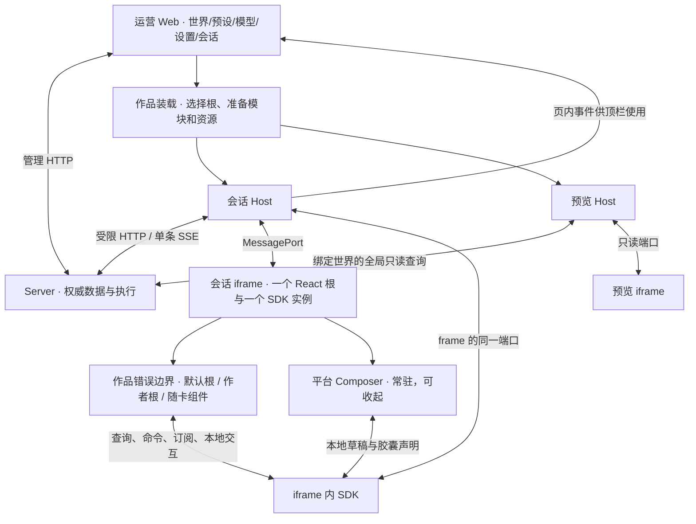
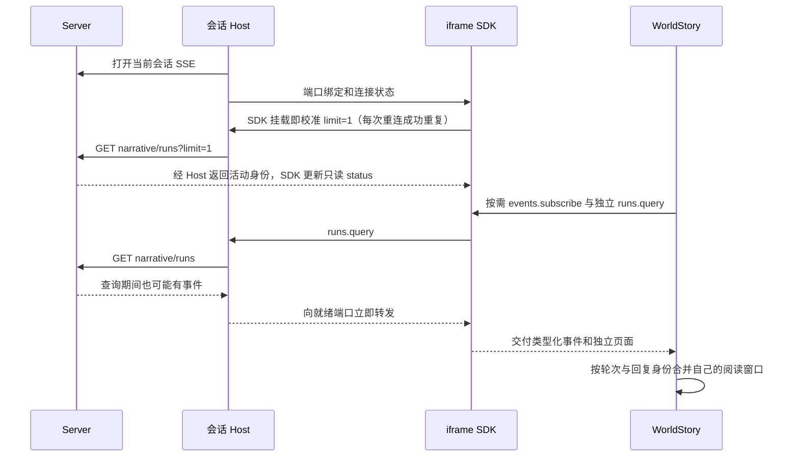

# SillyRealms 首发前端重构方案

**评审稿 · 2026-11-28。** 本文定义首发目标；可实现的作者接口见[SDK 契约与用例](首发舞台SDK契约与用例.md)，文件树、依赖与上线门槛见[实施任务](可组合舞台与薄宿主架构任务.md)。本次更新计划文档。下述目标尚待开发、导入验证与试玩。

## 1. 产品决定

SR 交付的是可以进入、持续游玩的世界。一部小说可以用官方舞台，一张地图卡可以只显示场景和几个行动按钮，两者能使用相同的会话、状态、生成和保存能力。在地图上点“推门”应与在输入框键入“推门”走相同的命令。作者换界面时无需修改 Web 或 Server。

1. 平台承担两类职责。**运营面**负责世界、预设、模型、应用设置、会话创建和配置，以及玩家退出和故障恢复。**基础设施**提供 Server 和隔离舞台的传输。平台团队另以普通作者身份发布官方舞台。这里的划分描述软件职责；会话归属、管理访问、状态写锁仍由各自契约检查。
2. **平台拥有会话顶栏与输入区，作者根拥有作品演出。** 顶栏在 iframe 外负责标题、返回、设置、用量和故障恢复。FrameShell 在会话 iframe 内固定挂载官方 Composer，提供发送、停止、重新生成、AI 帮答和收起/展开。作者可编排正文、行动建议、立绘和内容按钮，用 SDK 发送行动、填写草稿或登记胶囊。
3. **Host 只承诺四件事**：iframe/MessagePort 生命周期、绑定目标的命令白名单代理、会话 SSE 的连接与转发、外观下发。Host 的业务缓存容量为零，包括活跃 run、上一轮结果和未发送文本。预览没有会话，启用其中适用的三项。
4. **一条作者管线。** 显式 data.stage_component 选择作品根；缺省则选择已安装的官方默认舞台。两种根的包格式、编译白名单、SDK、模块解析和发布工具完全相同。非法声明、模块缺失、运行抛错均给出错误与显式恢复操作。
5. **单版本首发。** 本轮允许重写整个前端，无旧客户端适配、双轨开关、旧卡识别、数据转换或兼容镜像。使用新数据根做安装验收。实施前提不授权删除已有玩家数据；发现不支持的库/作品应报错，示例及内置包由项目主动更新重打。
6. **HTTP 查询/命令 + SSE 就够用。** 首发不建消息总线服务、WebSocket、运行回放表、组件市场、第三方远程代码装载或通用插件权限系统。Server 的流式断点续传作为独立未来能力。

## 2. 实物基线与重构理由

| 当前实物 | 首发去向 |
|---|---|
| [workspace](../apps/web/src/features/sessions/workspace.ts) 合并历史与流式文本、恢复状态/建议/立绘，并发布 StageSnapshot；[StageHost](../apps/web/src/stage-host/StageHost.tsx) 又转发事件 | 删除全页投影、快照消息、Host 业务恢复和 SDK 冻结镜像。将可重用的去重、查询与恢复函数迁进 iframe |
| [SessionPage](../apps/web/src/features/sessions/SessionPage.tsx) 承载输入、帮答、立绘和配置；history.refresh 实际触发全页刷新 | 页面收敛为运营外壳；输入迁入 frame 的平台 Composer，状态显示在卡内组合；每个刷新只影响对应查询 |
| [frame](../apps/web/src/frame.tsx) 内置 DefaultStage，私下接入故事渲染配置；官方部件现在和 Web 功能目录混合 | 删除内置根组件分支；导入普通官方世界包，所有作品同享公开的正文渲染和内容 API；编辑器保留在平台输入区 |
| [状态控制器](../apps/web/src/features/state/index.ts) 和[预览](../apps/web/src/features/worlds/WorldComponentView.tsx) 使用旧的分 scope 路径 | 改用 Server 实际注册的 POST /state/query、/state/update；一次查询只针对一个 scope，并返回字段行 |
| [运行查询](../apps/server/src/modules/sessions/service.ts) 从一等 Run 读取分页和详情，两种读取返回相同的轮次对象。状态、原因、执行身份、能力结果、用量与普通消息一并返回 | SDK 交付完整 Run。组件可单独识别中断、部分保存和再生。Host 无需从消息重建轮次 |
| 实时立绘和历史 Run.capabilities.characterSprite.items 均携带本次执行保存的 asset | 挂载或重连直接读取最新轮，按素材引用加载。会话舞台恢复无需额外请求立绘目录或指定消息 |

## 3. 概念模块与数据所有权

| 模块 | 所有者、输入与输出 | 生命周期和禁止依赖 |
|---|---|---|
| 世界卡 | 可移植的作品定义。拥有角色、开场、状态声明、组件、消息规则和素材；发行标识确定版本 | 不包含本地会话、模型凭据或玩家草稿 |
| 会话 | Server 上的一次游玩。sessionId 绑定世界、玩家身份、开局、运行配置、消息链和有效状态；runId 表示一轮，assistantEntryId 表示一次生成执行 | 页面退出、换组件或 SSE 断开均不删除会话、不等于停止模型；两个标签可各自打开同一会话 |
| Server | 世界安装与资源读取、访问检查、执行和写锁、模型调用、上下文/摘要、持久消息、状态更新、用量与结算后事件 | 唯一持久事实源。HTTP 受理、停止请求和最终终态有独立语义，不把 SQLite 模型搬进组件 |
| 运营 Web | 现有五个管理页及详情、导入导出/发行应用、预设模型与凭据、会话创建/配置、主题、平台语言设置及字号。会话顶栏展示连接、用量和需要的运行进度，提供可达的退出/设置/重载 | 直接走管理 HTTP。管理 store 不注入作品。停止操作由 iframe 中的平台输入区发起 |
| 作品装载器 | 输入 worldId、发行和入口；读取详情及组件源码，复用编译器，生成挂载材料；处理换版、取消旧读、错误和重试 | 是 Web 的资源装载函数。可按发行复用编译物；不读叙事历史。世界详情预览池负责十实例 FIFO、显示/隐藏、尺寸和弹窗焦点 |
| 两类 Host | 接受已授权的会话/世界绑定与挂载材料，使用精确来源/窗口/nonce 握手；按各自白名单代理；下发外观。会话 Host 打开一条 SSE | 只保留 iframe、port、连接状态、代次、在途请求及可重发的外观/挂载材料。没有历史、活动 run 缓冲、业务事件队列和组件注册中心 |
| 舞台 iframe | 独立来源、单个 React 根。安装 SDK、模块加载器、资源与外观上下文、根/消息错误边界，执行舞台及消息组件。预览 iframe 只安装预览能力 | 每次整 frame 重挂为新实例；仅在此处执行作者 JS。组件可以挂载或省略，会话状态监听随 SDK 绑定建立，组件的内容订阅按需启用 |
| SDK | 白名单端口客户端、事件分发、领域读取/命令、当前执行归并、轻量 hooks、公共渲染原语及本地填稿、胶囊扩展点 | 活动执行、共享草稿及按需读取只在这次 frame 中存活。阅读窗口、下一页游标、滚动位置、布局和动画归组件。没有全量加载所有域的 Store |
| 官方/作者/第三方组件 | 以 React 组合交付正文、内容行动、立绘、建议或别的玩法；公开 API 赋予同等能力。第三方首发随卡审核、固定版本、打包和发布 | 同一 iframe 同一作品信任域。能接触作者输入的模块也可能观察草稿；不宣称组件间保密。管理页面位于外层 Web，平台输入区与作品共用同一 frame |

“无状态 Host”指无**业务状态**。维护连接是否打开、端口是否作废、某请求等待响应是传输所必需。Server 的最终模型消息 snapshot、立绘完整快照、React 领域 hook 的快照各有具体语义，均不产生跨桥全页快照。

实现时有三个明确的依赖方向。Server 和打包工具只引用无 React 的世界格式、资源和协议类型；运营 Web 使用管理客户端、装载器和 Host；iframe 使用相同的共享契约、SDK 和已编译的作品模块。SDK 不能反向导入 apps/web 的管理 store、HTTP 客户端、翻译实例或 Server 实现。编辑器依赖仅在会话 frame 的平台 Composer 使用。静态预览不访问会话；纯地图舞台同样挂载平台输入区并执行一次状态校准。

### 创作者如何理解一次游玩

作者使用 `useSRSession()` 取得当前会话。一个 Run 代表作品中的一轮，内含可见的玩家和助手内容；开场也可以独自成轮。聊天阅读器与视觉小说使用同一接口，读取的轮数、对白分页、演出节奏由各自组件决定。

| 作者意图 | 唯一入口与所有者 |
|---|---|
| 判断当前会话状态 | `session.status` 取 unknown、idle 或 generating。SDK 随会话 frame 挂载立即查询 limit=1，每次 SSE 重连成功重新查询，读取方始终只读。进入/断线待确认是 unknown，受理到匹配终态之间是 generating。单次按钮等待和查询失败由发起组件处理 |
| 对当前会话采取行动 | session.send(text) 直接发行动并保留玩家草稿；session.setDraft(text) 返回异步成功/失败结果，仅填入本地草稿。停止、重新生成、帮答由平台输入区执行 |
| 回看或恢复一轮 | `session.runs.query({limit,cursor})` 每页 1–5 轮，返回 items、hasMore、nextCursor、activeRunId、tipEntryId。`session.runs.get(runId)` 精确读取同型 Run。组件直接读取 run.status、run.stopReason 和 message.status，WorldStory 自管自己的窗口 |
| 订阅会话事件 | `session.events.subscribe(types, listener)` 按调用者声明的事件名分发。所有送达当前就绪端口的会话 SSE 事件与字段均可订阅。便捷 hook 与作者回调共享分发器 |

顶栏负责摘要进度与计量 UI，普通舞台可以只监听生成和正文。所有组件都可订阅同一会话的原生事件，包括摘要、用量、状态、发行变化和帮答。Host 解析 SSE 后原样转发事件名与 data，工具分片、思考、snapshot 和 stop_reason 均保留。SDK 自身的状态归并和作者订阅各自消费，旧执行的事件仍按到达顺序交付。字段表及使用方式见 [SDK 契约](首发舞台SDK契约与用例.md)。

### 平台输入区与胶囊栏

FrameShell 创建单个 React 根和 SDK 实例，在其中并列挂载作者内容边界和平台 Composer。作者根只决定内容区；根抛错时输入区继续可用。Composer 固定占据平台布局槽，收起保留草稿、登记和活动运行的停止按钮，玩家随时可展开。作者不能借 SDK 卸载、替换或接管输入区。平台编辑器、帮答、重新生成、停止以及未来的输入功能通过 frame 私有依赖使用；发布给卡编译器的模块根只导出内容 API。输入区使用平台样式作用域，内容区有自己的滚动与错误边界，作品弹层定位于内容区。组件同处一个 JS 环境，这项约定是支持的 API 边界。

胶囊栏由 Composer 布局。作者通过 useSRComposerButtons 登记 label 与回调，本地注册器支持多个组件、同名标签及独立卸载。Composer 点击时直接调用当前回调，按钮列表、草稿写入、点击均不经 Host。平台不注入特殊“立绘按钮”，也不根据配置筛选胶囊。胶囊栏为固定宽度、最大不超过输入区可用宽度；统一等宽胶囊、禁止换行或压缩。容得下时整组居中；超出时以首项为起点，视口裁切，通过触摸或触控板横滑、键盘聚焦滚动可达两端。所有组件均无登记时不占行。推荐用横向 overflow:auto、内层 width:max-content / min-width:100% 居中排列，避免溢出时首项被居中裁掉。尺寸和间距复用平台控件规范，作者不能设置尺寸、位置或排序样式。

### 会话级配置

前端重构实施时需扩展 Server v15 现有会话 runtimeConfig，持久化 characterSprites、actionSuggestions、replyAssist 三个布尔开关，通过会话创建/设置读写。首次创建建议三项默认开启，创建/设置页均可逐项覆盖；关闭也是有效值。首次进入、设置保存与重连对齐服务端已存值，通过只读 session.capabilities 逐项交付，不合并世界目录、本地素材、模型预设或输出状态。平台 Composer 按 replyAssist 开关提供帮答，缺少预设时保留操作失败原因。两个内容 hook 忠实返回最新消息的实际输出；是否显示由作者决定，已有消息不因配置变化被改写。角色面板可独立使用获准加载的远程素材。

## 4. 官方舞台如何与作品同权

**根解析。** 新增一个正常的 spec_version 0.2 世界源码目录，含必填 publication、合规角色/开场、声明的根与组件。使用 world:check、world:pack、world:release 及现有 releases.json 规则生成普通发行物。通过现有 initial-data 世界安装流程安装；在清单中增加唯一的默认舞台来源引用 defaultStageWorldId，初始化后验证该世界显式声明了根。它仍是可在世界管理查看、导出、更新的普通作品；运行期间被删除时，已有显式根作品可继续加载，缺省根作品显示缺包诊断，并可通过原有导入流程恢复。运行部署配置只需返回此来源 ID 给可信装载器。这里选择了“从哪张卡取默认根”，没有内置 TSX 捷径或官方专属 RPC。

| 情况 | 加载行为 |
|---|---|
| A 声明根 | 取 A 该发行的模块图，按根 ID 加载。源码检查、模块未找到和运行错误均显示卡、版本、组件 ID |
| A 未声明根 | 取清单配置的 B 的根和依赖；会话、角色、开场、世界状态、消息规则、角色素材始终来自 A。B 不递归选择其他默认卡；B 缺失/根坏，提示修复默认发行包 |
| 默认根读取资源 | 数据资源如 SSE 的 asset 均按 A 解析。B 的界面装饰显式选择 stage 资源基址。消息替换组件从 A 的模块图加载，其 ./ID 始终在 A 图解析。A/B 的同名模块毋须合并或重命名 |
| A/B 更新 | 以两个来源各自的 worldId + release version 标识渲染材料；重新加载之前撤销旧读。绑定会话 A 的 SSE 不会替 B 接收更新：运营端本次安装后主动使相应装载失效；重新进入、重连或显式重载检查两个版本。V1 不为默认包开第二条 SSE |
| A 根坏或用户明确退出作品 UI | 基础外壳始终可达，显示重试、返回、设置、显式改用默认舞台。手动恢复模式可禁用 A 的自定义消息替换，按基础文本显示。恢复选择限定本页，不改卡、不改会话 |
| 第三方组件 | 首发把模块和合法素材随目标卡打包，内部仍以 ./组件ID 默认导入。选择官方部件源码同样可以随卡组合。工具检查重复 ID、环、未声明依赖和声明的包内资源缺失；分发第三方素材按其许可保留署名；首发不提供远程安装器 |

**执行与样式。** 同一份 sr-ui-compiler 白名单、默认导出规则、模块执行器和 CSP 作用于所有卡。共享外部入口仅 React、现有 React DOM/JSX 白名单和 @sillyrealms/sdk 根。卡内普通 TSX 可组合公开的 MessageBody 与 Document；正文清洗和规则匹配对所有卡一致。官方内容根、阅读列表、立绘等作为世界包普通模块交付；平台 Composer 随会话 frame 构建，内部复用现有 Lexical 编辑和角色扮演序列化。舞台 CSS 用卡内组件样式或受支持的资源方式，示例须经实际编译验证；不让官方卡直接导入 Web 的 CSS module、i18n 实例、路由、私有 Provider 或 npm 编辑器。首发 SDK 不感知国际化。作品直接提供内容和胶囊 label；平台语言设置留在运营 Web。错误、停止和草稿失败通过可机读原因区分，本轮不规定错误提示、输入框文案或译文。

**验证同权的方法。** 用另一包 ID 导入相同官方源码，明确声明其根，运行相同的聊天/状态/立绘/帮答用例。再用缺省根的 A 运行 B，使用冲突的组件 ID 和同名图片验证两个命名空间。检查正式编译后的 frame 包没有内置的官方根组件。官方特色功能若只能依靠包 ID 放行，视为 SDK 缺陷。

## 5. 传输、隔离与失效

| 通路 | 首发协议 |
|---|---|
| 运营 Web ↔ Server | 延用管理 HTTP；授权、归属、锁、校验和提交均由 Server 执行。作者侧不提供通用 fetch 代理 |
| 会话 Host ↔ Server | 每个打开的会话页用一条 GET /api/v1/sessions/:id/events 流连接顶栏与舞台。采用能读取任意命名帧的 fetch 流式 SSE 解析器，处理跨块 UTF-8、多行 data、空行分帧、心跳和断线重连。浏览器 EventSource 的命名监听需预先枚举事件，会漏掉未来的新名称。对当前就绪端口逐事件有序发送一次完整 {event,data}。无端口即丢弃，切会话或退出即关闭；组件的订阅变更只发生在 iframe |
| Host ↔ frame | 沿用独立源 sandbox、精确 origin、contentWindow、nonce 和 MessageChannel。一次握手分配一个端口代次。init 传模式、绑定、模块/规则、显示信息、资源根和当前连接状态；appearance/connection 随后可更新；event 携带原生会话信封，传输只检查来源、绑定和包络；state.changed 本身没有 sessionId，归属由连接保证。request/response 用当前端口唯一 ID 匹配，读支持取消，卸载清理监听与 pending；response 只投当前代次 |
| frame → 代理 | 名称、参数、尺寸、目标按白名单验证。URL、HTTP method 和可访问 scope 由操作表固定。会话/世界由绑定补入；entryId 等子资源由 Server 检查归属。读取敏感字段前投影安全 DTO。未知操作、空白 ID、非法目标、非 JSON 参数及超限请求拒绝 |
| 预览 | 只读当前世界的显式 global 路径。无会话端口能力、无 SSE。可见性/resize/焦点是预览 iframe 生命周期控制；沿用可见帧的有界高度、隐藏暂停 HTML 媒体/CSS 动画、重试销毁旧桥、离开取消源加载 |
| 资源与外观 | 包内资源经当前绑定的世界资源端点，HTTP(S) 素材遵守既有解析。沿用隔离来源、CSP、主题语义 token、字号与降动效。输入框已在 frame 内，键盘视口、胶囊栏和留给内容区的空间由 FrameShell 布局处理；不再从 Host 测量某个官方输入框 |

沿用现有会话桥单次请求 2 MiB、frame 侧最多 100 个 pending、30 秒 RPC 超时作为首发基线；资源文件走资源通道。此上限仅针对由 frame 发起的 RPC 请求。分页回复与 Server SSE 可包含较大的定稿快照，入帧按完整消息交付；失去连接时走重连校准，禁止静默截短。写请求超时或断端口只说明回执未知；不会自动重发、取消 Server 已受理的叙事或宣告失败。同一作品的部件共处同一 JS 环境；隔离源只承载静态 frame 和受限素材，不存管理令牌、草稿或叙事正文。Web 与它的允许来源及端口由运行配置校验。SDK 向组件提供可机读错误与取消语义；来源诊断给到运营界面，不透传凭据或磁盘路径。世界/会话切换、预览淘汰、页面卸载和开发热重载都由同一条撤销路径收尾。

### 谁先订阅

Host 拥有网络订阅，组件通过 SDK 安装本地监听。SDK 先安装端口接收器再声明 ready；某领域首次挂载先订阅再发查询。查询与实时流的交接不依赖精确的全局 SSE 游标。若加载期间出现删除、切换执行或相关字段变化，SDK 使旧连接的在途读失效；阅读器记录请求代次，查询期间若发生结构变化、无法安全合并，则对自己的近期窗口补读一次。连续 delta 只影响临时输出，不逐 token 取消并重发整页查询。每次重连成功，以及首次校准早于 SSE 就绪时，SDK 始终重校准会话状态，覆盖“已查完、SSE 才打开”的空档；其他领域只同步已挂载的消费者。断线期间保留已知展示、标明同步状态，禁止盲发新的生成命令。阅读器可在首屏查询期间暂存相关变化，超限时重新获取近期页；Host 不重播。

## 6. 必须实现的行为

| 场景 | 首发规则 |
|---|---|
| 开局、无聊天列表 | 201 的 data 是 {item,opening:{runId,message}}，提交后只有 session.created，数据含同一 opening。首次阅读也可直接从近期页恢复这个 completed Run。SDK 自动 limit=1 校准，多个 useSRSession 共享只读状态，纯地图仍可发行动 |
| 普通发送 | 捕获当时 tip，POST narrative/runs。202 或 run.created 先到均可确认一次已接受的用户消息，以消息 ID 去重；平台输入区提交时保留修订号，受理后仅清掉该版本草稿；作者直接 send 不清草稿。不同标签并发由 Server 锁和 expectedTipEntryId 决定；超时保留草稿，主动同步，禁止自动重发 |
| 流式与结算 | 阅读器按 assistantEntryId 处理 run.delta.messages[0]，分别归并 delta.content、reasoning_content 和工具分片。snapshot 整体替换，finish_reason 只说明模型输出。Server 提交助手（若有）、能力和轮次终态后才通知，completed 可立即解除本次忙态。stopped 保留原始 stop_reason、savedMessageIds 与真实 tip；只在需要保存内容时按 runId 补读，无需轮询落库 |
| 中途重载、漏事件 | 局部组件晚加入、整个 frame 或页面重建都可能错过分片。读近期页得到 activeRunId 及相应执行身份后标记 incomplete，标记当前执行仍在生成、正文尚不完整。正文与思考文本都可能缺失前缀，孤立后缀不充当完整回复。若随后收到整条模型 snapshot 可立即恢复，若只收到终态则取已保存历史。离线/迟到事件不触发新命令 |
| 重新生成与停止 | 平台 Composer 仅对最新含用户的终态轮提交 {runId,expectedAssistantEntryId,expectedTipEntryId}。即使上次未保存助手也使用 Run 的预留 ID，tip 取服务端的真实值（可能是摘要）。202 沿用同一 runId，分配新的 assistantEntryId，并给出 deletedMessageIds。旧执行的事件仍交付，消费者按身份忽略对新执行的更新。stop 以路由 runId 和正文 assistantEntryId 配对，受理后保持忙态至终态 |
| 轮次查询 | Server 按稳定轮次键从新到旧分页。SDK 可将单页 items 排成阅读顺序，保留不透明 cursor 和全部 Run 字段。按 ID 补读直接返回 Run。重连替换近期窗口，再生以新执行替换旧轮；启动收尾后的 stopped 原因同样可读。不按 seq 追赶，不用最后一条可见消息推断 tip |
| 三域状态 | 只请求订阅的路径；message 绑定具体 entryId，tip 切换撤销旧请求。空事件 path 替换整域，字段变更只影响相应路径。保留缺失、null、空数组区别。更新成功可表示路径缺失或同值，使用事件/查询得到有效值。预览只能显式读 global 路径。Server 对写入和锁负责 |
| 建议与立绘 | 读取最新 Run 的 capabilities，核对末条普通消息是否为本次执行保存的助手。玩家为末条、结果缺失/失败/显式空都清空，success/partial_success 使用有效 items。受理或再生删除旧助手即清空。实时 items 直接包含 asset，按消息身份替换；不回找老图或向前翻轮。开关独立于读取 |
| 草稿、帮答和互动 | 平台 Composer 管理本地草稿修订与 requestId，setDraft 异步报告结果。reply_assist.* 与其他会话事件同样公开，其他标签页能看到模型给出的帮答文本。仅当前发起 Composer 可把匹配结果自动写入自己的草稿。断线或撤桥解除关联，旧请求不写新草稿，生成中和离线仍可手动填稿 |
| 切换发行与故障 | 装载器在 Web 内消费已绑定 SSE 的 world.updated，随后核对身份/版本，按发行撤销旧模块与资源。简单改名和主题变化不重挂。运营面可在主动切换前提示会丢失输入，不收集草稿正文。消息组件失败回退该段正文，根故障由外壳提供操作 |
| 配置与用量 | 会话设置原值实时反映到 SDK，立绘胶囊声明及点击行为由组件独立决定。运营顶栏通过 GET narrative/usage 读取会话汇总及 latestContext；每轮 run.usage 和 Run.usage 含已知总量及已记录/未知请求数，再生时按轮替换，保留已提交摘要的费用。未知用量不当作实测零，输入组成以字节计。保存设置局部更新绑定，无需重建作品根或清空输入 |

### 不做无损续传的理由

当前 Server 已能回答“正在生成吗、是哪次执行”，无法回答“之前 37 个分片的完整文字是什么”。恢复状态并继续接后续 SSE 足以显示忙态；要逐字无缝接回，未来需同一执行的临时内容 checkpoint 加对应分片位置，并处理读与订阅的交接。单加 running 布尔值不够。首发不定义这个 API、不引入 Host 缓冲，不为此新增数据库状态。

## 7. 切换与上线

在开发分支上按纵向用例建设，首次上线一次性切换实现；所有被发行的内置卡、示例、卡包、SDK 文档、作者工具和 AGENTS 一起更新。没有“旧 API 仍可调用”阶段。可复用编辑、规则匹配、资源安全解析和领域归并算法；删除旧入口、Host 业务控制器、跨端口作者按钮及双份快照。正式 docs 只在代码落实后写为当前契约。

评审时用三个问题检验每一项新增能力：已有的哪个舞台或预览用例需要它？能否通过现有 HTTP/SSE 与本地组合实现？一份没有官方身份的卡能否用公开接口重做它？首发验收使用干净安装、显式根卡、缺省根卡、无聊天地图卡、损坏根卡、同一会话双标签和只读预览。用例、测试层次、真机试玩和放行条件详见配套任务。
