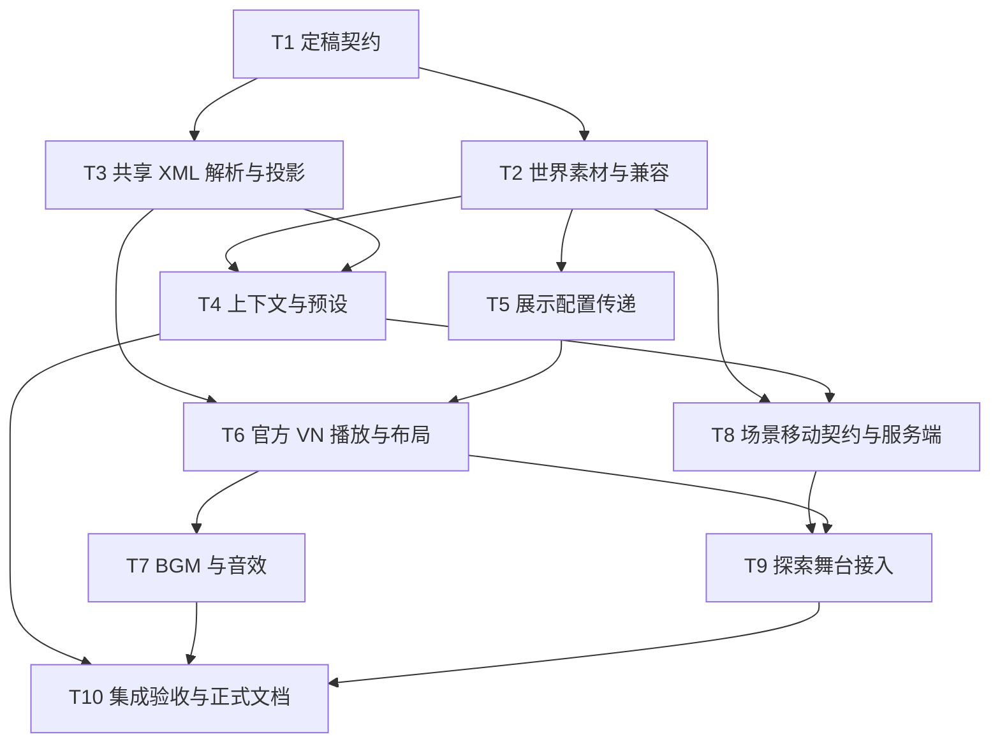

# 视觉小说与场景演出任务

日期：2026-11-22。状态：未实施。方案见 [视觉小说与场景演出方案](./视觉小说与场景演出方案.md)。

本次仅保存方案与任务。所有实施项均未完成，目录树是计划范围。XML 已确定，不再安排 JSONL 正文选型，也不创建第二套输出协议。任务编号表示依赖与验收边界，不授权自动开始代码变更。

## 阶段与依赖

基础 VN 交付范围为 T1–T7 和相应 T10；手动探索是 T8–T9 的独立阶段。T10 不要求为了验收基础 VN 先实现探索。自定义槽位是否首版纳入由 D5 决定。

## T1：定稿世界、XML、预设和场景契约

- [ ] 核对方案 D1–D6，区分基础 VN 必需决定与探索阶段决定。
- [ ] 定稿 sprites / backgrounds / bgm / sounds 对象、唯一性、default、资源引用和受限条件。
- [ ] 定稿 XML 标签、属性、初始画面、默认值、角色未上镜对白、实体、流式与损坏恢复规则。
- [ ] 明确 `<vn>` 与现有两个后处理块的边界；正文 XML 不修改状态更新 JSONL 和行动建议 JSON 数组。
- [ ] 定稿世界协议需求、预设兼容元数据及新视觉变量，不通过源码猜测模式。
- [ ] 更新方案的正式命名与变更树；探索地点权限、移动持久化若尚未决定，保留 T8 未开始。

交付：可用于实现和测试的契约说明及有效/无效样例。验收：所有未定项明确归属阶段，没有把尚未确认的建议标成已实现合同。

## T2：扩展世界卡素材、场景声明与持久化

依赖：T1 的基础素材契约。

- [ ] 修改 worlds validation / parser / types / repository / service，增加可选视觉字段和兼容迁移。
- [ ] 角色 sprites 纳入既有角色数据，世界级视觉目录使用明确受校验结构。
- [ ] 接入新增素材的 ZIP 文件存在性检查、JSON 在线资源和导出映射。
- [ ] 校验默认立绘、重复 ID、背景/BGM/角色/出口引用及表达式；自定义槽位仅在决定纳入时实现。
- [ ] 添加导入、导出、解析与旧数据库保留测试。

交付：素材与场景配置可正确往返。验收：旧卡保持原行为；新字段不静默丢失；无资源权限扩大。

## T3：实现共享纯 XML 解析与语义投影

依赖：T1 的 XML 契约。

- [ ] 在 SDK 的纯子入口提供 XML 类型、解析、投影和展示状态归约；Server 导入不加载 React、DOM 或媒体。
- [ ] 支持完整解析和流式增量；每个控制元素完整校验后生效，暂态文本不等同于完整事件。
- [ ] 输出稳定事件索引、可读正文、画面状态和诊断；明确未知引用与截断行为。
- [ ] 创建历史、关键词、摘要的只读投影，保留角色与必要场景语义。
- [ ] 覆盖任意分片、实体、嵌套错误、保留标签、未知 ID、空对白及不完整结束。

交付：一套可供客户端和服务端复用的解析实现。验收：同一完整正文的增量和一次性结果一致，不触发业务状态，不执行文本中的脚本或外部实体。

## T4：上下文材料与官方视觉小说预设

依赖：T2、T3。

- [ ] 在现有 sessionId-only 捕获边界取得视觉声明、当前状态和最新有效画面，不从前端传入权威场景。
- [ ] 生成候选角色立绘、背景、音效、场景与当前画面变量；不包含 URL、源码和重复长角色设定。
- [ ] 复用条件机制和加载规则，输出候选诊断；视觉材料计入实际输入预算。
- [ ] 提供官方视觉小说预设、模板入口、便携导入导出和兼容校验；保留独立采样参数和现有状态变量。
- [ ] 调整固定输出指令及必要的分离边界，允许 VN 正文根，业务块仍独立处理。
- [ ] 将共享语义投影接入 history、激活和 summary，核对摘要 sourceHash 与既有两条 assistant 旁注。
- [ ] 用函数级集成验证多人次序、候选条件、玩家决策停止、预算及旧预设兼容。

交付：模型能够收到正确候选及 XML 指令。验收：无新模型分类请求，无上下文重复注入，无状态权限放宽；XML 选择不重新回退为 JSONL。

## T5：Host / frame 最小展示配置

依赖：T2；数据形状遵循 T1。

- [ ] 在 stage-world 中构建经过验证的最小展示目录与必要场景投影。
- [ ] 修改世界 API 类型、frame 协议和 frame 注入，使官方组件可以解析 ID 到素材。
- [ ] 复用既有资源 URL、appearance 和 MessagePort；介绍/开局预览继续只读。
- [ ] 验证加载失败、世界切换、配置失效和帧重建；不复制历史恢复与状态业务。

交付：舞台可读取受限视觉配置。验收：不暴露原始世界卡、角色 prompt、完整规则或业务 transport；普通 WorldStory 与预览缓存合同不变。

## T6：官方 VisualNovel、布局与阅读

依赖：T3、T5。

- [ ] 新增 SR.VisualNovel 及样式，通过现有 stage_component 调用；保留 WorldStory 默认。
- [ ] 支持背景、唯一角色立绘实例、语义位置、说话者、旁白/对白和逐段播放。
- [ ] 实现 default / 保持 / hide / show 规则，明确冲突槽位和缺失素材降级。
- [ ] 复用现有输入、行动建议和生命周期反馈；旧开局按已定规则兼容。
- [ ] 维护本地阅读位置，处理历史补载、删除、重新生成和回到最新；不让阅读游标回写业务状态。
- [ ] 使用已有主题及 appearance，处理窄屏、输入区避让、键盘焦点和减少动效。
- [ ] 以纯归约与布局函数测试验证主要行为；真实浏览器布局验收另行明确安排。

交付：基础视觉小说可完整展示已有或实时演出。验收：单条历史可恢复初始画面，重建 iframe 不重发模型请求，旧 assistant 删除后不残留。

## T7：BGM 与一次性音效

依赖：T6。

- [ ] 实现背景绑定音乐、同曲持续播放、切曲/停止及用户静音音量。
- [ ] 为作者音乐接管提供明确方式，避免并行播放器；复用 URL 解析，不建设通用 AssetAPI。
- [ ] 音效绑定事件播放位置，用 assistantEntryId / 消息 ID 和事件索引区分执行。
- [ ] 处理自动播放拒绝、媒体失败、实例销毁及作者控制冲突。
- [ ] 验证重复快照、持久化交接、重连、历史读取和重新生成不意外重播。

交付：音乐和音效生命周期可靠。验收：不根据尚未阅读到的最终业务状态提前演出，不把音效视为业务状态操作。

## T8：探索场景解析与服务端进入用例

依赖：T2、T4；开始前必须解决 D3、D4。

- [ ] 定稿地点权威根、state scope、普通 entry/run 记录、可验证状态版本与幂等语义，并补全变更文件树。
- [ ] 明确玩家地点、NPC 地点、场景 presence 与 load 的关系，复用条件求值实现纯解析。
- [ ] 实现当前地点、出口及条件校验，复用现有锁及写入 permit 规则。
- [ ] 原子保存移动记录和新地点，提交后发布实际状态变化；不使用前端 PATCH + send 模拟事务。
- [ ] 对普通状态写入和模型后处理应用同一地点权限，防止绕过受控出口。
- [ ] 定义无模型移动和移动后可选叙事的行为；后续生成失败不重复移动，不自动伪造回滚。
- [ ] 覆盖重复提交、状态变化、锁竞争、部分失败、tip 变化、删除和重新生成影响。

交付：可验证的场景进入用例与 HTTP 契约。验收：只有成功提交才改变所在地，不出现“一半移动”，不引入 runs 表或第二套会话恢复。

## T9：探索命令、场景导航与作者能力

依赖：T6、T8。

- [ ] 增加受控 SDK 场景命令并经 Host 转发；保留 frame 代理和不可变镜像职责。
- [ ] 区分地图浏览和进入地点，展示服务端确认的可交互角色与出口。
- [ ] 进入请求待确认时不伪装移动成功；处理锁、陈旧状态、失败和可选入场生成反馈。
- [ ] 防止历史阅读界面中的旧出口直接操作当前业务状态。
- [ ] 验证场景切换、候选刷新、叙事约束及状态通知的一致性。

交付：作者舞台或官方探索界面能够安全使用手动切场景。验收：背景切换不冒充真实移动，模型 XML 不覆盖已确认的场景权威。

## T10：集成验收与正式文档

依赖：基础交付为 T4、T7；探索交付另加 T9。

- [ ] 准备小型可验证卡：透明立绘、两个背景、BGM、一次性音效、多个 NPC 与玩家角色；探索阶段再加入条件出口和 NPC 位置。
- [ ] 完成相关函数级集成测试，再运行 `pnpm typecheck`、`pnpm lint` 及受影响测试；仅在失败或新修改需要时扩大验证。
- [ ] 核对停止原因 output_limit_reached、部分正文保存、状态/建议独立失败和重新生成身份隔离。
- [ ] 检查新旧数据库、世界包和预设往返兼容，确认不会误修改已有卡或扩大作者权限。
- [ ] 实施完成后更新 AGENTS.md、正式视觉协议文档、世界示例及相关 runtime/design 合同。
- [ ] 检查计划中的新增/修改文件与实际 diff 一致，记录未完成范围；不把未实施探索功能写成事实性规范。

交付：测试证据、正式合同及明确的交付范围。验收：未启动开发服务或新增 mock E2E 环境；真实浏览器布局/媒体验收如未执行，应明确列为未验证项，不能宣称完成视觉 QA。

## 本次归档检查

- [x] 保存方案与任务两份文档。
- [x] 标明 XML 已决定，区分已接受方向与待定细节。
- [x] 附带树形计划变更目录，说明新增、修改与无删除范围。
- [x] 将手动探索与基础视觉小说分阶段，并保留待定契约。
- [ ] 以上 T1–T10 的业务实现尚未开始。
