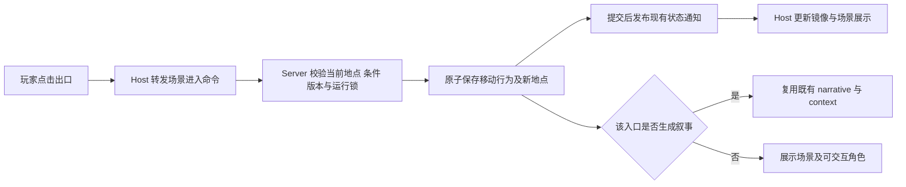

# 视觉小说与场景演出方案

日期：2026-11-22（Asia/Shanghai）。状态：讨论结论归档，尚未实施。

配套任务：[视觉小说与场景演出任务](./视觉小说与场景演出任务.md)。本次只新增两份规划文档，不修改业务代码、数据库、运行中服务或正式规范。

## 1. 决策状态与目标

在现有世界卡、叙事服务、上下文、隔离舞台和 SDK 上增加视觉小说能力：立绘、角色对白、旁白、场景背景、BGM、音效，以及可选的手动场景探索。

| 事项 | 讨论结论 | 状态 |
| --- | --- | --- |
| 正文格式 | 使用 XML，不再以 JSONL 作为正文候选，也不同时建设两套演出协议 | 用户明确决定 |
| 立绘素材 | 对象数组，包含 `id`、`asset`、`description`；`id=default` 表示默认立绘 | 用户明确要求 |
| 复杂情绪 | 用素材描述说明画面、适用情境及不适用情境，让模型选择 | 已接受方向 |
| 背景选择 | 模型根据上下文选择；可用背景及说明需正式注入 prompt | 用户明确要求 |
| 资源交付 | ZIP 内资源或 JSON 中的在线资源，也允许 ZIP 混用在线资源 | 已接受方向 |
| 官方组件 | 新增官方视觉小说组件，通过现有舞台入口选择，普通世界继续使用 WorldStory | 已接受方向 |
| 多人生成 | 一次请求允许模型按上下文安排多个在场角色的对白顺序 | 用户明确要求 |
| BGM / 音效 | BGM 可随背景或由作者控制；音效允许模型选择资源并输出演出指令 | 已接受方向，细节见下文 |
| XML 标签 | 建议固定标签、角色 ID 放属性；标签表及容器规则见第 4 节 | 设计建议，尚未逐项定稿 |
| 立绘位置 | 语义槽位；官方槽位为默认，自定义槽位作为扩展 | 设计建议 |
| 手动切场景 | 场景目录、条件在场关系、出口关系；浏览与真实移动分开 | 用户提出需求，结构为建议 |
| 场景进入命令 | 由服务端原子校验与提交，不使用前端“先改状态再发消息”串联 | 设计建议，命令与持久化尚需定稿 |

本文示例中的新增字段和接口均为提案，不代表现有 API 已支持。后续实施先处理第 12 节待定项，不重新讨论已选定的 XML 方向。

## 2. 当前能力与边界

- 角色已有独立 ID、名字、头像、描述、提示词和加载规则；尚无统一的立绘目录。人物背景设定不等于场景背景图片。
- `stage_component` 指向世界组件；SDK 当前提供 `SR.WorldStory`，可以扩展并列的 `SR.VisualNovel`。
- `useSRAssetUrl` / `resolveSRAssetUrl` 已支持 `sr-asset://assets/...` 与 HTTP(S) 资源；在线媒体推荐 HTTPS。实际播放还受 iframe CSP、源站和浏览器策略约束。
- 世界资源 HTTP 已有图片和音频类型支持；新增素材字段仍需接入导入校验、存储、资源引用检查及导出。
- 模型消息仍为一条 user / assistant 消息。一条 assistant 消息中的多角色演出不能直接由消息 role 判断。
- 预设模板变量有显式白名单，新增视觉材料必须通过正式变量和编译链路接入。
- context 只以 `sessionId` 为业务输入，在首次异步等待前捕获实际历史、tip 状态和配置。视觉材料遵守这一入口，不另建传入用户文本、run ID 或前端场景对象的上下文入口。
- 当前状态变量为 `state.global`、`state.session`、`state.message`。global / session 是只读上下文，只有本轮激活的 message 根参与模型状态更新；不沿用已淘汰的 `state.entries` 设计。
- 服务端已有独立的 `state_update` JSONL 和 `action_suggestions` JSON 数组协议。选择 XML 只改变演出正文，不改变上述业务能力格式。
- SDK 是命令代理和不可变展示镜像；业务恢复、状态提交和会话生命周期仍归 Host / Server。一次会话只有一个 SSE。

## 3. 素材与世界卡

### 3.1 角色立绘

建议在现有 `characters[]` 上增加 `sprites[]`：

```json
{
  "id": "xiaoyu",
  "name": "小雨",
  "avatar": "sr-asset://assets/xiaoyu/avatar.webp",
  "sprites": [
    {
      "id": "default",
      "asset": "sr-asset://assets/xiaoyu/default.webp",
      "description": "平静站立。用于日常交谈及没有更合适立绘的情境。"
    },
    {
      "id": "restrained_smile",
      "asset": "sr-asset://assets/xiaoyu/restrained-smile.webp",
      "description": "勉强维持微笑，眼神疲惫。适合掩饰担忧、安慰他人或故作轻松，不适合真正兴奋时使用。"
    }
  ]
}
```

- 立绘是人物透明背景图片，推荐 PNG / WebP；不要求素材必须由抠图产生。头像与立绘分别配置。
- 同一角色的立绘尽量保持画布、人物比例和脚底锚点一致；默认使用底部对齐及完整显示，不按头像裁切。
- `id` 在该角色内唯一；声明非空立绘集合时必须提供 `default`。旧卡没有 sprites 仍可使用。
- `description` 同时服务于复杂情绪、姿势、服装和使用情境，不建立固定情绪枚举。
- 自然语言适用条件是模型选择依据；真正的解锁条件可增加受限 `when`，复用现有表达式机制。默认立绘不附带解锁条件。
- `when` 在本轮捕获的状态上计算。未进入本轮候选的素材，不能因本轮稍后才发生的解锁立即成为合法新选项；不实现逐 XML 元素结算业务状态。
- 首次显示未指定立绘时使用 `default`；已显示角色省略立绘时保持原值。角色有效但立绘 ID 不存在时回退默认，保留对白并提供诊断。
- 无立绘角色的显示降级需定稿：推荐保留姓名和对白，可使用单独头像框，不把不透明头像强制当作透明立绘。

### 3.2 视觉配置命名空间

建议将世界级视觉资源和场景声明放在 `data.visual_novel` 下，避免与已有角色、状态、组件字段混杂。命名空间和具体字段名仍待 schema 定稿。

```json
{
  "visual_novel": {
    "protocol": "sr-vn-xml-v1",
    "mode": "exploration",
    "backgrounds": [
      {
        "id": "inn_hall_evening",
        "asset": "sr-asset://assets/backgrounds/inn-hall-evening.webp",
        "description": "傍晚的客栈大堂，有柜台和通向二楼的楼梯。适合室内交谈，不用于楼上客房。",
        "bgm": "quiet_inn"
      }
    ],
    "bgm": [
      {
        "id": "quiet_inn",
        "asset": "sr-asset://assets/audio/quiet-inn.ogg",
        "description": "安静客栈的循环背景音乐。"
      }
    ],
    "sounds": [
      {
        "id": "door_knock",
        "asset": "https://example.com/audio/door-knock.mp3",
        "description": "短促敲门声。有人实际敲门时使用，不用于回忆或预告。"
      }
    ]
  }
}
```

这是局部示例，不是一张可以独立导入的完整世界卡。`mode` 的拟议值为 `narrative`（连续叙事）和 `exploration`（手动探索）。世界明确声明格式需求；不通过扫描组件源码、角色标签或素材数量自动判断模式。

### 3.3 资源、BGM 与音效

- 模型只接收 ID、说明及适用条件，不接收 URL、路径、媒体字节或作者源码。
- ZIP 使用 `sr-asset://assets/...`；纯 JSON 使用在线资源，不能引用缺失的包内文件。新增显式资源引用必须纳入现有校验和导出往返。
- 背景配置引用独立 BGM ID，同一首音乐可由多个背景复用。默认同曲不重启，切曲或停止由播放器处理。
- 未配置音乐、明确静音和沿用当前音乐的具体缺省语义需定稿，不能把缺省值解释成多个不同动作。
- 作者可以通过自定义舞台接管音乐；必须明确关闭官方默认 BGM 控制，避免两个播放器竞争。
- 逐段同步的音乐跟随阅读到的演出画面。作者按业务状态控制音乐属于另一种策略，不应默认用整轮最终状态为尚未读到的剧情提前切曲。
- 音效是一次性展示事件，模型输出 `sound`。播放与展示游标关联，使用消息 / 执行身份及事件索引去重；不能只依赖 runId，因为重新生成复用 runId、但 assistantEntryId 会变化。
- 历史补载、重连、持久化交接、刷新和普通重渲染不自动重放音效；重新播放须是显式交互。语法错误和不完整指令不播放。
- 用户拥有启用音频、音量与静音控制；处理浏览器自动播放拒绝，离开舞台或销毁实例时清理媒体。
- 第一阶段复用现有 URL 解析能力，不新增通用文件读取 AssetAPI。若需要按 ID 查询，后续仅增加受限、只读的展示素材查询能力。

## 4. XML 演出协议草案

### 4.1 格式选择

正文已选择 XML。此前 JSONL 正文建议作废；不再安排 XML / JSONL 格式选型实验。可验证 XML 的正确率、实际 usage 和延迟，但不得宣称 XML 必然更省 token。

建议使用固定标签 `<char id="xiaoyu">`。`<char:xiaoyu>` 涉及 XML 命名空间前缀，不采用把角色 ID 编进标签名的写法。

### 4.2 示例与元素

```xml
<vn version="1" scene="inn_hall">
  <background id="inn_hall_evening"/>
  <show char="xiaoyu" sprite="default" position="left"/>
  <show char="zhanggui" sprite="default" position="right"/>
  <narration>渡轮刚刚靠岸，两位客人推开了客栈的门。</narration>
  <char id="xiaoyu" sprite="restrained_smile">掌柜，还有空房吗？</char>
  <char id="zhanggui" sprite="thinking">楼上还剩一间，不过……</char>
  <sound id="door_knock"/>
  <narration>身后再次传来敲门声，小雨回头望去。</narration>
  <show char="xiaoyu" sprite="looking_back" position="center"/>
  <char id="zhanggui">先等等，我去看看。</char>
  <hide char="zhanggui"/>
</vn>
```

示例假设这些角色均为 NPC，所有素材已声明并进入候选；不会替玩家编写重要对白。

| 元素 | 属性 / 内容 | 建议语义 |
| --- | --- | --- |
| `vn` | `version`；`scene` | 一条 assistant 的演出正文。探索模式 scene 必须对应本轮确认的所在地；连续叙事的可选性待定 |
| `background` | `id` | 切换已声明背景及其默认音乐，不修改业务所在地 |
| `show` | 必须 `char`；可选 `sprite`、`position` | 显示角色或更新已有立绘实例；没有文本内容 |
| `hide` | `char` | 移除画面立绘，不代表角色离开世界场景 |
| `char` | 必须 `id`；可选 `sprite`；内容为非空对白 | 显示对白、突出说话者，可切换已显示角色的立绘；不自动证明该角色在场 |
| `narration` | 文本 | 旁白，不绑定说话角色 |
| `sound` | `id` | 到达该播放位置时播放一次，不修改业务状态 |

基础版不加入任意脚本、CSS、像素坐标、动画时间轴或模型自创标签。`char` 不承载静默姿势更新，空对白不当作控制指令。位置变化统一由 `show` 表达。

### 4.3 初始画面与顺序

- 每条演出从一次完整初始画面开始：背景及需要显示的角色，由首段文本前的 background / show 序列表达；后续是顺序变化。
- 一条演出初始可见角色集合从空集合建立，不继承上一条消息中未声明的角色。业务所在地和候选角色来自本轮上下文。
- 初始化阶段可以合并应用，避免逐个 show 导致闪烁；不依赖整轮完成才显示正文。
- 同一角色一个实例；`show` 更新已有实例时省略属性保持原值，首次显示省略 sprite 则使用 default。
- `char` 可以是未上镜的在场角色或受明确规则允许的画外音；不自动 show。基础探索模式不据此允许任意远处 NPC 发言，远程通话如有需求另定规则。
- background 不清空在场关系，也不隐式 hide 全部立绘。切换背景与改变业务场景是不同动作。
- 点击下一段仅推进展示游标；不会调用模型或执行业务状态更新。到需要玩家决策的位置结束本轮。
- 初始开局也需支持同一格式。旧纯文本开局推荐作为旁白兼容，初始画面由开局所选场景及初始状态提供，具体缺省规则需定稿。

### 4.4 解析、流式和容错

- 采用 XML 的有限子集，固定标签和属性白名单，按 ID 引用素材。文本中的 `<`、`&` 等使用 XML 转义；不把 XML 内容直接作为 HTML 执行。
- 不使用声明自定义实体、DTD 或外部资源实体的能力。是否允许文本内 Markdown 需要定稿；首版建议按文本展示，避免 HTML/XML/Markdown 混合歧义。
- 共享解析层输出有序语义事件、可显示正文及诊断，不访问 DOM、数据库、SSE 或媒体。
- 完整控制元素才改变画面或触发音效。对白的开始标签和身份已合法时，可以显示增量文本；不完整文本标记为暂态，不补造协议指令。
- 服务端停止 / 长度截断仍保存既有公开输出；保留已解析的完整展示前缀。最终缺失闭合或出现结构错误需给出诊断，不能将暂态展示等同于完整协议或已持久化成功。
- 语法损坏后的恢复边界需通过明确状态机和测试定义，不用正则猜测补齐嵌套，也不跨后处理能力标签恢复 VN 元素。
- 未知立绘可回退默认；未知背景保持上一有效背景或初始兜底；未知音效忽略并诊断。未知角色不能默认为任意已知角色，应保留可读文本并标明无法识别。
- 严格区分生成时的候选校验和历史显示：不能用当前剧情阶段重新否定历史里当时合法的角色；历史素材被删除时采用展示降级，不删除旧对白。

### 4.5 与现有输出能力共存

模型输出仍遵守以下顺序：

```text
<vn ...>视觉小说正文</vn>
<state_update>现有 JSONL 状态更新</state_update>
<action_suggestions>现有 JSON 数组</action_suggestions>
```

这是一条复合模型输出，不声称整个输出是单根 XML 文档。VN 正文有自己的根，业务块保持各自现有解析协议。需调整当前“正文不要外层容器”的固定提示，明确仅允许 VN 正文容器，不能把业务块塞进 vn。

VN 正文中需要展示的保留标签必须编码为文本，防止被现有流式分离器或后处理误识别。修改边界处理不能破坏各能力独立标签匹配、坏自身标签不执行、停止时不后处理的约束。

## 5. 立绘位置与舞台布局

官方槽位建议为 `far-left / left / center / right / far-right`。模型选语义位置，组件根据屏幕宽高、人数和安全区域安排实际坐标、缩放和层级；移动端仍保留稳定的相对关系。

省略位置时，依次使用角色当前位置、场景默认位置、可用槽位。显式冲突不静默挤掉另一个角色：保持已有合法布局、选择可用降级位置并诊断，具体分配顺序在实现前定稿。

自定义舞台可以声明语义槽位（建议作为后续扩展，不要求首版实现）：

```json
{
  "slots": [
    {"id": "counter", "description": "柜台后方", "x": 0.72, "y": 1, "scale": 0.9},
    {"id": "doorway", "description": "门边", "x": 0.18, "y": 1, "scale": 0.85}
  ]
}
```

坐标相对舞台可用区域归一化，人物以底部锚点定位；模型只见 ID / description，不输出坐标。响应式覆盖、槽位数量和尺度范围仍待详细实现定义。遵守现有 appearance、主题、字体、输入区避让和减少动效设置。

## 6. 场景、角色与移动

### 6.1 场景目录

以下为 `visual_novel.scenes[]` 的局部示例：

```json
{
  "id": "inn_hall",
  "name": "客栈大堂",
  "description": "可以与掌柜交谈，通往街道和二楼。",
  "backgrounds": ["inn_hall_day", "inn_hall_evening"],
  "default_background": "inn_hall_day",
  "presence": [
    {
      "character": "zhanggui",
      "when": "getState('story.phase', {scope: 'message'}) === 'arrival'",
      "sprite": "default",
      "position": "right"
    },
    {
      "character": "xiaoyu",
      "when": "getState('xiaoyu.location', {scope: 'message'}) === 'inn_hall'",
      "sprite": "default",
      "position": "left"
    }
  ],
  "exits": [
    {"to": "street", "label": "走出客栈"},
    {
      "to": "upstairs",
      "label": "前往二楼",
      "when": "getState('quest.has_room', {scope: 'message'}) === true"
    }
  ]
}
```

- 场景引用背景、角色及出口，不复制角色的 prompt、头像和立绘目录。
- 条件不满足的角色不作为实际在场人物；缺省条件表示无额外条件。
- 场景列表、可见性、可进入性是不同问题；隐藏地点是否展示锁定原因需由作者配置和正式 schema 决定，不能自动向模型或玩家泄露所有隐藏条件。
- 固定剧情安排使用阶段条件；移动 NPC 推荐唯一 `npc.location` 状态，各场景用它判断。不要同时维护多份可写在场名单。
- `load` 是上下文材料加载，不代表在场。探索模式需明确二者的交集：模型可发言角色必须具有合法在场依据和可用角色材料，不因 prompt 未加载而编造角色设定。

### 6.2 三种状态

| 状态 | 来源 / 权威 | 示例 |
| --- | --- | --- |
| 业务所在地及实际在场 | 服务端当前状态、场景目录、条件求值 | 玩家在大堂；掌柜、小雨、伙计在场 |
| 镜头可见人物及背景 | XML 演出或场景初始画面 | 只显示掌柜和小雨 |
| 当前阅读和音频偏好 | 用户本地展示状态 | 读到第 3 段，音量 30% |

`hide` 不改变 NPC 地点；`show` 不生成在场事实；`background` 不修改玩家所在地。业务事实通过受控移动用例或现有合法状态更新产生。历史阅读仅展示历史，不回写当前业务状态。

### 6.3 浏览与真实移动

浏览地图或查看远景只改变视图，不调用模型、不修改玩家所在地。真实进入地点属于业务动作，建议提供受控 `scene.enter({sceneId})` 命令；命名、HTTP 路由及具体返回值仍未定稿。



- 不能由 iframe 直接换背景冒充成功移动；也不能把前端 state.patch 与 narrative.send 的顺序调用视为事务。
- 现有 batchUpdateState 逐项事务，不直接承担“校验出口、改地点、记行为”的原子业务动作。
- 生成活跃时复用 SESSION_WRITE_LOCKED / STATE_WRITE_LOCKED 边界；重复点击、陈旧状态和条件变化在服务端处理。
- 即使不调用模型，真实移动也要有持久记录，供后续上下文理解。普通消息记录、run 分组、tip 变化、移动失败及可选生成失败的语义需先定稿；不新增 runs 表或任意恢复引擎。
- 当前地点的 state scope / path 尚未决定。推荐使用独立明确的根，避免同时存一份 session 地点和一份 message 地点。选用 message scope 时必须定义与删除、重新生成和继承视图的关系。
- 若探索模式要求只有合法出口才能移动，就必须同时限制普通状态写入和模型后处理绕过该规则；只有前端隐藏入口或一个受控 scene.enter 接口并不构成完整约束。
- scene.enter 与可选模型生成应由明确用例编排。移动已提交但生成失败时如何展示及重试属于待定契约，不能自动回滚已发生移动或重复记录移动。

### 6.4 两种玩法

连续叙事允许较自由的镜头变化；探索模式以服务端确认的所在地为准，模型从当前场景背景和在场角色中安排演出。两者复用 XML 和素材目录，不建立两套渲染器。连续叙事若也维护逻辑所在地，必须另定它与剧情状态更新的对应规则，不能隐式把背景 ID 当地点。

## 7. 上下文与视觉小说预设

### 7.1 职责

| 层 | 负责内容 |
| --- | --- |
| 世界卡 | 角色、素材目录、说明、候选条件、开局和展示协议需求 |
| context | 捕获材料，筛选候选，提供当前画面和业务场景，计算真实输入预算 |
| 预设 | 风格、节奏、人物调度、叙事边界和变量编排 |
| 平台协议 | XML 版本、字段、引用及输出边界规则 |
| 官方组件 | 画面、阅读、音乐与音效，使用 Host 的已确认业务镜像 |

新增视觉小说预设仍属于现有 narrative 类型，优先扩展兼容元数据而非另建模型调用体系。世界声明格式需求，预设声明兼容关系；不匹配时在创建 / 切换配置处明确处理，不静默让 VN 组件消费不兼容正文。

### 7.2 材料变量建议

| 拟新增变量 | 内容 |
| --- | --- |
| `visual.characters` | 本轮可参与角色的 ID、名字、立绘 ID / description，不重复长角色 prompt |
| `visual.backgrounds` | 候选背景 ID、说明、适用范围 |
| `visual.sounds` | 可触发音效 ID、说明；无音效则为空 |
| `visual.stage` | 当前画面：背景、可见角色与立绘 / 位置 |
| `visual.scene` | 已确认场景、实际在场角色、允许向模型公开的出口信息 |

变量名及拆分粒度待 schema 定稿。BGM 由背景或作者控制时，不注入音乐目录。资源 URL、源码、完整 world 对象和无关状态均不注入。

少量素材优先提供完整候选；规模大后复用已有加载规则。当前有效背景和必要兜底必须有明确连续性策略。硬条件不满足的旧素材可以在历史里显示，但不能因“保留当前候选”而绕过解锁规则。

状态条件用捕获视图求值；关键词材料使用干净叙事文本。所有新增材料进入实际估算与预算，不能在预算通过后再偷偷追加。当前画面的求取不能依赖已被裁剪掉的很早历史；利用最新有效演出的独立初始画面与现有状态，具体读取边界需随解析器定稿。

### 7.3 预设规则

预设应集中说明以下行为，不仅提供 XML 示例：

1. 根据人物动机、在场和知情范围安排对白，不要求所有角色依次发言。
2. 只引用本轮允许的角色、背景、立绘、音效及槽位 ID，不输出 URL。
3. 立绘选择依据 description；没有合适变体时使用 default，避免每句话都换表情。
4. 根据已经发生的位置和时间选背景，不为展示素材强行改变剧情。
5. 旁白与对白按播放顺序输出短而完整的片段；多人输出不是替玩家完成多个重要决定。
6. 尊重玩家角色的行动与对白决定权，到决策点结束，交给既有行动建议与输入机制。
7. 音效对应实际发生的动作，不为回忆、计划或装饰性描述重复触发。
8. 探索模式不得通过 XML 擅自移动玩家或生成不在场 NPC；场景确认结果优先。
9. 先完成 VN 正文，再依据实际发生事实输出原有状态更新和行动建议。格式由平台固定规则维护，不依赖作者可编辑文本保证。

单角色生成可以复用同一格式，只限制允许说话的人。逐角色多次请求是另外的调度需求，不纳入首版；不为它开发第二套协议。

### 7.4 历史、摘要和激活

原始 XML 正文保持存储，用于展示、故障诊断与恢复。使用共享纯解析器构建只读投影：

- 主模型历史保留人物身份、对白、旁白及重要场景变化；避免反复携带所有立绘、音效控制。当前舞台画面另供。
- 关键词激活读取叙事内容，不让资源 ID 和协议标签误触世界书。
- 摘要保留事实与人物关系，不把立绘或音效切换当成新的剧情事实。
- 历史投影仍由 context/history 负责，摘要使用相同语义规则；不新增模型分类请求。
- 不修改现有最近两条 assistant 的模型旁注选择、两类历史数据块及当前状态优先规则；旁注继续在最终保留条目上追加并计入预算。
- 更新投影时检查 summary sourceHash / coverage 的来源语义，避免复用基于不兼容投影的摘要；具体版本处理在实施时核对。

## 8. 官方组件与展示权限

新增 `SR.VisualNovel`，由现有世界 stage_component 中的作者入口调用。WorldStory 保持现有默认和普通卡行为，不自动识别素材后替换舞台。

```tsx
import {SR} from '@sillyrealms/sdk';
export default function WorldStage() {
  return <SR.VisualNovel/>;
}
```

官方组件获得经过验证的最小展示目录与场景投影，不直接接收原始世界卡、角色长 prompt、完整规则源码或业务 transport。新增数据通过已有 frame / MessagePort 链路传递，不扩大介绍及开局只读预览权限。

组件负责背景、立绘、当前说话者、旁白 / 对白、逐段阅读、历史、音量和音效。沿用现有输入、状态展示、行动建议、生成 / 停止、错误及重连反馈，不重复实现业务恢复。

重新生成使用新的 assistantEntryId 清理旧演出和去重信息；删除消息后不能继续展示它为最新画面。重连以持久化历史替换结果为准；不按 afterSeq 自己重建已删除条目，也不因 iframe 重建重发用户输入。

阅读历史时禁止场景移动等写操作，或明确切回当前业务视图后再发起；具体交互需定稿。用户未读完本轮但业务状态已经结算时，不让阅读游标成为业务状态权威。

## 9. 架构取舍与兼容

- 不建设通用 VN 引擎、任意脚本解释器、通用资源读取服务或时间轴编辑器。
- 不新增与现有会话平行的历史 / run / SSE 系统，不在 renderer 中执行 state_update。
- 单一纯协议解析层供 Server 和 Web 使用，避免三套独立正则分别理解正文。
- 新世界字段可选；旧卡和旧预设继续按现有普通叙事运行。新卡向旧版本导入是否拒绝应通过格式版本规则明确，不承诺旧版本会保留未知字段。
- 新增世界级数据的 DB 映射需正式迁移并验证旧数据库。角色 sprites 可随既有角色 JSON 存储；不把所有新能力随意塞入无校验 extensions。
- 历史引用资源在世界被编辑后的版本稳定性未作承诺；首版至少保留正文、明确资源缺失降级。资源版本化 / 不可变历史素材不纳入首版。
- 模型输出的展示投影与持久化业务状态分离；有效展示前缀不意味着模型能力后处理成功。
- 待核心链路落地时更新 AGENTS.md 和相关 docs；当前 docs/design 不保存提案或调查记录。

## 10. 计划变更文件目录

以下目录描述后续实施范围，不代表代码已经修改。`[增]` 为拟新增，`[改]` 为现有文件计划修改；本方案不计划删除文件。具体新增命名在 T1 定稿，标为“探索阶段”的改动不要求基础 VN 阶段一起实现。

```text
SillyRealms/
├── AGENTS.md                                      [改] 落地后记录视觉协议、状态和场景边界
├── pnpm-lock.yaml                                 [改/按需] 若新增 XML 解析依赖则同步锁文件
├── plan/
│   ├── 视觉小说与场景演出方案.md                    [增/本次] 讨论归档与方案
│   └── 视觉小说与场景演出任务.md                    [增/本次] 分阶段任务与验收
├── packages/sr-sdk/
│   ├── package.json                               [改] 纯协议子入口及 VN 样式导出；依赖按需
│   └── src/
│       ├── visual-novel/
│       │   ├── types.ts                           [增] 展示目录、XML 事件与结果类型
│       │   ├── protocol.ts                        [增] 浏览器/Server 共用的纯 XML 子集解析
│       │   ├── projection.ts                      [增] 正文、激活、摘要与当前画面投影
│       │   ├── stage.ts                           [增] 有序演出到纯画面状态的归约
│       │   ├── layout.ts                          [增] 语义槽位及稳定布局计算
│       │   └── index.ts                           [增] 不加载 React/DOM 的纯子入口
│       ├── stage/
│       │   ├── visual-novel.tsx                    [增] 官方 VN 组件
│       │   ├── visual-novel-audio.ts               [增] BGM 生命周期与一次性音效
│       │   ├── index.tsx                          [改] 导出 SR.VisualNovel
│       │   ├── context.tsx                        [改] 最小展示配置的只读访问
│       │   └── runtime.ts                         [改] 探索阶段的受控场景命令代理
│       ├── stage-contract.ts                      [改] 展示配置/探索命令契约，保留 V2 身份语义
│       └── visual-novel.css                       [增] 官方布局、主题与响应式
├── apps/server/src/
│   ├── infrastructure/database/
│   │   ├── connection.ts                          [改] 新世界配置的兼容迁移
│   │   └── connection.test.ts                     [改] 旧数据保留验证
│   ├── modules/worlds/
│   │   ├── validation.ts                          [改] 新字段、唯一性、引用和条件校验
│   │   ├── assets.ts                              [改] 新素材包内引用检查
│   │   ├── types.ts                               [改] 世界领域数据
│   │   ├── parser.ts                              [改] 卡片与领域双向映射
│   │   ├── repository.ts                          [改] 视觉配置持久化
│   │   ├── service.ts                             [改] 世界读写、展示数据及兼容
│   │   ├── validation.test.ts                     [增] 视觉目录和场景引用用例
│   │   └── parser.test.ts                         [改] 新旧卡往返用例
│   ├── modules/presets/
│   │   ├── schema.ts                              [改] 变量白名单及格式兼容声明
│   │   ├── visual-novel.ts                        [增] 官方视觉小说预设
│   │   ├── card.ts                                [改] 预设便携格式映射
│   │   ├── service.ts                             [改] 模板入口与兼容检查
│   │   └── service.test.ts                        [改] 新旧预设兼容
│   ├── usecases/context/
│   │   ├── capture.ts                             [改] 在现有 sessionId 捕获边界纳入视觉数据
│   │   ├── diagnostics.ts                         [改] 候选选择与预算诊断
│   │   ├── stages/materials/index.ts              [改] 注册视觉变量，不改变三种状态变量规则
│   │   ├── stages/materials/visual-novel.ts        [增] 捕获数据上的候选选择与目录序列化
│   │   ├── stages/materials/visual-novel.test.ts   [增] 条件、候选和 prompt 内容验证
│   │   ├── stages/assemble/index.ts               [改] 视觉材料预算及格式选择
│   │   ├── stages/assemble/protocol.ts            [改] XML 正文与现有业务块的固定协议
│   │   ├── stages/history/index.ts                [改] VN 历史只读投影
│   │   ├── stages/compact/summary-request.ts       [改] 摘要只消费故事语义
│   │   └── context.test.ts                        [改] 历史、摘要和实际预算集成
│   ├── usecases/narrative/postprocess/
│   │   ├── stream-splitter.ts                     [改/按需] 明确保留标签和 VN 边界
│   │   └── stream-splitter.test.ts                [改] XML / 业务块边界、截断和转义
│   ├── usecases/scenes/
│   │   ├── enter.ts                               [增/探索阶段] 原子移动与可选叙事编排
│   │   ├── resolve.ts                             [增/探索阶段] 纯场景关系及条件投影
│   │   └── enter.test.ts                          [增/探索阶段] 原子性、锁、重复请求和失败
│   ├── routes/scenes.ts                           [增/探索阶段] 受控场景 HTTP 命令
│   ├── app.ts                                     [改/探索阶段] 注册路由和用例依赖
│   └── usecases/
│       ├── import-world.test.ts                   [改] ZIP / JSON 素材校验
│       └── export-world.test.ts                   [改] 视觉配置及资源往返
├── apps/web/src/
│   ├── frame.tsx                                  [改] 注入最小视觉配置与样式
│   ├── stage-frame-protocol.ts                    [改] 校验新增传输字段
│   ├── stage-host/commands.ts                     [改/探索阶段] 受控命令转发
│   └── features/
│       ├── worlds/api/worlds.ts                   [改] 新只读世界数据类型
│       ├── worlds/stage-world.ts                  [改] 验证并组装展示目录
│       ├── sessions/workspace.ts                 [改] 组合展示/探索生命周期，保留既有职责
│       ├── sessions/creation.ts                   [改] 预设与世界格式兼容校验入口
│       ├── presets/types.ts                       [改] 兼容元数据及变量提示所需类型
│       ├── presets/adapter.ts                     [改] 兼容元数据读写映射
│       └── presets/PromptEditorDialog.tsx         [改] 视觉变量提示
├── apps/web/tests/
│   ├── visual-novel-protocol.test.mjs              [增] 共享解析/投影函数用例
│   ├── visual-novel-stage.test.mjs                 [增] 布局、播放游标和音效去重函数用例
│   ├── stage-world.test.mjs                        [改] 展示目录最小化及引用校验
│   ├── stage-frame.test.mjs                        [改] iframe 契约
│   └── session-workspace.test.mjs                  [改] 重连、删除、重新生成及探索组合
└── docs/
    ├── world-card.json                            [改] 可验证的新字段示例
    ├── design/world-components.md                 [改] 实施后更新组件及展示权限合同
    ├── runtime/visual-novel.md                     [增] 实施后写入正式协议与作者说明
    ├── runtime/server-narrative.md                 [改] 上下文投影及输出协议
    ├── runtime/server-http.md                      [改] 世界字段和探索 HTTP 契约
    └── runtime/web-runtime.md                      [改] 舞台/播放/场景职责
```

探索模式若采用受保护地点根，还需在现有状态写入及模型后处理的合法写入边界增加同一校验，具体文件随 T8 的权威状态设计确定；不通过新用例偷偷绕开现有状态服务。方案目录树届时同步补全实际文件。

## 11. 验证与交付标准

- 新旧卡 JSON / ZIP 导入、保存、复制与导出不丢字段；缺失 default、重复 ID、坏引用和非法条件有明确错误。
- XML 在任意分片切割、实体、中文对白、截断、未知素材、非法嵌套和后处理边界下结果可预测；完整解析与增量最终结果一致。
- 样例至少覆盖多人轮流发言、画外对白、静默姿势变化、背景切换、音效、玩家决策停顿。
- 初始画面可以独立恢复；重连、刷新、重复快照和持久化交接不重播音效；重新生成不保留被删除 assistant 的画面。
- context 仍只有 sessionId 业务入口；视觉材料计入预算，投影不改历史或重复业务状态，三种状态变量和最近两条 assistant 旁注保持契约。
- 探索模式覆盖锁、出口关闭、重复点击、条件变化、直接状态写入绕过、移动已提交但模型失败，以及历史阅读与当前所在地分离。
- 测试以函数级集成、typecheck / lint 为主，不启动开发服务、不新增 mock E2E 环境。布局和媒体体验的真实浏览器验收作为后续明确安排的独立交付，不在当前归档任务启动。
- 核心链路实施后更新事实性 docs 和 AGENTS.md。当前只验证文档结构、路径与示例，不运行业务测试。

## 12. 待定项

| 编号 | 必须明确的问题 | 当前建议 |
| --- | --- | --- |
| D1 | 世界视觉字段、协议版本和预设兼容声明的正式名称与旧格式策略 | `visual_novel` + `sr-vn-xml-v1`；字段可选，旧卡保持普通叙事 |
| D2 | XML 根、初始画面、连续叙事 scene 属性、文本格式、错误恢复边界 | `<vn>` 包正文；完整初始画面；首版文本；控制元素完整才执行 |
| D3 | 玩家地点的权威 scope/path、普通写入与模型写入权限、重新生成关系 | 单一明确根；探索移动走受控用例；不得允许通用写入绕过 |
| D4 | 移动的普通 entry/run 分组、幂等与状态版本、移动后生成失败语义 | 一次原子移动持久化；生成是明确的后续步骤，不靠前端两次调用 |
| D5 | 首版是否包含手动探索、自定义槽位、作者音乐控制 | 基础 VN 先交付；探索独立阶段；自定义槽位可延后 |
| D6 | 无立绘、无匹配背景、BGM 缺省、旧开局的兜底规则 | 保留正文；使用明确默认画面；音乐缺省语义唯一 |

以上是范围或合同待定项，不是重新选择 XML，也不构成本次保存文档的阻塞。

## 13. 参考

- [XML 1.0](https://www.w3.org/TR/xml/) 与 [XML Namespaces](https://www.w3.org/TR/xml-names/)：固定标签、属性和转义规则。
- [SillyTavern VN 模式](https://docs.sillytavern.app/usage/user-settings/visual-novel/) 与 [表情扩展](https://docs.sillytavern.app/extensions/expression-images/)：作为背景参考，不视作本项目的演出协议。
- [浏览器自动播放规则](https://developer.mozilla.org/en-US/docs/Web/Media/Guides/Autoplay)：音频启用与失败处理。
- 本项目现有合同以根 AGENTS.md、docs/design/world-components.md、docs/runtime/server-narrative.md、docs/runtime/server-http.md 为准；本文件描述待实施扩展，不覆盖现行规范。
